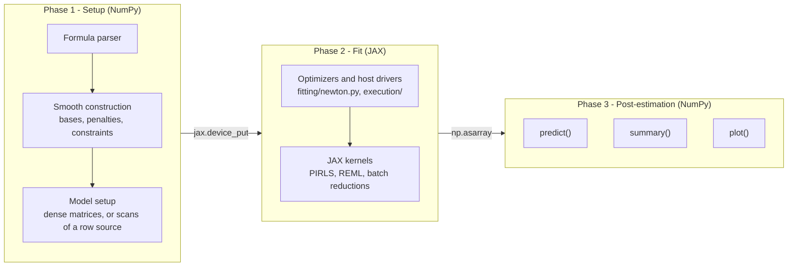
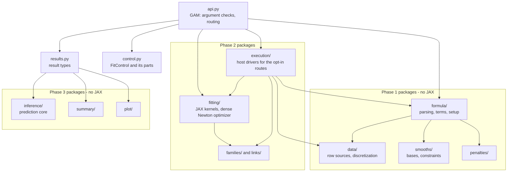

# Contributing to jaxgam

## Getting Started

```bash
git clone https://github.com/scatt67/jaxgam.git
cd jaxgam
uv sync --extra dev          # add --extra r to run the R comparison tests
make pre-commit-install
```

On Apple silicon, also install the OpenBLAS builds of NumPy and SciPy (see
the README, "Apple silicon"). With the default Accelerate builds
`import jaxgam` warns, and large fits can return wrong results.

## Development Workflow

### Running Tests

```bash
# Tests on this machine (R comparison tests skip without the pinned R)
make test-local

# Full test suite in Docker (includes R comparison tests, requires colima/Docker)
make test

# Run one file in Docker
make test-file FILE=tests/test_smooths/test_tprs.py

# Tests with coverage, in Docker
make test-cov
```

`make help` lists every target, including focused targets for single areas.

### Linting

```bash
make lint        # ruff check + format check + vulture
make format      # auto-format with ruff
```

### Pre-commit Hooks

Pre-commit hooks run `ruff --fix`, `ruff-format` and `vulture` on every
commit. Install them once:

```bash
make pre-commit-install
```

## Docker Test Environment

R comparison tests require pinned **R 4.5.2** + **mgcv 1.9-3** for reproducible results. Running locally with a different R version, or without rpy2, makes the R tests skip.

The Docker environment provides the exact pinned versions:

```bash
# Install colima + docker CLI (macOS)
brew install colima docker

# Run full suite (starts colima automatically)
make test
```

The image pins BLAS to one thread (`OPENBLAS_NUM_THREADS=1`,
`OMP_NUM_THREADS=1`) so that R's reference arithmetic is the same on every
machine. `make test-local` does not set these.

## Continuous Integration

`.github/workflows/test.yml` runs on every pull request and on pushes to
`main`:

- **lint**: `make lint`.
- **test-full**: the whole suite in the Docker image, split into eight
  shards on parallel runners. A test's shard is a hash of its node id
  (`tests/sharding.py`), so the shards run every test exactly once. To run
  one shard locally: `JAXGAM_TEST_SHARD=3/8 uv run pytest`.
- **coverage**: combines the shards' coverage data and enforces 80% on the
  total, with branch coverage.
- **test-platform-sensitive**: the tests marked `platform_sensitive`, on
  eight runners, because their outcome can depend on the runner's CPU.
- Four focused jobs that re-run specific numerically sensitive tests on
  their own runners.
- **gate**: passes only if none of the jobs above failed. It is the check
  that the `main` branch requires.

Because each test runs in one of eight shards, a test must not depend on
another test having run first in the same process.

`.github/workflows/docs.yml` builds this documentation site with MkDocs and
deploys it to GitHub Pages on pushes to `main`.

## Architecture

The [architecture pages](docs/architecture/index.md) describe how the code
is organized, with flow and class diagrams. [AGENTS.md](AGENTS.md) holds the
rules that contributors and coding agents follow. Read both before a first
change.

Every `GAM.fit()` call flows through three phases. This boundary is load-bearing - do not mix phases. Phase 1 modules must never import JAX.



The packages, and the imports between them that carry the main flow:



## Project Structure

```
jaxgam/
├── jaxgam/                     # Library source
│   ├── __init__.py             # Public API; float64, compile cache, Accelerate warning
│   ├── api.py                  # GAM class: checks, routing, fit orchestration
│   ├── control.py              # FitControl, EFSControl, OperatorControl, discretization control
│   ├── results.py              # GAMResults, GAMInferenceResult, GAMPredictionResult
│   ├── registry.py             # Generic string-key registry
│   ├── jax_utils.py            # Array dispatch, device transfer, linear-algebra helpers
│   ├── platform_guard.py       # Apple Accelerate LAPACK warning
│   ├── data/                   # Phase 1: row sources, discretization
│   ├── formula/                # Phase 1: parser, terms, design, row-source setups
│   ├── smooths/                # Phase 1: tp/ts, cr/cs/cc, te/ti, gp, re, by, constraints
│   ├── penalties/              # Phase 1: penalty construction
│   ├── families/               # Gaussian, Binomial, Poisson, Gamma, Negative Binomial
│   ├── links/                  # Link functions
│   ├── fitting/                # Phase 2: JAX kernels (PIRLS, REML, ...) and the Newton optimizer
│   ├── execution/              # Phase 2: host drivers (EFS, Gaussian QR, stream, discrete, operator)
│   ├── inference/              # Phase 3: prediction-only core (GAMPredictor)
│   ├── summary/                # Phase 3: summary + significance
│   └── plot/                   # Phase 3: plotting
├── tests/
│   ├── conftest.py             # Shared fixtures, R bridge fixture, shard selection
│   ├── helpers.py              # SEED, r_available, _AssertCollector, replay bounds
│   ├── r_bridge.py             # Typed rpy2 bridge to the pinned R
│   ├── tolerances.py           # STRICT / MODERATE / LOOSE
│   ├── sharding.py             # CI shard assignment
│   ├── test_validation_matrix.py   # Final-model R parity and hard-gate invariants
│   ├── test_api/  test_data/  test_execution/  test_fitting/  test_formula/
│   ├── test_inference/  test_penalties/  test_plot/  test_predict/
│   └── test_scripts/  test_smooths/  test_summary/
├── scripts/                    # Benchmarks + demos
├── docs/                       # User guide, API reference, architecture, design records
├── docker/
│   └── renv.lock               # Pinned R packages (mgcv 1.9-3)
├── .github/workflows/          # CI (test.yml), docs deploy, release publish
├── Dockerfile                  # Test image (R 4.5.2 + Python 3.13)
├── Makefile                    # Dev commands (test, lint, docker, benchmarks)
├── pyproject.toml              # Project metadata + dependencies
└── uv.lock                     # Locked Python dependencies
```

## Testing Rules

- Every new module gets a corresponding test file.
- Use tolerance classes from `tests/tolerances.py`, never a hand-written `rtol`/`atol`: `STRICT` (rtol 1e-10), `MODERATE` (1e-4), `LOOSE` (1e-2).
- R comparison tests use the rpy2 bridge in `tests/r_bridge.py`. Results **must** match R at `STRICT` wherever jaxgam reproduces mgcv's arithmetic. Use `MODERATE` or `LOOSE` only for a quantity that is genuinely ill-determined or depends on the BLAS/LAPACK build, and say why in a comment.
- Generate test inputs in code and take reference values from the bridge. Do not commit data fixtures or call `Rscript` directly.
- CI enforces 80% coverage on the whole suite.
- Hard-gate invariants (convergence, deviance non-negativity, EDF bounds, covariance and penalty PSD, objective monotonicity, no NaN) block the build on failure.

## PR Conventions

- One logical change per commit.
- Every PR must include tests.
- PR title format: `[phase] component: description` - e.g., `[phase1] smooths/tprs: implement thin plate basis construction`.
- If a change touches Phase 2 code, include a JIT compilation test.

## What Is Not Implemented

Sparse solvers, ML/GCV/UBRE smoothness selection, extended families beyond Negative Binomial, P-splines and B-splines, factor-smooth interactions (`bs="fs"`), multi-GPU or distributed fitting, and `gamm()`. Do not add these without discussing it first. See [AGENTS.md](AGENTS.md) for the full list.

## Getting Help

Open an issue on GitHub for bugs or feature requests.
