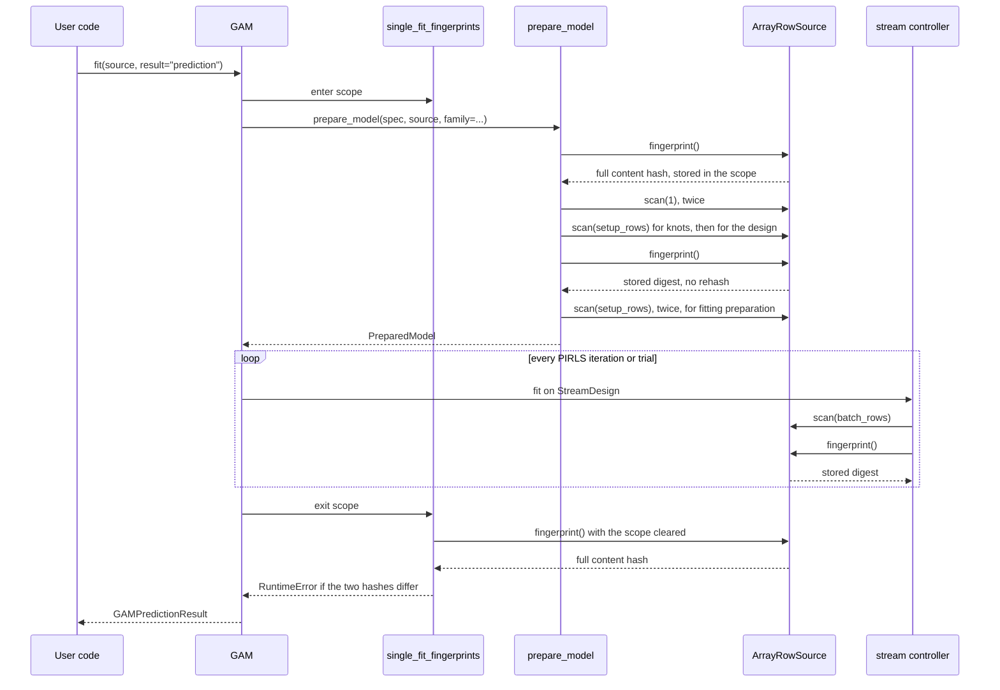
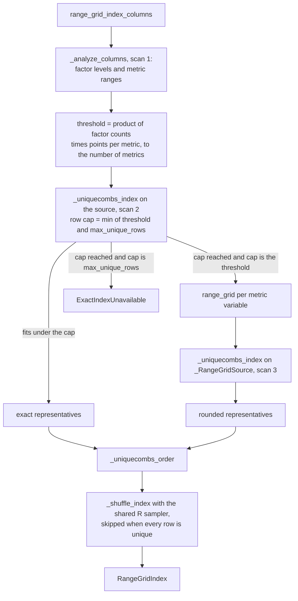
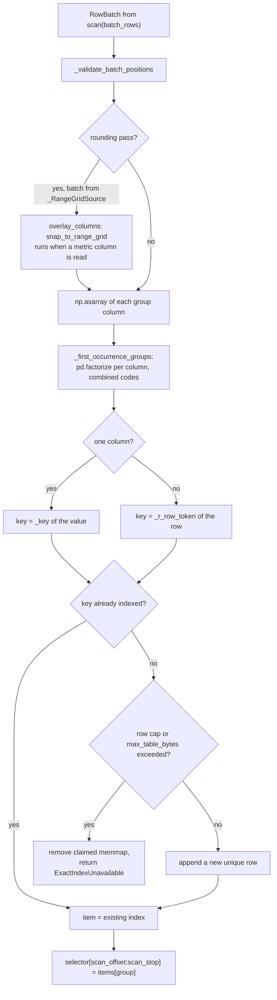
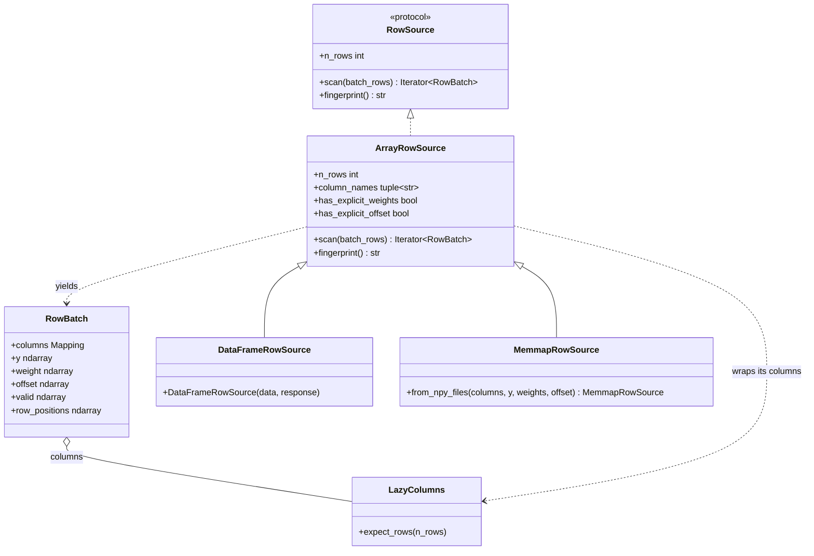
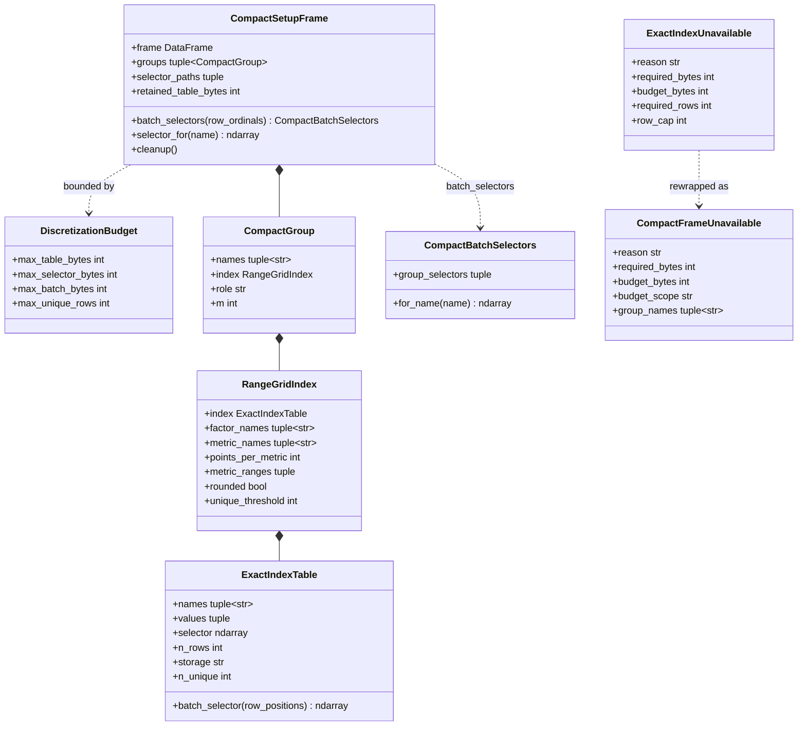

# Row sources and discretization

## Scope

This page covers the `jaxgam/data/` package: the `RowSource` protocol that the streamed, discretized and operator routes read rows from, the built-in sources, source fingerprints and the single-fit fingerprint scope, and lazily read batch columns. It then covers discretization for the discretized route, a port of `compress.df` and `discrete.mf` from `R/bam.r`: range grids, `uniquecombs`-style row indexing, compact frames, selectors and the `DiscretizationBudget`. The basis setup that runs on the compact frame is on [setup.md](setup.md); the discretized fit is on [fitting_discrete.md](fitting_discrete.md).

## Where the code is

| Module | Role |
|---|---|
| `jaxgam/data/__init__.py` | Public names: the sources, `RowBatch`, `RowSource`, `DiscretizationBudget`, `ExactIndexUnavailable`, `RangeGridIndex`, `range_grid_index_columns`, the compact-frame types and `build_compact_setup_frame`. None is re-exported from top-level `jaxgam`. |
| `jaxgam/data/source.py` | `RowSource` protocol, `RowBatch`, `ArrayRowSource`, `DataFrameRowSource`, `MemmapRowSource`, `LazyColumns`, `overlay_columns`, `declared_row_vectors`, `single_fit_fingerprints`, `stage_fingerprint`. |
| `jaxgam/data/source_tokens.py` | Ports of R 4.5 pieces: the Mersenne-Twister and rejection sampler (`_RRandom`), R's numeric text (`r_row_token`), `uniquecombs(ordered=TRUE)` row order (`r_uniquecombs_ordered`) and the large-data knot sample (`r_sample_knot_rows`). Also used by the thin-plate, GP and operator radial setups. |
| `jaxgam/data/discretize.py` | `DiscretizationBudget`, `ExactIndexTable` (unique rows plus an `int32` selector), `ExactIndexUnavailable`, and `exact_index_columns` (exact indexing without rounding). |
| `jaxgam/data/continuous_discretize.py` | `range_grid_index_columns`: the exact-first range-grid policy of `compress.df`, producing a `RangeGridIndex`. |
| `jaxgam/data/continuous_frame.py` | `build_compact_setup_frame`: groups variables as `discrete.mf` does, indexes each group and pads the compact `DataFrame` (`CompactSetupFrame`, `CompactGroup`, `CompactBatchSelectors`, `CompactFrameUnavailable`). |
| `jaxgam/data/continuous_request.py` | Prediction-time compression of a whole request, as `predict.bamd` does (`RequestCompressionSpec`, `FrozenRequestGrid`). |

## How it works

### The RowSource protocol and RowBatch

`RowSource` is a `typing.Protocol` marked `runtime_checkable`, with three members: `n_rows`, `scan(batch_rows)` returning an iterator of `RowBatch`, and `fingerprint()` returning a string. `isinstance(x, RowSource)` only checks that the three attributes exist. `GAM.fit` uses that check to refuse a source on the dense route and to require one on the other routes.

`RowBatch` is a frozen dataclass with six fields:

| Field | Meaning |
|---|---|
| `columns` | A mapping from column name to a NumPy array or pandas Series of the batch's rows. |
| `y` | The response for these rows, or `None` for a source without one. Every fitting route requires it. |
| `weight` | Prior weights, shape `(n,)`, present in every batch. |
| `offset` | Offset, shape `(n,)`, present in every batch. |
| `valid` | Boolean mask, shape `(n,)`, reserved for padding. |
| `row_positions` | Integer positions of these rows in the underlying source. |

`RowBatch.__post_init__` checks that `weight`, `offset`, `valid` and `y` have shape `(n,)` with `n = len(row_positions)`. For a plain mapping it checks every column's length at once; for a `LazyColumns` mapping it registers the length and checks each column when it is read.

What consumers require of a producer (each check is in the consuming code, not in the protocol):

- **Replay in a stable order.** Every `scan` yields the same rows in the same order. Consumers check this in different ways: `prepare_model` compares the first `row_positions` of two `scan(1)` calls; the streamed Gaussian QR route compares a digest of all `row_positions` with the one taken at setup; the discretized route indexes rows by scan ordinal (a running count over the batches), so its selectors are only correct if the order repeats; the operator route hashes every row of every scan (`_CheckedSource` in `jaxgam/formula/operator_prepare.py`).
- **Exactly `n_rows` rows per scan.** Consumers raise `RuntimeError` when a scan yields more or fewer.
- **Batches no larger than requested.** `prepare_model` raises `ValueError` and the discretization scans raise `RuntimeError` for a batch longer than `batch_rows`.
- **No padding.** Every consumer refuses a batch with a false `valid` entry: `NotImplementedError` in setup, discretization and the stream and discrete fits, `ValueError` in operator preparation.
- **`row_positions`** must be a one-dimensional, non-negative integer array.
- **Finite values.** `y`, `weight` and `offset` finite and weights non-negative; the fit drivers check this per batch.
- **A fingerprint that changes when the data change.** Every stage compares the fingerprint at its start and end and raises `RuntimeError` if it changed.

Weights and offset belong to the source: on the stream, discrete and operator routes, `fit(weights=...)` or `fit(offset=...)` raises `ValueError`.

**Declared row vectors.** A source may also define the booleans `has_explicit_weights` and `has_explicit_offset`. `declared_row_vectors(source)` reads them, treats a missing attribute as `True` (supplied), and raises `TypeError` for a non-boolean. Only the discretized route reads them: pinned `discrete.mf` compresses `(weights)` and `(offset)` columns whenever `bam` was given `weights=` or `offset=`, whatever their values, and those extra groups consume draws from the seeded sampler and can lengthen the padded frame (see "Compact frames" below). Built-in sources declare `False` when the caller passed `None`.

### Built-in sources

`ArrayRowSource(columns, *, y=None, weights=None, offset=None, row_selection=None, version=None)` replays aligned arrays, Series or memmaps.

- Construction checks that all columns have one length, that there is a response or at least one column, that `y`, `weights` and `offset` have that length and are finite (weights non-negative), and that the selected weights do not sum to zero. Missing weights and offsets are not stored; each batch gets fresh ones and zeros.
- `row_selection` is an optional integer array of positions into the columns. It must be non-empty and in range; it may reorder or repeat rows. `n_rows` is then its length, and each batch's `row_positions` are the selected positions.
- `scan(batch_rows)` cuts the (selected) rows into consecutive batches. Columns are wrapped in `LazyColumns`, so a column is sliced only when read; a Series is sliced with `iloc` and its index reset.
- `version` is an optional string mixed into the fingerprint (below). It is not a shortcut: the content is hashed either way.

`DataFrameRowSource(data, *, response=None, **kwargs)` is an `ArrayRowSource` over the frame's columns, with the response column taken out as `y`. Categorical and ordered categorical dtypes are kept as Series.

`MemmapRowSource.from_npy_files(columns, *, y=None, weights=None, offset=None, **kwargs)` opens each one-dimensional `.npy` file with `np.load(path, mmap_mode="r")` and builds an `ArrayRowSource` subclass instance from the memmaps. Reading a batch reads only those rows; computing the fingerprint reads every file once.

### Fingerprints

`ArrayRowSource.fingerprint()` returns a SHA-256 hex digest. `_content_fingerprint` starts from the tag `jaxgam-row-source-v2` and then hashes:

1. for each column, a schema token (name, dtype and shape; for a categorical Series, the categories and whether it is ordered) followed by the content in 65,536-row chunks: raw bytes for numeric arrays, `int64` codes for categoricals, the `repr` of each value for object arrays;
2. the names `y`, `weights`, `offset` and `row_selection`, each followed by its content when present;
3. the `version` string, or `content-addressed` when there is none.

Outside a fingerprint scope it is recomputed on every call, so a mutation of the arrays shows at the next check. `test_fingerprint_covers_content_schema_selection_and_version` in `tests/test_data/test_source.py` covers each component.

The internal wrapper sources that discretization builds (`_FormulaRowSource` in `jaxgam/data/continuous_frame.py`, `_RangeGridSource` in `jaxgam/data/continuous_discretize.py`) hash a tag, the wrapped source's fingerprint and their own parameters (response name; metric names and grids).

### The single-fit fingerprint scope

Setup and fitting compare fingerprints before and after nearly every scan. For an `ArrayRowSource` each comparison rehashed all the data; the comment on `single_fit_fingerprints` records that this was more than half of setup time at 100 smooths.

`single_fit_fingerprints(*, verify_on_exit=True)` is a context manager backed by a `ContextVar`. Inside it, the first `ArrayRowSource.fingerprint()` call of each source computes the digest and stores it (keyed by `id(source)`, with a reference to the source so the key stays valid); later calls return the stored digest. On a normal exit with `verify_on_exit=True`, every stored source is hashed once more, and a different digest raises `RuntimeError("RowSource changed during the fit")`. If the body raises, that exception propagates and no verification runs (`test_single_fit_fingerprints_do_not_mask_an_error_from_the_fit`). A nested scope joins the outer one.

What it guarantees: a built-in source is hashed twice per fit, at its first fingerprint request and at the end, and data changed during the fit are still reported, at the end of the fit rather than at the scan that would have seen them.

`stage_fingerprint(source)` is what a stage compares at its own end. With no scope, or inside a verifying scope, it is `source.fingerprint()` (the stored digest in a verifying scope, which then reports any change itself). Inside a non-verifying scope it switches the memo off and recomputes, so the stage's own error names the stage.

Who opens a scope:

- `GAM._fit_stream`, around `_fit_stream_routes` (setup and fit).
- `GAM._fit_discrete`, around `fit_discrete_gaussian` or `fit_discrete_regular` and the construction of the result.
- `build_continuous_discrete_setup` in `jaxgam/formula/continuous_setup.py`, with `verify_on_exit=False`; called from `_fit_discrete` it joins the outer scope, called on its own it ends with `stage_fingerprint`.

The operator route opens no scope; `_CheckedSource` digests every row it replays instead.

Read it top to bottom: the content is hashed once when the first stage asks and once on exit; every check in between returns the stored digest. A one-smooth streamed setup with a family makes six scans (two probes, one knot scan, one design scan, two fitting-preparation scans), before any fit scan; the stream controllers are described on [fitting_streamed.md](fitting_streamed.md).

### Lazy columns

`LazyColumns(names, load)` is a read-only `Mapping`. Iteration, `len` and `in` use the declared names; `__getitem__` calls `load(name)` the first time a column is read, checks its length against the batch, and keeps it, so a second read returns the same object. The class docstring gives the reason: setup reads one or two columns per pass, and slicing hundreds of columns per batch was almost all wasted work. `test_array_source_slices_a_column_only_when_it_is_read` and `test_prepared_batches_read_only_the_formula_columns` pin this.

`overlay_columns(base, overrides)` returns a `LazyColumns` that is `base` with some columns replaced or added by zero-argument producers, still read on first use. Discretization uses it to add the response and the `(weights)`/`(offset)` columns (`_FormulaRowSource`) and to replace metric columns with their grid-rounded values (`_RangeGridSource`) without touching the other columns.

### Caller-written sources

A source written by the caller differs from the built-in ones in four ways:

1. **Declared vectors.** Without `has_explicit_weights` and `has_explicit_offset` it counts as supplying both. On the discretized route that adds two replay-only groups, which changes the seeded padding and therefore the fitted numbers (`tests/test_execution/test_discrete_supplied_vectors.py`). Declare `False` for a vector the caller did not supply.
2. **Fingerprint caching.** Only `ArrayRowSource.fingerprint` consults the scope. A caller's `fingerprint()` runs at every check, so it should be cheap, and it is never verified at scope exit; changes are caught by the per-stage comparisons only.
3. **Column laziness.** A plain dict in `RowBatch.columns` is length-checked and must be fully built when the batch is created. Wrap columns in `LazyColumns` to get the built-in behaviour.
4. **No construction checks.** The validation `ArrayRowSource` does at construction (lengths, finiteness, selection bounds, positive weight sum) does not happen; only the per-batch checks of each consumer apply.

### Discretization overview

`build_compact_setup_frame(formula, source, *, factor_names, m, budget, selector_memmap_dir, batch_rows, seed)` builds the discretized route's compact data:

1. `_discover_requests` forms the groups as `discrete.mf` does: each `by` variable is a group; each `te`/`ti` margin is its own group; a multi-variable `s()` is one joint group; then the response and each parametric variable not already grouped. A smooth whose variables overlap an existing group with a different grouping raises `ValueError("continuous discretization has incompatible nesting")`, the analogue of `check.term`.
2. `_replay_only_requests` adds `(weights)` and `(offset)` groups for a source that declares them.
3. Each group is indexed with `range_grid_index_columns` on a `_FormulaRowSource` wrapper. All groups share one `_RRandom(seed)` stream, used for the shuffles and then the padding.
4. Every group's representative columns are padded to the largest group's row count with draws from the same stream (`_padded_column`), giving one `DataFrame`. The replay-only groups are then dropped: they only consumed draws and set the frame length.

`m` sets the grid points per metric variable: `None` gives 1000, 100 or 25 for groups of one, two, or three or more variables; an integer is used as given for one variable and as `round(m**(1/d)) + 1` for `d` variables (`_points_per_metric`, ties to even as R's `round`). A tuple gives one value per smooth term; the response and parametric groups use its maximum.

Factors are not inferred on this route: a column is a factor only if it is listed in `factor_names`. Any other column must be real numeric data; a categorical or object column raises `TypeError` with advice to declare it.

### Range grids, grouping and keying

`range_grid_index_columns` implements `compress.df`'s exact-first policy for one group:

A group keeps its distinct rows unless they outnumber the threshold; only then are its metric variables rounded. Each box labelled "scan" is one full pass over the source.

- **Range grid.** `range_grid(low, high, points)` is `seq(low, high, length=points)`. `snap_to_range_grid` ports `kx <- round((x - xl[1]) / dx) + 1; x <- xu[kx]` with round-half-to-even. A constant metric column in a group that must be rounded raises `ValueError`, because pinned `compress.df` produces an undefined grid there. When the threshold is above `max_unique_rows`, a group that pinned R would round is reported as unavailable instead.
- **Ordering.** `_uniquecombs_order` reproduces `uniquecombs(..., ordered=TRUE)`: one numeric column sorts by value, one factor column by level code, several columns by the byte order of their row tokens (R's C-locale collation).
- **Shuffle.** `_shuffle_index` permutes the representatives with a port of R's `sample` and remaps the selector in chunks, as `compress.df` does to avoid induced dependence between discretized covariates. It does not touch NumPy's global RNG (`test_group_shuffling_and_padding_leave_numpy_rng_untouched`).

One batch of `_uniquecombs_index`:

Only the first row of each group of equal rows is keyed, in order of first occurrence, so new keys are met exactly where a row-by-row walk would meet them (`test_first_occurrence_groups_match_a_row_by_row_walk`).

- **Grouping.** `_first_occurrence_groups` factorizes each column with `pd.factorize` and combines the codes, treating `NaN` as equal to `NaN` and `0.0` as equal to `-0.0`. Columns of other dtype kinds than float, signed, unsigned and bool, and batches whose combined code could overflow, fall back to one group per row.
- **Keys.** A one-column group uses `_key`, the value tagged with its Python type name (`NaN` tagged explicitly). A multi-column group uses `_r_row_token`: each metric value in R's 15-significant-digit text (`_r_number_text`) and each factor value as its 1-based level code, joined with `*`, as `uniquecombs` pastes rows. Two rows that differ beyond 15 digits therefore share a key, as in mgcv (`test_joint_numeric_token_collision_matches_uniquecombs`).
- **Selector write.** Each source row's position in the unique list is written at its scan ordinal.

### Compact frames, groups and selectors

A `RangeGridIndex` wraps an `ExactIndexTable` (the unique `values` per column, an `int32` `selector` of length `n_rows`, and `storage`, either `memory` or `memmap`) with the group's factor levels, metric ranges, `points_per_metric`, whether it was `rounded`, and the seed.

Selectors live in memory by default. With `ContinuousDiscretizationControl.selector_memmap_directory`, each group's selector is a `.npy` memmap at `compact-selector-{k}.dat` in that directory. The directory must exist; the file is claimed with `O_CREAT | O_EXCL`, so an existing file raises `FileExistsError` and is not removed. Files are removed if construction fails and by `CompactSetupFrame.cleanup()`, which `_prepared_discrete` in `jaxgam/execution/discrete.py` calls when the fit ends.

`CompactSetupFrame` holds the padded `frame`, the `CompactGroup`s (names, factor names, index, role and `m`), the mapping from variable to group, the selector paths and a byte ledger. `batch_selectors(row_ordinals)` gathers one selector slice per group for a batch, returned as `CompactBatchSelectors`, and raises `MemoryError` if that gather would exceed `max_batch_bytes`. The fit itself reads selectors through `FrozenDiscreteDesign.batch_indices` in `jaxgam/formula/discrete_design.py`, which gathers each distinct index once per batch.

`exact_index_columns` in `jaxgam/data/discretize.py` does the same indexing with exact equality and no rounding, and keys every row instead of grouping first. At HEAD it is called only by the exact descriptor builders in `jaxgam/formula/discrete_design.py`, which only tests use.

### Prediction requests

With `prediction_policy="mgcv_predict_bamd"`, prediction compresses the whole request first, as `predict.bamd` calls `discrete.mf` with `m=NULL`. `RequestCompressionSpec` holds the fitted groups (without the response). `freeze` (in-memory data) or `freeze_source` (a `RowSource`) makes a bounded pre-pass, keeping at most `min(threshold, max_unique_rows) + 1` distinct keys per group, and returns a `FrozenRequestGrid`, which records per group whether to round and the request's ranges. `FrozenRequestGrid.apply` then snaps any batch of that request elementwise, so results do not depend on batch boundaries but do depend on the request's composition. Factor-only groups are never rounded. Its consumer is `jaxgam/inference/predictor.py`; see [results_and_prediction.md](results_and_prediction.md).

### DiscretizationBudget and its limits

`DiscretizationBudget` is a frozen dataclass of four positive integers, set through `ContinuousDiscretizationControl.budget`:

| Field | Default | Bounds |
|---|---|---|
| `max_table_bytes` | 64 MiB | Construction and retained storage of unique-row tables and their discovery dictionaries, factor-level metadata, range grids, ordering and shuffle work, the padded compact frame, the prospective basis setup on the compact frame, the evaluated lookup tables of the descriptor, and the distinct-row state of request compression. |
| `max_selector_bytes` | 256 MiB | Resident selectors: 4 bytes per source row per group held in memory, plus 1 byte per row of validation state. Memmapped selectors count only the validation state. |
| `max_batch_bytes` | 64 MiB | Per-batch workspace: position validation, row tokens, range analysis, rounding, selector gathers, the descriptor's host batch and device action, and request compression batches. |
| `max_unique_rows` | 1,000,000 | Distinct rows any one group may discover before its rounding decision. |

When a limit is exceeded:

- The data layer returns a typed value instead of raising. `ExactIndexUnavailable` has `reason`, `required_bytes`, `budget_bytes` and, for the row cap, `required_rows` and `row_cap`. `build_compact_setup_frame` turns it into a `CompactFrameUnavailable`, adding the `budget_scope` (`table`, `selector` or `batch`, chosen from the reason) and the group's names.
- `build_continuous_discrete_setup` wraps that in a `ContinuousSetupUnavailable`, and `build_continuous_discrete_design` returns a `DiscreteDesignUnavailable`.
- `_prepared_discrete` raises `MemoryError(f"{reason}: requires {required_bytes} bytes, budget is {budget_bytes}.")`.
- Some checks raise directly: `CompactSetupFrame.batch_selectors` and request compression raise `MemoryError`; a constant metric column that must be rounded raises `ValueError`; a non-numeric undeclared column raises `TypeError`; a changed source raises `RuntimeError`.

## Key types

`RowSource` is structural: any object with the three members satisfies it. `LazyColumns` is one possible value of `RowBatch.columns`; any `Mapping` is accepted.

`range_grid_index_columns` returns either a `RangeGridIndex` or an `ExactIndexUnavailable`, and `build_compact_setup_frame` either a `CompactSetupFrame` or a `CompactFrameUnavailable`; callers test with `isinstance`.

## Rules and invariants

- **Phase 1, no JAX.** Modules in `jaxgam/data/` import NumPy and pandas only. `test_discretize_module_imports_without_jax`, `test_range_grid_module_imports_without_jax`, `test_compact_frame_module_imports_without_jax` and `test_request_module_imports_without_jax` (in `tests/test_data/`) load them with the package stubbed and assert JAX stays unloaded.
- **Mutation is detected.** Every stage compares fingerprints, and the fingerprint covers content, schema, selection and version (`tests/test_data/test_source.py`). A change inside a single-fit scope raises when the scope ends.
- **Batch partition does not change results.** Discretization is keyed by scan ordinal and first occurrence, so the compact frame and selectors are the same for any `batch_rows` (`test_selected_reordered_repeated_rows_replay_across_batch_boundaries` in `tests/test_data/test_continuous_discretize.py`).
- **Pinned R parity.** Grid rounding, `uniquecombs` order and tokens, shuffles, padding and the `discrete.mf` groups are compared with pinned R in `tests/test_data/test_continuous_discretize.py` and `tests/test_data/test_continuous_frame.py` (R-gated tests).
- **Budgets are checked before allocation.** Each limit is tested prospectively, before the array it bounds is created (`test_shared_budgets_reject_growth_and_clean_failed_memmap`, `test_rounding_workspace_is_rejected_before_transform_scan`, `test_combined_selector_budget_includes_retained_groups`).
- **Global RNG state is untouched.** Sampling uses the local `_RRandom` port.

## Pitfalls

- **Undeclared factors.** On the discretized route an integer-coded grouping variable not listed in `factor_names` is discretized as a metric and becomes one numeric coefficient, and a categorical one raises `TypeError`.
- **Undeclared row vectors.** A caller-written source that omits `has_explicit_weights`/`has_explicit_offset` fits a slightly different discretized model than the equivalent `ArrayRowSource`.
- **The row-cap error reports bytes.** When a group exceeds `max_unique_rows`, the reason is `uniquecombs rows exceed row cap` but `required_bytes` and `budget_bytes` are table bytes, so the `MemoryError` text shows bytes and the table budget, not rows and the cap.
- **Exact first means no rounding on small data.** A group is rounded only when its distinct rows exceed the threshold, so on small data the compact frame is the distinct data and the fit equals the dense one. Because bases are built on compact rows, an `m` below a smooth's `k` fails with the basis's "exceeds number of unique data values" error.
- **Memmap files.** `selector_memmap_directory` must not already hold `compact-selector-{k}.dat` files; leftover files from an interrupted process make the next fit raise `FileExistsError`.
- **Expensive caller fingerprints.** A caller-written `fingerprint()` is not cached by the scope and runs at every stage check.

## Where to change things

- **Add a built-in source:** subclass `ArrayRowSource` or implement the three protocol members in `jaxgam/data/source.py`, export it from `jaxgam/data/__init__.py`, and add replay, fingerprint and lazy-column tests to `tests/test_data/test_source.py`.
- **Change what the fingerprint covers:** `ArrayRowSource._content_fingerprint` (bump the `jaxgam-row-source-v2` tag when the meaning changes).
- **Open the fingerprint scope on another route:** wrap that route's setup and fit in `single_fit_fingerprints()` in `jaxgam/api.py`, and make its stages compare with `stage_fingerprint`.
- **Change grid resolution or rounding:** `_points_per_metric`, `range_grid` and `snap_to_range_grid` in `jaxgam/data/continuous_discretize.py`; the R-gated tests there must still pass.
- **Change how variables are grouped:** `_discover_requests` and `_smooth_requests` in `jaxgam/data/continuous_frame.py`, and `_group_roles` in `jaxgam/formula/continuous_metadata.py`, which must agree.
- **Add a budget limit:** a field on `DiscretizationBudget`, its check before the allocation it bounds, and a reason string that `_unavailable_scope` maps to the right scope.
