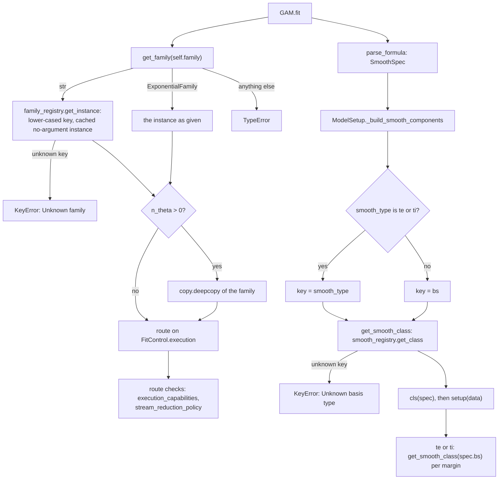
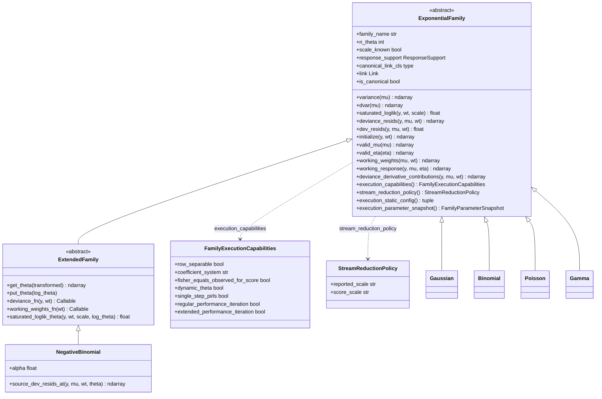
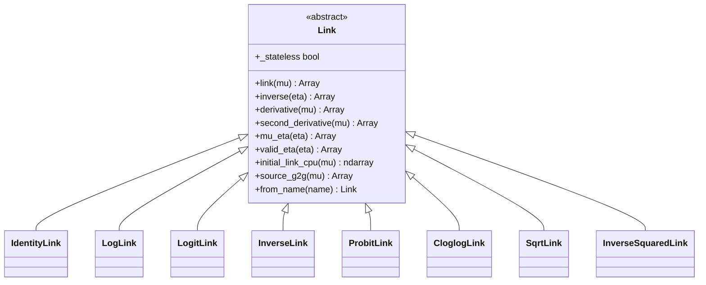
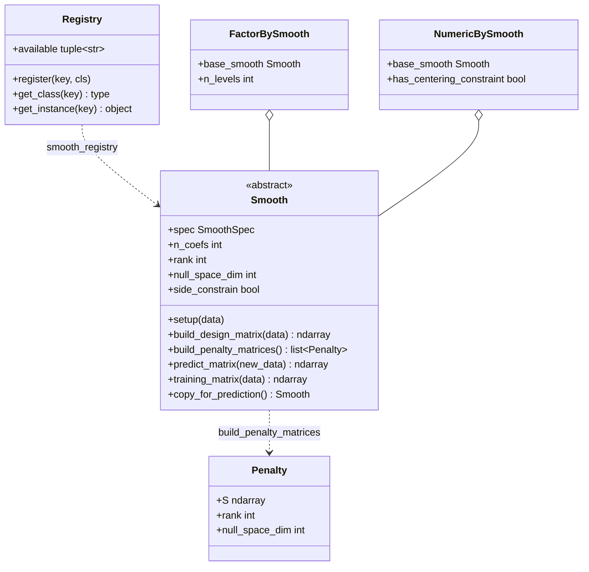

# Families, links and smooths: the extension points

## Scope

This page describes the three places a contributor extends JaxGAM's model space: distribution families (`jaxgam/families/`), link functions (`jaxgam/links/`) and smooth bases (`jaxgam/smooths/`). It covers the base-class contracts, the execution-capability contract that the fitting routes query, the registries and how strings are resolved at fit time, and the JAX or NumPy rule each extension must respect. It ends with checklists for adding a link, a family and a smooth.

## Where the code is

| Module | Role |
|---|---|
| `jaxgam/registry.py` | Generic `Registry`: case-insensitive string-to-class map with immutable built-ins. |
| `jaxgam/families/__init__.py` | Exports the family classes, the response supports, `family_registry` and `get_family`. |
| `jaxgam/families/base.py` | `ExponentialFamily` and the execution-contract descriptors `FamilyExecutionCapabilities`, `StreamReductionPolicy`, `FamilyPadding`, `FamilyParameterSnapshot`, `FamilyInitialWorkingState`; `ResponseSupport` and its constants. |
| `jaxgam/families/extended.py` | `ExtendedFamily`: families with extra parameters (theta) estimated with the smoothing parameters. |
| `jaxgam/families/standard.py` | `Gaussian`, `Binomial`, `Poisson`, `Gamma`. |
| `jaxgam/families/negative_binomial.py` | `NegativeBinomial` and its stable `lgamma` differences with custom JVPs. |
| `jaxgam/families/registry.py` | `family_registry` and `get_family`. |
| `jaxgam/families/execution_inventory.py` | `FAMILY_EXECUTION_INVENTORY`: a checked-in, descriptive record of every registered family, link and theta mode, with R constructor status and test evidence. Not read by any fit driver. |
| `jaxgam/links/__init__.py` | Exports the link classes, `link_registry` and `get_link`. |
| `jaxgam/links/links.py` | `Link` base class and the eight built-in links. |
| `jaxgam/links/registry.py` | `link_registry` and `get_link`. |
| `jaxgam/smooths/base.py` | `Smooth` base class. |
| `jaxgam/smooths/registry.py` | `smooth_registry` and `get_smooth_class`. |
| `jaxgam/smooths/gp_kernels.py` | `GPKernel` and `gp_kernel_registry`, the kernel extension point of `bs="gp"`. |
| `jaxgam/fitting/family_execution.py` | Phase 2 consumer of the family contract: `FamilyExecutionContext`, `FamilyExecutionLineage`, batch working quantities for the bounded routes. |

The smooth classes themselves are listed on [setup.md](setup.md).

## How it works

### Families

`ExponentialFamily` is an abstract base class. A subclass sets the class attribute `family_name` and implements nine abstract members:

| Member | Used for |
|---|---|
| `default_link` (property) | The link when the constructor gets `link=None`. |
| `variance(mu)` | Working weights and the REML criterion (`jaxgam/fitting/reml.py`). |
| `dvar(mu)` | The Fletcher scale estimate in REML and in the regular EFS PIRLS. |
| `saturated_loglik(y, wt, scale, *, max_y=0)` | The saturated log-likelihood in the REML score (R's `family$ls`). |
| `deviance_resids(y, mu, wt)` | Signed deviance residuals; `dev_resids` sums their squares for the PIRLS deviance. |
| `aic(y, mu, wt, scale)` | Abstract, but no fit or result code calls it at HEAD; only `tests/test_families.py` does. |
| `_initialize_impl(y, wt)` | Starting `mu`. Called by the concrete `initialize`, which first checks `y` against `response_support`. |
| `valid_mu(mu)`, `valid_eta(eta)` | Domain checks during initialization and PIRLS step control. |

Concrete methods on the base class that the fit calls: `working_weights` (`wt / (V(mu) * g'(mu)**2)`), `working_response` (`eta + (y - mu) * g'(mu)`), `dev_resids`, `initialize`, and the explicit-parameter hooks `working_weights_for_parameters`, `deviance_contributions_for_parameters`, `saturated_loglikelihood_for_parameters` and `deviance_derivative_contributions_for_parameters`, which take a `log_theta` array and reject a non-empty one unless overridden.

Optional methods that some routes require, each raising `NotImplementedError` on the base class:

- `deviance_contributions` (per-row deviance without the square root) and `deviance_derivative_contributions` (a smooth form for automatic differentiation). The dense route differentiates the latter to form observed-information weights, which mgcv uses in the REML `log|H|` for non-canonical links (`jaxgam/fitting/pirls.py`), so a custom family with a non-canonical link needs it even on the dense route.
- `source_dev_resids`: pinned `dev.resids` arithmetic with no domain safeguard, for the discretized performance iteration (`jaxgam/fitting/discrete/working.py`).

Class attributes: `n_theta` (number of estimated extra parameters, 0 by default), `scale_known`, `response_support` (`REAL`, `NON_NEGATIVE`, `POSITIVE` or `UNIT_INTERVAL`) and `canonical_link_cls`. `is_canonical` is true when the link is an instance of `canonical_link_cls`; Gaussian, Binomial, Poisson and Gamma declare `IdentityLink`, `LogitLink`, `LogLink` and `InverseLink`. `NegativeBinomial` declares none, so it is never canonical.

The constructor is `ExponentialFamily(link=None)`. `link` may be `None`, a link-registry name (resolved with `Link.from_name`) or a `Link` instance; anything else raises `TypeError`. The constructor does not check that the link suits the family: `NegativeBinomial(link="logit")` constructs, and the routes reject unsupported pairs later.

**JIT identity.** The dense kernels take the family as a static argument of `jax.jit` (for example `static_argnames=("family", ...)` in `jaxgam/fitting/pirls.py`). `__hash__` and `__eq__` therefore use `_static_cache_key()`: the class, `link._cache_key()`, `n_theta` and `scale_known`. Two equal families share compiled code. Any state that changes the traced arithmetic must be in this key; `NegativeBinomial` adds its fixed theta, because a fixed theta is read inside the trace.

### Extended families and the negative binomial

`ExtendedFamily` adds four abstract members for families whose extra parameters are estimated: `get_theta(transformed=False)` and `put_theta(log_theta)` (the mutable host state), `deviance_fn(y, wt)` and `working_weights_fn(wt)` (factories of pure functions of `eta` and `log_theta`, differentiated by the PIRLS custom JVP) and `saturated_loglik_theta` (the REML term with explicit theta). It also lists `_log_theta` in `execution_dynamic_config_attributes`, so the mutable value is kept out of the static configuration snapshot.

`NegativeBinomial(theta=1.0, *, fixed=False, link=None)`, mgcv's `nb()` from `R/efam.r`, has `V(mu) = mu + mu**2 / theta`, known scale 1 and the log link by default. `theta <= 0` raises `ValueError`.

- `fixed=False` (the default): `n_theta = 1` and `theta` is the starting value. On the dense route, when the model has penalties, the Newton optimizer appends `log theta` to the smoothing parameters and optimizes them jointly (`_joint_theta` in `jaxgam/fitting/newton.py`), then calls `put_theta`. `GAM.fit` deep-copies a family with `n_theta > 0` before fitting, so a cached registry instance is never mutated.
- `fixed=True`: `n_theta = 0`; theta is a constant baked into the trace and into `_static_cache_key`.

How the streamed, discretized and operator routes estimate theta is on their fitting pages ([fitting_streamed.md](fitting_streamed.md), [fitting_discrete.md](fitting_discrete.md), [fitting_operator.md](fitting_operator.md)).

### The execution-capability contract

The bounded routes do not branch on family names. They ask the family what it can do:

- `execution_capabilities()` returns a frozen `FamilyExecutionCapabilities`.
- `stream_reduction_policy()` returns a `StreamReductionPolicy` naming the reported-scale and score-scale formulas (`known_one`, `gaussian_fisher_edf_deviance`, `regular_fletcher`, `gaussian_fixed_sp`, or `unsupported`).
- `execution_padding()` returns finite response and `eta` values for masked rows.
- `execution_parameter_snapshot()` returns the theta and scale modes and values as immutable scalars.
- `execution_static_config()` freezes the family's and link's attributes, capabilities, padding and policy.

`prepare_model` stores the last two in `FittingPreparation`. `FamilyExecutionLineage.validate` in `jaxgam/fitting/family_execution.py` compares them again before each cached device dispatch, because JAX can reuse a compiled executable without retracing and so would not notice a family mutated after preparation.

The base class fills the capabilities from what the subclass implements: `direct_deviance` and `differentiable_deviance` are true only if the subclass overrides the corresponding method, `dynamic_phi` is `not scale_known`, and `coefficient_system` is `"fisher"` for a canonical link and `"observed"` otherwise. Subclasses override with `dataclasses.replace`.

| Capability | Meaning | Read by |
|---|---|---|
| `row_separable` | Per-row quantities depend only on that row. | `jaxgam/api.py` (`_check_stream_fixed_family`), `jaxgam/execution/stream/pirls.py`, `jaxgam/execution/stream/regular.py`, `jaxgam/fitting/family_execution.py`, `jaxgam/fitting/operator/family.py` |
| `fisher_working_system` | A positive Fisher working system exists. | `jaxgam/api.py`, `jaxgam/execution/stream/pirls.py`, `jaxgam/execution/stream/regular.py`, `jaxgam/fitting/family_execution.py` |
| `observed_information` | Observed information is available through the direct deviance. | `jaxgam/api.py`, `jaxgam/execution/stream/regular.py`, `jaxgam/fitting/family_execution.py`, `jaxgam/fitting/operator/family.py` |
| `direct_deviance` | `deviance_contributions` is implemented. | `jaxgam/api.py`, `jaxgam/execution/stream/pirls.py`, `jaxgam/execution/stream/regular.py`, `jaxgam/fitting/family_execution.py`, `jaxgam/fitting/operator/family.py` |
| `differentiable_deviance` | `deviance_derivative_contributions` is implemented. | `jaxgam/api.py` (required for unknown-scale streamed fixed-sp fits), `jaxgam/fitting/family_execution.py`, `jaxgam/fitting/operator/family.py` |
| `saturated_loglikelihood` | `saturated_loglik` is usable in a score. | `jaxgam/api.py`, `jaxgam/execution/stream/pirls.py`, `jaxgam/execution/stream/regular.py`, `jaxgam/fitting/family_execution.py` |
| `dynamic_theta` | Theta is estimated and passed as a dynamic argument. | `jaxgam/api.py`, `jaxgam/execution/stream/regular.py`, `jaxgam/execution/stream/reml.py`, `jaxgam/fitting/family_execution.py`, `jaxgam/fitting/stream/reml.py` |
| `dynamic_phi` | The scale is estimated. | No reader outside `jaxgam/families/` at HEAD. |
| `coefficient_system` | `"fisher"` or `"observed"` coefficient system. | `jaxgam/api.py`, `jaxgam/execution/stream/pirls.py`, `jaxgam/execution/stream/regular.py`, `jaxgam/fitting/family_execution.py`, `jaxgam/fitting/stream/reml.py` |
| `fisher_equals_observed_for_score` | The two informations coincide in the score (canonical links). | `jaxgam/api.py`, `jaxgam/execution/efs.py`, `jaxgam/execution/stream/pirls.py`, `jaxgam/execution/stream/regular.py`, `jaxgam/fitting/stream/reml.py` |
| `regular_fletcher_scale` | The Fletcher scale reduction applies (Gamma, non-canonical Gaussian). | `jaxgam/fitting/family_execution.py` |
| `single_step_pirls` | The first accepted coefficient solve is final (Gaussian identity, `gam.fit3`'s strictly additive branch). | `jaxgam/execution/operator/fit.py`, `jaxgam/execution/stream/regular.py`, `jaxgam/fitting/efs_regular_pirls.py` |
| `initial_alpha_resolution` | Flags the Binomial/log start whose alpha is cancellation-sensitive. | `jaxgam/fitting/family_execution.py` |
| `regular_performance_iteration` | `bgam.fitd`'s Fisher performance iteration is validated for this family and link. | `jaxgam/api.py` (`_fit_discrete`), `jaxgam/execution/discrete/regular.py` |
| `extended_performance_iteration` | `bgam.fitd`'s extended-family iteration is validated (NB log, identity, sqrt). | `jaxgam/api.py`, `jaxgam/execution/discrete/regular.py` |

The dense route does not read the descriptor; it uses `is_canonical`, `n_theta` and `scale_known` directly. A route's own acceptance policy can be narrower than the capabilities: the streamed EFS check `_check_stream_efs_family` in `jaxgam/api.py` accepts only the built-in classes, by `isinstance`.

`jaxgam/families/execution_inventory.py` is a record, not policy: its module docstring says fit drivers must not consult it. It lists, for each registered family and link (and NB theta mode), whether pinned R's constructor accepts the pair, the dense and EFS evidence scope and the test names.

### Links

`Link` is an abstract base class with three abstract methods: `link(mu)`, `inverse(eta)` and `derivative(mu)` (`d eta / d mu`). The other methods have defaults:

| Method | Default | Who needs an override |
|---|---|---|
| `mu_eta(eta)` | `1 / derivative(inverse(eta))` | Every built-in overrides it for stability; used by EFS, the discretized working model and the operator and stream initialization. |
| `second_derivative(mu)` | Raises `NotImplementedError` | Required by the streamed fixed-sp route (`_check_stream_fixed_family` refuses a link without it) and the observed-Newton initialization. |
| `valid_eta(eta)` | All finite values | Links with a restricted domain (`SqrtLink` requires `eta > 0`). |
| `linkinv(eta)` | Alias of `inverse` | None. |
| `initial_link_cpu(mu)` | `link(mu)` as NumPy | Links whose `link` clamps, so the R-style start can tell a clipped value from a valid one. |
| `source_g2g(mu)` | Raises `NotImplementedError` | Only the negative binomial's extended route; `IdentityLink`, `LogLink` and `SqrtLink` implement it. |

The built-in methods port R's `make.link` and mgcv's `fix.family.link` (`R/gam.fit3.r`) arithmetic. They clamp out-of-domain inputs rather than raise, so they stay usable inside `jax.jit`.

`_stateless = True` on a link makes `_cache_key()` return its class, so two instances share compiled code. A parameterized link must leave it `False` (the key is then `id(self)`) or override `_cache_key` to include its parameters; `test_parameterized_custom_link_uses_identity` in `tests/test_families.py` pins this.

### Smooths

The `Smooth` contract (details and the class hierarchy are on [setup.md](setup.md)):

- `__init__(spec)` receives the `SmoothSpec`; options come from `spec.k`, `spec.bs` and `spec.extra_args`.
- `setup(data)` builds the training basis into `self._X`, sets `n_coefs`, `rank`, `null_space_dim`, and ends with `self._is_setup = True`. Without `_X`, `training_design_matrix` raises `RuntimeError` during assembly.
- `build_penalty_matrices()` returns a list of `Penalty` objects, one per smoothing parameter, in the raw (unconstrained) basis.
- `predict_matrix(new_data)` evaluates the raw basis on new data with the stored knots and transforms.
- `build_design_matrix(data)` evaluates the raw basis on given data; the by-variable wrappers call it on the base smooth.
- Optional: `training_matrix` (when training rows differ from prediction rows), `copy_for_prediction` (must drop every fit-only cache), `copy_for_training`.
- Attributes model assembly reads with defaults: `side_constrain` (take part in `gam_side`, default true), `_has_centering_constraint` (read with `getattr`, default true; `RandomEffectSmooth` sets false), `_random` (summary test type), `_noterp` (skip tensor-margin reparameterization), `_s_scale` (the normalization factor `te` margins undo).

The penalty null space is declared through `null_space_dim` on the smooth and `rank`/`null_space_dim` on each `Penalty`.

### Registries

`Registry(entries, name, cache_instances=False)` in `jaxgam/registry.py` holds built-in entries in a read-only mapping and custom entries in a dict, both with lower-cased keys.

- `register(key, cls)` adds a custom entry. A key that already exists, built-in or custom, raises `ValueError`. The class is not type-checked, and there is no way to unregister.
- `get_class(key)` raises `KeyError("Unknown {name}: 'key'. Available: ...")` for a missing key.
- `get_instance(key)` calls `cls()` with no arguments, and caches the instance when `cache_instances` is true.

| Registry | Module | Keys | Instances cached |
|---|---|---|---|
| `smooth_registry` | `jaxgam/smooths/registry.py` | `tp`, `ts`, `cr`, `cs`, `cc`, `gp`, `re`, `te`, `ti` | No |
| `family_registry` | `jaxgam/families/registry.py` | `gaussian`, `binomial`, `poisson`, `gamma`, `nb` | Yes |
| `link_registry` | `jaxgam/links/registry.py` | `identity`, `log`, `logit`, `inverse`, `probit`, `cloglog`, `sqrt`, `inverse_squared` | No |
| `gp_kernel_registry` | `jaxgam/smooths/gp_kernels.py` | `spherical`, `power_exponential`, `matern_3_2`, `matern_5_2`, `matern_7_2` | No |

The registries are exported from their packages (`jaxgam.smooths`, `jaxgam.families`, `jaxgam.links`), not from top-level `jaxgam`. There are no `register_*` helper functions: the registration API is `<registry>.register(key, cls)`. Registration is process-global, so register before fitting, once per process.

### Resolution at fit time

A family string always yields the registry's shared instance with the default link; a non-default link needs an instance such as `Gamma(link="log")`. Links are resolved earlier, in the family constructor: `Link.from_name(name)` calls `get_link`, which returns a new instance from `link_registry`, and turns an unknown name into `ValueError("Unknown link function ...")`.

The registry path for smooths runs inside `ModelSetup.build`, which the dense route and the discretized route's compact setup call. The other routes have their own term checks: streamed preparation accepts only `cr`/`cs` through `_cubic_class` in `jaxgam/formula/prepare.py`, and `prepare_operator_model` accepts only `re`, `cr`, `cs`, `cc`, `tp`, `ts` and `gp`. A registered custom smooth is therefore reachable on the dense route, and possibly the discretized one (not verified), but never on the stream or operator routes.

## Key types

The members listed on `ExponentialFamily` are the ones the fitting code calls; `FamilyExecutionCapabilities` shows a subset of its fields (the full list is in the capability table above).

All eight built-ins set `_stateless = True` and implement `second_derivative` and `mu_eta`. `InverseSquaredLink` is registered although no built-in family uses it by default.

This is the contract view of the smooth hierarchy drawn on [setup.md](setup.md): a new basis subclasses `Smooth`, and the by-variable wrappers then work with it without change.

## Rules and invariants

- **Families and links run inside JIT.** Their methods are called on JAX tracers in `jaxgam/fitting/`. They must use `array_module(x)` from `jaxgam/jax_utils.py` (NumPy for NumPy input, `jax.numpy` for JAX input), must not branch in Python on array values, and must not mutate arrays in place. `test_link_methods_jax_match_numpy` and `test_link_jit_compiles` in `tests/test_links.py` check the built-in links.
- **Static state is in the cache key.** Anything a family or link reads inside a trace that can differ between instances must be part of `_static_cache_key` or `_cache_key`; otherwise two different models share one compiled executable.
- **Dynamic parameters are explicit.** Estimated theta flows through the explicit-parameter hooks (such as `working_weights_for_parameters`) and the factories as an argument, never read from mutable storage inside a kernel; `execution_dynamic_config_attributes` names the storage to exclude from the static snapshot.
- **Smooths are Phase 1.** Smooth code uses NumPy and SciPy (Numba and `ctypes` appear in the source-exact helpers) and never imports JAX.
- **Families are not imported by Phase 1.** `jaxgam/formula/prepare.py` receives the family as an argument and duck-types it.
- **Built-in keys are immutable.** `tests/test_registry.py` checks lower-casing, duplicate rejection and that built-ins are unchanged after a registration; the same file pins the nine smooth keys.
- **Every registered family and link has an inventory cell.** `test_execution_inventory_matches_pinned_r_constructors_and_evidence` in `tests/test_fitting/test_family_execution.py` iterates `family_registry.available` and `link_registry.available` and requires a `FAMILY_EXECUTION_INVENTORY` entry for each pair.
- **Every registered smooth has a prediction-copy strategy.** `test_copy_for_prediction_registry_audit` in `tests/test_smooths/test_prediction_copy.py` iterates `smooth_registry.available`.

## Pitfalls

- **`Gamma.family_name` is `"Gamma"`** while its registry key is `gamma`; code comparing names must lower-case.
- **`te` and `ti` are registry keys but not `bs` values.** They are selected by the function name; `s(x, bs="te")` recurses until Python raises a RecursionError.
- **String families are shared.** `family_registry` caches one instance per key. Only families with `n_theta > 0` are copied before fitting, so other mutable state on a custom family would be shared across fits.
- **Constructors do not validate links.** A family accepts any registered link; refusal comes later and differs per route.
- **Registering in tests leaks.** Registration cannot be undone, and the inventory and copy-audit tests iterate the registries, so a test that registers a custom class into a built-in registry affects later tests in the same process. Use a separate `Registry` instance in tests, as `tests/test_registry.py` does.
- **Default capabilities are conservative.** A custom family that does not override `deviance_contributions` gets `direct_deviance=False` and is refused by the streamed fixed-sp route; one that does not override `stream_reduction_policy` and has unknown scale gets `unsupported`.

## Where to change things

- **Change which routes accept a family or link:** the family's `execution_capabilities` (for the discretized route, the `regular_performance_iteration`/`extended_performance_iteration` link lists in `jaxgam/families/standard.py` and `jaxgam/families/negative_binomial.py`), and the route checks in `jaxgam/api.py` (`_check_stream_fixed_family`, `_check_stream_efs_family`, the family checks in `GAM._fit_discrete`).
- **Add a GP kernel:** subclass `GPKernel` in `jaxgam/smooths/gp_kernels.py` and add it to `gp_kernel_registry` (or call `gp_kernel_registry.register`); port the arithmetic of mgcv's `gpE` (`R/smooth.r`).

### Checklist: adding a link

1. Read R's `make.link` (R `stats` package) for the function, inverse and `valideta`, and mgcv's `fix.family.link` in `R/gam.fit3.r` for the derivative forms.
2. In `jaxgam/links/links.py`, subclass `Link`; implement `link`, `inverse`, `derivative`, `second_derivative` and `mu_eta` with `array_module`; override `valid_eta` and `initial_link_cpu` if the domain is restricted or `link` clamps; set `_stateless = True` only if the class has no parameters.
3. For a built-in link, add it to `link_registry` in `jaxgam/links/registry.py` and to `jaxgam/links/__init__.py`. For user code, call `link_registry.register("name", MyLink)` before constructing families with it.
4. A built-in link becomes a cell of `FAMILY_EXECUTION_INVENTORY`: add it to `_LINKS` and the tables in `jaxgam/families/execution_inventory.py`.
5. If a family should run it on the discretized or NB routes, extend that family's link lists in `execution_capabilities` and, for NB, `_link_name` in `jaxgam/execution/stream/nb.py` and `_check_stream_efs_family`.
6. Tests in `tests/test_links.py`: round trip, `mu_eta` against finite differences, values against R `make.link` through the R bridge, JAX against NumPy, and JIT compilation. Add family fits with the new link to `tests/test_validation_matrix.py` if it is meant for R parity.

### Checklist: adding a family

1. Read the R family constructor (`stats::family` objects, or mgcv's `R/efam.r` for an extended family) and mgcv's `fix.family.var` and `fix.family.ls` in `R/gam.fit3.r`, which supply `dvar` and the saturated log-likelihood.
2. Subclass `ExponentialFamily` (or `ExtendedFamily` for estimated parameters) in `jaxgam/families/`. Set `family_name`, `scale_known`, `response_support`, `canonical_link_cls`, and implement the nine abstract members with `array_module`. Give it a no-argument constructor if it should be usable by name.
3. For the bounded routes, implement `deviance_contributions` and `deviance_derivative_contributions`, and override `stream_reduction_policy` and `execution_capabilities` to declare exactly what is implemented; `source_dev_resids` is needed for the discretized performance iteration.
4. Extend `_static_cache_key` with any state read inside a trace. For an extended family, implement `get_theta`, `put_theta`, `deviance_fn`, `working_weights_fn`, `saturated_loglik_theta`, the four explicit-parameter hooks and `execution_parameter_snapshot`.
5. For a built-in family, add it to `family_registry` in `jaxgam/families/registry.py` and `jaxgam/families/__init__.py`, and add inventory cells in `jaxgam/families/execution_inventory.py`. For user code, call `family_registry.register("name", MyFamily)` or pass an instance as `GAM(..., family=MyFamily())`.
6. Tests: unit tests of each method against R in `tests/test_families.py`; JIT tests (compile the dense PIRLS with the family); R fits in `tests/test_validation_matrix.py`; and, for each bounded route it should run on, that route's tests under `tests/test_execution/`.

### Checklist: adding a smooth

1. Read the constructor `smooth.construct.<bs>.smooth.spec` and `Predict.matrix.<class>` in mgcv's `R/smooth.r`, and any C routine it calls in `src/`. Note how `smoothCon` (`R/smooth.r`) centers and scales the result.
2. Subclass `Smooth` in a new module under `jaxgam/smooths/`, NumPy and SciPy only. In `setup`, build `_X`, the penalty, `n_coefs`, `rank` and `null_space_dim`, apply `smoothCon`'s scaling (`_smoothcon_normalize`), and set `_is_setup`. Implement `build_design_matrix`, `build_penalty_matrices` and `predict_matrix`; override `training_matrix` if training rows differ from prediction rows, and `copy_for_prediction` if the class keeps caches other than `_X` and `_S` or nested smooths.
3. Set the assembly flags if the basis needs them: `side_constrain = False` to stay out of `gam_side`, `_has_centering_constraint = False` to skip centering, `_noterp = True` if tensor margins should not be reparameterized.
4. For a built-in smooth, add the key to `smooth_registry` in `jaxgam/smooths/registry.py` and the export to `jaxgam/smooths/__init__.py`, and update the expected keys in `tests/test_registry.py`. For user code, call `smooth_registry.register("key", MySmooth)`; it is then selectable with `s(x, bs="key")` on the dense route.
5. Add the class to the audit in `tests/test_smooths/test_prediction_copy.py`, either by overriding `copy_for_prediction` or by adding it to the audited default list there.
6. Tests: a new `tests/test_smooths/test_<name>.py` comparing basis, penalty and prediction matrix with R's `smoothCon` output through the R bridge; prediction round trip; `by=` and `te` margin use if supported; and R fits in `tests/test_validation_matrix.py`.
7. If the streamed, discretized or operator routes should accept it, extend `_cubic_class` in `jaxgam/formula/prepare.py`, the memory bounds in `jaxgam/formula/discrete/continuous_setup.py` and `jaxgam/formula/discrete/design.py`, or the term checks in `jaxgam/formula/operator/prepare.py`; see [setup.md](setup.md).

The proposed fitting-engine refactor in [docs/unify_fit/design.md](../unify_fit/design.md) concerns `jaxgam/fitting/`, `jaxgam/execution/` and routing in `jaxgam/api.py`; it describes the family capability contract as an abstraction to keep.
