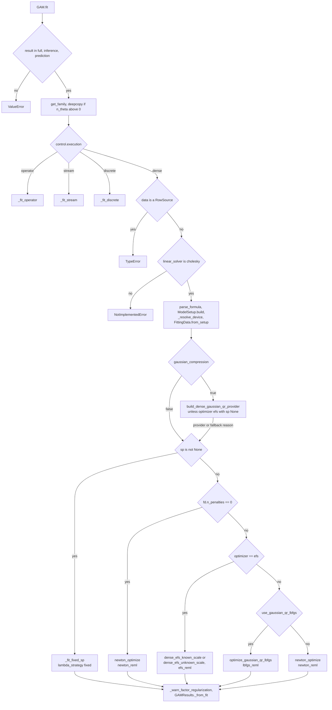
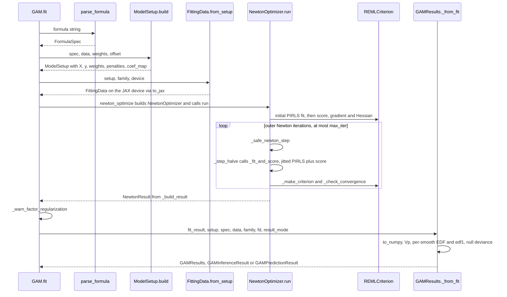
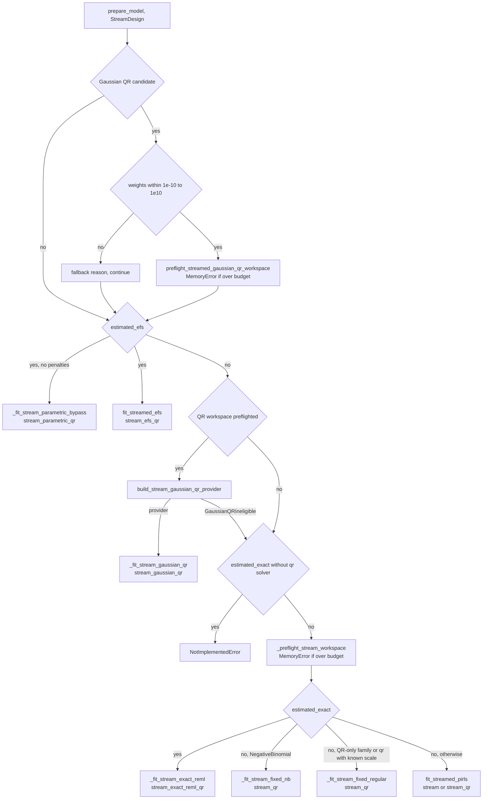
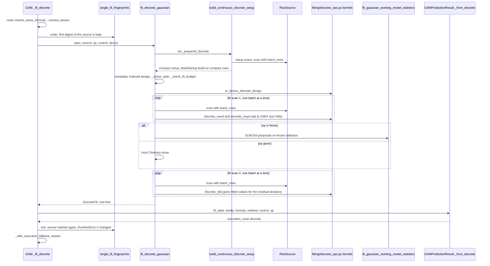
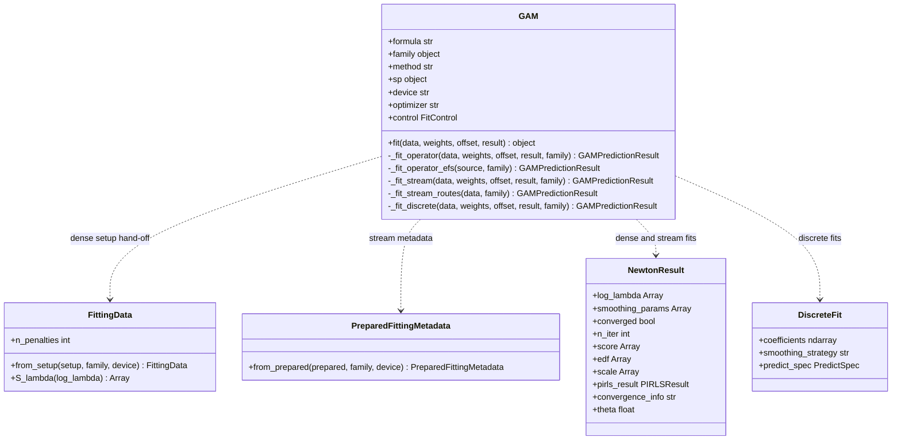

# Lifecycle of a fit

## Scope

This page follows one `GAM(...).fit(...)` call through `jaxgam/api.py`: the
checks made when the `GAM` is constructed, the checks `fit` makes, how it picks
a route and a sub-route, which setup and fitting modules each route calls, how
prior weights and the offset travel, how each route builds its result, and
every `execution_route` label and `execution_fallback_reason` the code can
report. The algorithms behind each route are on the Phase 2 pages.

## Where the code is

| Path | Role |
|---|---|
| `jaxgam/api.py` | `GAM`, `GAM.fit`, the `_fit_*` methods and module-level route functions, `_check_scope_guards`, `_resolve_device`. |
| `jaxgam/control.py` | `FitControl` and its nested controls; validation of field combinations in `__post_init__`. |
| `jaxgam/families/registry.py` | `get_family`, which turns `GAM(family=)` into a family instance. |
| `jaxgam/formula/parser.py` | `parse_formula`, called on every route. |
| `jaxgam/formula/design.py` | `ModelSetup.build`, dense Phase 1. |
| `jaxgam/formula/prepare.py`, `jaxgam/formula/design_provider.py` | `prepare_model` and `StreamDesign`, streamed Phase 1. |
| `jaxgam/formula/operator_prepare.py` | `prepare_operator_model`, operator Phase 1. |
| `jaxgam/fitting/data.py` | `FittingData.from_setup` (dense) and `PreparedFittingMetadata.from_prepared` (streamed), the Phase 1 to 2 hand-off. |
| `jaxgam/data/source.py` | `RowSource`, `single_fit_fingerprints`. |
| `jaxgam/results.py` | The result constructors each route ends in. |

## How it works

### Construction: `GAM.__init__`

`GAM(formula, family="gaussian", method="REML", sp=None, control=None, **kwargs)`
first calls `_check_scope_guards(method, kwargs)`, then stores `formula`,
`family`, `method.upper()`, `sp`, `device` (from `kwargs`), `optimizer`
(`kwargs.get("optimizer") or "newton"`) and `control` (`FitControl()` when
`None`). The extra keywords accepted are the set `_ACCEPTED_KWARGS`:
`device`, `backend`, `optimizer`, `select`, `gamma`, `knots`.

`_check_scope_guards` runs these checks in order:

| Condition | Exception |
|---|---|
| any keyword outside `_ACCEPTED_KWARGS` | `TypeError` naming the unexpected keywords and the accepted arguments |
| `method.upper() == "ML"` | `NotImplementedError` (ML needs mgcv's range-space determinant, `MLpenalty1` in `src/gdi.c`) |
| any other method except `"REML"` | `ValueError` |
| `backend` not `None` or `"jax"` | `NotImplementedError` |
| `device` not `None`, `"cpu"` or `"gpu"` | `ValueError` |
| `optimizer` not `None` and not a `str` | `ValueError` |
| `optimizer` a string other than `"newton"` or `"efs"` | `NotImplementedError` |
| `select` truthy | `NotImplementedError` |
| `gamma != 1.0` | `NotImplementedError` |
| `knots is not None` | `NotImplementedError` |

After the guards, `__init__` raises `TypeError` if `control` is neither a
`FitControl` nor `None`. Nothing else is validated here: an unknown family
name, a malformed formula or a wrong-length `sp` fails only in `fit`.
`FitControl` itself has already rejected inconsistent fields when it was
built (for example `execution="discrete"` without `discretization`, or
`smoothing_strategy="working_model_reml"` on another route), with
`ValueError` or `TypeError`. `tests/test_api/test_gam.py` and
`tests/test_control.py` cover these checks.

### What `fit` does before routing

`fit(data, weights=None, offset=None, *, result="full")`:

1. Rejects a `result` other than `"full"`, `"inference"` or `"prediction"`
   with `ValueError`.
2. Calls `get_family(self.family)`. A name is looked up in the family
   registry (`KeyError` if unknown) and returns a cached shared instance; an
   instance is used as given.
3. If the family has `n_theta > 0` (an estimated negative binomial theta), it
   is deep-copied, so the fit can update theta without mutating the
   registry's instance or the caller's object.
4. Dispatches on `self.control.execution`, in this order: `"operator"` to
   `_fit_operator`, `"stream"` to `_fit_stream`, `"discrete"` to
   `_fit_discrete`; anything else (only `"dense"` can reach here) continues
   inline in `fit`.

Read from the top. The three row-source routes leave `fit` at the first
branch; the dense route runs to the bottom. `use_gaussian_qr_lbfgs` is only
consulted when a Gaussian QR provider was built (otherwise it is skipped and
Newton runs); it is true above 50 penalties
(`GAUSSIAN_LBFGS_PENALTY_THRESHOLD` in `jaxgam/execution/gaussian.py`).

### The dense route, inline in `fit`

The dense route has no `_fit_dense` method; it is the tail of `GAM.fit`.

1. `data` must not be a `RowSource` (`TypeError`), and
   `control.linear_solver` must be `"cholesky"` (`NotImplementedError`
   naming the route that solver belongs to).
2. Phase 1: `parse_formula(self.formula)` then
   `ModelSetup.build(spec, data, weights, offset)`.
3. Phase 1 to 2: `_resolve_device(self.device)` (`None` keeps JAX's default
   device; `"gpu"` without a GPU backend raises `RuntimeError`), then
   `FittingData.from_setup(setup, family_obj, device=jax_device)`, which
   transfers the arrays with `to_jax`.
4. Gaussian QR request. With `control.gaussian_compression`:
   if `optimizer == "efs"` and `sp is None` the request is recorded as unmet;
   otherwise `build_dense_gaussian_qr_provider(fd)`
   (`jaxgam/execution/gaussian_optimizer.py`) either returns a score provider
   and sets `execution_route = "gaussian_qr"`, or raises
   `GaussianQRIneligible`, whose message becomes `execution_fallback_reason`
   while the ordinary dense fit runs.
5. Phase 2, in this order of precedence:
   - `sp` given: `_fit_fixed_sp(fd, sp, method, score_provider=...)`,
     `lambda_strategy = "fixed"`. It validates `sp` with
     `_fixed_log_smoothing_parameters` (`ValueError` for a wrong count or a
     non-positive or non-finite value). Families with estimated theta or
     unknown scale still run `newton_optimize` with `pin_lambda=True`, so
     theta or the scale is estimated at the fixed smoothing parameters, as in
     mgcv's `gam.outer` (`R/mgcv.r`); known-scale families run one PIRLS
     (`source_pirls` or `pirls_loop`) and evaluate `REMLCriterion` once. A
     Gaussian QR provider with more than 50 penalties sends a fixed-`sp` fit
     to `optimize_gaussian_qr_lbfgs` with `pin_lambda=True`.
   - no penalties: `newton_optimize(fd, method)`, whose purely parametric
     shortcut runs one inner fit; `lambda_strategy = "newton_reml"`. This
     branch wins over `optimizer="efs"`.
   - `optimizer == "efs"`: family checks (below), then
     `dense_efs_known_scale` or `dense_efs_unknown_scale`
     (`jaxgam/execution/efs.py`) started from `efs_initial_log_lambda` and,
     for unknown scale, `efs_initial_log_scale`; `lambda_strategy = "efs_reml"`.
   - otherwise Newton: `newton_optimize(fd, method, score_provider=...)`,
     `lambda_strategy = "newton_reml"`, or `optimize_gaussian_qr_lbfgs` and
     `"lbfgs_reml"` when a QR provider exists and there are more than 50
     penalties.
6. After an estimated-sp EFS fit with estimated theta, the selected theta is
   written back with `family_obj.put_theta`. (Newton synchronizes theta
   itself when it builds its result.)
7. `_warn_factor_regularization(fit_result)` issues a `RuntimeWarning` if
   the final penalized Hessian needed a diagonal jitter in its Cholesky
   factor.
8. Phase 2 to 3: `GAMResults._from_fit(..., result_mode=result, ...)` builds
   `GAMResults`, `GAMInferenceResult` or `GAMPredictionResult`.

Dense EFS refusals: an estimated-theta negative binomial with identity or
sqrt link whose zero-coefficient means are invalid for the offset raises
`ValueError`; a family or link outside `_known_scale_family_supported` or
`_unknown_scale_family_supported` raises `NotImplementedError`.

Each arrow into `NewtonOptimizer` is host Python; the jitted work is inside
`_fit_and_score` (one fused XLA program for the penalty, the PIRLS loop and
the criterion score) and inside the gradient and Hessian evaluation.
`_step_halve_gaussian` replaces `_step_halve` for Gaussian identity fits.

### The streamed route: `_fit_stream` and `_fit_stream_routes`

`_fit_stream` checks, in order: `linear_solver == "pcg"` (`ValueError`),
`data` not a `RowSource` (`TypeError`), `weights` or `offset` passed
(`ValueError`), `result != "prediction"` (`NotImplementedError`). It then
classifies the fit:

- `estimated_efs`: `optimizer == "efs"` and `sp is None`;
- `estimated_exact`: `optimizer == "newton"` and `sp is None`;
- fixed: `sp` given.

`_gaussian_qr_request_fallback` returns a reason when a Gaussian QR request
cannot apply (EFS selection, or not exactly `Gaussian` with `IdentityLink`);
otherwise the fit is a Gaussian QR candidate. Family and solver checks follow:
estimated EFS needs `linear_solver="qr"` and passes `_check_stream_efs_family`;
estimated exact REML needs `"qr"` unless it is a Gaussian QR candidate, and
passes `_check_stream_fixed_family(family, "qr")`; a fixed fit passes
`_check_stream_fixed_family(family, linear_solver)`. All raise
`NotImplementedError`. The rest runs inside `single_fit_fingerprints()`, so
an in-memory source is hashed once at the start and once at the end, and a
change raises `RuntimeError`.

`_fit_stream_routes` does Phase 1 with `prepare_model(spec, data, family=...,
batch_rows=..., maximum_bytes=...)` and wraps the result in
`StreamDesign(prepared, data)`. Then:

Read from the top; each leaf shows the function that fits and the
`execution_route` it reports. "QR-only family" means
`_stream_legacy_fisher_eligible(family)` is false. The last leaf reports
`"stream_qr"` when `linear_solver == "qr"` and `"stream"` otherwise.

What each streamed leaf calls:

- `fit_streamed_pirls` (`jaxgam/execution/stream.py`): fixed-sp streamed
  PIRLS with a Cholesky or QR solve.
- `_fit_stream_fixed_regular`: known scale uses `fit_regular_streamed_pirls`
  (`jaxgam/execution/regular_stream.py`); unknown scale uses
  `optimize_regular_stream_reml` (`jaxgam/execution/reml.py`) with the
  smoothing parameters pinned and the log scale free.
- `_fit_stream_fixed_nb`: fixed theta uses `fit_nb_streamed_pirls`
  (`jaxgam/execution/nb_stream.py`); estimated theta uses
  `optimize_nb_stream_reml` (`jaxgam/execution/nb_reml.py`) with the
  smoothing parameters pinned, then `put_theta`.
- `_fit_stream_exact_reml`: two startup scans in
  `prepare_stream_reml_start` (`jaxgam/execution/efs_stream_start.py`) when
  there are penalties, then `optimize_nb_stream_reml` or
  `optimize_regular_stream_reml` over log smoothing parameters plus log
  theta or log scale. With no penalty, known scale and no theta it delegates
  to the fixed-sp functions and relabels the result
  (`lambda_strategy = "exact_reml_no_parameters"`).
- `fit_streamed_efs` (`jaxgam/execution/efs_stream.py`) with `control.efs`.
- `_fit_stream_parametric_bypass`: one streamed coefficient fit
  (`fit_nb_streamed_pirls` or `fit_regular_streamed_pirls`), plus one
  replay for the saturated likelihood when the scale is unknown;
  `lambda_strategy = "newton_reml"`.
- `_fit_stream_gaussian_qr`: `newton_optimize` with the QR score provider, or
  `optimize_gaussian_qr_lbfgs` above 50 penalties; `pin_lambda` when `sp` is
  given.

Every streamed leaf ends in `GAMPredictionResult._from_stream_fit`, called
with the row-free `StreamFitState`, the `PreparedModel`, the
`PreparedFittingMetadata` and, for optimizer routes, a `selected_fit` that
carries the outer score and convergence: built by `_selected_stream_fit`, or
the accepted fit of the EFS execution on `stream_efs_qr`.
`_with_execution_fallback_reason` then records any unmet Gaussian QR request.

### The discretized route: `_fit_discrete`

`_fit_discrete` checks, in order: `data` not a `RowSource` (`TypeError`);
`weights` or `offset` passed (`ValueError`); `result != "prediction"`,
`linear_solver != "cholesky"`, `sp is None` without
`smoothing_strategy="working_model_reml"`, `sp is None` with
`optimizer != "newton"`, an `ExtendedFamily` without the
`extended_performance_iteration` capability, and any family that is neither
Gaussian with its canonical link nor declares `regular_performance_iteration`
or `extended_performance_iteration` (all `NotImplementedError`). It then
parses the formula, resolves the device and, inside `single_fit_fingerprints()`,
calls `fit_discrete_gaussian` (Gaussian identity) or `fit_discrete_regular`
(every other admitted family), and builds the result with
`GAMPredictionResult._from_discrete`. The route never reads `optimizer`
when `sp` is given, and ignores `gaussian_compression` except to report it.

Phase 1 for this route is called from the driver:
`_prepared_discrete` in `jaxgam/execution/discrete.py` runs
`build_continuous_discrete_setup` (which scans the source to build the
compact frame and runs `ModelSetup.build` on it), `build_discretization_metadata`,
`build_request_compression` (only for `prediction_policy="mgcv_predict_bamd"`)
and `build_continuous_discrete_design` (no source scan), and releases the
compact selectors when the fit ends.

Read top to bottom: setup scans happen before any fit scan, and
`source_scans` on the result counts only the two fit scans. For the other
families `fit_discrete_regular` (`jaxgam/execution/discrete_regular.py`)
replaces the middle part with the performance iteration of `bgam.fitd`
(`R/bam.r`): every outer iteration rescans the source to form working
weights and takes one `Sl.fitChol` proposal (`R/fast-REML.r`), and an
estimated negative binomial theta adds scans of its own.

### The operator route: `_fit_operator` and `_fit_operator_efs`

`_fit_operator` checks, in order: `linear_solver != "pcg"` (`ValueError`);
`result != "prediction"`, `uncertainty != "none"`, `sp is None` without
`optimizer="efs"`, an estimated theta, more than one theta, `device` other
than `None` or `"cpu"` (all `NotImplementedError`); `data` not a `RowSource`
(`TypeError`); `weights` or `offset` passed (`ValueError`). With `sp=None`
and `optimizer="efs"` it hands over to `_fit_operator_efs`. Otherwise it
validates `sp` (count, real values, positive and finite: `ValueError`; a
16-bytes-per-value check against the budget: `MemoryError`), calls
`prepare_operator_model` with an `OperatorPreparationControl` built from
the smaller of `batch_rows` and the source's row count
(`_operator_fit_batch_rows`), `memory_budget_bytes` and
`OperatorControl.max_modest_coefficients`, rechecks the `sp` count against
`model.penalties.n_penalties`, fits with `fit_operator_fixed_sp`
(`jaxgam/execution/operator_fit.py`) and builds the result with
`GAMPredictionResult._from_operator_fit`.

`_fit_operator_efs` admits only a canonical `Poisson` family and `batch_rows`
inside `CALIBRATED_OPERATOR_EFS_DOMAIN` before any scan, then prepares the
model with one eighth of the memory budget, checks the prepared shape
against the calibrated domain (one indexed random effect, at most
`CALIBRATED_OPERATOR_EFS_MAX_MODEST` modest coefficients), builds the start
with `prepare_indexed_operator_efs_start`, and runs
`run_operator_efs_known_scale` over a `SourceOperatorEFSFitProvider`
(`jaxgam/execution/operator_efs_controller.py`). Outside the domain it
raises `NotImplementedError`; a result that cannot fit the remaining budget
raises `MemoryError`. The result is `_from_operator_fit` on the accepted
fit, then `dataclasses.replace` with the selected score, its error bound,
scale, `edf_total`, convergence fields and `lambda_strategy = "efs_reml"`.
The operator route does not open a `single_fit_fingerprints` scope; its
preparation and fit verify replay themselves.

### How weights and the offset travel

| Route | Where they come from | Where they go |
|---|---|---|
| dense | `fit(weights=, offset=)`, each of shape `(n,)`. `ModelSetup.build` defaults weights to ones, rejects a wrong shape, negative or non-finite weights, all-zero weights and a non-finite offset with `ValueError`. | `setup.weights` and `setup.offset`, transferred to the device as `fd.wt` and `fd.offset`; used again in `_from_fit` for the null deviance, and `_offset_was_nonzero(setup)` tells the predictor to warn when new data come without an offset. |
| stream | `RowBatch.weight` and `RowBatch.offset` of each scanned batch; `fit` refuses separate arrays. | Reduced per batch by the drivers. `prepare_model` records their range in `prepared.fitting.response`, which decides Gaussian QR weight eligibility and the predictor's `offset_was_nonzero`. |
| discrete | `RowBatch.weight` and `RowBatch.offset`. `declared_row_vectors` reads the source's `has_explicit_weights` and `has_explicit_offset`; an undeclared attribute counts as supplied, which changes the seeded compact-frame padding as supplied vectors do in `bam`. | Accumulated into the indexed statistics in every fit scan; `DiscreteFit.offset_was_nonzero` reaches the predictor. |
| operator | `RowBatch.weight` and `RowBatch.offset`. | Moved to the device per batch in `jaxgam/execution/operator_fit.py`; the fit reports `offset_was_nonzero`. Operator EFS additionally requires unit weights and a zero offset. |

### How each route builds its result

| Route | Constructor | Notes |
|---|---|---|
| dense | `GAMResults._from_fit` | `result_mode` picks `GAMResults`, `GAMInferenceResult` or `GAMPredictionResult` from the same fit. |
| stream | `GAMPredictionResult._from_stream_fit` | Recomputes the REML score from the stream state unless a `selected_fit` supplies it. |
| discrete | `GAMPredictionResult._from_discrete` | Records `prediction_policy` and the bounded `discretization` metadata. |
| operator | `GAMPredictionResult._from_operator_fit` | Fixed sp: `score=None`, `edf_total=None`, `scale=None` for unknown-scale families. |

[Phase 3: results and prediction](results_and_prediction.md) describes what
each constructor keeps.

### `execution_route` labels

| Label | Set in | Meaning |
|---|---|---|
| `dense` | `GAM.fit`; also the field default on `_FitDiagnostics` and `GAMPredictionResult` | ordinary dense fit |
| `gaussian_qr` | `GAM.fit` | dense fit through a Gaussian QR score provider |
| `stream` | `_fit_stream_routes` (and the default of `_from_stream_fit`) | `fit_streamed_pirls` with the Cholesky solver |
| `stream_qr` | `_fit_stream_routes`, `_fit_stream_fixed_regular`, `_fit_stream_fixed_nb` | fixed-sp streamed fit with the QR solver |
| `stream_gaussian_qr` | `_fit_stream_gaussian_qr` | streamed Gaussian QR route |
| `stream_exact_reml_qr` | `_fit_stream_exact_reml` (both branches) | exact streamed REML |
| `stream_efs_qr` | `_fit_stream_routes` | streamed EFS |
| `stream_parametric_qr` | `_fit_stream_parametric_bypass` | `optimizer="efs"` on a model with no penalties |
| `discrete` | `GAMPredictionResult._from_discrete` | discretized route |
| `operator` | `GAMPredictionResult._from_operator_fit`, `_fit_operator_efs` | operator route |

`lambda_strategy` takes the values `fixed`, `newton_reml`, `lbfgs_reml`,
`efs_reml`, `exact_reml`, `exact_reml_no_parameters` (all set in
`jaxgam/api.py`) and `working_model_reml` (from the discrete fit state).
`execution_path` is `"jax"` except on the discretized route, where
`_from_discrete` reports `jax_actions_numpy_solve`,
`jax_actions_working_model_numpy_postestimation` or
`jax_actions_performance_iteration_numpy_postestimation`.

### `execution_fallback_reason` values

The field is set only for a Gaussian QR request that did not apply; the fit
then runs on the route it would have taken without the request.

| Reason | Set in |
|---|---|
| "Gaussian QR compression requires Newton smoothing selection." | `GAM.fit` (dense) and `_gaussian_qr_request_fallback` (stream) |
| "Gaussian QR requires the exact Gaussian family with identity link" | `_gaussian_qr_request_fallback` (stream); also a `GaussianQRIneligible` message |
| "Gaussian QR currently requires unclipped finite positive weights" | `_fit_stream_routes`; also a `GaussianQRIneligible` message |
| the message of a caught `GaussianQRIneligible` | `GAM.fit` (dense, from `build_dense_gaussian_qr_provider`) and `_fit_stream_routes` (from `build_stream_gaussian_qr_provider`). Messages include "Gaussian QR smoothing optimization requires at least one penalty", "Gaussian QR currently requires a full identifiable coefficient map" and "Gaussian QR requires finite dense fitting data" (`jaxgam/execution/gaussian_optimizer.py`, `jaxgam/execution/gaussian.py`). |
| "Gaussian QR compression requires execution 'dense' or 'stream'." | `_discrete_gaussian_qr_request_fallback` |

The operator route never reads `gaussian_compression`, so its results always
carry `None`.

## Key types

The `_fit_*` functions, all in `jaxgam/api.py`:

| Function | Chosen when | Setup it calls | Fitting it calls |
|---|---|---|---|
| `GAM.fit` (dense tail) | `execution="dense"` | `parse_formula`, `ModelSetup.build`, `FittingData.from_setup` | `_fit_fixed_sp`, `newton_optimize`, `dense_efs_known_scale`, `dense_efs_unknown_scale`, `optimize_gaussian_qr_lbfgs` |
| `_fit_fixed_sp` | dense with `sp` given | none | `newton_optimize` (pinned), `source_pirls` or `pirls_loop`, `REMLCriterion`, `optimize_gaussian_qr_lbfgs` |
| `GAM._fit_stream` | `execution="stream"` | none (checks only) | `_fit_stream_routes` |
| `GAM._fit_stream_routes` | always from `_fit_stream` | `parse_formula`, `prepare_model`, `StreamDesign`, `PreparedFittingMetadata.from_prepared` | the leaves below, or `fit_streamed_pirls` and `fit_streamed_efs` directly |
| `_fit_stream_gaussian_qr` | stream, Gaussian QR provider built | none | `newton_optimize` or `optimize_gaussian_qr_lbfgs` with the provider |
| `_fit_stream_fixed_regular` | stream, fixed sp, QR-only family or QR with known scale | none | `fit_regular_streamed_pirls` or `optimize_regular_stream_reml` |
| `_fit_stream_fixed_nb` | stream, fixed sp, `NegativeBinomial` | none | `fit_nb_streamed_pirls` or `optimize_nb_stream_reml` |
| `_fit_stream_exact_reml` | stream, `sp=None`, `optimizer="newton"`, no Gaussian QR | `prepare_stream_reml_start` | `optimize_regular_stream_reml` or `optimize_nb_stream_reml` |
| `_fit_stream_parametric_bypass` | stream, `optimizer="efs"`, no penalties | none | `fit_regular_streamed_pirls` or `fit_nb_streamed_pirls` |
| `GAM._fit_discrete` | `execution="discrete"` | `parse_formula` (the rest in the driver) | `fit_discrete_gaussian` or `fit_discrete_regular` |
| `GAM._fit_operator` | `execution="operator"` | `parse_formula`, `prepare_operator_model` | `fit_operator_fixed_sp` |
| `GAM._fit_operator_efs` | operator, `sp=None`, `optimizer="efs"` | `prepare_operator_model`, `prepare_indexed_operator_efs_start` | `run_operator_efs_known_scale` |

`NewtonResult` (`jaxgam/fitting/newton.py`) is the optimizer-neutral fit
record the dense route hands to `GAMResults._from_fit`; the streamed
optimizer routes build one with `_selected_stream_fit` to carry the outer
score. `DiscreteFit` (`jaxgam/execution/discrete.py`) is the row-free state
of a discretized fit. The class diagram shows only the members that this page
discusses.

## Rules and invariants

- **Route checks run before data access.** Every row-source route rejects a
  wrong solver, a wrong `result` and separate weights or offset before it
  parses the formula or scans the source; `tests/test_execution/test_stream_api.py`,
  `tests/test_execution/test_discrete_routes.py` and
  `tests/test_execution/test_operator_routes.py` assert these refusals, and
  `tests/test_inference/test_operator_geometry.py` checks that the operator
  refusals precede any source access.
- **The registry family is never mutated.** Families with estimated theta are
  deep-copied in `fit`; result builders snapshot the family again
  (`tests/test_result_mode.py`,
  `test_from_fit_owns_independent_family_snapshots_with_final_theta`).
- **A supplied `sp` is reported verbatim.** All constructors pass the caller's
  `sp` through `_report_smoothing_params` (`tests/test_supplied_smoothing_params.py`).
- **An unmet Gaussian QR request never changes the fit.** The fit takes the
  route it would take without the request and records why
  (`tests/test_execution/test_gaussian_stream_routes.py`,
  `tests/test_execution/test_gaussian_optimizer.py`,
  `test_discrete_gaussian_qr_request_keeps_the_discrete_fit_bitwise` in
  `tests/test_execution/test_discrete_routes.py`).
- **Other routes do not change the dense result.**
  `test_operator_control_leaves_existing_routes_bitwise_unchanged` in
  `tests/test_execution/test_operator_routes.py` and
  `test_published_routes_never_enter_the_discrete_route` in
  `tests/test_execution/test_discrete_routes.py` guard the dispatch.
- **One fingerprint scope per fit.** The stream and discrete routes wrap the
  whole fit in `single_fit_fingerprints()`; nested stages join it.

## Pitfalls

- `fit` defaults to `result="full"`, which every row-source route refuses:
  examples for those routes must pass `result="prediction"`.
- `sp` with `optimizer="efs"` runs the fixed-sp path on every route; the
  optimizer only matters when `sp is None`. On the discrete route
  `optimizer="efs"` is refused only when `sp is None`.
- A fixed `sp` does not always mean "no optimization" on the dense route:
  Gaussian, Gamma and estimated-theta negative binomial fits still run
  `newton_optimize` with `pin_lambda=True` to estimate scale or theta, and
  report its `n_iter`.
- Estimated streamed REML without `linear_solver="qr"` passes the first
  check when Gaussian QR was requested, and fails later with
  `NotImplementedError` only if the QR route turns out to be ineligible.
- `_preflight_stream_workspace` charges the requested `batch_rows`, not the
  source's row count, so a small source can fail the preflight at the
  default `batch_rows` with a large coefficient count.

## Where to change things

| To do this | Edit |
|---|---|
| Accept a new `GAM` keyword | `_ACCEPTED_KWARGS` and `_check_scope_guards` in `jaxgam/api.py`; store it in `GAM.__init__` |
| Add a field to `FitControl` | `jaxgam/control.py` (field and `__post_init__` rule), then its reader in the relevant `_fit_*` function |
| Add a streamed sub-route | `_fit_stream` (classification and checks) and `_fit_stream_routes` (dispatch); give it a new `execution_route` label and add it to the table above |
| Change dense smoothing selection | the dense tail of `GAM.fit` and `_fit_fixed_sp` |
| Change what a route refuses | the check list at the top of its `_fit_*` method; keep refusals before any source scan |
| Change result construction | the constructor named in the table above, in `jaxgam/results.py` |

A planned refactor will replace the per-route methods in `jaxgam/api.py`
with a shared fitting engine; see
[the unified fitting design](../unify_fit/design.md).
