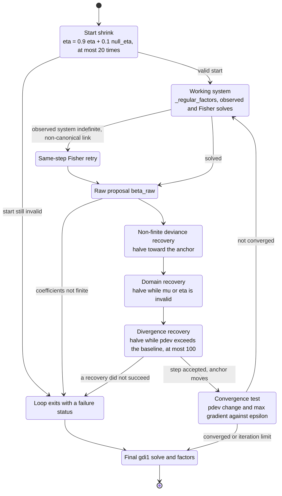
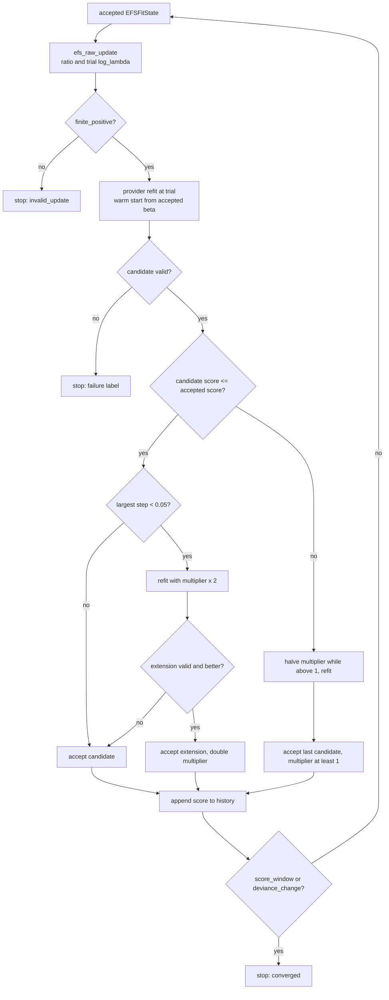
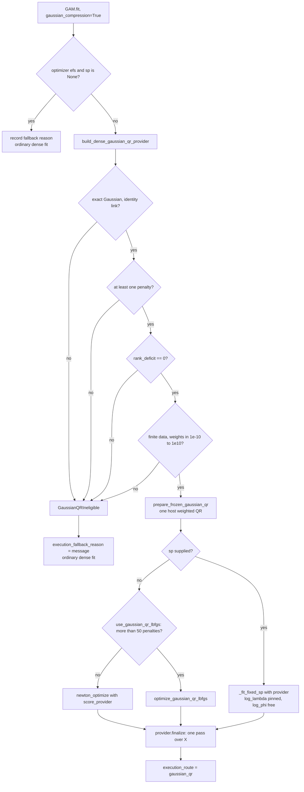
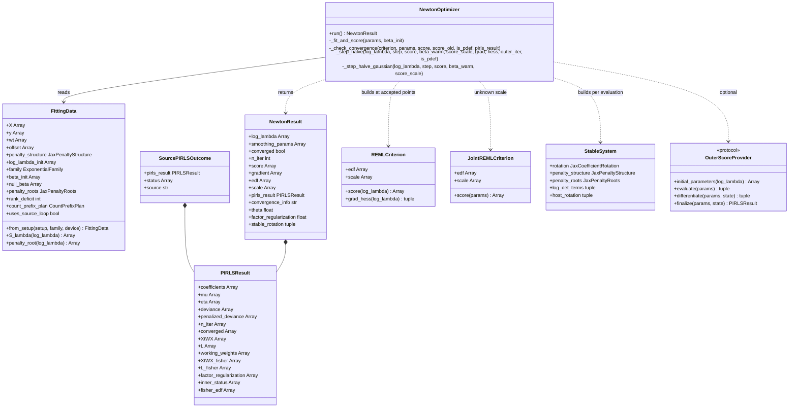
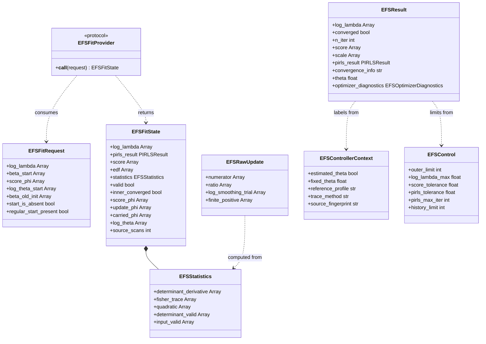
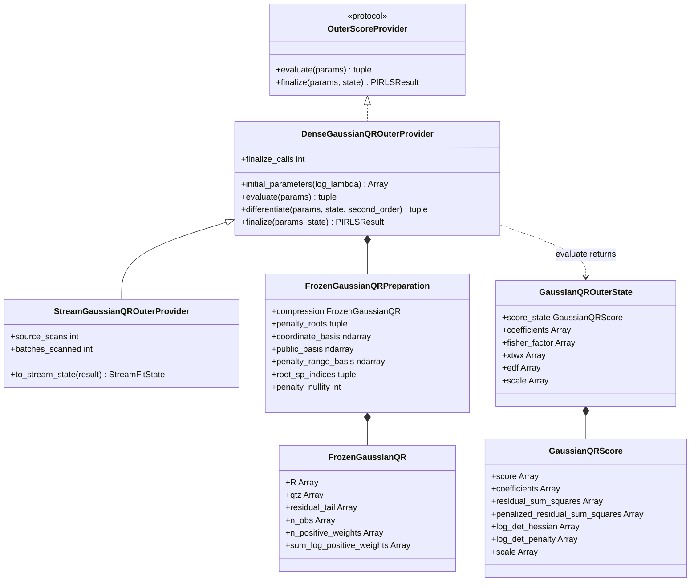

# Phase 2: the dense fit

## Scope

This page covers the default in-memory fit (`FitControl(execution="dense")`): the
Phase 1 to Phase 2 boundary object `FittingData`, the inner coefficient loops
(PIRLS and the pinned ports of mgcv's `gam.fit3` and `gam.fit4`), the REML
criterion, the outer Newton optimizer for the log smoothing parameters, fixed-`sp`
fits, negative-binomial theta, the dense extended Fellner-Schall (EFS) optimizer
and the opt-in Gaussian QR route. How `GAM.fit()` reaches this code is on
[the fit lifecycle page](fit_lifecycle.md); how the result is built afterwards is
on [the results page](results_and_prediction.md).

## Where the code is

| Module | Role |
|---|---|
| `jaxgam/fitting/data.py` | `FittingData`: device arrays, reparameterized penalty blocks, starts, null anchor and rank metadata built from `ModelSetup`; also `PreparedFittingMetadata` for the streamed routes. |
| `jaxgam/fitting/initialization.py` | `initialize_beta_cpu` (PIRLS start) and `r_null_coefficients` (port of mgcv's `get.null.coef` anchor), both NumPy. |
| `jaxgam/fitting/pirls.py` | `pirls_loop`, the ordinary `jax.lax.while_loop` PIRLS with step halving, `PIRLSResult`, and the NB in-loop theta solver `efs_theta_pirls_loop`. |
| `jaxgam/fitting/efs_regular_pirls.py` | `efs_regular_pirls_loop`: the jitted port of the `gam.fit3` coefficient loop (Fisher retry, sequential recovery, convergence test, final `gdi1` solve). |
| `jaxgam/fitting/source_pirls.py` | `source_pirls`: selects the pinned `gam.fit3` or `gam.fit4` loop for a dense inner fit; `SOURCE_EPSILON`; status messages. |
| `jaxgam/fitting/reml.py` | The REML criterion (`_criterion_core`, `reml_criterion`, `REMLCriterion`, `JointREMLCriterion`), `fletcher_scale`, `estimate_edf`, `fisher_edf`. |
| `jaxgam/fitting/stable_log_det.py` | Host NumPy port of `gam.reparam`/`get_stableS` for multi-penalty blocks: `StableSystem`, `stable_system`. |
| `jaxgam/fitting/penalty_ops.py` | JAX algebra on local penalty blocks: `materialize`, `log_pdet`, `augmented_root`, `JaxPenaltyRoots`, `JaxCoefficientRotation`. |
| `jaxgam/fitting/newton.py` | `NewtonOptimizer` / `newton_optimize`: the host outer loop, the differentiable score `_diff_score` with its `jax.custom_jvp`, `NewtonResult`, `OuterScoreProvider`. |
| `jaxgam/fitting/efs.py` | Jitted EFS algebra: `prepare_efs_statistics`, `efs_statistics` (d, t, q), `efs_raw_update`, `efs_fisher_factor`. |
| `jaxgam/fitting/efs_theta.py` | Conditional NB theta Newton kernel (port of mgcv's `estimate.theta` branch used by `gam.fit4` under EFS). |
| `jaxgam/fitting/efs_factor.py` | `efs_factor_statistics`: d, t, q computed from a coefficient-factor object; used by streamed EFS only. |
| `jaxgam/fitting/gaussian.py` | `FrozenGaussianQR` and `gaussian_qr_reml_score`: the Gaussian REML score from frozen QR statistics. |
| `jaxgam/fitting/rank_coordinates.py` | `reduced_augmented_qr` JAX kernel for rank-coordinate Gaussian QR solves; no module in `jaxgam/` imports it today, only tests. |
| `jaxgam/execution/efs.py` | Host EFS controller (`dense_efs_known_scale`, `dense_efs_unknown_scale`, `_run_efs_known_scale`, `_run_efs_unknown_scale`), `EFSFitState`, `EFSResult`, start values. |
| `jaxgam/execution/efs_provider.py` | The provider seam: `EFSFitRequest`, `EFSControllerContext`, `EFSFitProvider` protocol. |
| `jaxgam/execution/gaussian.py` | Host preparation of the frozen Gaussian QR (`prepare_frozen_gaussian_qr`), `GaussianQRIneligible`, the penalty-count threshold, workspace estimates. |
| `jaxgam/execution/gaussian_optimizer.py` | `DenseGaussianQROuterProvider`, `build_dense_gaussian_qr_provider`, `optimize_gaussian_qr_lbfgs`, `use_gaussian_qr_lbfgs`. |

Phase 2 is split as on every route: jitted kernels in `jaxgam/fitting/`, host
control in `jaxgam/execution/`. The dense route is the exception that its main
optimizer, `NewtonOptimizer`, lives in `jaxgam/fitting/newton.py` and is itself a
host Python loop around jitted pieces.

## How it works

### Dispatch inside `GAM.fit`

After `parse_formula` and `ModelSetup.build` (Phase 1), `GAM.fit` in
`jaxgam/api.py` builds `FittingData.from_setup(setup, family, device)` and then
chooses, in this order:

1. If `FitControl.gaussian_compression` is set, try
   `build_dense_gaussian_qr_provider` (see [Gaussian QR](#the-gaussian-qr-route)).
2. `sp` supplied: `_fit_fixed_sp` (see [Fixed-sp fits](#fixed-sp-fits)),
   `lambda_strategy="fixed"`.
3. No penalties: `newton_optimize`, which takes its parametric shortcut.
4. `optimizer="efs"`: `dense_efs_known_scale` or `dense_efs_unknown_scale`,
   `lambda_strategy="efs_reml"`.
5. Otherwise Newton (`newton_optimize`), or SciPy L-BFGS-B when a Gaussian QR
   provider exists and the model has more than 50 penalties.

Every branch returns an object with the `NewtonResult` field names (EFS returns
`EFSResult`), which `_warn_factor_regularization` inspects and
`GAMResults._from_fit` consumes.

### FittingData: the Phase 1 to Phase 2 boundary

`FittingData.from_setup` does all of its numerical preparation in NumPy, then
moves arrays with `to_jax` (`jax.device_put` of float64). In order:

- **Initial smoothing parameters.** `_initial_sp` forms `diag(X'WX)` in
  8192-row batches and calls `initial_log_sp_from_diagonal`, the port of mgcv's
  `initial.sp` (`R/mgcv.r`).
- **Reparameterization.** `reparameterize_structure`
  (`jaxgam/formula/fitting_prepare.py`) rotates each penalty block so its
  coordinates split into the null and range space of the block's total penalty,
  mgcv's `totalPenaltySpace` (`R/gam.fit3.r`). A single penalty becomes an exact
  0/1 diagonal; overlapping penalties use the eigenbasis of the norm-balanced sum
  `sum_j S_j / |S_j|_F`. The transformed penalties hold exact zeros on null rows
  and columns, which keeps a large smoothing parameter from amplifying roundoff
  into a spurious null-space penalty. `apply_transforms_to_design` applies the
  same block transforms to X, so the whole fit runs in these "fitting
  coordinates".
- **Start values.** `initialize_beta_cpu` (see [Starting values](#starting-values))
  gives `beta_init`; `_null_beta` gives `null_beta` from `r_null_coefficients`
  (`None` when the link of the response mean is not finite).
- **Penalty metadata.** `_build_block_metadata` classifies blocks into
  singletons (rank and log-eigenvalue constant, so `log|S+|` is exactly
  `rank * rho + const`) and multi-penalty blocks (range-space projections
  `multi_block_proj_S`).
- **Rank.** `_unpenalized_rank_deficit` counts aliasing among unpenalized
  columns and penalty null spaces.
- **Structural penalty roots.** `_structural_penalty_roots` repeats mgcv's
  lambda-free identifiability test from `pls_fit1` (`src/gdi.c`): it QR-factors
  `sqrt(w) X` and asks `structural_rank` whether `[R1; E]` has full column rank.
  If so it stores unscaled roots (`JaxPenaltyRoots`) and the inner fit solves by
  QR (`penalized_qr_solve`, a port of `pls_fit1`'s arithmetic) instead of the
  normal equations; if not, `penalty_roots` is `None` and the Cholesky solve is
  kept, because `pls_fit1`'s unidentifiable-column drop is not ported.
- **NB counts.** For `family_name == "nb"` a `CountPrefixPlan` records integer
  counts for the lgamma recurrences; other families keep `max_y = 0` so the
  response does not split JIT cache entries.

`_structural_penalty_roots` imports `structural_rank` from `jaxgam.execution.qr`
inside the function. A module-level import would be circular:
`jaxgam/execution/__init__.py` imports `jaxgam/execution/stream.py`, which
imports `_to_jax_structure` from `jaxgam/fitting/data.py`. As a consequence a
dense penalized fit loads `jaxgam.execution` (and its stream module) even though
the dense route uses nothing else from it. This is the only import from
`jaxgam/fitting/` into `jaxgam/execution/`.

`FittingData.uses_source_loop` is true when `null_beta` exists, `rank_deficit`
is 0 and the family is one of the five registered classes (`uses_source_loop` in
`jaxgam/fitting/source_pirls.py`). It decides which inner loop runs.

### The inner fit

`_inner_fit` in `jaxgam/fitting/newton.py` is the single entry point used by
Newton and by fixed-`sp` fits:

- with a `null_beta` (full-rank models of the five registered families) it calls
  `source_pirls`, which runs
  - `efs_regular_pirls_loop` for Gaussian, Binomial, Poisson and Gamma: the port
    of `gam.fit3` (`R/gam.fit3.r`);
  - `_efs_theta_pirls_loop_jit` with `estimate_theta=False` for
    `NegativeBinomial`: the port of `gam.fit4` (`R/gam.fit4.r`), with theta as
    dynamic data so one compiled loop serves every theta;
- without one (structurally rank-deficient models, hand-built fixtures) it calls
  the ordinary `pirls_loop`.

Both source loops converge at `SOURCE_EPSILON = 1e-11`, R's
`gam.control(epsilon=1e-11)` rather than R's default `1e-7`, and run at most 200
iterations. Called from Newton, the ordinary loop runs at the optimizer's PIRLS
tolerance (`min(tol / 100, 1e-8)`); called from `_fit_fixed_sp` it keeps
`pirls_loop`'s default `1e-7`. Either way it runs at most 100 iterations.

#### The pinned gam.fit3 loop

`_efs_regular_pirls_loop_jit` is one `jax.lax.while_loop`; every decision is a
`jnp.where` on traced values.



Read it top to bottom; each box between the start and the final solve is one
stage of one `while_loop` iteration. Every exit, including a failure, passes
through the final solve; a failure is carried in the status code. The details,
all from `jaxgam/fitting/efs_regular_pirls.py`:

- **Working system.** `_regular_factors` returns `gam.fit3`'s weights and working
  response. Canonical links use Fisher weights. Non-canonical links use the full
  Newton system, Fisher weights times `alpha = 1 + (y - mu) (V'/V + g'' mu.eta)`,
  whose weights can be negative. `_checked_exact_solve` classifies the
  curvature of the unit-diagonal `H`; a material negative eigenvalue triggers the
  same-step Fisher retry, as in `gam.fit3`. With `penalty_roots`, every
  nonnegative-weight system is solved by `_positive_qr_solve`.
- **Recovery.** The order is R's: a non-finite coefficient stops the loop; then
  non-finite deviance, then invalid `mu`/`eta`, then penalized-deviance
  divergence beyond `10 (0.1 + |old pdev|) sqrt(eps)` (at most 100 halvings).
  Each halving moves `beta` and `eta` half-way toward the anchor, which starts at
  `null_beta` and becomes the last accepted state.
- **Convergence.** Converged when the penalized-deviance change is below
  `epsilon (|scale| + |pdev|)` and `max|2 X'W(X beta - z) + 2 S beta|` is at most
  `epsilon (|pdev| + |scale|)`. A family whose capability `single_step_pirls` is
  set (Gaussian with identity link) is converged at its first accepted step, R's
  "strictly additive" branch.
- **Final solve.** After the loop, `gam.fit3`'s closing `gdi1` call is ported:
  weights are rebuilt at the final state, `XtWX` (observed) and `XtWX_fisher` are
  formed, and one last penalized solve gives the reported coefficients, unless
  that candidate leaves the family domain, in which case the pre-solve
  coefficients are kept. The reported deviance is the pre-solve deviance, and
  `penalized_deviance` adds the candidate's penalty, as R's `Dp` does.
- **Status.** A failure is reported in `inner_status` with one of the
  `EFS_REGULAR_STATUS_*` codes, never as convergence; `status_message` maps it to
  R's wording ("inner loop 3; can't correct step size ...").

The NB loop (`_efs_theta_pirls_loop_jit` in `jaxgam/fitting/pirls.py`) follows
`gam.fit4` instead: observed weights `0.5 d2D/deta2`, a positive-weight retry
for an indefinite system, the same recovery order and `gam.fit4`'s convergence
test.

#### The ordinary PIRLS loop

`_pirls_loop_jit` (behind `pirls_loop`) is a `jax.lax.while_loop` over
`_PIRLSState`. Its body calls `_beta_step`, which forms the weighted system,
solves it (`penalized_solve`, or `penalized_qr_solve` when a root is given) and
runs an inner `while_loop` over `_StepHalvingState`: a trial is accepted when
its penalized deviance is finite, `valid_mu`/`valid_eta` hold, and it is no more
than `1e-7 |pdev|` above the current value (any valid finite trial is accepted
on the first iteration). At most 25 halvings toward the previous coefficients
are tried; if none is accepted the iteration keeps the old state. Convergence is
tested only from iteration index 3, when both the relative penalized-deviance
change and the relative maximum coefficient change are below `tol`.

After the loop, the curvature is rebuilt at the final `mu` following mgcv's
information split: the `XtWX` that enters `log|H|` uses observed information for
non-canonical links (signed weights from `_observed_weights`, built by
`_signed_XtWX`), while `XtWX_fisher` and `L_fisher` use Fisher weights for EDF
and covariance. For canonical links the two are the same array. Standard
families use Fisher scoring (`gam.fit3`); a family with `n_theta > 0` uses
observed weights and working response (`gam.fit4`).

The plain Cholesky used here is `cho_factor` in `jaxgam/jax_utils.py`: it adds a
diagonal-relative jitter (`1e-12`, then `1e-6`) only when the plain factor fails,
and records the level in `factor_regularization`.

### The REML criterion

`_criterion_core` in `jaxgam/fitting/reml.py` computes, for converged inner-fit
outputs,

    Dp / (2 phi) - ls_sat + log|H| / 2 - log|S+| / 2

with `Dp = deviance + beta' S_lambda beta` and `H = XtWX + S_lambda`; the caller
subtracts `Mp / 2 log(2 pi phi)`, where `Mp` is the total penalty null-space
dimension. This is the Laplace REML of `gam.fit3` (`R/gam.fit3.r`). The terms:

- `ls_sat` is the family's saturated log-likelihood (`saturated_loglik`, or
  `saturated_loglik_theta` when theta is a free coordinate).
- `log|H|` comes from one of three places in `_criterion_log_determinants`:
  `qr_log_det` (`jaxgam/fitting/qr.py`, the QR of `[sqrt(W) X; E]`, with a
  `jax.custom_jvp` whose tangent is `tr(H^-1 dH)`) when `uses_qr_log_det` holds
  (roots present, no rank deficit, canonical link, no theta); otherwise a
  Cholesky of `H` scaled to unit diagonal; or, for a structurally rank-deficient
  `H`, the sum of log eigenvalues after dropping the `rank_deficit` smallest.
- `log|S+|` comes from `penalty_ops.log_pdet`: the exact `rank * rho + const`
  for singletons and a block log-determinant for multi-penalty blocks.

For multi-penalty blocks, mgcv calls `gam.reparam` (`R/gam.fit3.r`, which calls
the C routine `get_stableS` in `src/gdi.c`) at every evaluation. That routine
branches on the smoothing parameters, so `jaxgam/fitting/stable_log_det.py`
runs it on the host, in NumPy, between jitted calls: `stable_system` returns a
`StableSystem` (block rotations, rotated penalties and roots, and
`StableLogDetTerms` holding `log|S+|` with its first and second derivatives at
that point). The jitted criterion evaluates the quadratic expansion of those
terms, which is exact at that point and NaN anywhere else, so it cannot be used
away from the host's evaluation point. The inner fit is then run in the
rotated coordinates and mapped back by `pirls_from_stable`.

Scale and EDF: `fisher_edf` takes the QR trace `fisher_edf` recorded by the
inner fit when available, else `estimate_edf` (`tr(H^-1 XtWX_fisher)`).
`fletcher_scale` is the Fletcher (2012) Pearson estimate used by `gam.fit3`;
`estimate_scale` returns 1 for known-scale families.

`REMLCriterion` and `JointREMLCriterion` wrap this core with fixed inner-fit
outputs. They are used to report `edf` and `scale` at an accepted point, by the
parametric shortcut, and by `_fit_fixed_sp`. They are not what Newton
differentiates: the outer gradient and Hessian come from `_diff_score`. Only
REML is implemented; `NewtonOptimizer` raises `ValueError` for any other
`method`.

### The Newton outer loop

`NewtonOptimizer` ports mgcv's `newton` (`R/gam.fit3.r`) for non-Gaussian
families and the step handling of `fast.REML.fit` (an mgcv routine in
`R/fast-REML.r`) for Gaussian. Its parameter vector is
`[log_lambda, <log_theta>, <log_phi>]`: `log_theta` only for an NB family with
estimated theta (`_joint_theta`), `log_phi` only for unknown-scale families
(`_joint_scale`), and both only when the model has penalties.

```mermaid
sequenceDiagram
    participant Api as GAM.fit in api.py
    participant Opt as NewtonOptimizer.run
    participant Fwd as _jit_fit_and_score
    participant Inner as _inner_fit
    participant Crit as _criterion_core
    participant Diff as _jit_diff_grad_hess
    participant Step as _safe_newton_step
    Api->>Opt: newton_optimize(fd, method)
    Opt->>Fwd: params, beta_init
    Fwd->>Inner: S_lambda from log_lambda
    Inner-->>Fwd: PIRLSResult
    Fwd->>Crit: XtWX, beta, deviance, ls_sat
    Crit-->>Fwd: score
    Fwd-->>Opt: score and PIRLSResult
    Opt->>Diff: params, accepted coefficients
    Diff-->>Opt: gradient and Hessian through custom_jvp
    loop each outer iteration, at most max_iter
        Opt->>Opt: _compute_uconv_ind
        Opt->>Step: gradient and Hessian on unconverged coordinates
        Step-->>Opt: capped step and is_pdef
        loop _step_halve or _step_halve_gaussian
            Opt->>Fwd: trial params, warm start from accepted beta
            Fwd-->>Opt: trial score
        end
        Opt->>Diff: accepted params
        Diff-->>Opt: gradient and Hessian
        Opt->>Opt: _check_convergence
    end
    Opt-->>Api: NewtonResult from _build_result
```

The outer loop and all decisions are host Python (`for outer_iter in
range(self._max_iter)`); each arrow into `_jit_fit_and_score`,
`_jit_diff_grad_hess` and `_safe_newton_step` is one jitted dispatch. With
multi-penalty blocks, every evaluation first calls `stable_system` on the host.

**Forward pass.** `_fit_and_score_impl`, jitted as `_jit_fit_and_score`, fuses
`S_lambda` construction, the inner fit and the score into one XLA program. Trial
fits during step halving use only this.

**Derivatives.** `_diff_score` is the same computation written for
differentiation. Inside it the inner fit is wrapped in a `jax.custom_jvp`
(`_pirls_out`, or `_pirls_out_ext` when theta is a coordinate). The JVP rule
applies the implicit function theorem at the converged state instead of
differentiating through the `while_loop`:

- `d beta = -H^-1 (dS beta)` with `H = XtWX + S_lambda` (for joint theta, the
  observed Hessian `X' d2D X + 2 S` and an extra `X' d2D/(deta dtheta) dtheta`
  term);
- `dXtWX` from the JVP of the weight function at the converged `eta`: Fisher
  weights for canonical links, observed weights `0.5 d2D/deta2` otherwise and
  for NB;
- the deviance change from the JVP of the deviance at `eta`.

`jax.grad` and `jax.hessian` of `_diff_score` then give the full first and
second derivatives, the role mgcv's `gdi.c` and `Sl.ift` play in R. They are
compiled once per static configuration at module level (`_jit_diff_grad`,
`_jit_diff_hess`, `_jit_diff_grad_hess`). The penalty root and the scale enter
`_pirls_out` as primals whose tangents are ignored: they change the solver and
the convergence threshold, not the stationary point.

**Step.** `_safe_newton_step` (jitted) eigendecomposes the Hessian, flips
negative eigenvalues, floors small ones at `max|eig| * eps^0.7` (`eps^0.5` for
Gaussian), and caps the largest step component at 5. `_compute_uconv_ind`
restricts the step to coordinates whose gradient or Hessian diagonal is not
negligible, R's `uconv.ind`. Free log smoothing parameters are clamped to
`[-40, 40]` (`lsp_max`), a safety bound that mgcv's `newton` does not have.

**Step control.**

- Gaussian (`_step_halve_gaussian`, as `fast.REML.fit`): halve while the trial
  is non-finite or strictly worse, at most 25 times or until four consecutive
  insignificant changes; a step failure ends the optimization. Small changes are
  compared with `_gaussian_score_change`, an exact difference of the criterion
  that avoids subtracting two large scores near a flat optimum.
- Other families (`_step_halve`, as `newton`): accept immediately when the score
  falls, the Hessian is positive definite and the quadratic model's relative
  error is below 0.8; otherwise halve (at most 30 times), switching once to a
  steepest-descent step after three halvings in the first ten iterations, with
  the error threshold lowered to 0.4 after more than four halvings. The outcome is
  `ACCEPTED`, `STUCK` or `FAILED` (`_StepOutcome`).

**Convergence.** `_check_convergence` uses `score_scale = 1 + |score|` for
Gaussian and `|log scale| + |score|` otherwise. Gaussian converges when
`max|grad| <= tol * score_scale` and the score change is at most
`tol * score_scale`; other families additionally need a positive-definite
Hessian and test the projected gradient (zeroed at active `lsp_max` bounds)
against `5 * tol * score_scale`. `tol` is `sqrt(eps)` for Gaussian and `1e-6`
otherwise, mgcv's `newton.conv.tol`. A step failure while the gradient is
already within tolerance counts as convergence (`_gradient_within_tol`); three
consecutive `STUCK` outcomes also end the loop as converged.

**What it reports.** `_build_result` sets `convergence_info` to "full
convergence", "step failed", "iteration limit", or "non-finite REML score or
gradient" (the last is never converged). When the source inner loop did not
converge at the final point it appends "; inner fit did not converge: ..." and
marks the fit not converged. `factorization_fallbacks` re-checks every
factorization of the reported fit; a fired jitter is appended as "; fallback
jitter <level> in <factors>" and `GAM.fit` raises a `RuntimeWarning`. With
multi-penalty blocks, `stable_rotation` carries the block maps needed to form
`Vp` in Phase 3.

**Parametric shortcut.** With no penalties, `run` performs one inner fit, builds
a criterion and returns `n_iter=0`, converged. NB theta is not estimated there:
`_joint_theta` requires penalties.

### Starting values

- `initialize_beta_cpu`: `mu = family.initialize(y, wt)`, `eta = link(mu)`, then
  a least-squares projection onto X. If the fitted start leaves the family's
  domain, it projects the constant `link(weighted mean of y)` instead. It is
  computed once in `FittingData.from_setup`; `NewtonOptimizer._initial_beta`
  reuses it.
- `r_null_coefficients`: the unweighted response mean through the link,
  projected onto X with no offset; the recovery anchor of the source loops.
- `log_lambda_init`: R's `initial.sp`, from `FittingData._initial_sp`.
- `log_phi` start: one eager inner fit at `log_lambda_init`
  (`_eager_inner_fit`), then `fletcher_scale` with the Fisher EDF.
- `log_theta` start: the family's current theta (`get_theta`).

### Fixed-sp fits

`_fit_fixed_sp` in `jaxgam/api.py` validates `sp` (one positive finite value per
penalty) and then:

- with a Gaussian QR provider and more than 50 penalties: `optimize_gaussian_qr_lbfgs`
  with `pin_lambda=True`;
- for an NB family with estimated theta, or any unknown-scale family:
  `newton_optimize(..., pin_lambda=True)`. The smoothing parameters are held
  bitwise and only `log_theta`/`log_phi` move, as mgcv's `gam.outer` keeps
  theta and log scale free for a supplied `sp`. Such a fit can report
  `n_iter > 0`;
- otherwise one inner fit (`source_pirls` or `pirls_loop`, in `gam.reparam`
  coordinates when there are multi-penalty blocks), then `REMLCriterion` for the
  reported score. `convergence_info` is "fixed sp", or names the inner-loop
  failure or a non-finite score, and `n_iter=0`.

### Negative-binomial theta

`family="nb"` is a `NegativeBinomial` with estimated theta; `GAM.fit` deep-copies
it so the registry instance is never changed. Under Newton, `log_theta` is a
joint coordinate: `_diff_score` takes it as a traced primal, the saturated
likelihood uses `saturated_loglik_theta`, and the custom JVP adds the theta
cross-terms. `_build_result` writes the final theta into the copied family with
`put_theta` and reports it as `NewtonResult.theta`; a fixed-theta NB reports
`theta=None`. Under EFS, theta is updated inside the coefficient loop instead
(below).

### The dense extended Fellner-Schall path

`optimizer="efs"` with estimated smoothing parameters and at least one penalty
runs the host controller in `jaxgam/execution/efs.py`, a port of `efsudr`
(`R/gam.fit4.r`). Supported: Poisson and Binomial, NB with log, identity or sqrt
link (theta fixed or estimated), Gaussian and Gamma (`_known_scale_family_supported`,
`_unknown_scale_family_supported`). The model must be identifiable
(`rank_deficit == 0`) and prior weights must lie in `[1e-10, 1e10]` (zero
weights are allowed only for Gaussian log and inverse links); violations raise
`ValueError`.

**Start.** `efs_initial_log_lambda` ports mgcv's `initial.spg`; the controller
adds efsudr's `+2.5` once. For unknown scale, `efs_initial_log_scale` gives the
incoming scale `null.scale / 10` from the null deviance.

**One fit.** `_fit_state` refits the coefficients at the requested
`log_lambda` with the inner loop matching mgcv's EFS call:
`efs_theta_pirls_loop` for NB (with conditional theta for estimated theta),
`efs_regular_pirls_loop` for non-canonical regular links, `pirls_loop` for
canonical ones. Except after the `gam.fit3` loop, which already forms plain
Cholesky factors, it then replaces the Fisher factor by `efs_fisher_factor`, an
unjittered Cholesky of `X'W_F X + S_lambda` (a failure invalidates the fit
instead of being repaired). It computes `EFSStatistics` with `efs_statistics`
(d: derivative of `log|S+|`; t: `tr(H_F^-1 S_j)` per penalty from triangular
solves against local roots; q: `beta' S_j beta`), the scalar REML score at the
incoming scale `score_phi`, and the Fletcher scale `update_phi` of the new fit.
The result is an immutable `EFSFitState`.

**The update.** `efs_raw_update` reproduces efsudr's arithmetic:
`numerator = max(0, exp(-rho) d - t)`, `ratio = phi * numerator / max(0, q)`,
ratio 1 when both are zero, `1e6` when not finite, and
`trial = min(rho + log(ratio) * multiplier, log_lambda_max)`.



Read from the top: every iteration proposes one trial, may try one extension or
several contractions, and always accepts a valid state before testing the stop
rules. `score_window` needs iteration > 3, a largest proposed step below 0.05,
and the last four accepted scores differing by less than `score_tolerance`;
`deviance_change` needs `|dev change| < 100 * pirls_tolerance * |dev|`. Every
refit starts from the old accepted coefficients (and theta), never from a
rejected trial. Reaching `outer_limit` reports "iteration limit reached", not
converged, even if a stop rule first held on that iteration.

**Scale.** Unknown scale is not a coordinate. `_run_efs_unknown_scale` scores
each fit at the incoming `score_phi` and feeds the fit's Fletcher estimate
(`update_phi`) into the next ratio. After a winning extension the next score uses
the candidate's scale while the next ratio uses the extension's, as R does; the
field `carried_phi` records this. The reported `scale` is the accepted fit's
Fletcher estimate, while `score` was evaluated at the incoming scale.

**Theta.** For estimated-theta NB, `efs_theta_pirls_loop` runs the conditional
theta Newton of `jaxgam/fitting/efs_theta.py` inside each coefficient iteration,
as `gam.fit4` does under EFS. Theta lives in `EFSFitState.log_theta`, never in
the family object during the loop; `GAM.fit` writes the selected theta with
`put_theta` afterwards. A fixed-theta NB reports its fixed value as `theta`.

**Provider interface.** The controller functions `_run_efs_known_scale` and
`_run_efs_unknown_scale` never touch data. They call an `EFSFitProvider` (a
callable taking an `EFSFitRequest` and returning an `EFSFitState`) with an
`EFSControllerContext`. `_dense_fit_provider` wraps `_fit_state` for the dense
route; the streamed route passes its own providers to the same two functions
(see [the streamed fit](fitting_streamed.md)).

**Diagnostics.** `_EFSDiagnosticsAccumulator` counts on the host and `finish`
returns `EFSOptimizerDiagnostics` (`jaxgam/fitting/state.py`), exposed as
`result.optimizer_diagnostics`: `reference_profile`
("mgcv-1.9-3-efsudr-dense"), `trace_method`, `step_policy`, `stop_reason`,
outer, inner and theta iteration counts, the accepted score history (and score
`phi` history for unknown scale), the multiplier, the last update residual, the
largest proposed and accepted moves, counts of numerator clamps, ratio
replacements and `log_lambda_max` caps, and flags for invalid fits and
stabilized solves.

### The Gaussian QR route

`FitControl(gaussian_compression=True)` asks for a reduction that freezes the
weighted data once and evaluates every REML trial in coefficient space.



Read from the top: every "no" on the eligibility chain raises
`GaussianQRIneligible`, which `GAM.fit` catches; the ordinary dense fit then
runs with `execution_route="dense"` and the message in
`execution_fallback_reason`. Other errors from preparation are not caught.

**Frozen statistics.** `prepare_frozen_gaussian_qr` (`jaxgam/execution/gaussian.py`,
modelled on `qr_update` in mgcv's `R/bam.r` and `Sl.fit` in `R/fast-REML.r`)
QR-reduces `[sqrt(w) X, sqrt(w)(y - offset)]` with `reduce_positive_qr`,
re-expresses the factor in the coordinate map's global coordinates (on the dense
route, the public coefficients) with a second small QR, and stores a `FrozenGaussianQR`: `R`, `qtz`, the residual tail, `n_obs`,
`n_positive_weights` and the sum of log positive weights; compact penalty roots,
coordinate bases and the penalty range basis sit beside it in
`FrozenGaussianQRPreparation`. The dense design is still built first, because
`FittingData.from_setup` runs before the provider.

**Scoring.** `DenseGaussianQROuterProvider` implements the four-method
`OuterScoreProvider` protocol of `jaxgam/fitting/newton.py`:
`initial_parameters` (adds `log_phi` from a unit-scale evaluation), `evaluate`
(`jit_gaussian_qr_reml_score` on coefficient-sized arrays only), `differentiate`
(`jit_gaussian_qr_reml_value_and_grad` and `jit_gaussian_qr_reml_hessian`, JAX
autodiff through the QR-based score, with no custom JVP), and `finalize`,
the one call that touches X to build a `PIRLSResult` for Phase 3. With a
provider, `NewtonOptimizer` skips `_diff_score` and the stable-system work.

**Optimizer choice.** Up to 50 penalties (`GAUSSIAN_LBFGS_PENALTY_THRESHOLD`),
the same `NewtonOptimizer` runs (`lambda_strategy="newton_reml"`). Above 50,
`optimize_gaussian_qr_lbfgs` runs SciPy L-BFGS-B on exact gradients with no
outer Hessian (`lambda_strategy="lbfgs_reml"`): `maxcor=10`, `gtol=1e-10`,
`ftol=0`, log smoothing parameters bounded to `[-40, 40]`, log scale unbounded.
It converges when the projected-gradient max-norm is at most
`gtol (1 + |score|)`; after a line-search stop it may profile the log scale
exactly (`phi = penalized RSS / (n_positive - Mp)`) or apply mgcv's relative
test (`mgcv_relative_convergence`) before reporting.

**Known limit with many penalties.** The L-BFGS-B branch is tested at one size,
51 penalties (`tests/test_execution/test_gaussian_optimizer.py`), and its
agreement with Newton is asserted at MODERATE tolerance, not STRICT. On that
fixture both optimizers converge and the scores agree to about `8e-8` relative,
but the REML surface is flat and L-BFGS-B stops with `log10(sp)` near 10 where
dense Newton stops near 6.7. Expect the same fitted model and different
smoothing parameters at such optima. Its behaviour above 51 penalties is not
covered by tests.

## Key types



`FittingData` is a frozen dataclass and is read-only after construction.
`PIRLSResult` and `SourcePIRLSOutcome` are JAX pytrees, so they can be returned
from jitted functions; `NewtonResult` is a plain host dataclass.
`OuterScoreProvider` is the seam the Gaussian QR providers implement.



`EFSControl` is the public `FitControl.efs` field (`jaxgam/control.py`): 200
outer iterations, `log_lambda_max=15.0`, `score_tolerance=0.1`,
`pirls_tolerance=1e-7`, `pirls_max_iter=200`, `history_limit=200` by default.



The streamed subclass replaces the single dense QR by one source replay; it is
described on [the streamed page](fitting_streamed.md).

## Rules and invariants

- **Phase boundary.** Everything numerical in `FittingData.from_setup` happens
  in NumPy before `to_jax`; after that, the fit sees only device arrays. The
  exceptions on the host are deliberate and documented in their modules: the
  Newton and EFS controllers, `stable_system` (`get_stableS` branches on the
  smoothing parameters), and the Gaussian QR preparation.
- **Inner loops are jit-compatible.** `pirls_loop`, `efs_regular_pirls_loop`,
  the NB loop and `source_pirls` contain no Python branching on array values;
  Python `if` is used only on static arguments (`family`, flags). Enforced by
  `tests/test_fitting/test_pirls.py` (`TestJITCompilation`) and
  `tests/test_fitting/test_dense_source_parity.py`
  (`test_source_inner_loops_compile_and_converge_under_jit`,
  `test_source_loops_hold_the_hard_gates_under_jit`).
- **`family` is a static JIT argument.** Mutable family state read inside a
  jitted function is baked into the executable, so theta is passed as dynamic
  `log_theta` (see `pirls_loop`'s docstring). Do not read `get_theta()` inside a
  jitted body.
- **Failures are never convergence.** A non-converged source loop, a non-finite
  score or gradient, or a failed EFS refit is reported as not converged
  (`tests/test_fitting/test_newton.py` `TestPinnedSmoothingParameters`,
  `tests/test_execution/test_efs.py`
  `test_production_controller_named_stops_and_iteration_200`).
- **Jitter is visible.** Any fallback regularization appears in
  `convergence_info` and raises a `RuntimeWarning`
  (`test_every_fallback_jitter_is_visible_in_the_result`,
  `test_dense_fit_warns_only_when_the_fallback_regularizes`).
- **Derivatives are checked.** The custom JVP gradient and Hessian are compared
  with finite differences in `tests/test_fitting/test_newton.py` (`TestCustomJVP`)
  and `tests/test_fitting/test_nb_custom_jvp.py`; the host `get_stableS` terms in
  `tests/test_fitting/test_stable_log_det.py`.
- **Hard gates.** Outer Hessian symmetry and positive semi-definiteness and REML
  monotonicity are in `tests/test_fitting/test_newton.py` (`TestInvariants`,
  `test_reml_monotonicity`); the full set of hard-gate invariants over the
  validation matrix is `TestHardGateInvariants` in
  `tests/test_validation_matrix.py`.
- **EFS refits start from the accepted state.** Extension and contraction trials
  use the old accepted coefficients, theta and scale
  (`test_production_controller_extension_and_contraction_keep_old_warm_start`,
  `test_unknown_scale_extension_uses_old_accepted_phi`).
- **Gaussian QR threshold.** `use_gaussian_qr_lbfgs(50)` is false and
  `use_gaussian_qr_lbfgs(51)` true
  (`test_lbfgs_selection_threshold_is_strictly_above_fifty`); the scoring arrays
  contain no observation-sized array
  (`test_provider_score_and_derivative_jaxprs_have_no_observation_arrays`).

## Pitfalls

- **Rank-deficient models take a different inner loop.** With `rank_deficit > 0`
  there is no `null_beta` path and no QR roots, so the ordinary `pirls_loop`
  and Cholesky solve run, and `log|H|` drops the smallest eigenvalues. Dense
  EFS and Gaussian QR reject such models.
- **`log_phi` and `score` under EFS.** The EFS `score` is the criterion at the
  incoming scale, not at the reported Fletcher `scale`. Do not "fix" this by
  rescoring; `EFSFitState` keeps `score_phi`, `update_phi` and `carried_phi`
  separate on purpose.
- **A supplied `sp` does not always mean one PIRLS fit.** Gaussian, Gamma and
  estimated-theta NB still run Newton with the smoothing parameters pinned.
- **Parametric NB models keep their starting theta** under Newton, because theta
  is a coordinate only when there are penalties.
- **The PIRLS tolerance is not the source epsilon.** The Newton optimizer's
  `_pirls_tol` reaches only the ordinary loop; the source loops use
  `SOURCE_EPSILON` (`test_source_loop_epsilon_is_an_explicit_parameter`).
- **Flat optima.** The REML surface is often flat near the optimum, so smoothing
  parameters can differ between equally valid fits (see the Gaussian QR limit
  above). Compare deviance, coefficients and score, not `sp`.
- **The criterion classes are not the optimizer's derivative.**
  `REMLCriterion.grad_hess` treats the inner-fit outputs as constants;
  `_diff_score` is what the Newton loop differentiates.

## Where to change things

- To change how an inner fit iterates or recovers for a standard family, edit
  `_efs_regular_pirls_loop_jit` in `jaxgam/fitting/efs_regular_pirls.py`; for NB,
  `_efs_theta_pirls_loop_jit` in `jaxgam/fitting/pirls.py`; for rank-deficient
  models, `_pirls_loop_jit`.
- To change which inner loop a family uses, edit `uses_source_loop` in
  `jaxgam/fitting/source_pirls.py` and `_inner_fit` in `jaxgam/fitting/newton.py`.
- To change a REML term, edit `_criterion_core` or
  `_criterion_log_determinants` in `jaxgam/fitting/reml.py`, then check
  `_diff_score`, which calls the same core.
- To change outer step control or convergence, edit `_step_halve`,
  `_step_halve_gaussian`, `_check_convergence` and `_build_result` in
  `NewtonOptimizer`.
- To change how derivatives pass through the inner fit, edit the `defjvp` rules
  inside `_diff_score`.
- To add an EFS family, extend `_known_scale_family_supported` or
  `_unknown_scale_family_supported` and the inner-loop choice in `_fit_state`
  (`jaxgam/execution/efs.py`); the controller itself does not change.
- To change the Gaussian QR eligibility or threshold, edit
  `build_dense_gaussian_qr_provider` and `use_gaussian_qr_lbfgs`
  (`jaxgam/execution/gaussian_optimizer.py`) and
  `GAUSSIAN_LBFGS_PENALTY_THRESHOLD` (`jaxgam/execution/gaussian.py`).

A proposed refactor would merge the several inner loops and outer controllers
across routes; see [the unified fitting design](../unify_fit/design.md).
