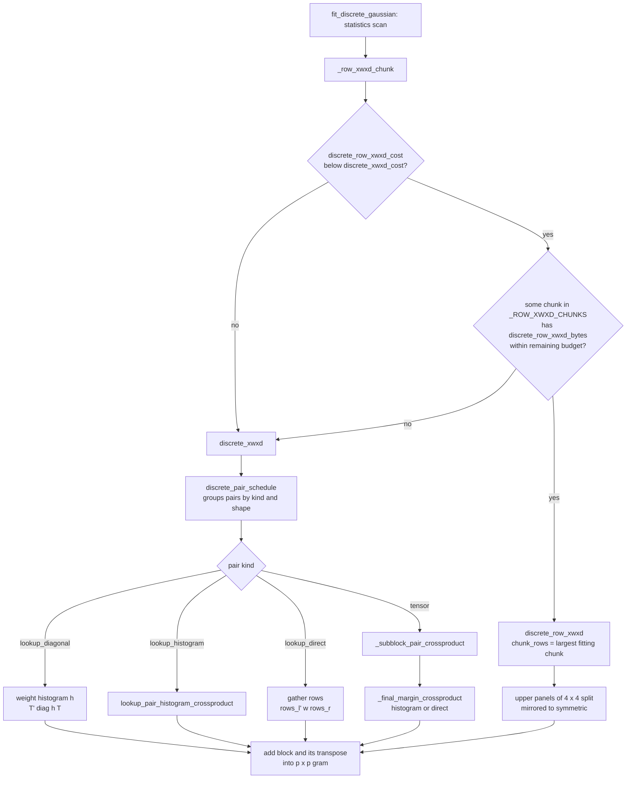
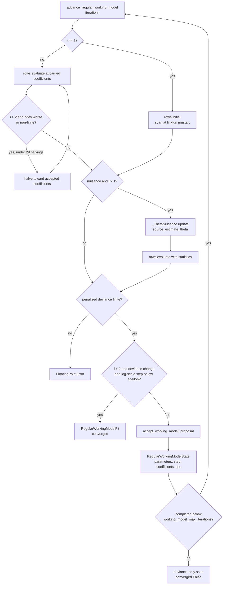
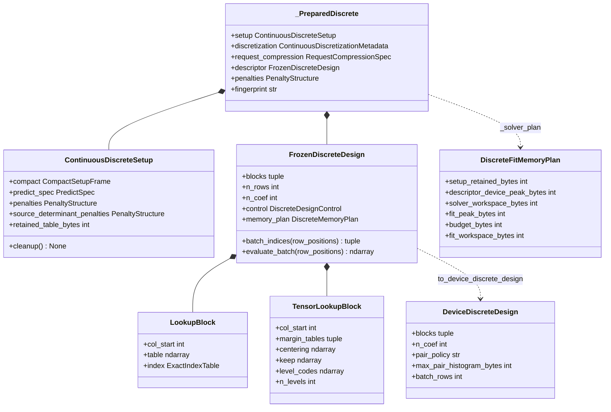
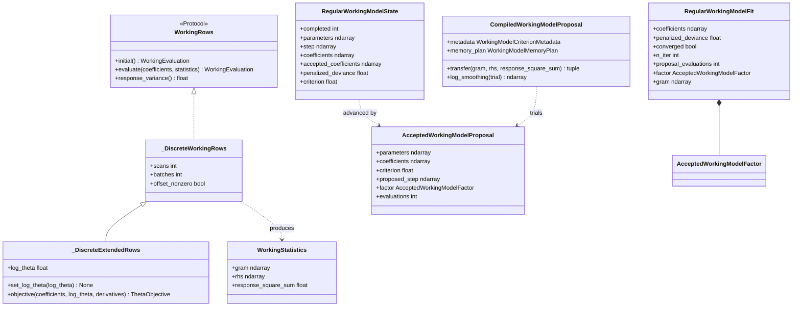

# Phase 2: the discretized fit

## Scope

This page covers `FitControl(execution="discrete")`, the JaxGAM analogue of
`mgcv::bam(discrete=TRUE)`. It describes how the compact discretized design is
acted on without an n-by-p model matrix, how the shared prepared problem is
built and budgeted, the additive Gaussian fit, the performance iteration for
regular families and the negative binomial (a port of `bgam.fitd` in mgcv's
`R/bam.r`), and the working-model REML proposal (a port of `Sl.fitChol` in
`R/fast-REML.r`). How the compact frame and its selectors are chosen belongs
to [setup](setup.md) and [data sources](data_sources.md); the result class
and predictor are in [results and prediction](results_and_prediction.md).

## Where the code is

| Module | Role |
|---|---|
| `jaxgam/api.py` (`GAM._fit_discrete`) | Route entry: refusals, family admission, dispatch to the Gaussian or regular driver, result construction. |
| `jaxgam/execution/discrete/gaussian.py` | Shared prepared problem (`_prepared_discrete`), fit memory plan, the additive Gaussian driver (`fit_discrete_gaussian`), fixed-sp REML score and scale iteration, `DiscreteFit`. |
| `jaxgam/execution/discrete/regular.py` | Regular-family and negative-binomial driver (`fit_discrete_regular`): source-scanning working rows, theta nuisance, budget and compile, final fields. |
| `jaxgam/execution/discrete/regular_working_model.py` | Host port of `bgam.fitd`'s outer loop for non-additive families: coefficient step control, convergence test, iteration trace. |
| `jaxgam/execution/discrete/working_model.py` | Host trial control around one `Sl.fitChol` proposal: the host pivoted-Cholesky boundary, `Nstep` halving, the frozen-statistic Gaussian controller, compile-time memory measurement. |
| `jaxgam/execution/discrete/working_theta.py` | Host port of `estimate.theta` (mgcv `R/efam.r`) for one log theta, each objective one source scan. |
| `jaxgam/fitting/discrete/ops.py` | JIT kernels for the indexed design: forward, transpose, `X'WX`, `X'Wy`, `diag(X V X')`, and their cost and scratch models. |
| `jaxgam/fitting/discrete/working.py` | JIT per-batch working statistics: Fisher weights and pseudodata, NB `dDeta` weights, `estimate.theta` row terms. |
| `jaxgam/fitting/discrete/working_model.py` | JIT kernels of the `Sl.fitChol` proposal: reparameterization, factor inputs, REML value, gradient, Hessian, Newton step, `H^-1`. |
| `jaxgam/fitting/penalty_ops.py` | Device-side local penalty algebra (`JaxPenaltyStructure`, stacked groups) used by the proposal kernels. |
| `jaxgam/formula/discrete/continuous_setup.py` | Phase 1: ordinary basis setup on the compact frame (`build_continuous_discrete_setup`). |
| `jaxgam/formula/discrete/continuous_design.py` | Phase 1: evaluates the frozen bases on compact representatives into lookup tables (`build_continuous_discrete_design`). |
| `jaxgam/formula/discrete/design.py` | Phase 1: descriptor types (`FrozenDiscreteDesign`, `LookupBlock`, `TensorLookupBlock`) and the per-batch memory plan (`_memory_plan`). |
| `jaxgam/formula/discrete/continuous_metadata.py` | Phase 1: the row-free record of the fitted discretization and the `predict.bamd` request grouping. |
| `jaxgam/formula/kernel_groups.py` | Pair schedule and `pair_reduction_plan` (histogram or direct rows). |
| `jaxgam/smooths/source_lapack.py` | The pinned DPSTRF (`source_pivoted_cholesky`) used by every working-model trial. |

The Phase 1 modules import no JAX. The outer iterations of this route are host
Python loops in `jaxgam/execution/`; only the per-batch kernels and the
per-trial proposal kernels are JIT-compiled.

A planned refactor will fold this route's controller into a shared engine; see
[the unified fit design](../unify_fit/design.md).

## How it works

### Entry and admission

`GAM._fit_discrete` runs every refusal before the formula is parsed: the data
must be a `RowSource`; `weights=` and `offset=` must come from the source;
`result` must be `"prediction"`; `linear_solver` must be `"cholesky"`; without
`sp` the control must name `smoothing_strategy="working_model_reml"`, and
`optimizer` must be `"newton"`. The family is then admitted by its execution
capabilities: canonical Gaussian identity goes to `fit_discrete_gaussian`;
families with `regular_performance_iteration` or
`extended_performance_iteration` go to `fit_discrete_regular`. A
`gaussian_compression=True` request is not refused; the result reports it in
`execution_fallback_reason`. The whole fit runs inside
`single_fit_fingerprints()`, so the source is content-hashed when the fit starts
and ends rather than around every scan.

### The compact design

Discretization replaces each group of covariates (a multi-variable `s()`, a
tensor margin, a `by` variable, a parametric covariate) by a small table of
unique, possibly rounded, rows plus one integer selector per observation
(the `ExactIndexTable` built by the data layer). The basis is constructed once,
on the compact rows. The fit then never holds an n-by-p matrix: every term is a
lookup block whose design rows are `table[selector]`.

`FrozenDiscreteDesign` (in `jaxgam/formula/discrete/design.py`) holds:

- `LookupBlock`: one constrained table (`q` unique rows by `k` columns) and its
  selector, for an ordinary smooth or parametric block.
- `TensorLookupBlock`: one table per margin, an optional `centering` transform,
  the retained columns `keep`, and optionally a numeric `by` multiplier table
  or a factor `by` with `level_codes` and `n_levels`. A single margin
  represents an ordinary smooth whose `by` variable stays a separate indexed
  multiplier.

`batch_indices(row_positions)` gathers one host batch of selectors, one per
distinct index table, for the next JIT dispatch. `evaluate_batch` is a CPU
oracle that materializes the batch rows; tests use it, the fit does not.

### Indexed design operators

`to_device_discrete_design` copies the compact tables, transforms, multipliers
and level codes to the device as a `DeviceDiscreteDesign` (with
`DeviceLookupBlock` and `DeviceTensorLookupBlock`). Selectors are never
transferred as a whole: each batch's selectors are passed into each kernel
call, and `_validate_device_batch` refuses a batch larger than the descriptor's
`batch_rows`.

The kernels port the linear algebra of mgcv's `Xbd`, `XWyd`, `XWXd` and
`diagXVXd` helpers (mgcv `R/misc.r`, C in `src/discrete.c`):

- `discrete_xbd(design, selectors, beta)`: for a lookup block,
  `(table @ beta_block)[selector]`, so the product is formed on the `q`
  compact rows and gathered; a tensor block maps its coefficients through the
  frozen constraint transform and contracts them with each margin's selected
  rows in turn (`_tensor_matvec`), never forming batch-by-tensor rows, with a
  separate path for factor `by`.
- `discrete_xb_transpose(design, selectors, values)`: scatter-adds `values` into
  a length-`q` vector per block and multiplies by `table.T`.
- `discrete_xwyd` is `discrete_xb_transpose(design, selectors, w * y)`.
- `discrete_xwxd` accumulates `X'WX` block pair by block pair (next section).
- `discrete_row_xwxd` is an alternative `X'WX` that materializes row chunks.
- `discrete_diag_xvxd` gives `diag(X V X')` for a supplied covariance.

#### How X'WX is accumulated

`discrete_xwxd` builds a host schedule with `discrete_pair_schedule`
(`jaxgam/formula/kernel_groups.py`) over all block pairs `(l, r)` with
`r >= l`, groups pairs by reduction kind and block shape, and runs one
`lax.scan` per group, so the compiled graph grows with the number of distinct
shapes rather than the number of smooth pairs. Each pair is reduced by
`_pair_part` in one of four ways:

- `lookup_diagonal` (a lookup block with itself): scatter the weights into a
  length-`q` histogram `h`, then `T' diag(h) T`.
- `lookup_histogram` (two lookup blocks): scatter weights into a
  `q_left` by `q_right` histogram `C`, then `T_l' C T_r`
  (`lookup_pair_histogram_crossproduct`).
- `lookup_direct` (two lookup blocks, histogram not chosen): gather both
  blocks' rows and form `rows_l' (w * rows_r)`.
- `tensor` (either block a tensor): `_subblock_pair_crossproduct` loops over the
  combinations of the leading margins and reduces only the final-margin pair by
  histogram or direct rows (`_final_margin_crossproduct`), then maps the result
  through the block's constraint transform. This is the final-margin reuse of
  mgcv's `XWXijs`.

`pair_reduction_plan` chooses the histogram only when the policy is
`"histogram_or_direct"`, the `q_left * q_right * 8` histogram bytes fit
`max_pair_histogram_bytes`, and they are no larger than gathering the batch rows
(`n_rows * (k_left + k_right) * 8`). With `pair_policy="direct_only"` every
lookup pair uses direct rows.

The row-chunk path `discrete_row_xwxd(..., chunk_rows=c)` expands `c` rows at a
time into a dense `c` by `p` matrix (lookup tables gathered per equal-shape
group, tensor blocks by their row product), forms only the upper panels of a
4 by 4 panel split (`_ROW_XWXD_PANELS`) and mirrors them, so the result is
exactly symmetric. Rows past the batch are padded with weight zero. It equals
the pair reductions up to rounding (`tests/test_fitting/test_stacked_kernels.py`).

The choice is made once per fit by `_row_xwxd_chunk` in
`jaxgam/execution/discrete/gaussian.py`:

1. Compare the flop-equivalent estimates `discrete_row_xwxd_cost(p, batch_rows)`
   (`n p^2` matrix-product work) and `discrete_xwxd_cost(design, batch_rows)`
   (per pair: a row touch charged `_ROW_TOUCH_FLOPS = 1000` flops, plus the
   histogram or direct-row work). If row chunks are not cheaper, use the pair
   kernels. Row chunks win for many smooths against few coefficients; a few
   wide blocks, such as a random effect with many levels, keep the pair kernels.
2. Otherwise take the largest chunk in `_ROW_XWXD_CHUNKS = (2048, 1024, 512,
   256, 128, 64)` whose scratch `discrete_row_xwxd_bytes(p, c) =
   8 * (3 * c * p + 2 * p * p)` fits the budget left after the fit plan
   (`memory_budget_bytes - fit_peak_bytes`). If none fits, use the pair kernels.

The row-chunk kernel is used only in the statistics scan of the additive
Gaussian fit. The regular-family kernels in `jaxgam/fitting/discrete/working.py`
always call `discrete_xwxd`.



Read it top to bottom: the chunk decision is taken once per fit; inside
`discrete_xwxd` each scheduled pair group runs one scan whose pair kind was
fixed on the host by `pair_reduction_plan`.

### The shared prepared problem

Every discrete fit enters `_prepared_discrete(spec, source, control)`, a
context manager that yields a `_PreparedDiscrete` and always calls
`setup.cleanup()` on exit, which releases the compact selectors (including any
memmap files under `selector_memmap_directory`). In order:

1. `_reject_unsupported_formula` refuses a multi-variable `s(..., bs="re")`:
   pinned `bam` discretizes each of its variables as a separate tensor margin,
   which the compact setup does not reproduce.
2. `build_continuous_discrete_setup` builds the compact frame
   (`build_compact_setup_frame` in `jaxgam/data/continuous_frame.py`), checks
   the prospective basis bytes plus retained compact tables against
   `DiscretizationBudget.max_table_bytes`, runs `ModelSetup.build` on the
   compact frame with `source_penalty_coordinates=True`, and freezes a
   `PredictSpec`, the `PenaltyStructure` and the separate
   `source_determinant_penalties`. The compact training matrix is discarded.
   A budget failure comes back as `ContinuousSetupUnavailable` and is raised as
   `MemoryError`.
3. `build_discretization_metadata` copies a bounded, row-free record of every
   group (policy, whether it was rounded, grid, ranges, compact row count, and
   representatives only up to `max_retained_representatives`).
   `build_request_compression` adds the fitted grouping when the effective
   prediction policy is `"mgcv_predict_bamd"`.
4. `build_continuous_discrete_design` evaluates each term's frozen basis on its
   compact representatives into lookup tables, with no source scan. It checks
   retained tables against `max_table_bytes`, retained selectors against
   `max_selector_bytes`, each term's evaluation temporaries, and finally
   `max(host_batch_bytes, device_action_bytes)` from `_memory_plan` against
   `max_batch_bytes`. A failure is a `DiscreteDesignUnavailable`, raised as
   `MemoryError`.

#### Memory planning

The descriptor's `DiscreteMemoryPlan` bounds one action batch: host selector
gathering, and on the device the retained tables plus the largest of the
`Xbd`, adjoint, `XWXd` (including the largest pair reduction) and `diagXVXd`
workspaces. Pairs are charged sequentially, not as if all coexisted.

The driver then builds a `DiscreteFitMemoryPlan`. `_solver_plan` (Gaussian)
and `_regular_solver_plan` (regular and NB) add a solver workspace: a fixed
count of p-by-p matrices (more when `uncertainty="covariance"`), explicit
materializations of non-dense local penalties, and a per-row workspace of
`batch_rows` times a fixed count of float64 vectors (the NB route adds the
`estimate.theta` row vectors and long-double accumulators). `fit_peak_bytes`
is the retained compact setup plus descriptor host and selector bytes plus the
descriptor device peak plus the solver workspace; `_check_fit_budget` raises
`MemoryError` when it exceeds `FitControl.memory_budget_bytes`, before any
device transfer. The working-model compile step later adds its measured
workspace to the same plan. The result reports `fit_peak_bytes`, the budget,
and `known_workspace_bytes` (the plan's `fit_workspace_bytes`, which excludes
the retained compact setup).

### The additive Gaussian fit

`fit_discrete_gaussian` (also reached as `fit_fixed_sp_discrete_gaussian`)
makes exactly two fitting scans:

1. **Statistics scan.** For each batch it validates finite inputs and
   nonnegative weights (padded invalid rows are refused), gathers selectors,
   and accumulates `X'WX` (pair kernels or row chunks) and `X'W(y - offset)`;
   for the working model also `sum(w (y - offset)^2)`. `CenteredMoments`
   merges batch moments of unweighted `y` around the first value, because R
   initializes the scale from `var(y)`.
2. **Solve.** With an explicit `sp`, the host forms `H = sym(X'WX) + S_lambda`,
   factors it with NumPy Cholesky (a non-positive-definite `H` raises
   `LinAlgError`: rank-deficient QR fitting is not implemented on this route)
   and solves for beta. Without `sp`, `fit_gaussian_working_model_statistics`
   runs the frozen-statistic working model (below), with no further row scans.
3. **Residual scan.** The deviance is the direct sum of `w (y - X beta -
   offset)^2` over a second scan, which is stable for nearly exact fits where
   `y'Wy - beta'X'Wy` would cancel.

EDF is `tr(H^-1 X'WX)`. For fixed `sp`, `_pinned_fixed_scale` ports
`bgam.fitd`'s damped log-scale Newton sequence (hard-coded tolerance 1e-7 and
200 iterations, starting at `log(var(y) * 0.05)`) and `_reml_score` evaluates
the criterion, with `log|S|+` from `_log_pdet` on setup-owned structural range
spaces (a port of `Sl.setup` plus `ldetS`; coupled blocks use SciPy's
`dpstrf` in `_pivoted_cholesky_root` and `_positive_logdet`). The null
dimension in the normalization is `_pinned_criterion_null_dimension`, which
reproduces `bgam.fitd`'s final `Mp` reset. A fixed-sp Gaussian fit always
reports `converged=True`.

### The regular-family and negative-binomial fits

`fit_discrete_regular` enters `regular_working_components`, which prepares the
problem, budgets `_regular_solver_plan`, compiles the proposal
(`compile_working_model_proposal`), transfers the design and builds a
`RegularWorkingComponents` bundle:

- `rows`: a `_DiscreteWorkingRows` (or `_DiscreteExtendedRows` for the NB).
  Every call is one complete source scan. `initial()` evaluates at `eta =
  linkfun(mustart)` from the family initializer; `evaluate(beta,
  statistics=...)` evaluates at `X beta + offset`. Each batch runs a JIT kernel
  from `jaxgam/fitting/discrete/working.py` and returns per-row deviance plus,
  when requested, `X'WX`, `X'Wz` and `sum(w z^2)`. Per-row deviances are reduced
  on the host by `source_sum`, R's left-to-right long-double `sum`, because
  step-control decisions compare two such sums near convergence.
- `propose`: transfers each iteration's statistics to the device once
  (`CompiledWorkingModelProposal.transfer`) and evaluates trials on them.
- `penalty`: `source_penalty_quadratic`, `b'Sb` in the `Sl.setup` coordinates,
  so a very large smoothing parameter cannot cancel against null-space
  coefficients.
- `start`: iteration one's free parameters, `initial.sp` from the diagonal of
  the iteration-one `X'WX` (`initial_log_sp_from_diagonal`) when smoothing is
  selected, then `log(var(y) * 0.05)` when the scale is estimated.
- `nuisance`: `_ThetaNuisance` for an NB with estimated theta.

The working model is `bgam.fitd`'s, not the dense route's `gam.fit3`:

- Regular families use Fisher weights and pseudodata
  (`_fisher_working_quantities`): `w = prior * mu.eta^2 / V(mu)`,
  `z = (eta - offset) + (y - mu) / mu.eta`, with a zero `mu.eta` replaced by
  0.1 before both are formed; no observed-curvature split, weight clipping or
  row filtering, and no `validmu`/`valideta` check.
- The NB uses `bgam.fitd`'s `dDeta` Newton weights at the current theta
  (`discrete_extended_working_batch`, family method `source_newton_working`).
- The scale is fixed at one for Poisson and Binomial; for Gamma it is a
  working-model parameter `log.phi`.

#### The performance iteration

`fit_regular_working_model` loops `advance_regular_working_model` until
convergence or `working_model_max_iterations`. One outer iteration:

1. **Iteration one** scans at `linkfun(mustart)`; there are no coefficients
   yet.
2. **Iteration two** scans at the first proposal's coefficients with no step
   control. A non-finite deviance raises `FloatingPointError("Non-finite
   working-model deviance at iteration 2.")`, which is where pinned `bam`
   also stops.
3. **From iteration three** the step is halved toward the previous accepted
   coefficients (`coef0 / 2 + coef / 2`) while the penalized deviance
   `dev + b'Sb` exceeds the accepted one or is non-finite, at most 29 times
   (`_MAX_COEFFICIENT_TRIALS = 30`, R's `kk < 30`). Each trial's relative margin
   is kept in `RegularWorkingModelIteration.step_control_margins`.
4. With an estimated theta (NB), `dev0` is first re-evaluated at the current
   theta, trial scans compute deviance only, then `estimate.theta` runs at the
   step-controlled coefficients (from iteration two), and one more scan forms
   the statistics with the new theta. Without a nuisance, an accepted trial's
   scan already formed the statistics, so it costs one scan.
5. **Convergence test**, before any proposal: from iteration three, stop when
   `|pdev - pdev_old| / (0.1 + |pdev|) < working_model_epsilon` and, if the
   scale is estimated, the last log-scale step is below
   `epsilon * (|log phi| + 1)`.
6. **Proposal**: `accept_working_model_proposal` (below), then the next
   criterion `crit = (pdev / phi - log|S|+ + log|H|) / 2`.

After a converged iteration the final coefficients are its step-controlled
ones, paired with the previous proposal's factor and smoothing parameters; at
the iteration limit they are the last proposal's coefficients, whose deviance
needs one more deviance-only scan. In both cases the result keeps
`converged`, and `fit_discrete_regular` emits a `RuntimeWarning` when the limit
is reached. An explicit `sp` runs the same loop with every smoothing parameter
fixed: `Sl.fitChol` then updates only an estimated scale.



Each box that says "rows" is one complete source scan; everything else is
coefficient-space work on the host or in the proposal kernels.

#### Theta

`source_estimate_theta` in `jaxgam/execution/discrete/working_theta.py` ports
`estimate.theta` for one log theta with known scale: a Newton iteration on
`nll = sum(dev.resids)/2 - ls` at fixed `mu`, with the absolute value of a
non-positive Hessian (and a 1e-5 relative floor), a step capped at 4, halving
while the objective rises by more than `eps^0.75` relative (at most 25 times),
and convergence when `|g| <= 1e-7 (|nll| + 1)`. A step failure warns and keeps
the last theta. Each objective is `_DiscreteExtendedRows.objective`, one full
scan of `discrete_theta_batch`, so `source_scans` grows faster than the
iteration count for an estimated theta. A fixed theta
(`NegativeBinomial(theta, fixed=True)`) skips the nuisance.

### The working-model REML proposal

The proposal is shared by every family. It ports `Sl.fitChol`'s trial, not the
dense route's nested exact REML: the Gaussian controller passes frozen
`X'X`, `X'y`, `y'y`; the regular controller passes each iteration's Fisher
`X'WX`, `X'Wz`, `sum(w z^2)`.

**Reparameterization.** `WorkingModelCriterionMetadata.from_structure` builds
`Sl.setup`-style blocks (`build_working_penalty_blocks` in
`jaxgam/formula/discrete/working_penalties.py`): per block a coefficient transform,
local penalties declared diagonal when they are, and for coupled
multi-penalty blocks the projected roots used by the determinant. The
statistics are transformed once per set by `working_model_statistics`, the
block transform of `Sl.initial.repara`; trials reuse the transformed arrays.

**Pivoted Cholesky at a host boundary.** Each trial crosses the host once:

1. `working_model_factor_inputs` (JIT) forms `H = X'WX + S_lambda` in working
   coordinates, scales it by `d = sqrt(diag H)` as `t(A/d)/d`, and forms the
   scaled combined root products of each coupled penalty block.
2. `factor_working_model` factors each matrix on the host with
   `source_pivoted_cholesky`, R's `chol(pivot=TRUE)` (LAPACK DPSTRF) from the
   pinned `scipy-openblas32` wheel that matches the OpenBLAS 0.3.26 pinned R
   links, run single-threaded (`jaxgam/smooths/source_lapack.py`). The pivot
   order and rank decision are part of the criterion's arithmetic, so the
   provider is pinned to reproduce R's. The factor is a host operation with no
   derivatives.
3. `gaussian_working_model_proposal` (JIT) consumes the factors.

`exp(log sp)` is evaluated once per trial with the C library `exp`
(`source_exponentials`), as R does; `source_exp` and `source_log` serve the
same purpose in the controllers.

**Criterion and derivatives** (`_source_gaussian_state`): beta from the scaled
pivoted solve (`_source_cholesky_solve`, which pads dropped coordinates);
`log|H|` from the factor diagonal; `log|S|+` and its derivatives in closed form
for singleton blocks and from the host factors for coupled blocks; the
penalized residual `yy - sum(beta * f)`; and its first and second derivatives
in log smoothing parameters from `_source_ift_chol`, a port of `Sl.iftChol`
(the implicit-function-theorem solve `db/drho = -H^-1 S_j beta lambda_j`).
The value is `(pdev / phi - log|S|+ + log|H| + (n - M_p) log(2 pi phi)) / 2`;
when the scale is free, a log-phi coordinate is appended to the gradient and
Hessian. With `fixed_smoothing` only the log-phi coordinate stays free.

**Newton step on log smoothing parameters** (`_sl_newton_step`): coordinates
are active when `|g|` or `|H_ii|` exceeds the tolerance
`|crit| * sqrt(eps)`; the restricted Hessian's eigenvalues are made absolute and
floored at `max * sqrt(eps)`; the step `-V diag(1/|lambda|) V' g` is zeroed on
inactive coordinates and scaled so its largest entry is at most 4.

**Step control** (`accept_working_model_proposal`, `bgam.fitd`'s update loop):
the carried step `Nstep` from the previous proposal is tried from the current
parameters; it is accepted at once when it is empty or `max(Nstep) == 0`, and
otherwise halved while the directional derivative `sum(grad * Nstep)` exceeds
`pdev * 1e-7`. The accepted trial's own step becomes the next iteration's
`Nstep`. A non-finite proposal raises `FloatingPointError`.

**EDF and covariance.** `working_model_hessian_inverse` forms `H^-1` from the
accepted factor (dropped coordinates get zero rows and columns); the block
transforms map it back to public coordinates. EDF is `sum(H^-1 * X'WX')`, that
is `tr(H^-1 X'WX)`, pairing the last accepted proposal's factor with the last
iteration's `X'WX` as `bgam.fitd` does; `Vp = scale * H^-1` when
`uncertainty="covariance"`, and a `PivotedQRFisherFactor` plus transforms is
retained when `uncertainty="fisher"`.

**Compile-time memory.** `compile_working_model_proposal` first charges
`_prospective_memory` (metadata, statistics, state, trace) against the budget
left after the fit plan, then lowers and compiles the three kernels
(`working_model_statistics`, `working_model_factor_inputs`,
`gaussian_working_model_proposal`) and adds their measured
`memory_analysis()` temporaries and outputs (less aliases) plus the DPSTRF
workspace (`source_pivoted_cholesky_workspace_bound`). Either check raises
`MemoryError` before any proposal runs. A backend whose compiled
`memory_analysis()` is `None` is refused with `NotImplementedError`.

#### The Gaussian working-model controller

`fit_gaussian_working_model_statistics` starts from `initial.sp` on the diagonal
of `X'X` and `log(var(y) * 0.05)`, then loops
`advance_gaussian_working_model`: the penalized deviance at the top of an
iteration is `yy - beta'X'y` from the frozen statistics; the convergence test
(iteration above two, relative deviance change and log-scale step below
`working_model_epsilon`) precedes each proposal; then one
`accept_working_model_proposal`. The trace keeps accepted iterations only.

### Sequence of a discretized fit

```mermaid
sequenceDiagram
    participant API as GAM._fit_discrete
    participant Drv as fit_discrete_regular
    participant Prep as _prepared_discrete
    participant Comp as compile_working_model_proposal
    participant Rows as _DiscreteWorkingRows
    participant Loop as fit_regular_working_model
    participant Res as GAMPredictionResult
    API->>Drv: spec, RowSource, family, sp, control
    Drv->>Prep: enter context
    Prep->>Prep: build_continuous_discrete_setup
    Prep->>Prep: build_discretization_metadata
    Prep->>Prep: build_continuous_discrete_design
    Prep-->>Drv: _PreparedDiscrete
    Drv->>Drv: _regular_solver_plan and _check_fit_budget
    Drv->>Comp: penalties, n, remaining budget
    Comp-->>Drv: CompiledWorkingModelProposal
    Drv->>Rows: to_device_discrete_design
    Drv->>Loop: rows, propose, penalty, start
    loop each outer iteration
        Loop->>Rows: initial or evaluate, one source scan each
        Rows-->>Loop: WorkingEvaluation
        Loop->>Comp: trial parameters on transferred statistics
        Comp-->>Loop: GaussianWorkingModelProposal
    end
    Loop-->>Drv: RegularWorkingModelFit
    Drv->>Drv: RegularWorkingComponents.result
    Drv->>Prep: exit context, release selectors
    Drv-->>API: DiscreteFit
    API->>Res: _from_discrete
```

The additive Gaussian fit follows the same preparation and budget steps but
calls `fit_discrete_gaussian`: one statistics scan, then either a host Cholesky
solve or `fit_gaussian_working_model_statistics` with no further scans, then
one residual scan.

### What the result reports

`GAMPredictionResult._from_discrete` builds a row-free result:

- `execution_route="discrete"`, `discretization_strategy="mgcv_range_grid"`,
  `smoothing_strategy` and `lambda_strategy` (`"fixed"` or
  `"working_model_reml"`), `prediction_policy` and the `discretization` record.
- `execution_path`: `"jax_actions_numpy_solve"` (fixed-sp Gaussian),
  `"jax_actions_working_model_numpy_postestimation"` (selected Gaussian) or
  `"jax_actions_performance_iteration_numpy_postestimation"` (regular and NB).
- `n_iter` is the scale-iteration count for fixed-sp Gaussian and the outer
  iteration count otherwise; `convergence_info` names the strategy and counts.
- `working_model_proposal_evaluations`: proposal trials, including halved ones
  (zero for fixed-sp Gaussian, nonzero for fixed-sp regular fits).
- `source_scans` and `batches_scanned` count fit scans only, not setup.
- `fit_peak_bytes`, `fit_memory_budget_bytes`, `known_workspace_bytes`.
- `theta` for the NB only (its final fixed or estimated value).
- `score` is `bgam.fitd`'s criterion with the `Mp` reset; `edf_total` is
  `tr(H^-1 X'WX)`. The per-iteration trace is not copied to the result.

### Prediction policies

`ContinuousDiscretizationControl.prediction_policy` is recorded on the result
and the predictor. Both policies reuse the fitted knots, constraints and
transforms:

- `"continuous_frozen_basis"` (default): every new value is evaluated exactly
  by the frozen basis, so predictions never depend on the request or its
  batching.
- `"mgcv_predict_bamd"`: pinned `predict.bamd` semantics. A bounded pre-pass
  over the whole request (`jaxgam/data/continuous_request.py`) freezes each
  group's rounding decision and grid with `discrete.mf`'s default `m`; batches
  are then compressed elementwise. Results depend on the request's composition
  but not on batch boundaries. A model without smooth terms records
  `"continuous_frozen_basis"` and keeps the request in
  `discretization.requested_prediction_policy` (`effective_prediction_policy`).

Factor semantics are the same under both: a missing or unseen random-effect
level contributes zero.

## Key types



The prepared problem owns host descriptors; `to_device_discrete_design` makes
the device copy without selectors, and the fit plan combines the descriptor's
plan with the solver workspace.



`WorkingRows` is the only way the controller reaches rows; any provider that
implements it (tests use an explicit design) runs the identical controller.
`GaussianWorkingModelFit` and `WorkingModelState` in
`jaxgam/execution/discrete/working_model.py` play the roles of `RegularWorkingModelFit`
and `RegularWorkingModelState` for the frozen Gaussian controller.

## Rules and invariants

- **No n-row array is retained.** Rows are reached only by complete bounded
  source scans; finished batches are deleted before the next is built.
  `tests/test_execution/test_discrete.py`
  (`test_completed_fitting_scan_releases_batch_arrays_before_residual_scan`) and
  `tests/test_scaling_allocation_guards.py`
  (`test_source_routes_never_build_the_training_design`) enforce this.
- **Selectors stay on the host.** `to_device_discrete_design` transfers tables
  only; kernels refuse batches above `batch_rows`.
- **Budget before allocation.** The fit plan is checked before device transfer
  and the working-model workspace before any proposal
  (`test_fit_workspace_rejects_before_device_transfer`,
  `tests/test_execution/test_working_model.py`
  `test_gaussian_compiled_budget_rejects_before_proposal`,
  `tests/test_execution/test_regular_working_model.py`
  `test_budget_rejects_before_device_transfer`).
- **Source identity.** A changed fingerprint during or after a scan raises
  `RuntimeError`; row counts must match the declared `n_rows`.
- **R arithmetic is part of the port.** Deviance sums use `source_sum` (long
  double, row order); `exp` and `log` use the C library; the pivoted Cholesky
  is the pinned DPSTRF. Step-control ties near convergence depend on these
  (`tests/test_execution/test_regular_working_model.py`
  `test_source_sum_is_left_to_right_in_long_double`,
  `tests/test_execution/test_working_model.py`
  `test_source_exp_and_log_are_the_c_library_functions`).
- **Parity with pinned `bam`.** Fixed and selected fits are compared to
  `bam(discrete=TRUE)` in `tests/test_execution/test_discrete.py`,
  `tests/test_execution/test_discrete_regular.py`,
  `tests/test_execution/test_discrete_nb.py` and
  `tests/test_execution/test_working_model.py`;
  proposals at matched states in `tests/test_fitting/test_working_model.py`
  (`test_proposal_matches_pinned_sl_fitchol`); `estimate.theta` in
  `tests/test_execution/test_working_theta.py`; predictions in
  `tests/test_execution/test_discrete_prediction.py`; the indexed kernels against
  explicit designs and pinned R layouts in `tests/test_fitting/test_discrete_ops.py`.
- **Batch invariance.** Fits must not depend on `batch_rows`
  (`test_fit_is_batch_invariant_and_cleans_owned_selector_files`,
  `test_public_regular_fit_is_batch_invariant_and_pickles`).
- **The oracle hook is private.** `_oracle_replay_halvings` replays a recorded R
  step-control outcome at rounding-level ties for matched-state tests only;
  `GAM` never sets it (`test_oracle_replay_hook_is_unreachable_from_the_public_api`).
- **Phase 1 stays NumPy.** `jaxgam/formula/` modules used here import no JAX.

## Pitfalls

- `fit()` defaults to `result="full"`, which this route refuses; every call
  needs `result="prediction"`, and the result has no `summary()` or `plot()`.
- `working_model_reml` is `bgam.fitd`'s performance iteration, not the dense
  route's nested exact REML. In `tests/test_execution/test_discrete_regular.py`
  every comparison with pinned `bam` is STRICT except two documented flat
  smoothing-parameter vectors.
- Step-control decisions near convergence can be rounding-level ties whose
  outcome flips under a one-ulp perturbation even in R; matched-state tests
  replay R's outcome there through `_oracle_replay_halvings`.
- Iteration two has no step control and there is no `validmu` check, so a first
  proposal that leaves the family domain raises at iteration two, as pinned
  `bam` does (`test_domain_exit_without_step_control_stops_like_pinned_bam`).
- The fixed-sp Gaussian scale iteration hard-codes 1e-7 and 200; the
  `working_model_epsilon` and `working_model_max_iterations` controls do not
  apply to it, but they do govern fixed-sp regular fits.
- `source_scans` is not the iteration count: estimated theta adds one scan per
  `estimate.theta` objective.
- Because the basis is built on the compact rows, an `m` smaller than a smooth's
  `k` fails in basis construction with a message about unique data values.
- The default policy's table and batch budgets can be too small for radial
  smooths or many-level factors at scale; the errors are `MemoryError` naming
  the stage.
- The coefficients of a thin-plate smooth on a symmetric grid may differ from
  `bam`'s by a change of coordinates
  (`tests/test_execution/test_discrete_prediction.py`).
- A missing random-effect group predicts a zero contribution where pinned R gives
  `NA` (`test_random_effect_missing_and_unseen_levels_contribute_zero`).
- Memory bounds cover known arrays; native compiler and allocator memory are
  outside them.

## Where to change things

- **Admit a new family or link**: give the family the
  `regular_performance_iteration` or `extended_performance_iteration`
  capability (see [families, links and smooths](families_links_smooths.md)) and
  check `GAM._fit_discrete`'s admission; extended families also need the
  `source_*` row methods used in `jaxgam/fitting/discrete/working.py`.
- **Change how `X'WX` is reduced**: `_pair_part` and the schedule in
  `jaxgam/formula/kernel_groups.py`; keep `discrete_xwxd_cost` and the
  descriptor's `_memory_plan` in step with any new reduction.
- **Change the row-chunk choice**: `_row_xwxd_chunk` and `_ROW_XWXD_CHUNKS` in
  `jaxgam/execution/discrete/gaussian.py`, the cost constants in
  `jaxgam/fitting/discrete/ops.py`.
- **Change the proposal arithmetic**: `jaxgam/fitting/discrete/working_model.py`; rerun
  the matched-state R tests in `tests/test_fitting/test_working_model.py`.
- **Change step control or convergence**: `accept_working_model_proposal` and
  `advance_gaussian_working_model` in `jaxgam/execution/discrete/working_model.py`, and
  `advance_regular_working_model` in `jaxgam/execution/discrete/regular_working_model.py`.
- **Change memory accounting**: `_solver_plan`, `_regular_solver_plan`,
  `_prospective_memory` and `compile_working_model_proposal`.
- **Change what the result reports**: `DiscreteFit` and
  `GAMPredictionResult._from_discrete` in `jaxgam/results.py`.
