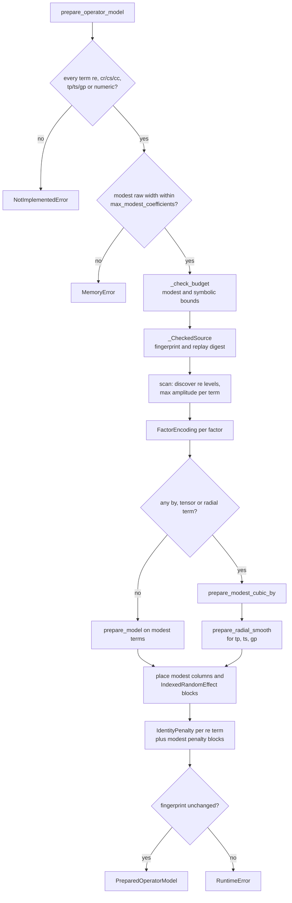
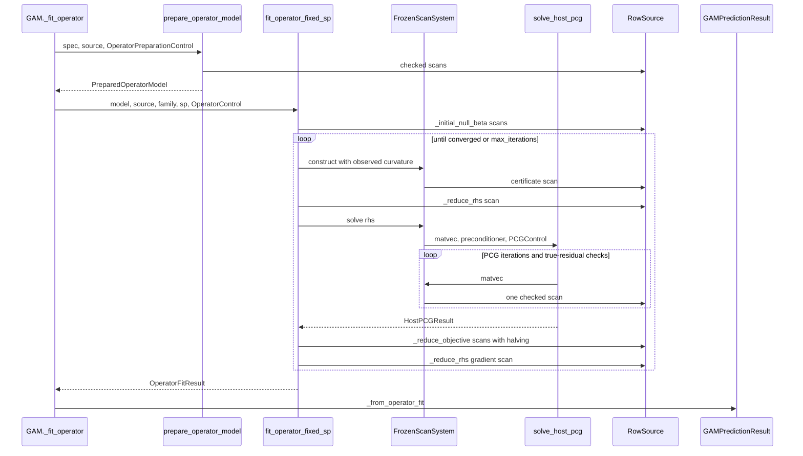
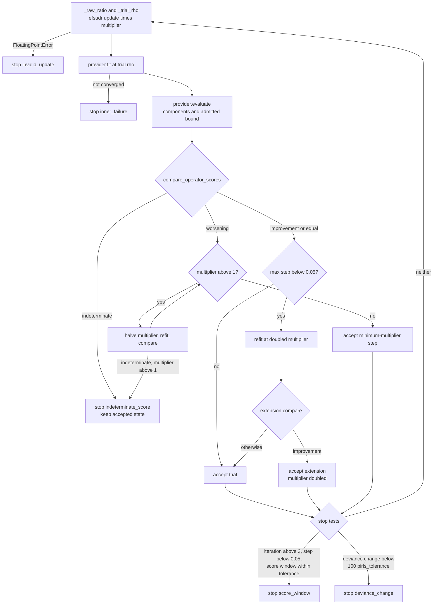
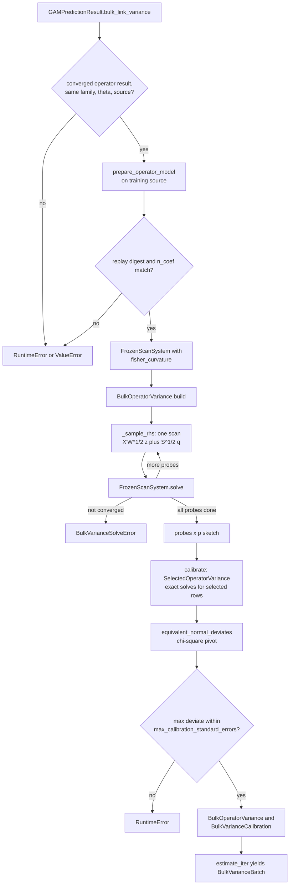
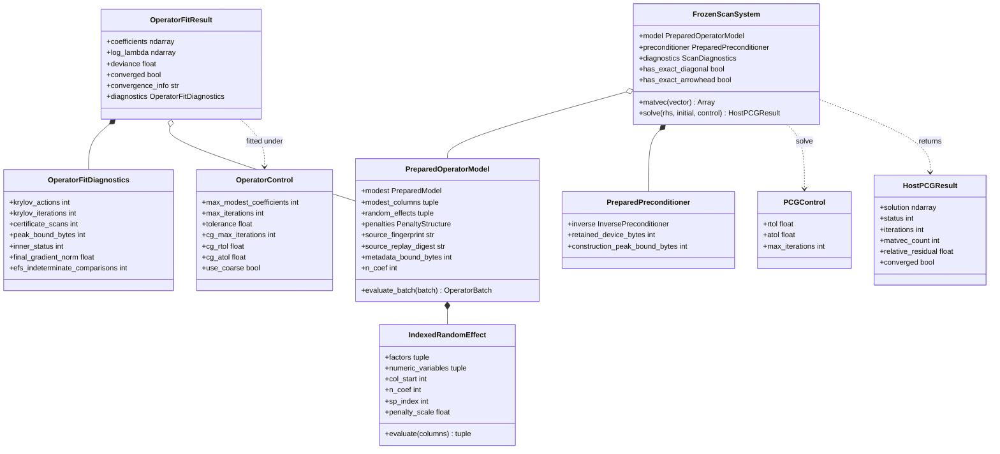

# Phase 2: the operator fit

## Scope

This page covers `FitControl(execution="operator", linear_solver="pcg")`:
matrix-free fitting for models whose random effects have too many levels for
a dense or discretized design. It describes how preparation bounds the model,
the matrix-free actions, the frozen system and its positive-definiteness
certificate, preconditioned conjugate gradients (PCG), the fixed-smoothing
coefficient driver, the operator Fellner-Schall (EFS) controller with its score
error bounds, score assembly, and the bulk link-scale variance. Routing into
the route is in [the fit lifecycle](fit_lifecycle.md); the dense EFS it is
compared with is in [the dense fit](fitting_dense.md).

## Where the code is

| Module | Role |
|---|---|
| `jaxgam/api.py` (`GAM._fit_operator`, `GAM._fit_operator_efs`) | Route entry: refusals, `sp` checks, preparation, fixed-sp fit or the EFS admission and budget split, result construction. |
| `jaxgam/formula/operator/prepare.py` | Phase 1: `prepare_operator_model`, `PreparedOperatorModel`, `IndexedRandomEffect`, `FactorEncoding`, `OperatorBatch`, and `_CheckedSource` (bounded, replay-hashed scans). |
| `jaxgam/formula/operator/modest.py` | Phase 1: rowless preparation of capped cubic, `by` and tensor terms (`prepare_modest_cubic_by`). |
| `jaxgam/formula/operator/radial.py` | Phase 1: rowless thin-plate and Gaussian-process setup with mgcv's knot harvesting (`prepare_radial_smooth`). |
| `jaxgam/formula/operator/workspace.py` | Phase 1: prospective evaluator workspace bounds for modest prediction (`predict_spec_evaluator_workspace_bound`). |
| `jaxgam/inference/operator_geometry.py` | Phase 3: `OperatorPredictionGeometry`, the retained prediction encoding (modest rows plus symbolic random effects). |
| `jaxgam/fitting/operator/actions.py` | JIT batch actions: `matvec_batch`, `rmatvec_batch`, `normal_matvec_batch`, donated accumulators, `penalty_matvec`. |
| `jaxgam/fitting/operator/family.py` | JIT family rows: observed (Newton) curvature and working response from AD of the deviance (`operator_family_rows`). |
| `jaxgam/fitting/operator/iterative.py` | JIT PCG recurrences and status codes (`initialize_pcg`, `advance_pcg`, `verify_pcg`); a resident `lax.while_loop` solver. |
| `jaxgam/fitting/operator/preconditioners.py` | Diagonal, small-block and coarse inverse preconditioners (`prepare_preconditioner`, `apply_preconditioner`). |
| `jaxgam/execution/operator/system.py` | `FrozenScanSystem` (certified `X'WX + S` replayed from the source), `PCGControl`, `solve_host_pcg`. |
| `jaxgam/execution/operator/fit.py` | Fixed-sp observed Newton driver `fit_operator_fixed_sp`, `FrozenOperatorWorkingState`, source null start, `OperatorFitDiagnostics`, `OperatorFitResult`. |
| `jaxgam/execution/operator/arrowhead.py` | Exact Schur algebra for one modest block plus one indexed identity block (`ExactArrowheadFactorization`). |
| `jaxgam/execution/operator/efs_controller.py` | Operator EFS policy (`_run_operator_efs`), calibrated domain, score envelopes and their admission, `SourceOperatorEFSFitProvider`. |
| `jaxgam/execution/operator/efs_provider.py` | Matched-state components at one fit: score rows, penalty determinant, observed log-determinant, Fisher traces, EDF (`MatchedOperatorEFSProvider`). |
| `jaxgam/execution/operator/efs_start.py` | Source `initial.spg` start for one indexed identity penalty (`prepare_indexed_operator_efs_start`). |
| `jaxgam/execution/operator/efs_trace.py` | Fisher traces `tr(H_F^-1 S_j)` and quadratics: structured, coordinate-solve and stochastic providers. |
| `jaxgam/execution/operator/logdet.py` | `log det(H)`: structured diagonal, structured arrowhead, or stochastic Lanczos quadrature (`FrozenOperatorLogDet`). |
| `jaxgam/execution/operator/penalty_determinant.py` | Local `log|S|+` and its log-sp gradient without a p-by-p array (`LocalOperatorPenaltyDeterminant`). |
| `jaxgam/execution/operator/score_rows.py` | One replay of direct deviance, `family$ls` and penalty quadratic at a frozen state (`MatchedOperatorScoreReducer`). |
| `jaxgam/execution/operator/score.py` | Score assembly (`assemble_operator_score`) and the bounded three-way comparison (`compare_operator_scores`). |
| `jaxgam/fitting/operator/efs_score.py` | JIT scalar REML formula `operator_reml_score`. |
| `jaxgam/execution/operator/variance.py` | Exact selected-row Fisher variances by one solve per row (`SelectedOperatorVariance`). |
| `jaxgam/execution/operator/bulk_variance.py` | Monte Carlo bulk Fisher variance and its chi-square calibration (`BulkOperatorVariance`). |

The PCG solver and the preconditioners are documented in code as new
algorithms, not mgcv ports. The Newton loop and the PCG driver are host Python
loops in `jaxgam/execution/`; only per-batch kernels and PCG recurrences are
JIT-compiled. `solve_resident_pcg`, the `lax.while_loop` solver in
`jaxgam/fitting/operator/iterative.py`, has no caller outside that module. The
The modules of `jaxgam/formula/operator/` import no JAX.

A planned refactor will move this route onto a shared engine; see
[the unified fit design](../unify_fit/design.md).

## How it works

### Entry and refusals

`GAM._fit_operator` refuses, before any source access: `linear_solver` other
than `"pcg"`; `result` other than `"prediction"`; `uncertainty` other than
`"none"`; `sp=None` unless `optimizer="efs"`; an estimated theta (use
`NegativeBinomial(theta, fixed=True)`) or more than one theta; a `device` other
than `None` or `"cpu"`. The data must be a `RowSource` that owns weights and
offset. With `sp=None` and `optimizer="efs"` it calls `_fit_operator_efs`;
otherwise it validates `sp` (length, real, positive, finite; a quick length
check before preparation when every smooth is a plain `s()` without `by`, and
the exact check against `penalties.n_penalties` after it), prepares the
model, and calls `fit_operator_fixed_sp`. A formula with no penalty still
needs `sp=[]`.

### Prepared geometry

`prepare_operator_model(spec, source, control=OperatorPreparationControl(...))`
splits the model into two parts and never builds an n-by-p matrix, a dense
random-effect design or a p-by-p penalty:

- **Indexed random effects** (`s(..., bs="re")`): an `IndexedRandomEffect`
  holds the term's factors (`FactorEncoding`, a frozen level tuple and lookup)
  and numeric variables. `evaluate(columns)` returns one level id and one
  amplitude per row: the id is the mixed-radix product of the factor codes,
  numeric variables multiply the amplitude (random slopes), and an unknown level
  or a non-finite amplitude contributes zero. The width is the product of the
  level counts. The penalty is one `IdentityPenalty(width, scale)` per term,
  with `scale` the squared largest absolute amplitude seen in training.
  Levels are a categorical's declared categories (unused ones included),
  otherwise the sorted observed values; a missing training level is an error.
- **Modest block**: intercept, numeric parametric terms and `s`/`te`/`ti`
  smooths with `cr`, `cs`, `cc`, `tp`, `ts`, `gp` bases (with numeric or factor
  `by`). Its raw width is capped by `OperatorControl.max_modest_coefficients`
  (default 64) before anything is built. Plain cubic terms go through the
  ordinary `prepare_model`; any `by`, tensor or radial term goes through
  `prepare_modest_cubic_by`, which calls `prepare_radial_smooth` for
  `tp`/`ts`/`gp` (knots harvested from bounded scans, mgcv's sampler run
  locally). A modest penalty block is copied into the global
  `PenaltyStructure` at its global columns.

Every scan runs through `_CheckedSource`, which checks positions, validity,
finite response, weights and offset, the column schema, and pickles and
SHA-256-hashes every row to prove identical replay (`source_replay_digest`),
charging each row's bound before serializing it. Memory is checked by
`_check_budget` at each stage; failures are `MemoryError` before allocation.
The result `PreparedOperatorModel` records `metadata_bound_bytes`,
`preparation_peak_bound_bytes` and preparation scan counts, and
`evaluate_batch` turns a `RowBatch` into an `OperatorBatch` (modest rows plus
`(ids, amplitudes, start, size)` per indexed term) under
`batch_workspace_bound`.

Every scan in this flow is a `_CheckedSource` scan; the replay digest from the
first complete scan is checked by every later scan in preparation and in the
fit.

### Matrix-free actions

`to_device_operator_batch` validates one `OperatorBatch` (finite modest values,
ids in range, non-overlapping coefficient intervals), charges its transfer,
and makes a `DeviceOperatorBatch` with `DeviceIndexedRows`. The kernels in
`jaxgam/fitting/operator/actions.py` follow `Xbd`/`XWyd`'s gather/reduce contract in
public coordinates:

- `matvec_batch`: `modest_values @ v[modest_columns]` plus, per indexed term,
  `amplitudes * v[start + ids]`.
- `rmatvec_batch`: scatter-add of `modest_values.T @ u` and of
  `amplitudes * u` into `start + ids`.
- `normal_matvec_batch` and `accumulate_normal_matvec_batch`: `X'W X v`, the
  latter adding into a donated p-vector across host batches so no extra
  p-vector is allocated per batch; `accumulate_rmatvec_batch` likewise for
  right-hand sides and gradients.
- `penalty_matvec`: `S_lambda v` from local penalty blocks
  (`penalty_ops.apply`, mgcv's `Sl.Sb` pattern).

`operator_family_rows` (`jaxgam/fitting/operator/family.py`) evaluates one
batch's family rows at `eta`: it takes the first and second derivatives of the
row deviance with JAX AD, giving `half_gradient = D'/2`, the observed curvature
`observed_weight = D''/2`, and the working response
`W (eta - offset) - D'/2` (the form pinned `gam.fit4` uses, which avoids
dividing by zero curvature). There is no Fisher substitution or curvature
clipping; it requires the family capabilities `row_separable`,
`observed_information`, `direct_deviance` and `differentiable_deviance`.

### The frozen system and its certificate

`FrozenScanSystem(model, source, log_sp, curvature_from_rows=..., memory_budget_bytes=..., use_coarse=...)`
represents `H = X'WX + S_lambda` at one frozen curvature. Construction:

1. Checks the construction bound (`65p + 288K^2 + 32pK` and further terms,
   where K is the modest width) and copies and freezes the modest metadata and
   penalties.
2. Weights the penalties with the C library `exp`. Each modest penalty must be
   positive semidefinite (`ValueError` otherwise); every other block must be a
   full-rank `IdentityPenalty` (`NotImplementedError` otherwise, though
   preparation never builds one).
3. One certificate scan accumulates the modest Gram matrix (also split into
   positive- and negative-curvature parts), the assembled diagonal, indexed
   off-diagonal bounds, the indexed-to-modest coupling (p by K), and a
   SHA-256 digest of the row curvature.
4. Certifies positive definiteness without forming H:
   - With no negative rows: `S_modest + G / (1 + t)` must have a Cholesky
     factor, where `t` is the trace of the indexed Gram relative to the
     indexed penalty (an upper bound on its spectral radius).
   - With negative rows and no indexed effect: `S_modest + G` itself must
     have a Cholesky factor.
   - With negative rows and indexed effects: first a Schur-complement test
     that replaces the indexed block by a lower bound on its diagonal
     (diagonal minus the off-diagonal bound), when that bound is positive;
     otherwise a leverage test (total negative-row
     leverage below one in a block lower-bound metric); otherwise a low-rank
     certificate for at most `_MAX_SIGNED_DOWNDATE_RANK = 8` independent
     negative directions; otherwise `LinAlgError("Actual signed system has no
     sufficient Schur SPD certificate.")`.
   - The data curvature must be positive definite on the modest penalty's null
     directions (`LinAlgError` otherwise).
   The certificate is sufficient, not necessary: a refusal does not prove H is
   indefinite (`tests/test_execution/test_operator.py`,
   `test_signed_certificate_cap_is_not_a_claim_of_indefiniteness`).
5. Builds the preconditioner (below), compiles the normal-action and penalty
   kernels, reads their measured scratch, and checks the action peak bound.

`matvec(v)` is one complete checked source scan: start from `S_lambda v`, add
each batch's `X'WXv`, and verify that the curvature digest is unchanged. Each
matvec, right-hand side and objective is therefore one full scan.

`has_exact_diagonal` (one indexed effect and nothing else) and
`has_exact_arrowhead` (one modest block of at most 64 columns coupled to one
indexed identity block) mark the structured shapes for which the
log-determinant and traces are computed exactly.

### Preconditioned conjugate gradients

`prepare_preconditioner` builds an `InversePreconditioner`: the reciprocal of
the assembled diagonal for every coordinate, a Cholesky-factored
`SmallBlockInverse` for the modest columns (`G + S_modest`), and with
`OperatorControl.use_coarse=True` an additive `CoarseInverse` on the modest
penalty-null directions. Large blocks retain only the diagonal; the
construction bound is `17p` plus the capped block terms.

`solve_host_pcg` (reached through `FrozenScanSystem.solve`) charges 14 float64
p-vectors plus the measured scratch of its four compiled kernels before
allocating, then iterates on the host with JIT steps from
`jaxgam/fitting/operator/iterative.py`. The threshold is
`max(atol, rtol * ||rhs||)`. A recursive residual below the threshold only
moves the state to `VERIFY_RESIDUAL`; convergence (`CONVERGED`) needs a fresh
true residual `rhs - H x` from another matvec, and a failed verification
restarts CG without resetting the iteration count. Other statuses are
`MAX_ITERATIONS`, `NONFINITE` and `NONPOSITIVE_CURVATURE`. Every matvec is
counted in `HostPCGResult.matvec_count`.

### The fixed-smoothing coefficient driver

`fit_operator_fixed_sp` is a host observed-Newton loop:

1. **Budget.** `fit_bound` (metadata, family snapshot, `80p` for retained
   vectors, extra terms for no-intercept layouts, `128 * max_iterations`) plus a
   row bound plus the measured scratch of the compiled family, forward and
   adjoint kernels must fit `memory_budget_bytes`; the remainder is the frozen
   system's budget.
2. **Start.** `_initial_null_beta` ports mgcv's `get.null.coef` for layouts it
   can prove: with an intercept, the intercept alone at
   `link(mean(initialized y))`; for no-intercept layouts, bounded source QR
   projections, some of which refuse with `NotImplementedError`. Unknown-scale
   families also reduce a null scale, used in the convergence test and
   reported as `initial_null_scale`.
3. **Each iteration** builds a `FrozenOperatorWorkingState` (iteration one at
   the family's `mustart`, later at the current beta), a `FrozenScanSystem` with
   its observed curvature, the right-hand side `X'(W(eta - offset) - D'/2)` by
   `_reduce_rhs`, and solves `H beta_new = rhs` by PCG. A failed PCG ends the
   loop with `converged=False` and the last accepted state.
4. **Gaussian identity** (`single_step_pirls`) is solved once and refined
   against its true residual up to `_STRICTLY_ADDITIVE_REFINEMENTS = 3` times,
   then accepted.
5. **Step halving**: while the penalized deviance `_reduce_objective`
   (direct row deviance plus `beta'S beta`, infinite outside the domain)
   exceeds the previous value plus a small allowance, halve toward the previous
   beta; after 100 halvings `RuntimeError`.
6. **Convergence**: relative objective change below `OperatorControl.tolerance`
   and `2 max|X'D'/2 + S beta| <= tolerance * (|objective| + null scale)`. At
   `max_iterations` the result is returned with `converged=False`.

Every arrow into the source is a complete, replay-checked scan, so the scan
count per Newton iteration is roughly one certificate, one right-hand side, one
per PCG matvec, at least one objective and one gradient.

`OperatorFitResult` carries coefficients, `log_lambda`, the model, the family
snapshot, deviance, `converged`, `n_iter`, `convergence_info` and
`OperatorFitDiagnostics`: source counters, `initialization_scans`,
`rhs_scans`, `objective_scans`, `certificate_scans`, `certificate_actions`,
`krylov_actions`, `krylov_iterations`, `completed_solves` (Newton solves only),
`peak_bound_bytes`, the three measured kernel temporaries,
`accepted_objectives`, `inner_status` (the last PCG status),
`final_gradient_norm`, `initial_null_scale`, the `preparation_*` counts,
`efs_indeterminate_comparisons`, and preconditioner sizes reported apart from
the peak. There is no PCG residual norm in the fit diagnostics.

`GAMPredictionResult._from_operator_fit` keeps an
`OperatorPredictionGeometry` in the predictor, `score=None`,
`edf_total=None`, no covariance, `scale=1.0` for known-scale families and
`None` otherwise, `lambda_strategy="fixed"`, `execution_route="operator"`,
and fit-only `source_scans` and `batches_scanned`.

### The arrowhead exact algebra

For `H = [[A, B'], [B, D]]` with a positive diagonal indexed block D,
`ExactArrowheadFactorization.from_system` replays one checked scan to recover
the coupling B (`FrozenScanSystem.exact_arrowhead_coupling`, which also checks
the curvature digest), forms the modest Schur complement `A - B' D^-1 B` and
factors it. It gives `log_determinant`, `inverse_diagonal`, `modest_inverse`,
and spectral lower and condition estimates in `O(pK + K^2)` storage. Its
floating result is conditional on the assembled H; it is not by itself a score
error bound.

### The operator Fellner-Schall controller

`_fit_operator_efs` admits only:

- Poisson with the log link;
- `batch_rows` from 64 to 65536 (checked before any scan);
- after preparation, exactly one indexed effect with `257 <= L <= 4096`
  levels and `L <= n_obs <= 16 L` (`CALIBRATED_OPERATOR_EFS_DOMAIN.admits`),
  plus at most `CALIBRATED_OPERATOR_EFS_MAX_MODEST = 4` modest columns, and no
  other coefficients;
- from the start provider, a factor-only effect with an identity penalty and
  unit weights and zero offset (`NotImplementedError` otherwise).

It splits `memory_budget_bytes`: one eighth for preparation and the start, a
quarter for each refit, half for the score components, and the rest less a
result reserve as the aggregate budget. `prepare_indexed_operator_efs_start`
replays the `initial.spg` working diagonal and balances one smoothing
parameter by factors of 10. `SourceOperatorEFSFitProvider` refits with
`fit_operator_fixed_sp` and evaluates states with
`MatchedOperatorEFSProvider`; `run_operator_efs_known_scale` runs
`_run_operator_efs`, which follows pinned `efsudr` (mgcv `R/gam.fit4.r`) for
known scale.

**Matched components** (`MatchedOperatorEFSProvider.evaluate`, all at one
beta, theta and rho, bound by `operator_efs_fit_fingerprint`):

- score rows: `MatchedOperatorScoreReducer.reduce`, one replay giving penalized
  deviance, the saturated log-likelihood term and diagnostics such as
  `unit_weights`, `zero_offset`, `maximum_response`, `maximum_row_l1_norm`;
- `log|S|+` and its gradient: `LocalOperatorPenaltyDeterminant`, with the range
  fixed by the unscaled local penalties;
- `log det H` on an observed-curvature system: `exact_structured_diagonal`
  (decimal logarithms with a rounding bound), `exact_structured_arrowhead`, or
  otherwise the stochastic `estimate` (Rademacher probes and Lanczos);
- Fisher traces `tr(H_F^-1 S_j)` and quadratics `beta'S_j beta` on a second
  system with Fisher curvature (`FrozenOperatorWorkingState.fisher_curvature`):
  structured for the diagonal and arrowhead shapes, else coordinate solves
  capped at 256 coordinates (`ExactOperatorPenaltyStatistics`);
- EDF `p - sum_j lambda_j tr(H_F^-1 S_j)`.

`assemble_operator_score` combines them with `operator_reml_score`:
`pdev / (2 phi) - ls + (log|H| - log|S|+) / 2 - M_p log(2 pi phi) / 2`, where
M_p is the penalty null dimension. The observed log-determinant is used, not
the Fisher one. For every shape `GAM.fit` admits, the determinant and traces are
structured, so no probes or Lanczos run; the `OperatorLogDetControl(probes=4,
lanczos_depth=4)` passed by `_fit_operator_efs` only sizes the output
reservation.

**Score bounds.** `admitted_operator_efs_score_bound` returns a bound and a
method label, `"indexed_poisson_empirical_v2"`,
`"arrowhead_poisson_empirical_v2"` (or `"indexed_gaussian_empirical_v2"`, whose
Gaussian runner `run_operator_efs_gaussian_scale` `GAM.fit` cannot reach), or
`(None, "unavailable")`. Each bound is the total of an `OperatorScoreEnvelope`:

- `arithmetic`: `32 * eps * (n + p) * M` (plus `K^2` for the arrowhead), where
  `M` sums the score's term magnitudes;
- `coefficient`: the effect of the final coefficient residual, from the final
  gradient and the identity-penalty floor (indexed) or the Schur spectral lower
  estimate (arrowhead);
- `determinant`: the structured log-determinant's rounding bound.

A state is admitted only inside the calibrated domain and with: unit weights,
zero offset, Poisson responses at most 32, converged PCG, `tolerance <= 1e-7`,
`cg_rtol <= 1e-10`, `cg_atol <= 1e-12`, final gradient at most 1e-5, all
`|beta| <= 20`, and conditioning gates (diagonal condition ratio at most 1e4
and minimum diagonal at least 1e-6 for the indexed shape; spectral lower
estimate at least 1e-3 and condition at most 1e5 for the arrowhead). The three
control thresholds equal the `OperatorControl` defaults, so loosening any one
leaves every comparison undecided. The code calls these empirical envelopes,
not certificates.

**Comparison.** `compare_operator_scores` requires identical probes and
strategy. With both bounds present and radius `r = bound_old + bound_trial`, the
trial is an `improvement` if `diff + r < 0`, `worsening` if `diff - r > 0`,
`equal` only if both `diff` and `r` are zero, and otherwise `indeterminate`; a
missing bound is always `indeterminate`. The paired standard error is reported
but never decides. Only a `stochastic_lanczos` score is refined (probes and
depth doubled up to 256 and 128); structured scores return `indeterminate`
directly.

**One outer iteration** of `_run_operator_efs`:

`_raw_ratio` is `efsudr`'s `max(0, exp(-rho) d - t) / max(0, q) * phi` (1 when
both numerator and `q` are zero, `1e6` when non-finite), and `_trial_rho`
clips at `EFSControl.log_lambda_max`. The first fit is at the start plus 2.5
on the log scale; if it does not converge the controller raises
`RuntimeError`. An undecided extension is declined and counted. The score
window (`_score_window_certified`) needs the last four accepted scores and
bounds, with every adjacent change plus both bounds below
`EFSControl.score_tolerance`. `score_window` and `deviance_change` are
converged outcomes, except that convergence on the last allowed outer iteration
is relabelled `iteration_limit`; `indeterminate_score`, `iteration_limit`,
`inner_failure` and `invalid_update` are not converged. No exception or warning
is raised for an indeterminate stop: the result has `converged=False`,
`convergence_info` set to the stop reason and
`operator_diagnostics.efs_indeterminate_comparisons`.

The EFS result adds `score`, `score_error_bound`, `score_bound_method`,
`edf_total`, `scale` and `score_scale` (1.0), `lambda_strategy="efs_reml"`,
`n_iter` as outer iterations, cumulative `source_scans`, and
`known_workspace_bytes`. Its `operator_diagnostics` describe only the accepted
state's refit.

**Calibration.** The domain and envelope constants were measured with
`scripts/benchmark_operator_efs_calibration.py` (`make
benchmark-operator-efs-calibration`) against an independent 50-digit decimal
REML reference (`tests/operator_efs_calibration.py`). The tests in
`tests/test_execution/test_operator_efs_calibrated.py` check that at domain
boundaries the matched-state score error stays inside the admitted bound, that
just outside the domain (or past a conditioning gate) the bound is refused, and
that the domain constants are the recorded ones; complete operator EFS fits
are compared with dense EFS. `tests/test_validation_matrix.py` compares
operator EFS for `y~x+s(g,bs='re')` with pinned R at STRICT, using tightened
EFS and operator controls.

### Uncertainty

Operator fits retain no covariance: `predict(se_fit=True)` raises and
`materialize_covariance` has no provider. The uncertainty path is
`GAMPredictionResult.bulk_link_variance(training_source, calibration_data, *,
probes, seed, memory_budget_bytes, control=None, scale=None,
max_calibration_standard_errors=5.0)`, which returns a
`(BulkOperatorVariance, BulkVarianceCalibration)` pair:

1. It requires a converged operator result, unchanged family and theta, and the
   original training source (row count and fingerprint). Known-scale families
   use their scale; others need `scale=`.
2. It re-runs `prepare_operator_model` on the training source (the replay
   digest must match), builds a `FrozenScanSystem` with Fisher curvature at the
   fitted coefficients and smoothing parameters, using half the budget, and
   `PCGControl()` defaults (`rtol=1e-10`, `atol=0`, 1000 iterations) unless
   `control` is passed. `FitControl.operator` is not consulted.
3. `BulkOperatorVariance.build` draws `probes` (at least 2) right-hand sides
   `b = X'W^(1/2) z + S^(1/2) q` (one scan each, local penalty blocks factored
   with null spaces preserved by `_penalty_noise`) and solves `H u = b` for
   each, keeping a probes-by-p sketch. Since `E[(x'u)^2] = x'H^-1 x`, the
   variance of a row is `scale * mean((x'u)^2)` with a Monte Carlo standard
   error. A failed probe solve raises `BulkVarianceSolveError`; no partial
   sketch is kept.
4. `calibrate(calibration_data)` solves exactly for at most
   `min(256, batch_rows)` selected rows with `SelectedOperatorVariance` (one PCG
   solve per row), and maps each row's pivot `probes * estimate / exact`, which
   is chi-square with `probes` degrees of freedom, to an equivalent standard
   normal deviate (`equivalent_normal_deviates`). `bulk_link_variance` raises
   `RuntimeError` when the largest absolute deviate exceeds
   `max_calibration_standard_errors`.
5. `estimate_iter(source)` then streams any prediction source in batches,
   yielding `BulkVarianceBatch(positions, variance, monte_carlo_se)` with a
   `link_se` property. Results are on the link scale only.

The calibration checks the selected rows only; it does not bound unselected
rows or the iterative-solve bias, which `BulkVarianceDiagnostics` reports
separately as `maximum_relative_residual`. `tests/test_execution/test_operator_bulk_variance.py`
compares the exact selected-row variances with pinned R's squared link-scale
standard errors at STRICT and checks that a biased sketch fails calibration.

The sketch is built once; calibration and streaming both read it, and neither
changes the probes.

### Memory bounds

Every stage checks a prospective bound before allocating and raises
`MemoryError`: preparation through `_check_budget` and per-row charges;
`fit_operator_fixed_sp` through `fit_bound` plus measured kernel scratch;
`FrozenScanSystem` through its construction and action peak bounds;
`solve_host_pcg` through 14 p-vectors plus measured scratch;
`prepare_preconditioner` through `17p` plus block terms; the EFS provider
through `reserve` on its aggregate budget. No p-by-p array is formed for the
indexed coefficients; the indexed width is not capped by
`max_modest_coefficients`. The reported byte figures (`peak_bound_bytes`,
`known_workspace_bytes`) are accounting bounds that exclude source storage and
native allocator or compiler memory.

## Key types

`PreparedOperatorModel` is the Phase 1 handoff; each Newton iteration builds a
new `FrozenScanSystem` over it; `OperatorFitResult` is the private row-free
handoff to the result builder. The EFS side adds `OperatorEFSState` (a fit,
its `MatchedOperatorEFSComponents`, `score_error_bound` and
`score_bound_method`) and `OperatorEFSControllerResult` (accepted state,
`converged`, `stop_reason`, counts and histories).

## Rules and invariants

- **No dense design, penalty or covariance.** The route never forms X, a p-by-p
  penalty or a covariance; `tests/test_execution/test_operator_fit.py` fails a
  fit that calls `PenaltyStructure.materialize`, and
  `tests/test_scaling_allocation_guards.py` checks that the dense design
  builder never sees the training rows.
- **Replay identity.** Every scan is checked against the preparation replay
  digest and every system action against its curvature digest
  (`tests/test_execution/test_operator.py`,
  `test_selected_repeated_lineage_and_frozen_curvature_replay`).
- **Certified SPD before PCG.** `solve_host_pcg` assumes the caller certified
  the system; sampled CG curvature does not certify it. Certificate failures
  raise from `GAM.fit` rather than returning `converged=False`.
- **Convergence needs a true residual** (`tests/test_fitting/test_iterative.py`,
  `test_recursive_residual_cannot_claim_convergence_and_false_candidate_restarts`).
- **Observed curvature, never Fisher, in the fit**; Fisher curvature only in the
  EFS traces and the bulk variance, each on its own frozen system.
- **Budgets before allocation**
  (`test_memory_preflight_rejects_before_source_scan_predictor_or_transfer`,
  `test_fit_combined_budget_rejects_before_initial_source_pass`,
  `tests/test_fitting/test_preconditioners.py`).
- **R parity.** Fixed-sp coefficients, deviance and fitted values are compared
  with pinned R for Gaussian, Poisson, Binomial, Gamma and fixed-theta NB links
  in `tests/test_execution/test_operator_fit.py`
  (`test_operator_observed_fixed_sp_fit_matches_pinned_family_reference`), and
  through `GAM.fit` in `tests/test_validation_matrix.py`.
- **EFS decisions only with admitted bounds**
  (`tests/test_execution/test_operator_score.py`,
  `test_common_probe_difference_reports_noise_but_waits_for_calibration`).
- **Phase 1 stays NumPy.** The modules of `jaxgam/formula/operator/` import no JAX.

## Pitfalls

- `fit()` defaults to `result="full"`; this route needs `result="prediction"`.
- `family="nb"` is an estimated theta and is refused; use
  `NegativeBinomial(theta, fixed=True)`.
- Loosening `OperatorControl.tolerance`, `cg_rtol` or `cg_atol` from their
  defaults removes every EFS bound, so an EFS fit ends `indeterminate_score`
  after one outer iteration with no warning. A Poisson response above 32 does
  the same.
- Non-unit weights, an offset, a penalized modest smooth or a random slope are
  hard `NotImplementedError` refusals under operator EFS (from the start
  provider), not indeterminate outcomes.
- Parametric terms must be numeric; a factor main effect is refused in
  preparation.
- A `gp` penalty can keep signed eigenvalues; a modest penalty with a negative
  eigenvalue is refused in `FrozenScanSystem`.
- No-intercept layouts depend on source null projections, several of which
  refuse with `NotImplementedError`.
- Scan counts are high: every matvec, right-hand side, objective and gradient
  re-reads and re-hashes every row.
- The fit and the result use different batch sizes on a small source. The
  prepared model carries the smaller of `FitControl.batch_rows` and the
  source's row count (`_operator_fit_batch_rows` in `jaxgam/api.py`), because
  the kernels pad every batch to that size and every bound charges it.
  `OperatorPredictionGeometry` keeps `FitControl.batch_rows`, so a prediction
  request may be larger than the training data.
- `PCGControl` is not exported from the top-level package; import it from
  `jaxgam/execution/operator/system.py`.

## Where to change things

- **Admit a new basis in the modest block**: `prepare_operator_model`'s term
  check and `jaxgam/formula/operator/modest.py` (or
  `jaxgam/formula/operator/radial.py`), plus its evaluator bound in
  `jaxgam/formula/operator/workspace.py`.
- **Change the actions**: `jaxgam/fitting/operator/actions.py`; keep
  `to_device_operator_batch`'s validation and charges in step.
- **Change the SPD certificate or preconditioner**: `FrozenScanSystem.__init__`
  in `jaxgam/execution/operator/system.py` and `jaxgam/fitting/operator/preconditioners.py`.
- **Change PCG**: `solve_host_pcg` and `jaxgam/fitting/operator/iterative.py`; keep the
  true-residual rule.
- **Change the Newton driver, start or step halving**: `fit_operator_fixed_sp`
  and `_initial_null_beta` in `jaxgam/execution/operator/fit.py`.
- **Widen operator EFS admission**: the domain, envelopes and
  `admitted_operator_efs_score_bound` in
  `jaxgam/execution/operator/efs_controller.py`, `_fit_operator_efs` in
  `jaxgam/api.py`, and the start provider; re-measure with
  `scripts/benchmark_operator_efs_calibration.py` and update
  `tests/test_execution/test_operator_efs_calibrated.py`.
- **Change score assembly**: `jaxgam/execution/operator/score.py` and
  `jaxgam/fitting/operator/efs_score.py`.
- **Change bulk variance**: `jaxgam/execution/operator/bulk_variance.py` and
  `GAMPredictionResult.bulk_link_variance` in `jaxgam/results.py`.
