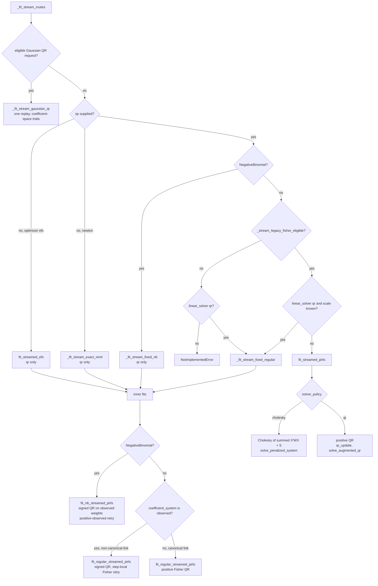
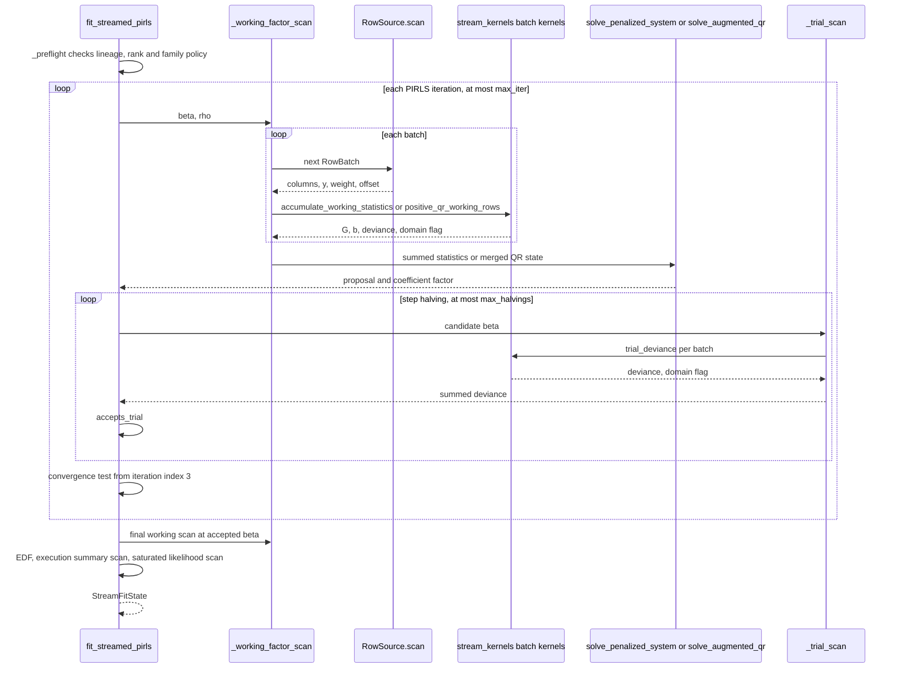
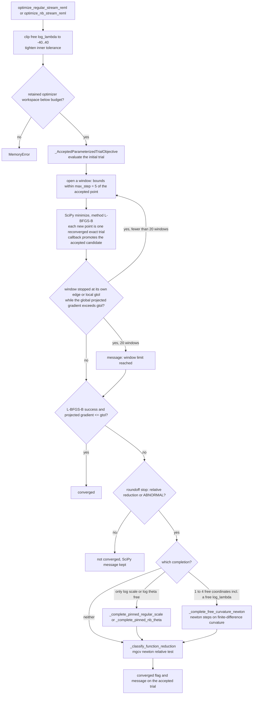
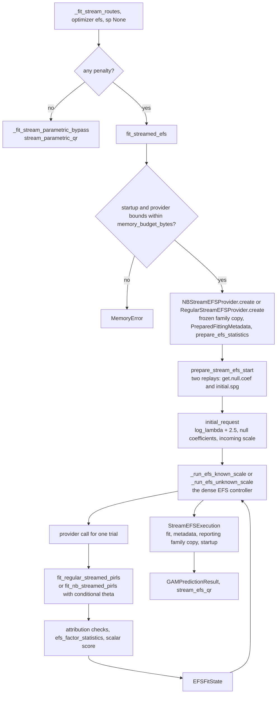
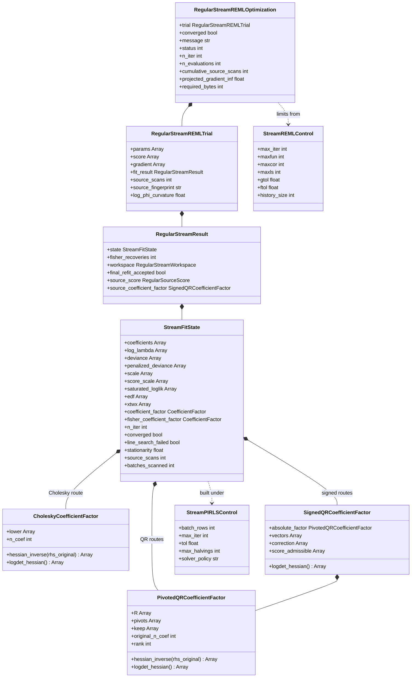
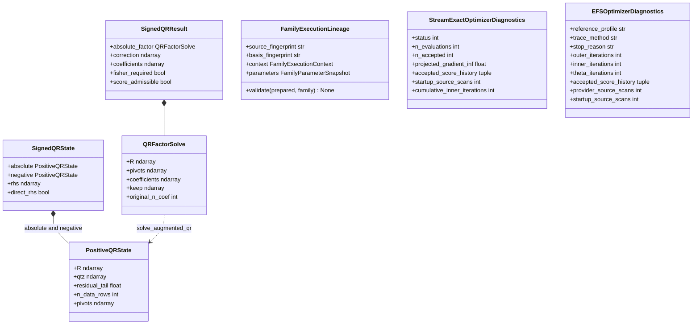

# Phase 2: the streamed fit

## Scope

This page covers `FitControl(execution="stream")`: fitting from a replayable
`RowSource` without ever holding the model matrix or any row-aligned array. It
describes the host drivers in `jaxgam/execution/` and the per-batch JAX kernels
in `jaxgam/fitting/` for fixed-`sp` PIRLS, the positive and signed QR solvers,
exact streamed REML with its L-BFGS-B optimizer, streamed negative-binomial
theta, streamed Fellner-Schall, and the scan accounting and memory checks
around them. Streamed setup (`prepare_model`) is on [the setup page](setup.md)
and the sources themselves on [the data sources page](data_sources.md).

## Where the code is

| Module | Role |
|---|---|
| `jaxgam/api.py` | `GAM._fit_stream`, `GAM._fit_stream_routes` and the module helpers `_fit_stream_fixed_regular`, `_fit_stream_fixed_nb`, `_fit_stream_exact_reml`, `_fit_stream_gaussian_qr`, `_fit_stream_parametric_bypass`, `_check_stream_fixed_family`, `_check_stream_efs_family`, `_preflight_stream_workspace`. |
| `jaxgam/execution/stream.py` | `fit_streamed_pirls`: fixed-sp PIRLS for families whose Fisher and observed information agree, by summed normal equations (Cholesky) or positive QR; `StreamPIRLSControl`; the shared scanners `_source_batches` and `_fitting_batches`. |
| `jaxgam/execution/regular_stream.py` | `fit_regular_streamed_pirls`: the `gam.fit3` port for Gaussian, Binomial, Poisson and Gamma with signed (observed-information) QR; `regular_working_scan`; `preflight_regular_stream_workspace`. |
| `jaxgam/execution/nb_stream.py` | `fit_nb_streamed_pirls`: the `gam.fit4` port for NB, optionally estimating theta inside the loop. |
| `jaxgam/execution/qr.py` | CPU packed-reflector QR reducer: `PositiveQRState`, `qr_update`, `reduce_positive_qr`, `solve_augmented_qr`, `structural_rank`. |
| `jaxgam/execution/signed_qr.py` | `SignedQRState`, `signed_qr_update`, `solve_signed_qr`: the negative-weight correction of mgcv's `pls_fit1` (`src/gdi.c`). |
| `jaxgam/execution/null_coefficient.py` | `project_null_coefficients`: mgcv's `get.null.coef` projection from QR statistics. |
| `jaxgam/execution/family_initialization.py` | `select_initial_working_state_cpu`: R-style start with up to 20 shrinks toward the null predictor, by replay. |
| `jaxgam/execution/reml.py` | Exact streamed REML: `evaluate_regular_stream_reml`, `optimize_regular_stream_reml`, the common L-BFGS-B driver `_run_parameterized_stream_reml`, `StreamREMLControl`, the mgcv `newton()` completions and relative test. |
| `jaxgam/execution/nb_reml.py` | `evaluate_nb_stream_reml`, `optimize_nb_stream_reml`: the same for NB with theta as a joint coordinate. |
| `jaxgam/execution/nb_theta_stream.py` | `conditional_theta_stream`: conditional theta Newton by replay, used inside streamed NB EFS fits. |
| `jaxgam/execution/efs_stream.py` | `fit_streamed_efs`: composes startup, provider and the shared EFS controller. |
| `jaxgam/execution/efs_stream_provider.py` | `RegularStreamEFSProvider`, `NBStreamEFSProvider`: `EFSFitProvider` implementations over a source. |
| `jaxgam/execution/efs_stream_start.py` | `prepare_stream_efs_start`, `prepare_stream_reml_start`: initial smoothing parameters and null coefficients by two replays. |
| `jaxgam/fitting/stream_kernels.py` | Per-batch jitted reductions for `fit_streamed_pirls`: `accumulate_working_statistics`, `positive_qr_working_rows`, `trial_deviance`, `saturated_loglik_reduction`, `solve_penalized_system`, `coefficient_stationarity`, `accepts_trial`. |
| `jaxgam/fitting/regular_stream.py` | `regular_trial_deviance`: the trial kernel of the regular controller. |
| `jaxgam/fitting/nb_stream_kernels.py` | NB batch working factors: `nb_working_batch`, `nb_positive_observed_retry`, `nb_working_statistics`. |
| `jaxgam/fitting/family_execution.py` | Family-generic batch primitives and the lineage objects `FamilyExecutionContext`, `FamilyExecutionLineage`, `FamilyExecutionParameters`. |
| `jaxgam/fitting/qr.py` | Jitted triangular actions on QR factors (`qr_root_inverse`, `qr_root_transpose_inverse`, `qr_hessian_inverse`). |
| `jaxgam/fitting/signed_qr.py` | `SignedQRCoefficientFactor`: actions and log-determinant of a signed factor. |
| `jaxgam/fitting/stream_reml.py` | Batch VJP kernels for the exact REML gradient: `regular_batch_statistics_vjp`, `regular_score_cotangents`. |
| `jaxgam/fitting/nb_stream_reml.py` | `nb_batch_statistics_vjp`: the NB batch derivative kernel. |
| `jaxgam/fitting/nb_theta_stream.py` | `nb_conditional_theta_batch`, `nb_conditional_theta_step`: batch terms of the conditional theta objective. |
| `jaxgam/fitting/state.py` | Observation-independent fit state: `StreamFitState`, the coefficient-factor classes, `EFSOptimizerDiagnostics`. |

## How it works

### Host drivers and batch kernels

Every streamed driver is a host Python loop over source scans. Inside a scan it
evaluates one batch's design with `PreparedModel.evaluate_fitting_batch`, moves
the batch with `jax.device_put`, calls one jitted kernel that returns only
coefficient-sized statistics (`p` or `p x p`), adds them to running totals and
calls `jax.block_until_ready` so at most one batch is in flight. The kernels in
`jaxgam/fitting/` do no file iteration; the drivers in `jaxgam/execution/` own
iteration, step control and every cross-batch reduction. QR reductions are not
JAX: `jaxgam/execution/qr.py` and `jaxgam/execution/signed_qr.py` merge row blocks with SciPy
(`linalg.qr` with pivoting, LAPACK `ormqr`) on the CPU, and the resulting
coefficient-sized factors are moved to the device for the jitted triangular
actions in `jaxgam/fitting/qr.py`.

The streamed routes use `PreparedFittingMetadata.from_prepared`
(`jaxgam/fitting/data.py`), not `FittingData`: the same penalty structure and
`log|S+|` metadata, but no design matrix, response, weights or offset.

### Entry and route choice

`GAM._fit_stream` rejects `linear_solver="pcg"`, data that is not a `RowSource`,
separate `weights`/`offset` arrays, and any `result` other than `"prediction"`.
It checks the family statically (`_check_stream_fixed_family`,
`_check_stream_efs_family`) and requires `linear_solver="qr"` for exact REML and
for EFS. It then opens `single_fit_fingerprints()` and calls
`_fit_stream_routes`, which runs `prepare_model` and wraps the result in a
`StreamDesign`. The route is then:

| Condition | Driver | `execution_route` | `lambda_strategy` |
|---|---|---|---|
| eligible `gaussian_compression=True` request | `_fit_stream_gaussian_qr` | `stream_gaussian_qr` | `newton_reml`, `lbfgs_reml` or `fixed` |
| `optimizer="efs"`, `sp=None`, no penalties | `_fit_stream_parametric_bypass` | `stream_parametric_qr` | `newton_reml` |
| `optimizer="efs"`, `sp=None` | `fit_streamed_efs` | `stream_efs_qr` | `efs_reml` |
| `sp=None`, no free parameter at all | fixed regular or NB fit | `stream_exact_reml_qr` | `exact_reml_no_parameters` |
| `sp=None` | `_fit_stream_exact_reml` | `stream_exact_reml_qr` | `exact_reml` |
| `sp` given, NB | `_fit_stream_fixed_nb` | `stream_qr` | `fixed` |
| `sp` given, other families, see the solver chart | `_fit_stream_fixed_regular` or `fit_streamed_pirls` | `stream_qr` or `stream` | `fixed` |

Read it from the top. `_stream_legacy_fisher_eligible` holds when the family
declares a Fisher coefficient system equal to observed information and a
reported scale of `known_one` or `gaussian_fisher_edf_deviance`: among the
built-in families that is Gaussian with identity link, Poisson with log and
Binomial with logit. Only those can use `linear_solver="cholesky"`, and only with
a fixed `sp`. Gaussian identity keeps `fit_streamed_pirls` under `"qr"` too;
Poisson log and Binomial logit with `"qr"` go to the regular controller. A
family's `coefficient_system` is `"fisher"` for canonical links and
`"observed"` otherwise (`ExponentialFamily.execution_capabilities`). For an
unknown-scale family with a fixed `sp` (Gamma, non-identity Gaussian),
`_fit_stream_fixed_regular` runs `optimize_regular_stream_reml` with
`pin_lambda=True`, so the log scale is still optimized; a fixed-`sp` NB with
estimated theta likewise runs `optimize_nb_stream_reml` with `pin_lambda=True`.

### Scanning, lineage and fingerprints

`_source_batches` in `jaxgam/execution/stream.py` is the one replay loop most
drivers share. Before the scan it validates the `FamilyExecutionLineage` and
compares `source.fingerprint()` with the fingerprint recorded at preparation;
for each batch it re-validates the lineage, requires a response, rejects padded
rows (`valid` all true) with `NotImplementedError`, and requires finite `y`,
weights and offset and nonnegative weights (`ValueError`); after the scan it
checks the fingerprint again and that the number of valid rows equals
`prepared.n_obs` (`RuntimeError` otherwise). `_fitting_batches` adds the
fitting-coordinate design of each batch and rejects non-finite design values.

`FamilyExecutionLineage.validate` (`jaxgam/fitting/family_execution.py`) fails
closed when the source or basis fingerprint, the family or link name, the
family's static configuration or its parameter snapshot changed since
preparation. It runs before every cached device dispatch because a compiled
executable can be reused without retracing, so trace-time checks alone would not
see a mutation.

`single_fit_fingerprints()` (`jaxgam/data/source.py`) makes those repeated
fingerprint calls cheap: inside the scope each in-memory source is hashed once,
and once more when the scope ends, which raises
`RuntimeError("RowSource changed during the fit")` if the data changed.

### Fixed-smoothing PIRLS: `fit_streamed_pirls`

Each inner loop box is one full replay of the source. One iteration is one
working scan plus at least one trial scan; the final state costs a further
working scan, an execution-summary scan and a saturated-likelihood scan.

Details:

- **Systems.** With `solver_policy="cholesky"`, `accumulate_working_statistics`
  sums `G = X'WX`, `b = X'Wz`, the deviance and a domain flag, and
  `solve_penalized_system` factors `G + S_lambda` with a plain Cholesky. A
  non-finite factor or proposal raises `LinAlgError`: no jitter is ever added.
  With `"qr"`, `positive_qr_working_rows` returns the weighted rows of each
  batch, `qr_update` merges them into a `PositiveQRState`, and
  `solve_augmented_qr` attaches the rho-scaled penalty roots (built once per fit
  by `_qr_roots`).
- **Acceptance.** `accepts_trial` applies the dense rule `accepted_penalized_step`:
  finite, inside the family domain, and no more than `1e-7 |pdev|` above the
  current penalized deviance (any valid trial on the first iteration). Up to 25
  halvings toward the current coefficients; if none is accepted the loop stops
  with `line_search_failed`.
- **Convergence.** From iteration index 3, when the relative coefficient and
  penalized-deviance changes are below `tol` (default `1e-7`), a working scan at
  the accepted coefficients computes the normal-equation residual
  `coefficient_stationarity`; the fit is converged when it is below `tol`.
- **Final state.** EDF is `estimate_edf` (Cholesky) or `_qr_data_edf` (QR, from
  the data factor, without forming `G H^-1`). The family's reduction policy
  gives the reported scale (1, or Gaussian deviance over `n - edf`) and the score
  scale (for Gaussian fixed `sp`, penalized deviance over the positive-weight
  count minus the penalty null dimension).

The public route sets only `batch_rows` and `solver_policy` of
`StreamPIRLSControl`; `max_iter=100`, `tol=1e-7` and `max_halvings=25` are not
reachable from `FitControl`.

### Fixed-smoothing PIRLS: the regular and NB controllers

`fit_regular_streamed_pirls` (`jaxgam/execution/regular_stream.py`) ports the
`gam.fit3` coefficient loop (`R/gam.fit3.r`) as the dense
`efs_regular_pirls_loop` does, but by replay:

- **Start.** A null anchor from `project_null_coefficients` (or an explicit
  `null_coefficients`), and a start from `select_initial_working_state_cpu`,
  which replays the source with up to 20 `0.9/0.1` shrinks toward the null
  predictor until every row is valid.
- **Working scan.** `regular_working_scan` replays one predictor and builds, per
  batch, the Fisher system into a `PositiveQRState` and, for an observed
  coefficient system, the signed Newton system into a `SignedQRState`
  (`signed_qr_update`). Rows outside `gam.fit3`'s `good` set (zero weight or
  zero `mu.eta`) are dropped before the QR.
- **Proposal.** `solve_signed_qr` applies `pls_fit1`'s correction. If the signed
  system is indefinite (`fisher_required`), the same step is re-solved on the
  Fisher system, R's step-local Fisher retry, counted in `fisher_recoveries`.
- **Step control.** A candidate is accepted when it is in the domain, finite,
  and its penalized deviance exceeds the old value by at most
  `10 (0.1 + |old pdev|) sqrt(eps)`; otherwise it is halved toward the current
  coefficients, at most `max_halvings` times.
- **Convergence.** `gam.fit3`'s test: penalized-deviance change below
  `tol (|phi| + |pdev|)` and `max|2 residual|` within `tol (|pdev| + |phi|)`;
  Gaussian identity (`single_step_pirls`) converges at its first accepted step.
- **Final solve.** As in `gam.fit3`'s closing `gdi1` call, one more scan forms
  the final systems and a last solve gives the reported coefficients, falling
  back to the accepted ones if that candidate leaves the domain.
  `RegularSourceScore` keeps the raw deviance, the solve penalty and the
  incoming and reported scales apart.

`fit_nb_streamed_pirls` (`jaxgam/execution/nb_stream.py`) ports `gam.fit4`
(`R/gam.fit4.r`): observed weights from the NB kernels, a signed QR solve,
and when that is indefinite a re-scan with positive observed weights
(`nb_positive_observed_retry`, counted in `positive_observed_recoveries`). When a
retained start or estimated theta is present, recovery follows `gam.fit4`'s
order: non-finite deviance, then domain, then divergence (at most 100 halvings,
toward the null coefficients on the first iteration). With
`estimate_theta=True` it calls `conditional_theta_stream` after every accepted
coefficient step (see [Streamed NB theta](#streamed-nb-theta)).

Both controllers require `solver_policy="qr"`, never modify the caller's family
object, and run their own workspace preflight before any scan.

### The QR reductions

- **Positive QR** (`jaxgam/execution/qr.py`). `qr_update` stacks the previous
  triangular factor on a new block of nonnegative-weight rows and re-factors
  with column pivoting; the state keeps `R`, `Q'z`, the residual tail and the
  pivots, never the rows. `solve_augmented_qr` appends the actual
  (lambda-scaled) penalty roots and solves. The structural rank is decided on
  `balanced_roots`, the unscaled roots, so a tiny smoothing parameter cannot hide
  an identifiable direction; a deficient balanced system needs an explicit
  `identifiable_subspace`, while an ill-conditioned actual factor raises.
  `_mgcv_r_cond` and `structural_rank` follow `pls_fit1`'s condition test.
- **Signed QR** (`jaxgam/execution/signed_qr.py`). For a system with some
  negative weights, `SignedQRState` holds a QR of the absolute-weight rows, a QR
  of the negative-weight rows and the right side `X'Wz`. `solve_signed_qr`
  follows `pls_fit1`: factor the absolute system with the penalty roots, take the
  SVD of the negative rows in that basis, and correct by `I - 2 Q_neg' Q_neg`. A
  correction eigenvalue below `-100 eps` returns `fisher_required=True`; zero
  eigenvalues are treated as pseudoinverse modes and make the result not
  `score_admissible`.

Which solver runs follows from the chart above: Cholesky only for
`fit_streamed_pirls` under `"cholesky"`; positive QR for `fit_streamed_pirls`
under `"qr"` and for Fisher (canonical) systems in the regular controller;
signed QR for observed (non-canonical) regular systems and for NB.

### Exact streamed REML

With `sp=None` and the default Newton optimizer, `_fit_stream_exact_reml`
optimizes the REML criterion over `[log_lambda, <log_phi>]` (regular families)
or `[log_lambda, <log_theta>]` (NB with estimated theta) by SciPy L-BFGS-B with
exact gradients. It is not the dense Newton loop.

**Start.** With penalties, `prepare_stream_reml_start` replays the source twice:
once for the null coefficients (`get.null.coef`) and once for the weighted
diagonal of mgcv's `initial.spg`. The log scale starts at the startup's
`score_phi`, theta at the family's theta. A model with no penalty, no free scale
and no theta is fitted once by the fixed-`sp` helpers and labelled
`exact_reml_no_parameters`.

**One trial.** `evaluate_regular_stream_reml` computes the score and gradient at
one exact parameter vector:

1. `fit_regular_streamed_pirls` reconverges the coefficients from the accepted
   trial's coefficients (several scans). A non-converged or invalid inner fit
   raises `RuntimeError`; it is never scored.
2. Coefficient-space work: the observed and source factors give `H^-1`, both are
   checked against the observed Hessian (residual below `1e-7`), and
   `regular_score_cotangents` evaluates the score and the cotangents of its
   coefficient-space terms.
3. One more replay: `regular_batch_statistics_vjp` per batch gives that batch's
   contribution to the coefficient cotangent and to the log-scale derivative.
4. The adjoint `H^-1 beta_bar` (checked again) and `penalty_ops.parameter_vjp`
   give the gradient in `log_lambda`, the implicit-function-theorem derivative
   through the converged coefficients.

So one trial costs the PIRLS scans plus one derivative scan, and keeps only
coefficient-sized arrays. `evaluate_nb_stream_reml` does the same with
`nb_batch_statistics_vjp` and theta as an explicit coordinate.

**The optimizer.** `optimize_regular_stream_reml` and `optimize_nb_stream_reml`
share `_run_parameterized_stream_reml`.

Read from the top. Windows cap each move at the scale of `fast.REML.fit`'s
`maxNstep=5` (an mgcv routine in `R/fast-REML.r`); each window is a fresh
L-BFGS-B run with its own `max_iter` and `maxfun`, at most
`MAX_SOURCE_STEP_WINDOWS = 20` of them. After a roundoff stop, one completion
may continue the search by mgcv's `newton` rules (`R/gam.fit3.r`): steps of
`-H^-1 g` capped at 5, accepted on decrease with quadratic-model error below
0.8, at most three halvings, converged only with a positive-definite curvature
model. The free-coordinate completion builds that curvature from `2m`
reconverged central-difference gradient probes, so it is limited to four free
coordinates. Finally `_classify_function_reduction` turns an L-BFGS-B
relative-reduction exit into convergence only if mgcv's own `newton` test holds:
projected gradient at most `5 * 1e-6 * score.scale` and score change at most
`1e-6 * score.scale` (`mgcv_relative_convergence`).

Settings: `StreamREMLControl` defaults are `max_iter=100`, `maxfun=500`,
`maxcor=10`, `maxls=20`, `gtol=1e-6`, `ftol=1e-12`, `history_size=32`. The
public route passes `ftol=0` for regular families and `gtol=1e-9, ftol=0` for NB,
and `max_step=5.0`. Log smoothing parameters are bounded to `[-40, 40]`; log
scale and log theta are unbounded; pinned coordinates are fixed bounds.

**What it reports.** `converged` and `convergence_info` (the SciPy message with
the window count and any completion or relative-test note) come from the
optimizer; there is no warning. `exact_optimizer_diagnostics` is a
`StreamExactOptimizerDiagnostics` (`jaxgam/results.py`): L-BFGS-B `status`,
evaluation and acceptance counts, `projected_gradient_inf`, the bounded accepted
score history, startup scans and cumulative inner iterations.

The objective keeps at most two trials alive, the accepted one and the current
candidate (`_AcceptedParameterizedTrialObjective`), and never an outer Hessian
or a list of trial points.

`evaluate_stream_reml` and `optimize_stream_reml` in the same module are an
earlier canonical Poisson/Binomial-only version; nothing in `jaxgam/` outside
`jaxgam/execution/reml.py` calls them, only tests.

### Streamed NB theta

Theta is handled two ways on this route:

- **Exact REML and pinned fixed `sp`.** `log_theta` is a joint L-BFGS-B
  coordinate in `optimize_nb_stream_reml`; each trial fits coefficients at that
  theta with `fit_nb_streamed_pirls(estimate_theta=False)`. The selected theta is
  written into the family with `put_theta` by `_fit_stream_exact_reml` and
  `_fit_stream_fixed_nb`.
- **EFS.** `fit_nb_streamed_pirls(estimate_theta=True)` calls
  `conditional_theta_stream` (`jaxgam/execution/nb_theta_stream.py`) after every
  accepted coefficient step. It runs the one-parameter Newton of mgcv's
  `estimate.theta` (as `gam.fit4` does under EFS) at fixed coefficients; every
  objective and derivative evaluation is a replay that sums
  `nb_conditional_theta_batch` over batches, and `nb_conditional_theta_step`
  takes the step. `NBThetaStreamControl` sets tolerance `1e-7`, 100 iterations,
  step at most 4 and 25 halvings. A failed solve keeps its last valid theta with
  a non-zero status.

With `optimizer="efs"` and no penalties, the parametric bypass fits with
`estimate_theta=False`, so theta keeps its start value and is not reported.

### Streamed Fellner-Schall

Read from the top; the loop between the controller and the provider is the
dense EFS outer iteration of [the dense page](fitting_dense.md#the-dense-extended-fellner-schall-path),
unchanged. Only the provider differs:

- `_provider_parts` freezes a deep copy of the family, builds
  `PreparedFittingMetadata` and the EFS statistics plan, and records an
  `EFSControllerContext` with `reference_profile="mgcv-1.9-3-efsudr-streamed"`,
  `trace_method="exact-streamed-fisher"` and the source and basis fingerprints.
- Each call re-validates lineage and fingerprint before and after the fit, runs
  the coefficient controller with `EFSControl.pirls_max_iter` and
  `pirls_tolerance`, and checks that the returned state belongs to the request
  (rho, scale, and for NB the theta transition history); a mismatch raises
  `RuntimeError`.
- Statistics come from `efs_factor_statistics` (`jaxgam/fitting/efs_factor.py`),
  which computes the same d, t and q as the dense `efs_statistics` but through
  the fit's `fisher_coefficient_factor` actions, because a streamed fit has a QR
  factor, not a dense Cholesky.
- The regular provider scores with `reml_criterion_from_penalized_deviance` at
  the incoming scale and returns the fit's Fletcher scale as `update_phi`; the NB
  provider uses the score the NB controller computed, at scale 1.
- The recovery anchor is the zero vector on every refit (regular:
  `source_null_coefficients`; NB: `beta_old_init`), as mgcv's EFS dispatch does
  not pass `G$null.coef` on.

Supported families: Gaussian, Binomial, Poisson and Gamma with no theta, and NB
with log, identity or sqrt link (`_check_stream_efs_family`).

### Streamed Gaussian QR

An eligible `gaussian_compression=True` request (exact Gaussian with identity
link, Newton or fixed `sp`, prior weights within `[1e-10, 1e10]`, at least one
penalty, no rank deficit) builds a `StreamGaussianQROuterProvider` with
`build_stream_gaussian_qr_provider`. `prepare_streamed_frozen_gaussian_qr`
replays the source once into the frozen QR; every smoothing trial then uses
coefficient-size arrays, as on [the dense Gaussian QR route](fitting_dense.md#the-gaussian-qr-route),
with Newton up to 50 penalties and L-BFGS-B above. Either solver setting is
accepted. An over-budget QR workspace (`preflight_streamed_gaussian_qr_workspace`)
raises `MemoryError` and does not fall back; an ineligible request records
`execution_fallback_reason` and takes the ordinary route, except that with
`sp=None`, Newton and `"cholesky"` there is no ordinary route, and the fit raises
`NotImplementedError`.

### Observation-independent state

`StreamFitState` (`jaxgam/fitting/state.py`) is everything a streamed fit
returns: coefficients, `log_lambda`, deviance, penalized deviance, reported and
score scales, saturated log-likelihood, EDF, `xtwx` and `xtwx_fisher`, the
coefficient and Fisher coefficient factors, iteration and line-search
diagnostics, `stationarity`, and the scan counts. It has no fitted values,
working weights or responses; those stay in the `RowSource` and are recomputed by
a later scan when needed (`test_stream_fit_state_contains_no_observation_aligned_fields`).

A factor is one of three classes with the same action interface
(`root_inverse`, `root_transpose_inverse`, `hessian_inverse`,
`logdet_hessian`): `CholeskyCoefficientFactor` (`H = B' B`, `B = lower'`),
`PivotedQRCoefficientFactor` (rank-aware, `B = R P'` embedded by `keep`), and
`SignedQRCoefficientFactor` (an absolute QR factor plus the signed correction;
`logdet_hessian` is minus infinity unless `score_admissible`). Phase 3 uses these
actions for standard errors, so a QR factor never has to be turned into a
lower-triangular matrix. The legacy properties `factor` and `fisher_factor`
raise for QR factors.

### Scan and batch accounting

`source_scans` and `batches_scanned` on the result never include the
`prepare_model` setup scans. Otherwise they mean:

- `fit_streamed_pirls`, fixed regular and fixed NB fits: the controller's total,
  including the final summary and likelihood scans;
- fixed `sp` with an optimized scale or theta: the optimizer's cumulative count
  over all trials;
- exact REML: startup scans plus the optimizer's cumulative count;
- Gaussian QR: the provider's single replay;
- streamed EFS: the final accepted fit only. The totals are in
  `optimizer_diagnostics.provider_source_scans` and `startup_source_scans`.

`known_workspace_bytes` is the preflight value, the controller or optimizer
ledger, the exact-REML startup/trial maximum, or the Gaussian QR estimate; it is
`None` on the EFS route and the parametric bypass.

### Memory preflights and errors

Every streamed driver estimates the arrays it knows it will hold and raises the
built-in `MemoryError` before scanning when the estimate exceeds
`FitControl.memory_budget_bytes`. These are prospective ledgers, not allocator
limits: source storage and native LAPACK, BLAS or XLA scratch are excluded (see
the `RegularStreamWorkspace` docstring).

| Check | Where | Charges |
|---|---|---|
| fixed and exact routes | `_preflight_stream_workspace` (`jaxgam/api.py`) | `12 p^2` (Cholesky) or `14 p^2` (QR) float64 plus batch buffers for the requested `batch_rows` |
| regular and NB controllers | `preflight_regular_stream_workspace` | batch design buffers, coefficient matrices, QR states, histories |
| exact REML optimizer | `optimize_regular_stream_reml`, `optimize_nb_stream_reml` | retained trials, history, L-BFGS-B work, curvature completion |
| exact REML startup | `_fit_stream_exact_reml` | startup workspace plus retained start vectors |
| streamed EFS | `fit_streamed_efs`, `_provider_parts` | startup retention, provider metadata, prior fits, trace blocks, histories, conditional theta |
| Gaussian QR | `preflight_streamed_gaussian_qr_workspace` | QR design, compression, score derivatives, outer Hessian or L-BFGS-B work |

`_preflight_stream_workspace` charges the requested `batch_rows`, not the number
of rows in the source, so a model with many coefficients can be rejected on a
small source until `batch_rows` is lowered.

Other failures raise rather than return a non-converged result: unpenalized
rank deficiency (`LinAlgError` in `_preflight` and the EFS provider), a
non-finite Cholesky factor or proposal (`LinAlgError`), current coefficients
outside the family domain (`ValueError`), a non-finite final state
(`FloatingPointError`), a changed source or lineage (`RuntimeError`), padded
batches (`NotImplementedError`), and, under exact REML and the pinned
scale/theta optimizers, any inner fit that does not converge (`RuntimeError`).
A fixed-`sp` PIRLS that runs out of iterations or halvings returns
`converged=False` with `convergence_info` "fixed sp streamed PIRLS did not
converge".

## Key types

`CoefficientFactor` in `jaxgam/fitting/state.py` is the type alias for the union
of the three factor classes. `NBStreamResult` and `NBStreamREMLTrial` mirror
`RegularStreamResult` and `RegularStreamREMLTrial` for NB, adding the theta
history and count metadata.

`PositiveQRState`, `SignedQRState`, `QRFactorSolve` and `SignedQRResult` are
host NumPy values (`jaxgam/execution/qr.py`, `jaxgam/execution/signed_qr.py`); their arrays are
made read-only on construction. `StreamExactOptimizerDiagnostics` is attached to
exact-REML results, `EFSOptimizerDiagnostics` to streamed EFS results.

## Rules and invariants

- **No row-aligned state.** Nothing that outlives a scan may be observation
  sized: not the design, not `eta`, `mu` or working weights, not a count-prefix
  table. Ledgers and tests check this
  (`tests/test_execution/test_stream.py`
  `test_stream_fit_state_contains_no_observation_aligned_fields`,
  `test_qr_retained_fit_state_is_coefficient_sized_as_source_grows`).
- **Kernels see one batch.** Batch kernels in `jaxgam/fitting/` take one
  materialized batch and return coefficient-sized values; source iteration stays
  in `jaxgam/execution/` so no reverse-mode trace can capture source rows
  (module docstring of `jaxgam/fitting/stream_reml.py`).
- **Validate before every dispatch.** Call `FamilyExecutionLineage.validate`
  before each jitted call and compare fingerprints before and after each scan
  (`test_scanner_rejects_runtime_source_basis_and_family_mutation`,
  `tests/test_execution/test_stream_api.py`
  `test_streamed_fit_raises_when_its_source_changes_during_the_fit`).
- **No hidden jitter.** The streamed Cholesky and QR solves never regularize;
  a failure raises (`test_final_cholesky_offdiagonal_nonfinite_is_rejected`).
- **A failed line search is not convergence**
  (`test_failed_line_search_is_not_convergence`); an iteration-limited exact
  optimizer is not converged
  (`tests/test_execution/test_regular_reml.py`
  `test_regular_stream_reml_optimizer_all_32_cells_report_iteration_limit`);
  neither is an EFS outer limit
  (`tests/test_execution/test_efs_stream.py`
  `test_outer_iteration_limit_is_not_reported_as_convergence`).
- **Exact gradients are exact.** The regular adjoint gradient is compared with
  pinned mgcv derivatives and with refitted finite differences for all 32
  family/link cells (`test_regular_source_gradient_matches_all_32_pinned_gdi_cells`,
  `test_regular_source_gradient_matches_all_32_refitted_finite_differences`).
- **Windows reopen only from accepted trials**
  (`test_regular_stream_reml_step_windows_reopen_from_exact_accepted_trial`,
  `test_regular_stream_reml_window_cap_stops_truthfully`).
- **Results do not depend on batching.** Fixed-`sp` fits are invariant to
  `batch_rows` and to the setup partition
  (`test_public_fixed_sp_stream_fit_is_invariant_to_fit_control_batch_rows`,
  `test_public_stream_fits_are_invariant_to_setup_partition`).
- **Scan counts are real.** Reported counts match the source's actual `scan`
  calls (`test_qr_source_scan_accounting_matches_replayed_source_calls`).
- R parity for the streamed family and link inventory is in
  `tests/test_validation_matrix.py` (for example
  `test_public_streamed_efs_regular_family_link_inventory`).

## Pitfalls

- **Default solver.** `FitControl(execution="stream")` defaults to
  `linear_solver="cholesky"`, which supports only fixed `sp` and only the three
  canonical families above. Estimating smoothing parameters needs
  `linear_solver="qr"` (or an eligible Gaussian QR request).
- **"newton" means L-BFGS-B here.** The default optimizer on this route is
  L-BFGS-B with exact gradients and mgcv `newton` completions; only streamed
  Gaussian QR with at most 50 penalties runs the dense `NewtonOptimizer`.
- **A fixed `sp` can still optimize.** Gamma, non-identity Gaussian and
  estimated-theta NB optimize the scale or theta with lambda pinned;
  `lambda_strategy` stays `"fixed"` and `convergence_info` is an optimizer
  message.
- **EFS scan counts.** The result's `source_scans` on the EFS route covers only
  the final fit; use `optimizer_diagnostics` for the cost of the whole fit.
- **Preflight uses `batch_rows`.** A large `p` with the default
  `batch_rows=65_536` can exceed the budget on any source size.
- **Inner failures raise under exact REML.** Code that wraps the optimizer must
  expect `RuntimeError`, not a `converged=False` result.
- **Padding.** Kernels can mask padded rows, but the host rejects padded
  batches; a source must return only real rows.
- **Stale docstrings.** Some module docstrings in `jaxgam/execution/` still say
  their code "does not enable public streaming" or is internal until a later PR
  (`jaxgam/execution/stream.py`, `jaxgam/execution/nb_stream.py`,
  `jaxgam/execution/regular_stream.py`); the routes are public
  through `FitControl`.

## Where to change things

- To add a family to the streamed fixed-`sp` route, give it the execution
  capabilities and `stream_reduction_policy` that `_check_stream_fixed_family`
  requires (see [extension points](families_links_smooths.md)); no driver
  dispatches on family names except the NB checks.
- To change fixed-`sp` step control, edit `fit_streamed_pirls`
  (`jaxgam/execution/stream.py`), `fit_regular_streamed_pirls` or
  `fit_nb_streamed_pirls`; the per-batch arithmetic lives in
  `jaxgam/fitting/stream_kernels.py`, `jaxgam/fitting/regular_stream.py` and
  `jaxgam/fitting/nb_stream_kernels.py`.
- To change how a block of rows enters a QR, edit `qr_update` or
  `signed_qr_update`; to change rank or indefiniteness decisions, edit
  `solve_augmented_qr` and `solve_signed_qr`.
- To change the exact REML gradient, edit `evaluate_regular_stream_reml` and the
  kernels in `jaxgam/fitting/stream_reml.py` (or `evaluate_nb_stream_reml` and
  `jaxgam/fitting/nb_stream_reml.py`).
- To change optimizer limits or windows, edit `StreamREMLControl`,
  `MAX_SOURCE_STEP_WINDOWS` and `_run_parameterized_stream_reml`; the values the
  public route passes are set in `_fit_stream_exact_reml`, `_fit_stream_fixed_regular`
  and `_fit_stream_fixed_nb` (`jaxgam/api.py`).
- To change streamed EFS, edit the providers in
  `jaxgam/execution/efs_stream_provider.py`; the outer policy is shared with the
  dense route in `jaxgam/execution/efs.py`.
- To change a memory estimate, edit the ledger that owns it (table above) and its
  test in `tests/test_execution/`.

A proposed refactor would replace the near-duplicate scans and per-route
controllers with shared ones; see [the unified fitting design](../unify_fit/design.md).
