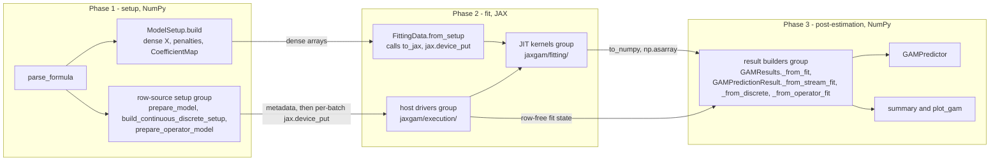
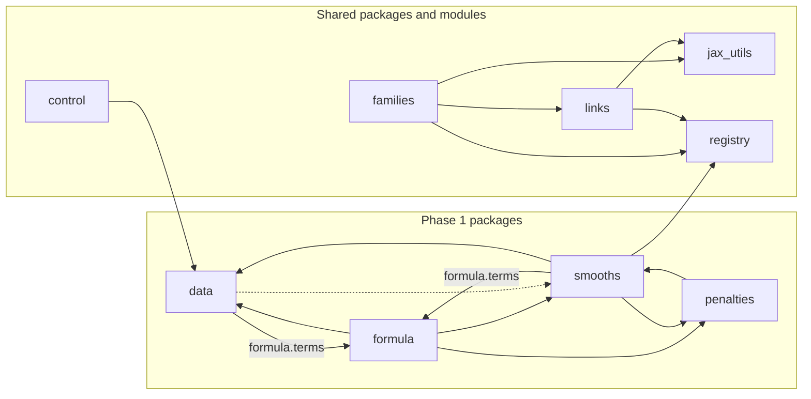
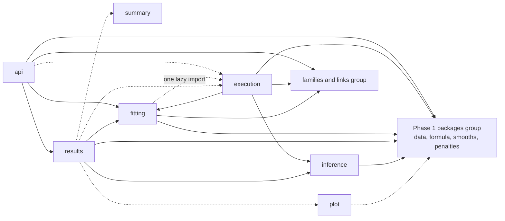
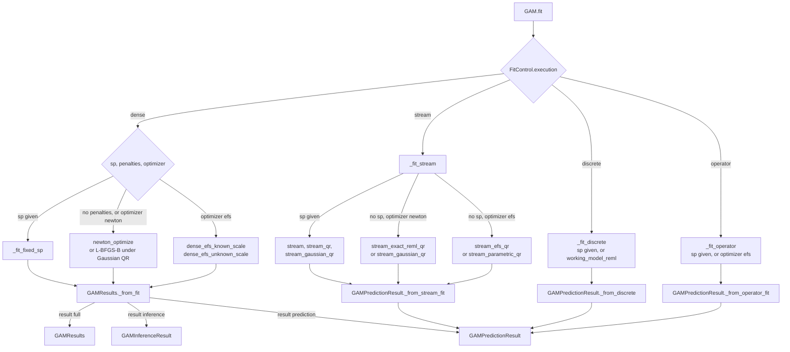
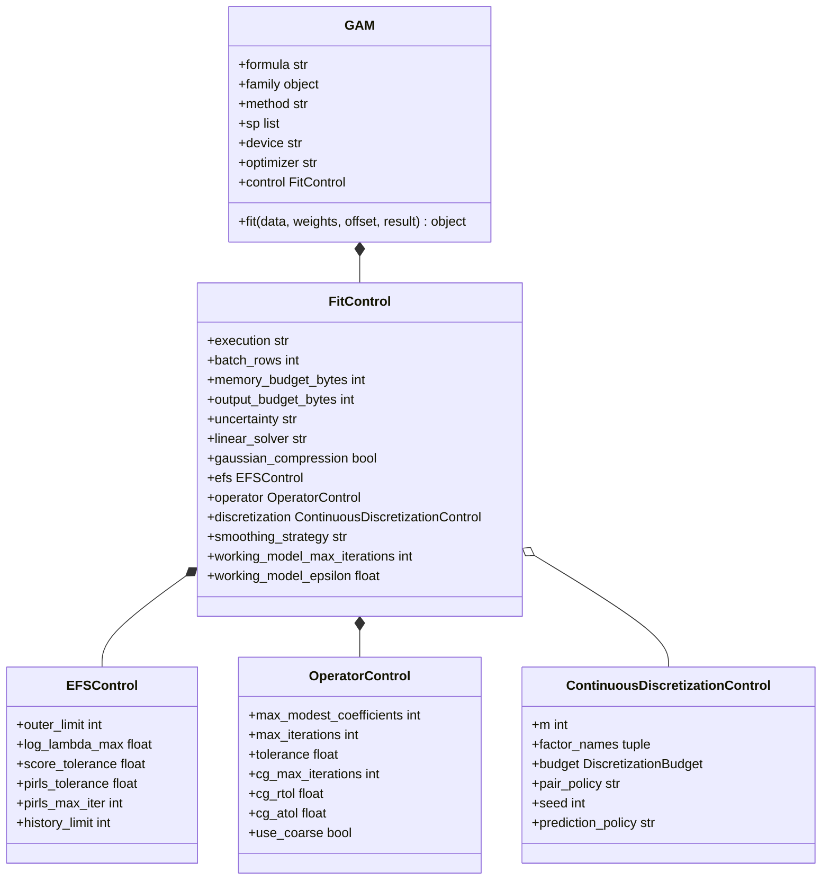

# Architecture overview

## Scope

This page is the entry point to the maintainer documentation. It says what
JaxGAM does, how the three phases split the code, which sub-package depends on
which, which fitting routes exist and how one is selected, and defines the
terms the other architecture pages use. It ends with a reading order.

JaxGAM is a Python port of R's mgcv. It fits generalized additive models: a
response from an exponential family (Gaussian, Binomial, Poisson, Gamma, or
negative binomial) whose link-scale mean is a sum of parametric terms and
penalized smooth functions (thin plate, cubic, Gaussian process, random effect
and tensor product bases). Smoothing parameters are chosen by REML or by an
extended Fellner-Schall iteration, or fixed by the caller. The public entry is
`GAM` in `jaxgam/api.py`: `GAM(formula, family, ...).fit(data, ...)` returns a
frozen result object that predicts, and on the default route also summarises
and plots. Besides the in-memory (dense) route, the package fits from a
replayable row source by streaming, by a discretized compact design (the
analogue of `bam(discrete=TRUE)` in mgcv's `R/bam.r`), and by a matrix-free
operator route for random effects with very many levels.

## Where the code is

| Path | Role |
|---|---|
| `jaxgam/__init__.py` | Enables float64 in JAX, configures the compilation cache, runs the Accelerate warning, exports the ten public names. |
| `jaxgam/api.py` | `GAM`: argument checks, route dispatch, and the per-route fit functions. |
| `jaxgam/control.py` | Frozen control dataclasses: `FitControl`, `EFSControl`, `OperatorControl`, `ContinuousDiscretizationControl`. |
| `jaxgam/results.py` | Result types `GAMResults`, `GAMInferenceResult`, `GAMPredictionResult` and their constructors. |
| `jaxgam/jax_utils.py` | Array dispatch, `to_jax` (the Phase 1 to 2 transfer) and `to_numpy` (the Phase 2 to 3 transfer). |
| `jaxgam/registry.py` | `Registry`, the case-insensitive string-to-class map used by families, links and smooths. |
| `jaxgam/platform_guard.py` | `warn_if_accelerate_lapack`, the Apple Accelerate warning. |
| `jaxgam/data/` | Phase 1. `RowSource` protocol, `RowBatch`, built-in sources, fingerprints, discretization of row sources. |
| `jaxgam/formula/` | Phase 1. Formula parser, term specs, dense `ModelSetup`, `PredictSpec` and the prepared model of the row-source routes; the discretized and operator setup are in `jaxgam/formula/discrete/` and `jaxgam/formula/operator/`. |
| `jaxgam/smooths/` | Phase 1. Smooth bases and penalties, the smooth registry, `CoefficientMap` identifiability constraints, pinned-arithmetic helpers. |
| `jaxgam/penalties/` | Phase 1. `Penalty`, `PenaltyStructure` block descriptors, stable reparameterization of multi-penalty blocks. |
| `jaxgam/families/` | Used by the fit and by prediction; Phase 1 receives family objects as arguments without importing the package. Family base classes, the five registered families, the execution-capability contract. |
| `jaxgam/links/` | Used by the families. The eight link functions and their registry. |
| `jaxgam/fitting/` | Phase 2 kernels. JAX code for PIRLS, the REML criterion, the dense Newton optimizer and Fellner-Schall algebra at the top level; one sub-package of kernels per route (`gaussian_qr/`, `stream/`, `discrete/`, `operator/`). |
| `jaxgam/execution/` | Phase 2 host drivers. Python control loops that scan row sources, call `fitting/` kernels, and own budgets and step control; one sub-package per route (`gaussian_qr/`, `stream/`, `discrete/`, `operator/`). |
| `jaxgam/inference/` | Phase 3. `GAMPredictor`, the shared prediction finish (`jaxgam/inference/_core.py`), the operator prediction geometry. |
| `jaxgam/summary/` | Phase 3. `summary`, `GAMSummary`, Davies' method for weighted chi-square tails. |
| `jaxgam/plot/` | Phase 3. `plot_gam` (matplotlib). |

### Layout by route

`jaxgam/formula/`, `jaxgam/fitting/` and `jaxgam/execution/` are laid out the
same way. A module that only one route uses is in that route's sub-package,
and the sub-package has the same name in each of the three packages. A module
that the dense fit uses, or that more than one route uses, stays at the top
level of its package.

| Route | Phase 1 setup | Kernels (`jaxgam/fitting/`) | Host drivers (`jaxgam/execution/`) | Page |
|---|---|---|---|---|
| Dense, Newton REML | `jaxgam/formula/design.py` | top level: `jaxgam/fitting/pirls.py`, `jaxgam/fitting/reml.py`, `jaxgam/fitting/newton.py`, `jaxgam/fitting/stable_log_det.py`, `jaxgam/fitting/source_pirls.py` | none: the Newton loop is in `jaxgam/fitting/newton.py` | [Dense fitting](fitting_dense.md) |
| Dense Fellner-Schall | `jaxgam/formula/design.py` | top level: `jaxgam/fitting/efs.py`, `jaxgam/fitting/efs_regular_pirls.py`, `jaxgam/fitting/efs_theta.py` | top level: `jaxgam/execution/efs.py`, `jaxgam/execution/efs_provider.py` | [Dense fitting](fitting_dense.md) |
| Gaussian QR | `jaxgam/formula/rank_coordinates.py` | `jaxgam/fitting/gaussian_qr/` | `jaxgam/execution/gaussian_qr/` | [Dense fitting](fitting_dense.md) |
| Streamed | `jaxgam/formula/prepare.py`, `jaxgam/formula/design_provider.py` | `jaxgam/fitting/stream/` | `jaxgam/execution/stream/` | [Streamed fitting](fitting_streamed.md) |
| Discretized | `jaxgam/formula/discrete/`, with `jaxgam/data/` | `jaxgam/fitting/discrete/` | `jaxgam/execution/discrete/` | [Discretized fitting](fitting_discrete.md) |
| Operator | `jaxgam/formula/operator/` | `jaxgam/fitting/operator/` | `jaxgam/execution/operator/` | [Operator fitting](fitting_operator.md) |

```text
jaxgam/execution/
├── efs.py, efs_provider.py     Fellner-Schall loop: the dense adapter, shared with the streamed route
├── qr.py, null_coefficient.py  reductions that several routes use
├── gaussian_qr/                preparation.py, optimizer.py
├── stream/                     pirls.py, regular.py, nb.py, nb_theta.py, reml.py, nb_reml.py,
│                               efs.py, efs_provider.py, efs_start.py, family_initialization.py, signed_qr.py
├── discrete/                   gaussian.py, regular.py, working_model.py, regular_working_model.py,
│                               working_theta.py
└── operator/                   system.py, fit.py, variance.py, bulk_variance.py, arrowhead.py, logdet.py,
                                penalty_determinant.py, score.py, score_rows.py, efs_controller.py,
                                efs_provider.py, efs_start.py, efs_trace.py

jaxgam/fitting/
├── pirls.py, reml.py, newton.py, initialization.py, stable_log_det.py, source_pirls.py   dense fit
├── efs.py, efs_regular_pirls.py, efs_theta.py                                            Fellner-Schall algebra
├── data.py, state.py, family_execution.py, penalty_ops.py, qr.py, signed_qr.py           shared by the routes
├── gaussian_qr/                kernel.py, rank_coordinates.py
├── stream/                     kernels.py, regular.py, nb_kernels.py, nb_theta.py, reml.py, nb_reml.py,
│                               efs_factor.py
├── discrete/                   ops.py, working.py, working_model.py
└── operator/                   actions.py, family.py, iterative.py, preconditioners.py, efs_score.py

jaxgam/formula/
├── parser.py, terms.py, design.py, predict_matrix.py                dense setup and prediction state
├── prepare.py, design_provider.py, fitting_prepare.py               prepared model of the row-source routes
├── kernel_groups.py, rank_coordinates.py                            shared helpers
├── discrete/                   continuous_setup.py, continuous_design.py, continuous_metadata.py, design.py,
│                               working_penalties.py
└── operator/                   prepare.py, modest.py, radial.py, workspace.py
```

Several file names occur in more than one place: for example
`jaxgam/fitting/reml.py` (the dense criterion), `jaxgam/fitting/stream/reml.py`
and `jaxgam/execution/stream/reml.py`, or `jaxgam/formula/prepare.py` and
`jaxgam/formula/operator/prepare.py`. The package path tells them apart, so
these pages always write the full path. A sub-package's initializer, such as
`jaxgam/execution/operator/__init__.py`, holds a description and imports
nothing, so importing one module of a route does not load the rest. The other packages
(`data/`, `smooths/`, `penalties/`, `families/`, `links/`, `inference/`,
`summary/`, `plot/`) are flat, and so are the test directories: the tests of
`jaxgam/execution/operator/fit.py` are in
`tests/test_execution/test_operator_fit.py`.

## How it works

### The three phases

Every fit passes through three phases.

- **Phase 1, setup (NumPy, CPU).** Parse the formula, build bases, penalties
  and identifiability constraints, and either assemble the dense model matrix
  (`ModelSetup.build` in `jaxgam/formula/design.py`) or prepare
  observation-independent metadata by scanning a row source
  (`prepare_model` in `jaxgam/formula/prepare.py`,
  `build_continuous_discrete_setup` in `jaxgam/formula/discrete/continuous_setup.py`,
  `prepare_operator_model` in `jaxgam/formula/operator/prepare.py`).
  Packages: `data`, `formula`, `smooths`, `penalties`.
- **Phase 2, fit (JAX).** Arrays cross to a JAX device and the smoothing
  parameters and coefficients are estimated. JIT kernels live in
  `jaxgam/fitting/`; host-side drivers that iterate over row sources, hold
  accepted and trial states and enforce memory budgets live in
  `jaxgam/execution/`. Not all of `fitting/` is jitted: the outer loop of
  `NewtonOptimizer.run` in `jaxgam/fitting/newton.py` is host Python, and
  `jaxgam/fitting/stable_log_det.py` runs in NumPy between jitted evaluations.
- **Phase 3, post-estimation (NumPy, CPU).** Results return through
  `to_numpy` and become frozen result objects (`jaxgam/results.py`) holding a
  prediction core (`jaxgam/inference/`); `summary` and `plot` work on the
  full result only.



Read left to right: the dense route hands a whole model matrix to JAX through
`FittingData.from_setup` (which calls `to_jax` in `jaxgam/jax_utils.py`); the
row-source routes hand over metadata and move each scanned batch to the device
inside their host drivers. Only `GAMResults` reaches `summary` and `plot_gam`.

Which packages import JAX (an AST walk of the import statements at HEAD):

| Package or module | JAX imports |
|---|---|
| `fitting/` | 32 of its 37 files at module level (all but the five `__init__.py` files). |
| `execution/` | 18 of 40 files at module level; the other 22, five `__init__.py` files among them, use NumPy and SciPy only. |
| `families/` | `jaxgam/families/standard.py` and `jaxgam/families/negative_binomial.py` at module level; `jaxgam/families/base.py` imports `jaxgam.jax_utils`. |
| `links/` | `jaxgam/links/links.py` only under `TYPE_CHECKING` and inside functions, but it imports `jaxgam.jax_utils` at module level. |
| `jaxgam/api.py` | Under `TYPE_CHECKING` and inside functions only. |
| `jaxgam/__init__.py`, `jaxgam/jax_utils.py`, `jaxgam/platform_guard.py` | At module level. |
| `data/`, `formula/`, `smooths/`, `penalties/`, `inference/`, `summary/`, `plot/`, `jaxgam/control.py`, `jaxgam/registry.py`, `jaxgam/results.py` | None. |

`jaxgam/results.py` has no JAX import of its own, but it imports
`jaxgam.fitting.state` and `jaxgam.jax_utils`, which do. And because every
`import jaxgam.<module>` first runs `jaxgam/__init__.py`, which imports `jax`,
"no JAX import" is a property of the source text: the guard tests load a
module under a stub parent package to check it (see Rules and invariants).

### Package map and dependency directions

The diagrams below show the import edges between sub-packages that occur at
runtime (module-level imports as solid arrows, imports inside functions only as
dotted arrows; `TYPE_CHECKING` imports are left out). The first shows Phase 1
and the shared packages, the second Phase 2, Phase 3 and `jaxgam/api.py`; the second
leaves out edges into `control`, `jax_utils` and `registry`, which the table
after it lists with every other edge.



Phase 1 packages import one another in cycles (`smooths` and `data` both
import `jaxgam.formula.terms`; `penalties` and `smooths` import each other),
but nothing in Phase 1 imports `families`, `links` or `jax_utils`.



The edges in detail (counts are import statements):

| From | To, module level | To, inside functions only |
|---|---|---|
| `jaxgam/api.py` | `control`, `data`, `families` (3), `fitting` (7), `formula` (4), `results` | `execution` (32), `families`, `fitting`, `formula`, `links` |
| `execution/` | `fitting` (73), `formula` (37), `families` (25), `data` (12), `penalties` (9), `control` (8), `links` (5), `smooths` (5), `inference` (4) | none |
| `fitting/` | `families` (21), `jax_utils` (8), `formula` (6), `links` (4), `penalties` (3) | `execution` (1) |
| `jaxgam/results.py` | `control`, `fitting`, `inference` (2), `jax_utils`, `smooths` | `execution` (3), `inference`, `fitting`, `formula`, `penalties`, `data`, `summary`, `plot`, `smooths` |
| `inference/` | `formula` (3), `data` (2), the `jaxgam` package itself (for `__version__`) | `formula` |
| `plot/` | none | `smooths` (5) |
| `summary/` | none (only a `TYPE_CHECKING` import of `results`) | none |
| `formula/` | `smooths` (41), `data` (14), `penalties` (10) | `smooths` |
| `smooths/` | `formula` (7), `penalties` (7), `data` (2), `registry` (2) | none |
| `penalties/` | `smooths` (3) | `smooths` (2) |
| `data/` | `formula` (1) | `smooths` (1) |
| `families/` | `jax_utils` (3), `links` (3), `registry` (1) | none |
| `links/` | `jax_utils`, `registry` | none |
| `jaxgam/control.py` | `data` | none |

Directions that never occur:

- No Phase 1 package (`data`, `formula`, `smooths`, `penalties`) imports
  `fitting`, `execution`, `families`, `links`, `jax_utils`, `inference`,
  `results`, `summary`, `plot` or `api`. Family objects reach Phase 1 code as
  arguments, without an import.
- `families` and `links` import no Phase 1, Phase 2 or Phase 3 package.
- `execution` never imports `results`, `api`, `summary` or `plot`.
- `fitting` never imports `inference`, `results` or `api`.
- `inference` never imports `fitting` or `execution`.
- Nothing imports `api` except `jaxgam/__init__.py`.

The one known exception to "kernels do not depend on drivers" is in
`jaxgam/fitting/data.py`: `_structural_penalty_roots` imports
`structural_rank` from `jaxgam/execution/qr.py` inside the function, with a
comment giving the circular import as the reason. It runs from
`FittingData.from_setup` for every dense model with penalties, so a dense fit
loads `jaxgam.execution`. Two other edges cross the phase lines on purpose:
`jaxgam/execution/discrete/gaussian.py` calls the Phase 1 setup builders for the
discretized route, and `GAMPredictionResult.bulk_link_variance` in
`jaxgam/results.py` calls into `jaxgam/execution/` after the fit.

### Fitting routes at a glance

`FitControl.execution` selects the route. Inside a route, `sp`, `optimizer`,
`FitControl.smoothing_strategy` and `FitControl.gaussian_compression` select
the sub-route, which the result reports in `execution_route`.

| Route | Selected by | Input | Phase 1 entry | Host driver package and main drivers | Result type |
|---|---|---|---|---|---|
| dense | `execution="dense"` (default) | DataFrame or dict | `parse_formula`, `ModelSetup.build` | mostly none: `jaxgam/api.py` calls `newton_optimize`, `pirls_loop` and `source_pirls` in `fitting/` directly; `jaxgam/execution/efs.py` for `optimizer="efs"`, `jaxgam/execution/gaussian_qr/optimizer.py` for Gaussian QR | `GAMResults`, `GAMInferenceResult` or `GAMPredictionResult`, by `result=` |
| stream | `execution="stream"` | `RowSource` | `prepare_model`, `StreamDesign` | `jaxgam/execution/stream/pirls.py`, `jaxgam/execution/stream/regular.py`, `jaxgam/execution/stream/nb.py`, `jaxgam/execution/stream/reml.py`, `jaxgam/execution/stream/nb_reml.py`, `jaxgam/execution/stream/efs.py`, `jaxgam/execution/gaussian_qr/optimizer.py` | `GAMPredictionResult` only |
| discrete | `execution="discrete"` plus `FitControl.discretization` | `RowSource` | `build_continuous_discrete_setup` (called from the driver) | `jaxgam/execution/discrete/gaussian.py` (`fit_discrete_gaussian`), `jaxgam/execution/discrete/regular.py` (`fit_discrete_regular`) | `GAMPredictionResult` only |
| operator | `execution="operator"` plus `linear_solver="pcg"` | `RowSource` | `prepare_operator_model` | `jaxgam/execution/operator/fit.py` (`fit_operator_fixed_sp`), `jaxgam/execution/operator/efs_controller.py` (`run_operator_efs_known_scale`) | `GAMPredictionResult` only |



Read from the top: the execution route is chosen first, then the smoothing
selection inside it. Only the dense route can build `GAMResults` or
`GAMInferenceResult`; the other three refuse any `result` but `"prediction"`.
[Lifecycle of a fit](fit_lifecycle.md) gives every branch and label.

## Key types



`GAM` is a mutable specification object; `fit` may be called many times. The
controls are frozen dataclasses in `jaxgam/control.py` that validate
themselves in `__post_init__` (for example `execution="discrete"` requires a
`discretization` policy and the reverse). `ContinuousDiscretizationControl`
has more fields than shown (`selector_memmap_directory`,
`max_pair_histogram_bytes`, `max_retained_representatives`). The result types
are drawn on [Phase 3: results and prediction](results_and_prediction.md).

## Rules and invariants

- **Phase 1 stays free of JAX.** `data`, `formula`, `smooths` and `penalties`
  must not import `jax`, `jaxgam.fitting`, `jaxgam.execution`,
  `jaxgam.families`, `jaxgam.links` or `jaxgam.jax_utils`. Six tests load a
  Phase 1 module under a stub `jaxgam` package and assert that no `jax`
  module was imported: `test_discretize_module_imports_without_jax`
  (`tests/test_data/test_discretize.py`) and its siblings in
  `tests/test_data/test_continuous_discretize.py`,
  `tests/test_data/test_continuous_frame.py`,
  `tests/test_data/test_continuous_request.py`,
  `tests/test_formula/test_continuous_metadata.py` and
  `tests/test_formula/test_rank_coordinates.py`. No other import-boundary
  check (such as an import linter) runs in CI; the rest of this page's
  direction rules are kept by review.
- **Kernels do not import drivers.** `fitting/` imports `execution/` only in
  `_structural_penalty_roots`. A new import in that direction is likely to
  create a circular import, because `jaxgam/execution/` imports streamed
  routes that import `jaxgam/fitting/data.py`.
- **Float64 everywhere.** `jaxgam/__init__.py` sets `jax_enable_x64` before
  anything is compiled. See [Numerics and platform](numerics_and_platform.md).
- **Row-source routes return prediction results only.** `_fit_stream`,
  `_fit_discrete` and `_fit_operator` raise `NotImplementedError` for
  `result="full"` or `"inference"`, and take weights and offset from the
  source, never from `fit(weights=, offset=)`.
- **Phase 3 operates on host arrays.** Result builders convert with
  `to_numpy` before any covariance, EDF or prediction work.

## Pitfalls

- A plain `import jaxgam.smooths.tprs` imports JAX through
  `jaxgam/__init__.py`. Checking "no JAX in Phase 1" by importing a module in
  a normal interpreter proves nothing; use the stub-package pattern of the
  guard tests.
- `jaxgam/execution/__init__.py` says execution code "does not construct
  formula bases or perform post-estimation work". The discretized route's
  driver calls Phase 1 setup builders, and `bulk_link_variance` runs after
  the fit, so treat that sentence as a guideline, not a fact about every
  module.
- `GAM` does not validate `family`, `sp` or the formula at construction: an
  unknown family name raises `KeyError` only in `fit`, from
  `Registry.get_class`.
- `FitControl.smoothing_strategy` defaults to `"exact_reml"` and is read only
  by the discretized route, which cannot use that default without an `sp`.

## Where to change things

| To do this | Edit |
|---|---|
| Add a public name | `jaxgam/__init__.py` (`__all__`) |
| Add a fit argument or control field | `jaxgam/control.py` and its readers in `jaxgam/api.py`; see [Lifecycle of a fit](fit_lifecycle.md) |
| Change route selection | `GAM.fit` and the `_fit_*` methods in `jaxgam/api.py` |
| Add a family, link or smooth | see [Extension points](families_links_smooths.md) |
| Change what a result keeps | `jaxgam/results.py`, `jaxgam/inference/predictor.py`; see [Phase 3](results_and_prediction.md) |
| Change the Phase 1 to 2 transfer | `to_jax` in `jaxgam/jax_utils.py`, `FittingData.from_setup` in `jaxgam/fitting/data.py` |
| Add a module to a route | That route's sub-package in `jaxgam/formula/`, `jaxgam/fitting/` or `jaxgam/execution/`. Put it at the top level of the package instead when the dense fit or a second route uses it; see [Layout by route](#layout-by-route). |

A planned refactor will merge the per-route controllers in `fitting/` and
`execution/` and the routing in `jaxgam/api.py`; see
[the unified fitting design](../unify_fit/design.md).

## Glossary

- **Smoothing parameter.** The weight `lambda_j` on penalty `S_j`. `GAM(sp=)`
  takes natural-scale values; the code optimizes `log_lambda`. Results report
  a supplied `sp` verbatim (`_report_smoothing_params` in
  `jaxgam/results.py`) and estimated ones as `exp(log_lambda)`.
- **Penalty, `S_lambda`.** The penalty matrix `sum_j lambda_j S_j`, held as
  local coefficient-block descriptors in `PenaltyStructure`
  (`jaxgam/penalties/structure.py`) and materialized by `FittingData.S_lambda`.
- **Scale.** The dispersion `phi`; 1 for known-scale families
  (`scale_known`), estimated for Gaussian and Gamma.
- **Theta.** The negative binomial shape parameter, fixed or estimated
  (`NegativeBinomial(theta, fixed=...)` in
  `jaxgam/families/negative_binomial.py`).
- **EDF.** Effective degrees of freedom: the trace of
  `F = (X'WX + S_lambda)^-1 X'WX` over a smooth's coefficient block. `edf1` is
  `2 edf - tr(F F)` per block, which `summary` uses to set the reference
  degrees of freedom of the smooth tests (`_compute_per_smooth_edf`,
  `_compute_per_smooth_edf1` in `jaxgam/results.py`).
- **PIRLS.** Penalized iteratively reweighted least squares, the inner
  coefficient fit at fixed smoothing parameters: `pirls_loop`
  (`jaxgam/fitting/pirls.py`) and `source_pirls`
  (`jaxgam/fitting/source_pirls.py`, the port of `gam.fit3` in mgcv's
  `R/gam.fit3.r` and `gam.fit4` in `R/gam.fit4.r`).
- **REML.** Restricted maximum likelihood, the smoothing-selection criterion
  (`REMLCriterion` in `jaxgam/fitting/reml.py`). `method="REML"` is the only
  accepted method; `"ML"` raises `NotImplementedError`.
- **Newton optimizer.** The dense outer loop over log smoothing parameters,
  `newton_optimize` and `NewtonOptimizer` in `jaxgam/fitting/newton.py`, a
  port of `newton` in mgcv's `R/gam.fit3.r`.
- **Fellner-Schall (EFS).** The extended Fellner-Schall update of smoothing
  parameters, selected by `optimizer="efs"`, a port of `efsudr` in mgcv's
  `R/gam.fit4.r`. Dense in `jaxgam/execution/efs.py`, streamed in
  `jaxgam/execution/stream/efs.py`, operator in
  `jaxgam/execution/operator/efs_controller.py`; settings in `EFSControl`.
- **Row source.** An object satisfying the `RowSource` protocol
  (`jaxgam/data/source.py`): `n_rows`, `scan(batch_rows)` yielding `RowBatch`
  objects in a stable order, and `fingerprint()`. Built-ins:
  `ArrayRowSource`, `DataFrameRowSource`, `MemmapRowSource`.
- **Scan.** One full pass over a row source in batches of `batch_rows` rows.
  Results count fit scans in `source_scans` and `batches_scanned`.
- **Fingerprint.** A content digest of a row source, compared at the start
  and end of a fit (`single_fit_fingerprints`) to detect data that changed.
- **Compact or discretized design.** On the discrete route, the compact
  frame of representative covariate rows (`build_compact_setup_frame` in
  `jaxgam/data/continuous_frame.py`) plus row selectors, and the indexed
  design built on it (`FrozenDiscreteDesign`, `DeviceDiscreteDesign`), on
  which kernels such as `discrete_xwxd` act. The analogue of mgcv's
  `discrete.mf` and `XWXd`.
- **Working model.** On the discrete route, the frozen coefficient-space
  Gaussian problem on which one `Sl.fitChol` proposal (mgcv
  `R/fast-REML.r`) is taken per iteration; repeated re-forming of it is the
  performance iteration of `bgam.fitd` (`R/bam.r`). Selected by
  `smoothing_strategy="working_model_reml"`.
- **Prediction policy.** On the discrete route, `continuous_frozen_basis`
  evaluates new covariate values exactly; `mgcv_predict_bamd` first
  compresses the whole request as mgcv's `predict.bamd` does.
- **CoefficientMap.** The Phase 1 to 3 contract in
  `jaxgam/smooths/constraints.py`: per-term `TermBlock` entries holding the
  identifiability transform (`Z_centering`, `del_index`) that maps a raw basis
  block to the constrained coefficients (`transform_X`).
- **PredictSpec.** The observation-free prediction state (`CoefficientMap`,
  factor levels, smooth metadata) in `jaxgam/formula/predict_matrix.py`.
- **Operator route.** The matrix-free route for large random effects:
  indexed random effects (`IndexedRandomEffect`) never form dense columns,
  a small "modest" block holds the other terms, and systems are solved by
  preconditioned conjugate gradients (`jaxgam/fitting/operator/iterative.py`).
- **Gaussian QR compression.** `FitControl(gaussian_compression=True)`:
  one weighted QR reduction of a Gaussian identity model, then
  coefficient-space smoothing trials (`jaxgam/execution/gaussian_qr/preparation.py`).
- **Fisher factor.** A retained triangular factor of the penalized Fisher
  information (lower Cholesky, or a `PivotedQRFisherFactor`) from which
  prediction standard errors are computed without a dense covariance.
- **Execution route.** The `execution_route` string on every result, naming
  the sub-route that ran; `lambda_strategy` names how smoothing parameters
  were set; `execution_fallback_reason` records an unmet Gaussian QR request.
- **Host driver and kernel.** A driver is Python in `jaxgam/execution/` that
  loops, scans and decides; a kernel is a pure function in `jaxgam/fitting/`,
  usually jitted.
- **Memory budget.** `FitControl.memory_budget_bytes` and
  `output_budget_bytes`: prospective estimates of known arrays, checked
  before allocation and raising `MemoryError`. Dense fitting is not budgeted.

## Reading order

1. [Lifecycle of a fit](fit_lifecycle.md) - one `GAM.fit()` call end to end: checks, routing, the `_fit_*` methods, route labels.
2. [Phase 1: setup](setup.md) - formula parsing, smooth construction, `CoefficientMap`, penalties, and the streamed, discretized and operator setup.
3. [Data sources](data_sources.md) - `RowSource`, `RowBatch`, built-in sources, fingerprints and discretization.
4. [Phase 2: dense fitting](fitting_dense.md) - `FittingData`, PIRLS, the REML criterion, the Newton optimizer, dense EFS and Gaussian QR.
5. [Phase 2: streamed fitting](fitting_streamed.md) - streamed PIRLS, QR reducers, exact streamed REML, streamed theta and EFS.
6. [Phase 2: discretized fitting](fitting_discrete.md) - indexed design actions, the working-model REML proposal and the performance iteration.
7. [Phase 2: operator fitting](fitting_operator.md) - matrix-free actions, PCG, the operator EFS controller and bulk variance.
8. [Phase 3: results and prediction](results_and_prediction.md) - result types, the prediction core, batched prediction, summary, plot and pickling.
9. [Extension points](families_links_smooths.md) - family, link and smooth base classes, registries, and checklists for adding one.
10. [Testing and CI](testing_and_ci.md) - test layout, the R bridge, tolerance classes, the validation matrix and CI jobs.
11. [Numerics and platform](numerics_and_platform.md) - float64, the pinned LAPACK provider, BLAS threads, the Accelerate guard, determinism.
