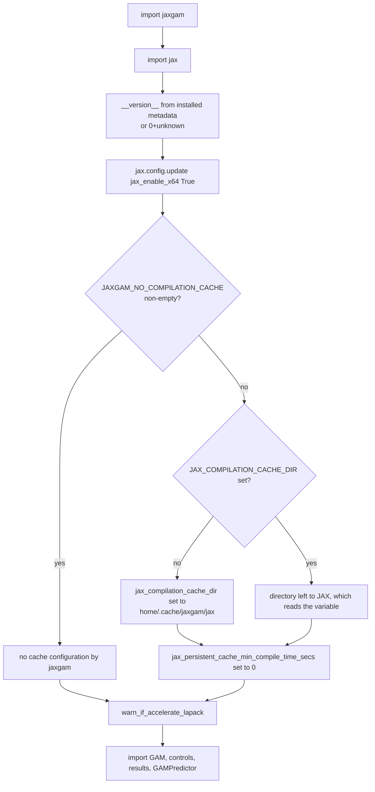
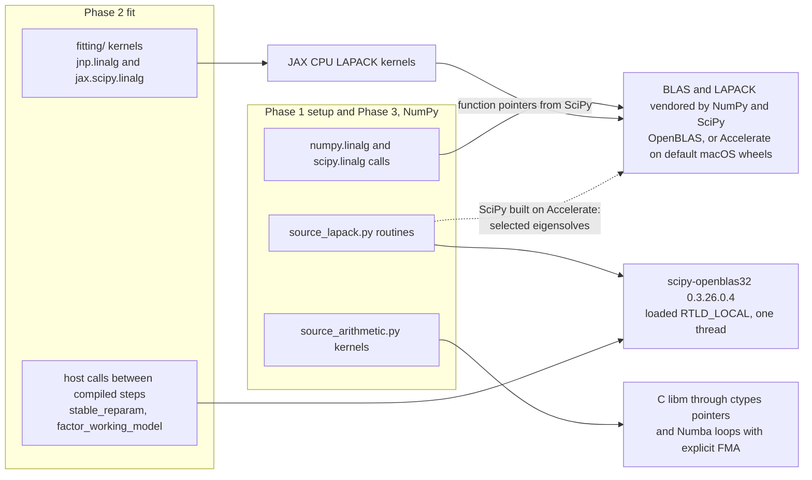
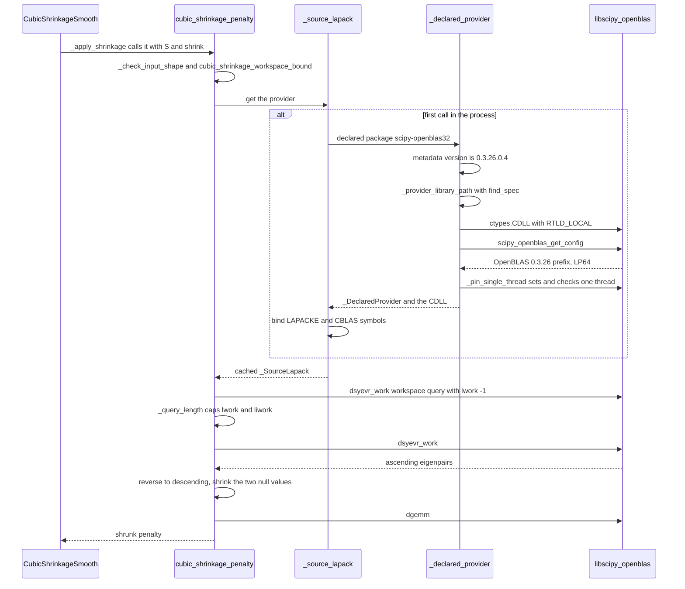
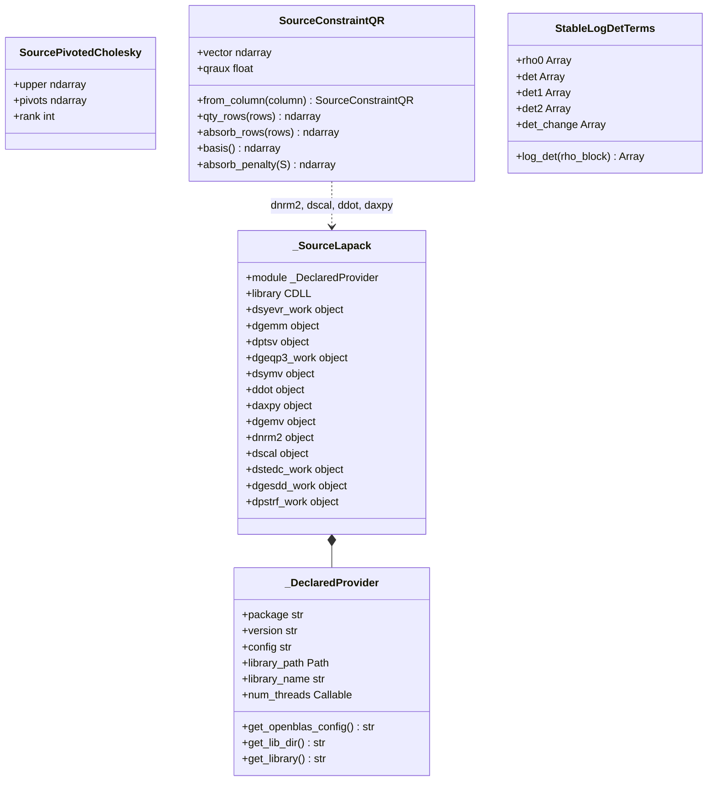

# Numerics and platform behaviour

## Scope

This page collects the numerical and platform decisions that cut across the
package: what `import jaxgam` configures, which linear-algebra library serves
which call, the pinned LAPACK provider that reproduces mgcv's arithmetic for
selected routines, the scalar kernels that reproduce mgcv's compiled C loops,
the Apple Accelerate guard, thread pinning and determinism, environment
variables, device handling, and the rules for JAX and NumPy-only code.

## Where the code is

| Path | Role |
|---|---|
| `jaxgam/__init__.py` | Enables float64, configures the persistent compilation cache, runs the Accelerate warning, exports the public names. |
| `jaxgam/platform_guard.py` | `warn_if_accelerate_lapack` and `accelerate_warning_applies`: the Apple silicon Accelerate warning. |
| `jaxgam/smooths/source_lapack.py` | The pinned LAPACK provider: loads `scipy-openblas32==0.3.26.0.4` with `ctypes`, pins it to one thread, and exposes source-exact ports of mgcv's LAPACK and BLAS calls. Also the NumPy/SciPy Accelerate probes. |
| `jaxgam/smooths/source_penalty_coordinates.py` | Penalty coordinates in pinned mgcv's gauge: R's `colMeans` centering reflector, `qr.qty` absorption, and lower-triangle DSYEVR eigensolves on the provider. |
| `jaxgam/smooths/source_arithmetic.py` | Numba kernels that keep mgcv's C loop order and fused multiply-add rounding, and element-wise calls to the C library's `exp`, `log`, `log10` and `pow`. |
| `jaxgam/jax_utils.py` | NumPy/JAX array dispatch, the Phase 1 to 2 and Phase 2 to 3 transfers, and JIT-compiled linear-algebra helpers. |
| `jaxgam/smooths/cubic.py`, `jaxgam/smooths/utils.py`, `jaxgam/summary/_davies.py` | The other Numba users. |
| `jaxgam/api.py` | `_resolve_device`, which maps `device=` to a JAX device. |

## How it works

### What `import jaxgam` does

Read top to bottom: float64 is enabled before any other jaxgam module is
imported, so no module-level compilation runs in float32. The Accelerate check
runs once, after the JAX configuration and before the public classes are
imported. Importing `jaxgam` loads `jaxgam.fitting` but not
`jaxgam.execution`, and does not load the pinned provider.

**Float64.** `jax_enable_x64` is set to `True` in `jaxgam/__init__.py`. Four
fitting modules (`jaxgam/fitting/discrete/working_model.py`,
`jaxgam/fitting/stream/efs_factor.py`, `jaxgam/fitting/discrete/working.py`,
`jaxgam/fitting/stream/nb_theta.py`) set it again at import.

**Persistent compilation cache.** By default compiled XLA executables are
cached in `~/.cache/jaxgam/jax`, and the minimum compile time for caching is
set to 0 seconds so that small programs are cached too. Importing `jaxgam`
already writes entries to the cache. The behaviour is controlled only by
environment variables read at import:

- **Redirect:** set `JAX_COMPILATION_CACHE_DIR` before importing `jaxgam`.
  jaxgam then sets no directory (JAX reads the variable itself) but still sets
  the threshold to 0.
- **Disable jaxgam's configuration:** set `JAXGAM_NO_COMPILATION_CACHE` to any
  non-empty value, including `0`; the test is truthiness of the string. If
  `JAX_COMPILATION_CACHE_DIR` is also set, JAX still caches there with its own
  default threshold (1 second in the installed JAX).
- **Not a redirect:** a `jax.config.update("jax_compilation_cache_dir", ...)`
  made before `import jaxgam` is overwritten by the default; one made after
  the import changes the setting but, in a check with jax 0.9.0.1, entries
  were not written to the new directory, because the import had already
  initialized the cache.

### The Accelerate guard

`jaxgam/platform_guard.py` explains the problem in its module docstring: on
Apple silicon the default NumPy and SciPy wheels link Apple Accelerate, and
JAX's CPU LAPACK kernels take their function pointers from SciPy. When several
LAPACK calls run concurrently inside one compiled computation, the process
heap can be corrupted, and no JAX or XLA setting prevents it; the OpenBLAS
builds of NumPy and SciPy do. The warning text says this was observed with
about 100 smooths (about 1,000 coefficients) and not with 50 or fewer, that
Linux is unaffected, and gives `uv` and `pip` commands that reinstall the
OpenBLAS builds of the installed NumPy and SciPy versions.

`accelerate_warning_applies()` returns true only when all of these hold, in
this order:

1. `os.environ.get("JAXGAM_ALLOW_ACCELERATE") != "1"` (exactly the string
   `1` silences it; `0` or `true` do not);
2. `sys.platform == "darwin"` and `platform.machine() == "arm64"`;
3. `accelerate_lapack_in_process()` in `jaxgam/smooths/source_lapack.py`:
   NumPy's or SciPy's build configuration names `accelerate` as its LAPACK;
4. `jax.default_backend() == "cpu"`. The backend is queried only after the
   first three hold, so elsewhere importing jaxgam never initializes a JAX
   backend.

`warn_if_accelerate_lapack()` issues a `RuntimeWarning` at most once per
process. `tests/test_platform_guard.py` covers each condition, the once-only
behaviour and the opt-out value.

### Which library serves which call

Ordinary setup and post-estimation linear algebra goes to whatever NumPy and
SciPy vendor. Kernels in the fit go to JAX's CPU LAPACK kernels, which share
SciPy's LAPACK. Only the routines listed below go to the pinned provider, both
when called from setup and when the fit calls them on the host. The dashed
edge is the Accelerate exception described further down.

### The pinned LAPACK provider

**Why it exists.** Several smooth constructors are sensitive to exactly
which null-space coordinates and eigenvector gauge their LAPACK returns: the
cubic shrinkage penalty, the thin-plate and Gaussian-process Lanczos bases,
tensor-margin factorizations, and penalty coordinates in rank-deficient
fits. Small differences there cascade into different bases and coefficients.
`jaxgam/smooths/source_lapack.py` therefore binds the needed LAPACKE and CBLAS
entry points from one declared package, `scipy-openblas32==0.3.26.0.4`
(OpenBLAS 0.3.26, LP64), because that is the OpenBLAS release the pinned
Linux R 4.5.2 links. The wheel is an unconditional runtime dependency in
`pyproject.toml`. The module never searches for R or a system BLAS and does
not replace NumPy's or SciPy's backend.

**Locating, loading and verifying.** `_source_lapack()` is cached with
`functools.lru_cache(maxsize=1)` and runs on first use, not at import. It
calls `_declared_provider`, which:

1. checks `importlib.metadata.version("scipy-openblas32")` equals
   `_PROVIDER_VERSION` (`0.3.26.0.4`), else `RuntimeError`;
2. finds the package with `importlib.util.find_spec` (without running the
   wheel's `__init__`, which would load OpenBLAS with `RTLD_GLOBAL`) and
   resolves `lib/libscipy_openblas.dylib` on macOS, `lib/libscipy_openblas.so`
   on Linux, or the single DLL on Windows (`_provider_library_path`);
3. opens it with `ctypes.CDLL(path, ctypes.RTLD_LOCAL)`, so its symbols do not
   leak into the process namespace;
4. reads `scipy_openblas_get_config` and requires the prefix
   `"OpenBLAS 0.3.26 "` and the LP64 ABI (no `USE64BITINT`);
5. pins the thread count with `_pin_single_thread`.

`_source_lapack` then binds 13 symbols with explicit `argtypes` and
`restype` and returns a frozen `_SourceLapack`.

**One thread.** The wheel is a threaded OpenBLAS whose default thread count
follows `OPENBLAS_NUM_THREADS` or the core count, and threaded reductions
change last-bit results. `_pin_single_thread` calls
`scipy_openblas_set_num_threads(1)` once at load and checks
`scipy_openblas_get_num_threads() == 1`, so every provider result is the
single-thread arithmetic validated against pinned R, whatever the caller's
environment. The setting is local to this library: NumPy's and SciPy's thread
counts are unchanged.

The load block runs once per process; later calls go straight to the cached
`_SourceLapack`. Every routine follows the same pattern: validate shapes and
finiteness, check a workspace bound before allocating, query LAPACK
workspace, then call.

**Routines and callers.**

| Function | Routines | mgcv source it reproduces | Package callers |
|---|---|---|---|
| `cubic_shrinkage_penalty` | DSYEVR, DGEMM | the `cs` eigentransform in `smooth.construct.cs.smooth.spec` (`R/smooth.r`) | `CubicShrinkageSmooth` in `jaxgam/smooths/cubic.py` (setup) |
| `natural_cubic_system_solve` | DPTSV | `getFS` (`src/mgcv.c`) | `CubicRegressionSmooth._compute_natural_f_and_penalty` (setup) |
| `source_lanczos` (with `source_trisymeig`) | DSYMV, DDOT, DAXPY, DSTEDC | `Rlanczos` and `mgcv_trisymeig` (`src/mat.c`), called by `slanczos` | `_source_tprs_knot_basis` in `jaxgam/smooths/tprs.py`, `GaussianProcessSmooth.setup`, `jaxgam/formula/operator/radial.py` (setup) |
| `source_project_rows` | DGEMV per row | `predict_tprs` (`src/tprs.c`) | `TPRSSmooth._project_design_rows` (setup and prediction) |
| `source_r_matprod`, `source_matprod` | DGEMV or DGEMM | R's `%*%` | `GaussianProcessSmooth._build_design`; tensor margins in `jaxgam/smooths/tensor.py` |
| `source_svd` | DGESDD | R's `svd` | tensor-margin reparameterization in `jaxgam/smooths/tensor.py` |
| `SourceConstraintQR` | DNRM2, DSCAL, DDOT, DAXPY | `qr(t(C))` and `qr.qty` for one constraint column | tensor margins; `jaxgam/formula/operator/modest.py` |
| `source_pivoted_qr` | DGEQP3 | `mgcv_qr` as used by `gdiPK` (`src/gdi.c`) | `jaxgam/formula/rank_coordinates.py`, whose map builders are called only from tests |
| `source_pivoted_cholesky` | DPSTRF | R's `chol(pivot=TRUE)` in `Sl.fitChol` (`R/fast-REML.r`) | `factor_working_model` in `jaxgam/execution/discrete/working_model.py` (during the discretized fit) |
| `_source_symmetric_eigen`, `source_symmetric_eigh`, `source_symmetric_max_eigenvalue` (in `jaxgam/smooths/source_penalty_coordinates.py`) | DSYEVR | R's `eigen` on penalties | `stable_reparam` in `jaxgam/penalties/stable_reparam.py` (setup, and on the host between compiled dense REML evaluations through `jaxgam/fitting/stable_log_det.py`); `_symmetric_eigh` in `jaxgam/formula/fitting_prepare.py`; `build_working_penalty_blocks` in `jaxgam/formula/discrete/working_penalties.py`; tensor penalty normalization |

`source_frobenius_norm` is not a provider call: it reproduces
`gdi.c::frobenius_norm` as one column-major running sum in NumPy.

During the discretized fit the provider is called between two compiled JAX
executables: a compiled step builds the Hessian and penalty inputs,
`factor_working_model` copies them to the host and factors them with DPSTRF,
and the factors go back with `jax.device_put` to the compiled proposal. See
[The discretized fit](fitting_discrete.md).

**On a SciPy built with Accelerate.** `scipy_uses_accelerate_lapack()` routes
a few eigensolves to SciPy's own LAPACK instead, because the audited SciPy
Accelerate build preserves R's separate libRlapack gauge more closely there:
the eigensolve inside `cubic_shrinkage_penalty` (its DGEMM still uses the
provider), `_symmetric_eigh` in `jaxgam/formula/fitting_prepare.py`, `_dsyevr`
in `jaxgam/penalties/stable_reparam.py`, and the largest-eigenvalue
normalization of `cr`/`cs` tensor margins in `jaxgam/smooths/tensor.py`. All
other provider routines are used on every platform. On such a machine the
Accelerate warning also fires.

### Source arithmetic

`jaxgam/smooths/source_arithmetic.py` reproduces mgcv's compiled scalar loops
(`tprs.c`, `mat.c`, `matrix.c`), which accumulate `s += a*b` in fixed index
order. How those statements round depends on how R's mgcv shared object was
compiled: the module records that the aarch64 Linux and macOS arm64 builds
contract them into fused multiply-adds and the x86-64 Linux build does not.
`SOURCE_FMA_CONTRACTION` is therefore true on `aarch64`/`arm64` machines.
The kernels (`sequential_dot`, `column_squares`, `squared_distances`,
`knot_squared_distances`, `matmult_tn`, `qt_factor`, the Householder and
Lanczos helpers, `ritz_accumulate`) are `numba.njit` functions compiled
without `fastmath`, so LLVM neither reorders nor contracts plain expressions;
the fused form uses the `llvm.fma` intrinsic through `_fused`.

`libm_exp`, `libm_log`, `libm_log10` and `r_pow` call the C math library
element by element through ctypes function pointers inside Numba loops.
NumPy's own `exp`/`log`/`power` may dispatch to SIMD implementations (AVX-512
on x86_64) whose last bits differ from libm, which is what R calls. `r_pow`
also reproduces `R_pow`'s special cases. These are used across setup and the
host side of the fit (for example `jaxgam/penalties/stable_reparam.py`,
`jaxgam/execution/discrete/working_model.py`, `jaxgam/execution/operator/system.py`).

`jaxgam/smooths/source_penalty_coordinates.py` builds R's sum-to-zero
centering reflector from column means accumulated in `np.longdouble` in row
order (as R's `colMeans` does), applies it with BLAS `ddot`/`daxpy` in R's
`qr.qty` order (`source_centered_penalties`, used by the dense design;
`source_centered_smooth`, used for `te()` centering in
`jaxgam/smooths/constraints.py`), and runs DSYEVR on the lower triangle of the
provider. Its purpose is to keep R's penalty coordinate gauge, which decides
the canonical coefficients at rank ties and the small eigenvalues of
penalty determinants.

Inside JAX kernels, `_materialize_source_operation` in `jaxgam/jax_utils.py`
applies `nextafter(x, x)` (an exact identity with an identity derivative) to
stop XLA from contracting arithmetic across a source vector-operation
boundary. It is used in `jaxgam/links/links.py`,
`jaxgam/fitting/family_execution.py` and `jaxgam/fitting/stream/nb_kernels.py`.

### `jaxgam/jax_utils.py`

- `array_module(x)` returns `jax.numpy` for a JAX array and `numpy`
  otherwise; `is_jax_array` is the test. Families and links use them so one
  implementation serves both NumPy and JAX inputs.
- `to_jax(*arrays, device=None)` is the Phase 1 to 2 boundary:
  `jax.device_put(jnp.asarray(a, dtype=jnp.float64), device)`. `to_numpy` is
  the Phase 2 to 3 boundary: `np.asarray`.
- JIT-compiled helpers: `cho_factor` (plain Cholesky, with a
  diagonal-relative jitter of `1e-12` then `1e-6` only when the plain factor
  fails or a relative pivot is below `1e-12`, selected by `jax.lax.cond`),
  `penalized_cholesky`, `penalized_solve`, `numerical_rank` (pivoted QR),
  `build_S_lambda`, `block_log_det_S`, `stable_log_pseudo_det`, and
  `StableLogDetTerms`, a pytree carrying host `gam.reparam` log-determinant
  terms into the compiled criterion.

### Numba

| Module | Use |
|---|---|
| `jaxgam/smooths/source_arithmetic.py` | Source-ordered FMA kernels (disk-cached with `cache=True`) and libm loops (compiled per process, not cached, because they embed process addresses). |
| `jaxgam/smooths/cubic.py` | `_compiled_source_cubic_basis`: a fused-multiply-add row loop for the cubic basis on macOS arm64. |
| `jaxgam/smooths/utils.py` | `row_tensor` and `interaction_matrix` (row-wise Kronecker products for tensor and random-effect designs), and `_slanczos_jit`, an older Lanczos with no package caller. |
| `jaxgam/summary/_davies.py` | Port of mgcv's `src/davies.c` for weighted chi-square tail probabilities. |

No kernel uses Numba's `parallel=True` or fastmath options, or its parallel range loops.

### Determinism across machines

- The provider runs on one thread whatever the environment says.
- The Docker test image sets `OPENBLAS_NUM_THREADS=1 OMP_NUM_THREADS=1`. The
  embedded R, SciPy and the provider all link threaded OpenBLAS, whose
  reduction order changes with the core count, so without the pin R reference
  values would differ between a local image and a CI runner.
  `make test-platform-sensitive-ci` passes the same variables; `make
  test-local` sets none.
- Apart from the provider pin, jaxgam sets no JAX, XLA, OpenMP or BLAS thread
  count.
- FMA contraction is chosen per machine (`SOURCE_FMA_CONTRACTION`), and
  element-wise transcendental functions use libm, not NumPy's SIMD loops.
- Residual differences remain and are acknowledged in the tests rather than
  hidden: tests that depend on SIMD maths or the OpenBLAS kernel family carry
  `@pytest.mark.platform_sensitive` and run on eight CI replicas, and the
  discretized-fit tie replays have per-platform reviewed bounds keyed by
  `cpu_platform_class()`. `tests/r_number_format.py` models R's number
  formatting with the platform's `long double` width (53, 64 or 113 bits).
  See [Testing and CI](testing_and_ci.md).

### Environment variables

| Variable | Read by | Effect |
|---|---|---|
| `JAXGAM_NO_COMPILATION_CACHE` | `jaxgam/__init__.py` at import | Any non-empty value skips jaxgam's cache configuration. |
| `JAX_COMPILATION_CACHE_DIR` | `jaxgam/__init__.py` at import, and JAX | Cache directory; when set, jaxgam does not set one. |
| `JAXGAM_ALLOW_ACCELERATE` | `jaxgam/platform_guard.py` | Exactly `1` suppresses the Accelerate warning. |
| `OPENBLAS_NUM_THREADS`, `OMP_NUM_THREADS` | OpenBLAS in NumPy, SciPy and R (not the provider) | Set to 1 in the Docker image and the platform-sensitive target. |
| `JAXGAM_TEST_SHARD` | `tests/conftest.py` (`SHARD_ENV` in `tests/sharding.py`) | `i/N` keeps shard i of N; unset or blank runs everything. |
| `COVERAGE_FILE` | coverage.py | Set per shard by `make test-cov-shard-ci`. |
| `R_HOME`, `LD_LIBRARY_PATH`, `UV_PYTHON_PREFERENCE` | rpy2, the loader, uv | Set in the `Dockerfile`. |
| `JAXGAM_BENCHMARK_TASK_TMPDIR`, `JAXGAM_SOURCE_COMMIT`, `JAXGAM_IMAGE_DIGEST`, `JAXGAM_BENCHMARK_SOURCE_COMMIT`, `JAXGAM_BENCHMARK_IMAGE_ID` | scripts under `scripts/` | Benchmark isolation and provenance only. |

The package itself reads only the first three. No code reads `MGCV_SOURCE`.

### Devices

`GAM(..., device=...)` accepts `None`, `"cpu"` or `"gpu"`; anything else is a
`ValueError`. `_resolve_device` in `jaxgam/api.py` maps `"cpu"` to
`jax.devices("cpu")[0]` and `"gpu"` to `jax.devices("gpu")[0]`, raising
`RuntimeError` when no GPU backend exists; `None` leaves placement to JAX's
default device. The device is passed to `to_jax`/`jax.device_put` on the
dense, streamed and discretized routes. The operator route rejects any device
other than CPU with `NotImplementedError`. Provider calls, setup and
post-estimation always run on the host CPU. No CI job runs on a GPU.

## Key types

All are frozen dataclasses. `_SourceLapack` holds the `ctypes` function
handles; `source_pivoted_cholesky` returns a `SourcePivotedCholesky` (upper
factor as R's `La_chol` returns it, zero-based pivots, DPSTRF's rank).
`StableLogDetTerms` (in `jaxgam/jax_utils.py`) is a registered pytree; its
`log_det` returns NaN away from `rho0` so host terms cannot be used at the
wrong smoothing parameters.

## Rules and invariants

- **Float64 everywhere.** JAX code relies on `jax_enable_x64` from
  `jaxgam/__init__.py`; `to_jax` casts to float64. Do not introduce float32
  arrays.
- **Phase 1 modules import no JAX.** `jaxgam/formula/`, `jaxgam/smooths/`,
  `jaxgam/penalties/` and `jaxgam/data/` use NumPy, SciPy and Numba only.
  Because any `import jaxgam.<module>` first runs `jaxgam/__init__.py` (which
  imports JAX), the tests stub the package in a subprocess and assert that no
  `jax` module was loaded: `tests/test_data/test_discretize.py`,
  `tests/test_data/test_continuous_discretize.py`,
  `tests/test_data/test_continuous_frame.py`,
  `tests/test_data/test_continuous_request.py`,
  `tests/test_formula/test_continuous_setup.py`,
  `tests/test_formula/test_continuous_design.py`,
  `tests/test_formula/test_continuous_metadata.py` and
  `tests/test_formula/test_rank_coordinates.py`. There is no such
  check for `smooths/` or `penalties/`.
- **JAX kernels are pure and traceable.** Kernels in `jaxgam/fitting/` branch
  with `jax.lax.cond` and loop with `jax.lax.while_loop`, `scan` or
  `fori_loop`; Python-level iteration, step control and cross-batch reductions
  live in the host drivers in `jaxgam/execution/` (and in host parts of
  `jaxgam/fitting/newton.py` and `jaxgam/fitting/stable_log_det.py`). See
  [The dense fit](fitting_dense.md).
- **The provider stays single-threaded and local.** Load it only through
  `_source_lapack()`; never import `scipy_openblas32` (its `__init__` loads
  the library globally). `tests/test_smooths/test_source_lapack.py` checks
  that the pin leaves NumPy's and SciPy's thread counts unchanged, that
  outputs are identical with 1 and 8 caller threads, and that a missing or
  refused thread control raises.
- **Provider version and identity are checked at load.** A different wheel
  version, an unexpected config string or an ILP64 build raises
  `RuntimeError`.
- **Workspace is bounded before allocation.** `source_lanczos`,
  `source_pivoted_cholesky` and `cubic_shrinkage_penalty` check
  `*_workspace_bound` against `available_workspace_bytes` and raise
  `MemoryError` first.
- **The Accelerate warning fires at most once per process** and only on Apple
  silicon with an Accelerate NumPy or SciPy and a CPU backend
  (`tests/test_platform_guard.py`).

## Pitfalls

- `JAXGAM_NO_COMPILATION_CACHE=0` disables the cache configuration; the
  variable is tested for being non-empty, not for a true value.
- Setting the cache directory with `jax.config.update` does not work around
  jaxgam's default; use `JAX_COMPILATION_CACHE_DIR` before import.
- `make test-local` runs with your machine's BLAS thread count, so last-bit
  comparisons with R can differ from CI.
- On an Accelerate SciPy, some eigensolves deliberately bypass the provider;
  a gauge difference seen only on macOS may come from that routing, not from
  the provider.
- `SOURCE_FMA_CONTRACTION` follows the machine, so an x86_64 and an arm64 run
  of the same source test exercise different arithmetic. Native x86-64 CI is
  the authority for the non-fused path.
- `device="gpu"` moves the compiled fit to the GPU but not the host provider
  calls; the discretized route copies factor inputs to the host every trial.

## Where to change things

- **Bind another LAPACK or BLAS routine:** add the symbol and its `argtypes`
  in `_source_lapack` and a field to `_SourceLapack` in
  `jaxgam/smooths/source_lapack.py`, then a public wrapper that validates
  inputs, bounds workspace and calls it. Add a pinned-R comparison in
  `tests/test_smooths/test_source_lapack.py`.
- **Change the provider version:** `_PROVIDER_VERSION` and `_OPENBLAS_PREFIX`
  in `jaxgam/smooths/source_lapack.py` and the pin in `pyproject.toml`; the
  version must match the OpenBLAS that pinned R links.
- **Reproduce another mgcv C loop:** add a `numba.njit` kernel to
  `jaxgam/smooths/source_arithmetic.py` using `_madd`/`_msub` and
  `SOURCE_FMA_CONTRACTION`, with tests in
  `tests/test_smooths/test_source_arithmetic.py`.
- **Change the compilation cache default or the Accelerate check:**
  `jaxgam/__init__.py` and `jaxgam/platform_guard.py`.
- **Add an environment variable:** read it in one place, document it in the
  table above, and add a test.
- **Change device placement:** `_resolve_device` in `jaxgam/api.py` and the
  `device=` arguments of `FittingData.from_setup` and the route functions.
