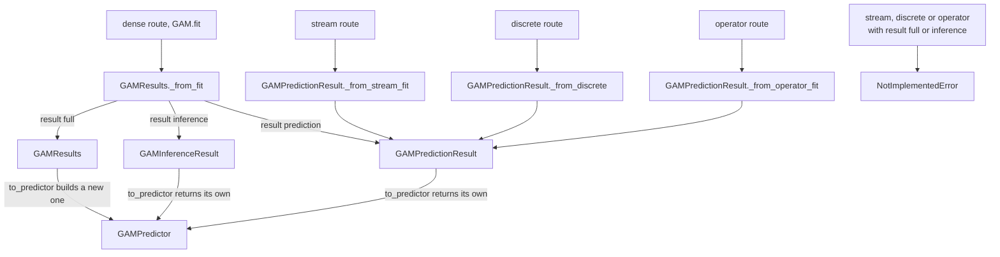
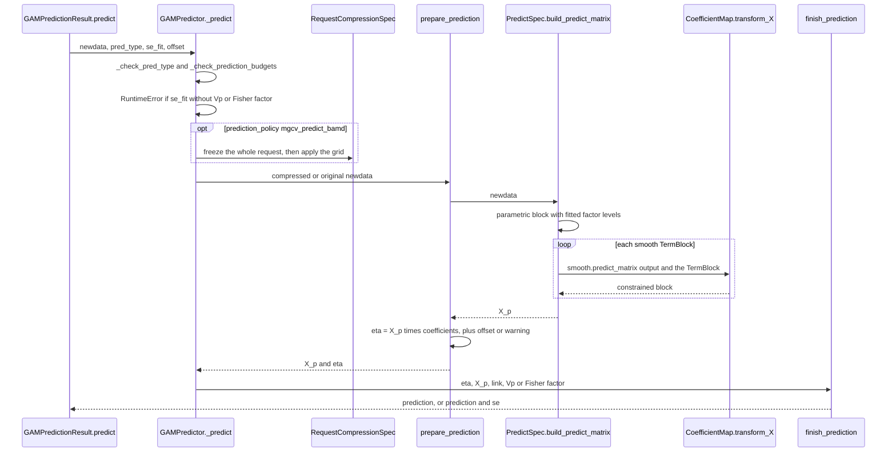
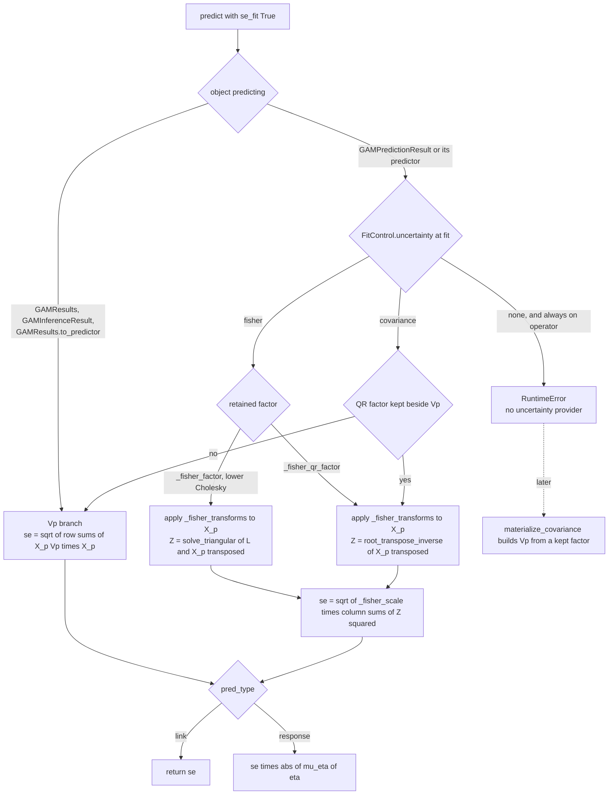
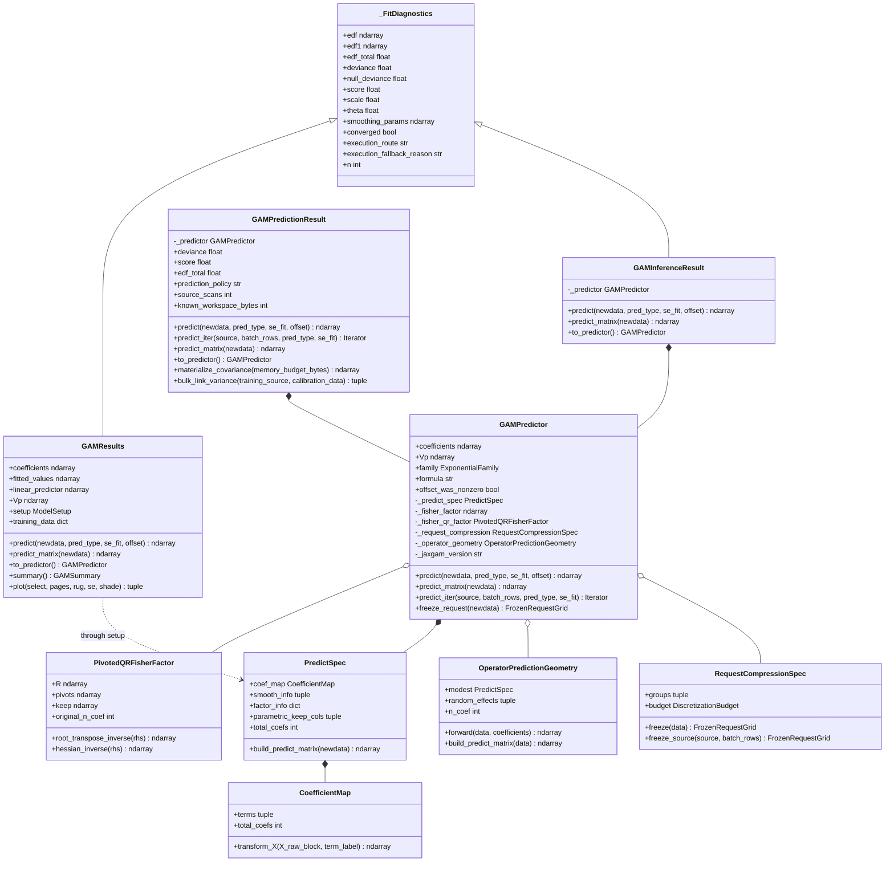

# Phase 3: results and prediction

## Scope

This page covers what a fit returns and how it predicts: the result types
`GAMResults`, `GAMInferenceResult` and `GAMPredictionResult`, the prediction
core `GAMPredictor`, how each result is built from each route, copying,
immutability and pickling, how new data become a prediction matrix, link and
response scales, standard errors, batched prediction, behaviour for unseen
factor levels, the discretized route's prediction policies, and `summary` and
`plot`. Phase 3 code runs on the host in NumPy and SciPy.

## Where the code is

| Path | Role |
|---|---|
| `jaxgam/results.py` | `_FitDiagnostics`, `GAMResults`, `GAMInferenceResult`, `GAMPredictionResult`, `StreamExactOptimizerDiagnostics`; the constructors `_from_fit`, `_from_stream_fit`, `_from_discrete`, `_from_operator_fit`; EDF, covariance and null-deviance helpers. |
| `jaxgam/inference/predictor.py` | `GAMPredictor`, the frozen picklable prediction core; `PivotedQRFisherFactor`; prediction budget checks. |
| `jaxgam/inference/_core.py` | `predict_core`, `prepare_prediction` (new data to linear predictor, offsets) and `finish_prediction` (response scale and standard errors). |
| `jaxgam/inference/operator_geometry.py` | `OperatorPredictionGeometry`: operator-route prediction without dense random-effect columns. |
| `jaxgam/formula/predict_matrix.py` | `PredictSpec`, `build_predict_spec`, `build_predict_matrix`: the one encoder from new data to the constrained prediction matrix. |
| `jaxgam/formula/design.py` | `ModelSetup.build_predict_matrix` and `ModelSetup._lazy_predict_spec`, which builds and caches the dense route's `PredictSpec`. |
| `jaxgam/smooths/constraints.py` | `CoefficientMap` and `TermBlock`; `transform_X` applies a term's identifiability constraint to its raw basis block. |
| `jaxgam/data/continuous_request.py` | `RequestCompressionSpec`, `FrozenRequestGrid`: request compression for `prediction_policy="mgcv_predict_bamd"`. |
| `jaxgam/formula/continuous_metadata.py` | The discretized route's retained metadata and `build_request_compression`. |
| `jaxgam/summary/summary.py` | `summary`, `GAMSummary`, the Wood (2013) smooth test, the random-effect test, `psum_chisq_davies`. |
| `jaxgam/summary/_davies.py` | Numba port of Davies' algorithm from mgcv's `src/davies.c`. |
| `jaxgam/plot/plot_gam.py` | `plot_gam`. |
| `jaxgam/execution/operator_bulk_variance.py` | `BulkOperatorVariance`, used by `GAMPredictionResult.bulk_link_variance`. |

## How it works

### The four types and what they keep

`GAMResults` and `GAMInferenceResult` share the frozen dataclass
`_FitDiagnostics` (EDF vectors, deviance, score, scale, theta, smoothing
parameters, convergence and route fields). `GAMPredictionResult` is a
separate frozen dataclass with only scalar diagnostics plus scan and memory
accounting. The last three hold a `GAMPredictor`, to which they delegate
every prediction.

| | `GAMResults` | `GAMInferenceResult` | `GAMPredictionResult` | `GAMPredictor` |
|---|---|---|---|---|
| Produced by | dense, `result="full"` | dense, `result="inference"` | dense `result="prediction"`; the only mode on stream, discrete and operator | `to_predictor()` on any result |
| Coefficients | field | from predictor | from predictor | field, read-only copy |
| `Vp` (Bayesian covariance) | always | always, via predictor | only with `FitControl(uncertainty="covariance")` | optional |
| Fisher factor for standard errors | not needed | not kept | with `uncertainty="fisher"` (and a QR root alongside `Vp` on some streamed fits) | optional |
| Per-smooth `edf`, `edf1`, `null_deviance` | yes | yes | no | no |
| `edf_total`, `deviance`, `score`, `scale`, `theta`, `smoothing_params`, convergence and route fields | yes | yes | yes (`score` and `edf_total` may be `None` on the operator route) | no |
| `setup` (`ModelSetup`: `X`, `y`, `weights`, `offset`, penalties, `coef_map`) | yes | no | no | no |
| `fitted_values`, `linear_predictor`, `training_data` | yes | no | no | no |
| Scan and memory diagnostics (`source_scans`, `batches_scanned`, `known_workspace_bytes`, `fit_peak_bytes`) | no | no | yes | no |
| `predict`, `predict_matrix`, `to_predictor` | yes | yes | yes | `predict`, `predict_matrix` |
| `predict_iter` | no | no | yes | yes |
| `summary`, `plot` | yes | no | no | no |
| `materialize_covariance`, `bulk_link_variance` | no | no | yes (`bulk_link_variance` on operator results only) | no |

`GAMResults` exposes the setup through properties: `X`, `y`, `weights`,
`offset`, `coef_map`, `smooth_info`, `term_names`. `GAMInferenceResult` has
`coefficients`, `Vp`, `family`, `formula`, `smooth_info` and `term_names` as
properties reading the predictor. `tests/test_result_mode.py`
(`test_inference_result_retains_no_banned_training_or_penalty_state`) and
`tests/test_prediction_result.py`
(`test_point_only_result_retains_no_rows_or_dense_covariance`) check what the
lean types do not retain.

### How each route builds its result

Only the dense route chooses among three types; the others always build a
`GAMPredictionResult`, and refuse the other modes in `jaxgam/api.py` before
any work.

**`GAMResults._from_fit` (dense).** It deep-copies the family (after
Newton or EFS has written the final theta into it), moves the coefficients
and scale to NumPy with `to_numpy`, and reads `stable_rotation`, the
`gam.reparam` block maps of a fit made in stable coordinates. Then, by
`result_mode`:

- `"prediction"`: maps the coefficients to public coordinates
  (`_transform_coefficients_cpu`), keeps `edf_total` only, and, depending on
  `FitControl.uncertainty`, keeps nothing, the lower Cholesky factor
  `pr.L_fisher` with its coordinate maps (`_factor_transforms`), or a dense
  `Vp` built from that factor. Building `Vp` raises `MemoryError` when
  `3 p^2 * 8` bytes exceed `memory_budget_bytes`. This branch runs before any
  per-smooth EDF or row output is computed.
- `"inference"` and `"full"`: form `H^-1` from the Fisher factor by a
  triangular solve (as mgcv's `chol2inv`), rotate it out of stable
  coordinates (`_rotate_covariance`) and through the block transforms
  (`_transform_covariance_cpu`), form `F = H^-1 X'WX` (or take the
  Fisher-system hat matrix `pr.fisher_hat`), and compute per-smooth `edf`
  (`_compute_per_smooth_edf`, the trace of each smooth's block of `F`) and
  `edf1` (`_compute_per_smooth_edf1`, `2 edf - tr(F F)` per block, as in
  `gam.fit3.post.proc` in mgcv's `R/mgcv.r`). `Vp` is `phi * H^-1` with
  `phi = 1` for known-scale families. `null_deviance` comes from
  `_compute_null_deviance`, which fits an intercept-plus-offset model by
  IRLS (`_fit_null_intercept`) when there is a nonzero offset.
  `"inference"` stops here and wraps a `GAMPredictor`; `"full"` also keeps
  `mu`, `eta`, the `ModelSetup` and the smooth covariates
  (`_extract_training_data`) for plotting.

**`GAMPredictionResult._from_stream_fit` (stream).** It maps the streamed
coefficients to public coordinates (`_prepared_transform_coefficients_cpu`),
evaluates the REML score from the row-free stream state with the criterion
variant that matches its coefficient factor (signed QR, pivoted QR or
Cholesky), and overrides score, scale, theta, smoothing parameters, EDF and
convergence from `selected_fit` when an outer optimizer ran. With
uncertainty it keeps a `PivotedQRFisherFactor` when the state's Fisher factor
is a `PivotedQRCoefficientFactor`, otherwise the lower Cholesky
`fisher_factor`; with `"covariance"` it also builds `Vp` (`MemoryError` above
`3 p^2 * 8` bytes, or `12 p^2 * 8` for the QR factor) and keeps the QR root
beside it.

**`GAMPredictionResult._from_discrete` (discrete).** It deep-copies the
family, writes a final negative binomial theta into the copy, and builds the
predictor from the `DiscreteFit`: its `predict_spec` (built on the compact
setup), `covariance`, `fisher_factor` or `fisher_qr_factor`, and the
`request_compression` used by `mgcv_predict_bamd`. It records the effective
`prediction_policy`, the bounded `discretization` metadata,
`discretization_strategy="mgcv_range_grid"`, the fit's scan counts and its
memory plan.

**`GAMPredictionResult._from_operator_fit` (operator).** It checks that the
retained geometry fits `memory_budget_bytes` (`MemoryError`), builds an
`OperatorPredictionGeometry` (the modest block's `PredictSpec`, the
`IndexedRandomEffect` terms and their column offsets), and keeps no
covariance. Fixed-sp operator results have `score=None`, `edf_total=None`,
and `scale=None` for unknown-scale families. It also stores the source
fingerprint, replay digest and family configuration that
`bulk_link_variance` later checks. `_fit_operator_efs` in `jaxgam/api.py`
replaces the score, its error bound, scale, `edf_total` and convergence fields
with `dataclasses.replace`.

### Immutability and copying

- All four types are frozen dataclasses: attributes cannot be reassigned.
- `GAMPredictor.__post_init__` copies `coefficients`, `Vp`, the Fisher factor
  and each Fisher transform, and marks them read-only; it rebuilds a
  `PivotedQRFisherFactor`, whose own `__post_init__` validates and freezes
  its arrays. So arrays read through `GAMInferenceResult`,
  `GAMPredictionResult` or a predictor are read-only.
- `GAMResults` freezes its attributes but not its array contents:
  `GAMResults.coefficients` and `GAMResults.Vp` are writable NumPy arrays.
- `GAMPredictionResult.__post_init__` copies `smoothing_params` and marks it
  read-only.
- `GAMResults.to_predictor()` builds a new `GAMPredictor` on every call. Its
  arrays are copies, but it shares the result's `family` object and the
  `PredictSpec` cached on `setup`; it sets no prediction budgets.
  `GAMInferenceResult.to_predictor()` and `GAMPredictionResult.to_predictor()`
  return the predictor they already hold, without copying.
- `PredictSpec` is built by `build_predict_spec`, which shallow-copies every
  smooth through `copy_for_prediction` (the base version in
  `jaxgam/smooths/base.py` drops the `_X` and `_S` caches) and shares
  constraint arrays by reference. `ModelSetup._lazy_predict_spec` builds it
  once and caches it.
- `tests/test_inference/test_predictor.py`
  (`test_coefficients_and_covariance_are_owned_and_read_only`,
  `test_family_snapshot_is_independent_and_keeps_final_nb_theta`) and
  `tests/test_result_mode.py`
  (`test_to_predictor_ownership_lazy_setup_and_memory_reduction`) cover these
  rules.

### Pickling and version checks

- Every result type and `GAMPredictor` round-trips through the standard
  `pickle` module with identical predictions
  (`tests/test_execution/test_efs_public_api.py` for all three result types,
  `tests/test_inference/test_predictor.py`, `tests/test_prediction_result.py`,
  `tests/test_inference/test_operator_geometry.py` for operator results).
- `GAMPredictor` stamps `_jaxgam_version` (from `jaxgam.__version__`) at
  construction. Its `__setstate__` fills fields missing from older pickles
  (`_fisher_qr_factor`, `_prediction_policy`, `_request_compression`,
  `_operator_geometry`), restores the read-only flags, and warns with a
  `UserWarning` ("not a cross-version format") when the stamped version
  differs from the running one. Its docstring scopes pickles to "trusted,
  same-version transient handoff".
- The version check lives only in `GAMPredictor`, so unpickling a
  `GAMInferenceResult` or `GAMPredictionResult` warns through the predictor
  it contains, and unpickling a `GAMResults` (which holds no predictor) does
  not check the version.
- `GAMPredictionResult.__setstate__` defaults a missing `discretization` to
  `None`; `OperatorPredictionGeometry.__setstate__` re-freezes its
  `PredictSpec`; `PivotedQRFisherFactor.__setstate__` re-runs its validation.
- A family with a link class defined in a local scope cannot be pickled with
  `pickle`; `test_pickle_cloudpickle_and_version_stamp` shows `cloudpickle`
  (a development dependency) handling it.

### The prediction core

All new-data prediction runs through `jaxgam/inference/_core.py`:

1. `prepare_prediction` rejects a `pred_type` other than `"response"` or
   `"link"` (`ValueError`). It builds `X_p = spec.build_predict_matrix(newdata)`
   and `eta = X_p @ coefficients`, or, with an operator geometry,
   `eta = geometry.forward(newdata, coefficients)` and no matrix. An `offset`
   must be one-dimensional with one finite value per row (`ValueError`) and
   is added to `eta`; when none is given and the model was fitted with a
   nonzero offset (`offset_was_nonzero`), it warns and leaves the offset out,
   as `predict.gam` does for external offsets.
2. `finish_prediction` applies `link.linkinv(eta)` for `"response"`, or
   returns `eta` for `"link"`, and computes standard errors when asked
   (next section).

`build_predict_matrix` in `jaxgam/formula/predict_matrix.py` turns new data
into the constrained matrix in the fitted column order:

- `_to_dict` converts a DataFrame column by column, keeping factor columns
  as pandas Series so categorical identity survives; all referenced
  variables must have one length (`ValueError`).
- The parametric block is encoded with the factor levels and orderedness
  stored at fit time (`factor_info`, `ordered_factors`), treatment contrasts
  or `contr.poly` contrasts for ordered factors, and the training-time drop of
  aliased columns (`parametric_keep_cols`).
- Each smooth `TermBlock` in the `CoefficientMap` evaluates its frozen basis
  on the new data (`term.smooth.predict_matrix`), and
  `CoefficientMap.transform_X` maps the raw block to constrained columns by
  multiplying by `Z_centering` and deleting the `del_index` columns. The
  `TermBlock` itself is passed, not its label, so two smooths with one label
  use their own constraints.
- The blocks are stacked and the column count checked against
  `total_coefs` (`RuntimeError`).

`GAMResults.predict` with `newdata=None` skips the matrix build and finishes
the stored `linear_predictor` with the training `X`; any `offset` argument is
ignored in that case. `GAMResults.predict` with new data calls `predict_core`
directly, without the predictor or its budgets. `predict_matrix` is the
equivalent of `predict.gam(type="lpmatrix")` in mgcv's `R/mgcv.r`; there is
no `"terms"` prediction type.

This is the general path. When the predictor holds a dense `Vp` and no QR
factor, `_predict` calls `predict_core`, which runs the same
`prepare_prediction` and `finish_prediction` pair. On the operator route
`prepare_prediction` calls `OperatorPredictionGeometry.forward` instead of
`PredictSpec`, so no matrix exists.

### Standard errors

`se_fit=True` returns `(prediction, se)`. The link-scale standard error of row
`i` is `sqrt(x_i' Vp x_i)`; `finish_prediction` gets it in one of two ways,
and on the response scale multiplies it by `|mu_eta(eta)|` (the delta
method).

Read from the top: full and inference results always carry `Vp`; prediction
results carry what `FitControl.uncertainty` asked for at fit time.

- Lower Cholesky factors come from the dense route (`pr.L_fisher`), from
  streamed fits whose Fisher factor is not a pivoted QR factor, and from
  fixed-sp discrete Gaussian fits. `PivotedQRFisherFactor` comes from
  streamed fits with a `PivotedQRCoefficientFactor`, from discrete Gaussian
  working-model fits and from the discrete performance iteration.
- `_fisher_transforms` maps the factor's fitting coordinates to public ones,
  block by block, so `X_p` is moved into fitting coordinates before the
  solve; `_fisher_scale` is `phi`.
- `materialize_covariance(memory_budget_bytes)` returns the kept `Vp`, or
  builds it from the kept factor (`MemoryError` above `3 p^2 * 8` bytes,
  `12 p^2 * 8` for a QR factor; `RuntimeError` with no factor). It returns a
  read-only array and does not change the result.
- The operator route keeps no uncertainty state (`_fit_operator` refuses
  `uncertainty != "none"`). `bulk_link_variance` on an operator result
  instead replays the training source, checks that its fingerprint, replay
  digest and family configuration match the accepted fit (`RuntimeError`
  otherwise), and returns a `BulkOperatorVariance` provider of approximate
  link-scale variances with a calibration against exact values on selected
  rows; see [Phase 2: operator fitting](fitting_operator.md).

### Prediction budgets

A predictor built by a prediction-mode result carries
`_output_budget_bytes` and `_memory_budget_bytes` from `FitControl`.
`_check_prediction_budgets` raises `MemoryError` before any work when the
returned array (`n * 8` bytes, `2 n * 8` with standard errors, `n * p * 8`
for `predict_matrix`) exceeds the output budget, or when the known workspace
(`n * p * 8` times 1 for point prediction, 3 with `Vp`, 4 with a Cholesky
factor, 7 with a QR factor; the operator geometry computes its own bound)
exceeds the memory budget. The message suggests `predict_iter`. Predictors
from `GAMResults.to_predictor()` and inference results have no budgets.

### Batched prediction with `predict_iter`

`GAMPredictionResult.predict_iter(source, batch_rows=None, *, pred_type,
se_fit)` delegates to `GAMPredictor.predict_iter` with `batch_rows` defaulting
to the fit's `FitControl.batch_rows`. `GAMResults` and `GAMInferenceResult`
have no `predict_iter`; call it on their predictor.

- Checks made when `predict_iter` is called, before the first batch: a
  `RowSource` (`TypeError`), a positive integer `batch_rows` (`ValueError`),
  the prediction type, and the uncertainty provider (`RuntimeError`). Under
  `mgcv_predict_bamd` it also scans the whole source once
  (`RequestCompressionSpec.freeze_source`) to freeze the compression grid.
- The generator then hashes the source, scans it, and for each non-empty
  batch yields `(row_positions, prediction)` or
  `(row_positions, (prediction, se))`, computed by the same `_predict` as a
  single call, with the batch's offset. Padded batches raise
  `NotImplementedError`; row positions must be nonnegative integers
  (`ValueError`); too many or too few rows, or a source whose row count or
  fingerprint changed by the end, raise `RuntimeError`.
- A source that declares `has_explicit_offset=False` passes no offset for its
  first non-empty batch, so a model fitted with an offset warns once; the
  later batches pass the source's zero offsets.
- Each batch is one `predict` call for the budgets, so a large source is
  predicted within the output budget by choosing `batch_rows`.

### Unseen and missing factor levels

| Term | Unseen level | Missing value (None or NaN) | Code |
|---|---|---|---|
| `s(g, bs="re")` | zero random-effect contribution, no warning | zero contribution | `RandomEffectSmooth.predict_matrix` in `jaxgam/smooths/random_effects.py` sets non-finite indicator entries to 0; on the operator route `IndexedRandomEffect.evaluate` in `jaxgam/formula/operator_prepare.py` sets the amplitude to 0 |
| factor `by` variable | `NaN` row for the smooth block and a `UserWarning` ("factor levels ... not in original fit") | the same, as a missing value is not a fitted level | `FactorBySmooth.predict_matrix` in `jaxgam/smooths/by_variable.py` |
| parametric factor | `ValueError` ("Parametric factor ... has new level(s)") | `NaN` row | `_build_parametric_matrix` and `_encode_factor` in `jaxgam/formula/predict_matrix.py` |

The random-effect rule is a deliberate divergence from mgcv, which returns
`NA` for a missing group: a missing or unseen group predicts the population
level. Tests: `tests/test_smooths/test_random_effects.py`,
`tests/test_smooths/test_by_variable.py`, `tests/test_formula/test_design.py`,
`tests/test_execution/test_discrete_prediction.py` (both discrete policies),
and
`test_symbolic_large_prediction_budget_avoids_expanded_rows_and_zeros_unknown_levels`
in `tests/test_inference/test_operator_geometry.py`.

### Prediction policies on the discretized route

`ContinuousDiscretizationControl.prediction_policy` decides how a discrete
fit predicts; the result reports it in `prediction_policy` and the predictor
in its `prediction_policy` property.

- `"continuous_frozen_basis"` (default): new covariate values are evaluated
  exactly by the compact setup's `PredictSpec`, with no rounding.
- `"mgcv_predict_bamd"`: the predictor holds a `RequestCompressionSpec`
  built by `build_request_compression` from the fitted variable groups and
  the policy's `DiscretizationBudget`. Before the frozen bases are
  evaluated, the whole request is compressed as `predict.bamd` does
  (`R/bam.r`, through `discrete.mf` and `compress.df`): each group keeps its
  own distinct rows when there are few enough, otherwise its metric
  variables are rounded to an even grid over the request's own range. So a
  prediction depends on the other rows in the same request, but not on how
  `predict_iter` batches it. Factor-only groups pass through unchanged.
  `predict_matrix` returns the matrix of the compressed request.
  `freeze_request(newdata)` returns the `FrozenRequestGrid` for a request
  (`None` under the exact policy). A source changed after its grid was
  frozen raises `RuntimeError`. Compression beyond the budget raises
  `MemoryError`.
- A model without smooth terms follows `"continuous_frozen_basis"` even when
  `"mgcv_predict_bamd"` was requested (`effective_prediction_policy` in
  `jaxgam/formula/continuous_metadata.py`); the requested policy stays in
  `discretization.requested_prediction_policy`.

`tests/test_execution/test_discrete_prediction.py` covers both policies,
their batching invariance and their agreement with pinned mgcv.

### Operator-route prediction

`OperatorPredictionGeometry` keeps the modest block's `PredictSpec`, the
coefficient positions of the modest columns, and each `IndexedRandomEffect`.
`forward` evaluates rows in batches of `batch_rows`: the modest block through
its `PredictSpec`, and each random effect as one coefficient index and one
amplitude per row, never as dense indicator columns. `build_predict_matrix`
forms a dense matrix only for an explicit `predict_matrix` call, which the
budget check bounds. `slice_columns` passes only the required covariates.

### Summary

`GAMResults.summary()` calls `summary` in `jaxgam/summary/summary.py` (a port
of `summary.gam` in mgcv's `R/mgcv.r`), prints the returned `GAMSummary` and
returns it. It needs the training-backed fields (`X`, `fitted_values`,
`weights`, `Vp`, `edf`, `edf1`), which is why only `GAMResults` has it.

- **Parametric table.** Estimates, standard errors from `diag(Vp)`, and a z
  test for known-scale families or a t test with `n - edf_total` residual
  degrees of freedom. Aliased parametric columns dropped at setup appear as
  `NaN` rows (`dropped_param_names`).
- **Smooth table.** For each smooth, `_test_stat` (a port of `testStat`)
  computes the Wood (2013) statistic on the Fisher-weighted design block
  `sqrt(W) X` with reference rank `min(k, edf1)`. The p-value uses a mixture
  of chi-squares through `psum_chisq_davies` (a port of `psum.chisq`, which
  calls Davies' method `_davies` and falls back to `_liu2`, a port of
  `liu2`), or a plain chi-square or F tail for an integer rank. Known scale
  reports `Chi.sq`, estimated scale `F`. Random-effect smooths with no null
  space use `_re_test` (a port of `reTest` and `recov`), conditioning on the
  other random effects through `_re_test_general` when there are several.
- **Model statistics.** Adjusted R-squared (`_compute_r_squared`), deviance
  explained (`_compute_deviance_explained`), scale, the REML score and
  `theta`.

`GAMSummary.__str__` formats the tables as `print.summary.gam` does.
`tests/test_summary/test_summary.py` compares the tables with mgcv.

### Plot

`GAMResults.plot()` calls `plot_gam` in `jaxgam/plot/plot_gam.py` (the
counterpart of `plot.gam` in mgcv's `R/plots.r`), which imports matplotlib
only when called. It draws one panel per smooth term, one per level for a
factor-`by` smooth: a one-dimensional smooth as its partial effect on the
link scale with a band of `se_mult` (default 2) standard errors from the
term's `Vp` block and a rug of the stored training covariate; a
two-dimensional smooth as a filled contour; a random effect as a normal
quantile plot of its coefficients (as `plot.random.effect`); higher
dimensions as a labelled placeholder with a warning. Each panel's basis is
evaluated with `smooth.predict_matrix` and `CoefficientMap.transform_X` on
the term's own `TermBlock`. The `pages` argument is accepted and unused.
`tests/test_plot/test_plot.py` covers it.

## Key types

Solid diamonds are always present, hollow ones optional. `GAMPredictionResult`
has many more diagnostic fields than shown (`score_scale`,
`score_error_bound`, `batches_scanned`, `fit_peak_bytes`,
`operator_diagnostics`, `discretization` and others). `plot` also takes
keyword arguments passed to `plot_gam`.

## Rules and invariants

- **One encoder for prediction.** Every prediction path, including
  `predict_iter` and the full result, builds rows through
  `build_predict_matrix` and `CoefficientMap.transform_X` (or the operator
  geometry). Full, inference and predictor predictions are byte-identical:
  `test_full_and_inference_predictions_are_byte_identical` in
  `tests/test_result_mode.py` and
  `test_predict_and_matrix_are_byte_identical_to_full_results` in
  `tests/test_inference/test_predictor.py`.
- **Self-prediction reproduces the fit.** `GAMResults.predict()` without new
  data returns the stored fit; predicting the training data through the
  matrix must agree (`tests/test_predict/test_predict.py`).
- **Prediction results keep no rows.** No training arrays, setup or dense
  covariance unless asked for (`tests/test_prediction_result.py`).
- **All missing-group paths agree.** A missing or unseen random-effect group
  gives a zero contribution on every route and every result type.
- **Batching does not change predictions.** `predict_iter` equals one
  concatenated `predict` call, also under `mgcv_predict_bamd`
  (`test_predict_iter_matches_concrete_prediction_with_source_offsets` in
  `tests/test_inference/test_predictor.py`,
  `tests/test_execution/test_discrete_prediction.py`).
- **Phase 3 has no JAX import.** `jaxgam/inference/`, `jaxgam/summary/` and
  `jaxgam/plot/` import none; `jaxgam/results.py` converts every device
  array with `to_numpy` before covariance or EDF work.

## Pitfalls

- `GAMResults` array fields are writable even though the dataclass is
  frozen; writing into `coefficients` changes later predictions of that
  result (but not of a predictor already taken from it, which owns a copy).
- `GAMResults.predict(offset=...)` without `newdata` ignores the offset.
- A prediction result made without `uncertainty="fisher"` or
  `"covariance"` cannot give standard errors; refitting is the only remedy.
- The `FitControl` docstring says `uncertainty="fisher"` retains a Cholesky
  factor; on QR-solver and discrete working-model fits it retains a
  `PivotedQRFisherFactor` instead.
- Discrete `mgcv_predict_bamd` predictions of one row change when other rows
  are added to the same request. This is mgcv's behaviour, not a bug.
- Pickles are not a storage format: a version mismatch only warns.
- Operator results report `score=None` and `edf_total=None` for fixed `sp`;
  code that formats results must allow `None`.

## Where to change things

| To do this | Edit |
|---|---|
| Keep a new field on a result | the dataclass in `jaxgam/results.py` and every constructor that builds it (`_from_fit`, `_from_stream_fit`, `_from_discrete`, `_from_operator_fit`) |
| Change what prediction needs from setup | `PredictSpec` and `build_predict_spec` in `jaxgam/formula/predict_matrix.py`, and a smooth's `copy_for_prediction` if it holds new caches |
| Change prediction arithmetic or offsets | `prepare_prediction` and `finish_prediction` in `jaxgam/inference/_core.py` |
| Add an uncertainty provider | `GAMPredictor` fields, `finish_prediction`, `_check_prediction_budgets`, and the constructor that retains it |
| Change batched prediction | `GAMPredictor.predict_iter` and `_predict_iter` in `jaxgam/inference/predictor.py` |
| Change unseen-level behaviour | the smooth's `predict_matrix` (`jaxgam/smooths/random_effects.py`, `jaxgam/smooths/by_variable.py`) or `_build_parametric_matrix`, and `IndexedRandomEffect.evaluate` for the operator route |
| Change discrete request compression | `jaxgam/data/continuous_request.py` and `build_request_compression` in `jaxgam/formula/continuous_metadata.py` |
| Change summary tables | `summary` and its helpers in `jaxgam/summary/summary.py` |
| Change plots | `plot_gam` in `jaxgam/plot/plot_gam.py` |
| Add pickle compatibility for a new predictor field | give it a default and add it to `GAMPredictor.__setstate__` |
