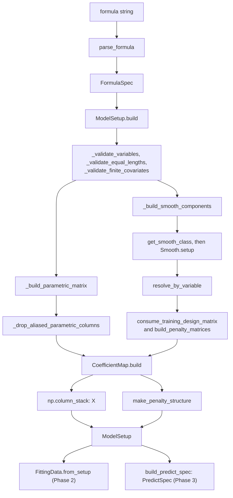
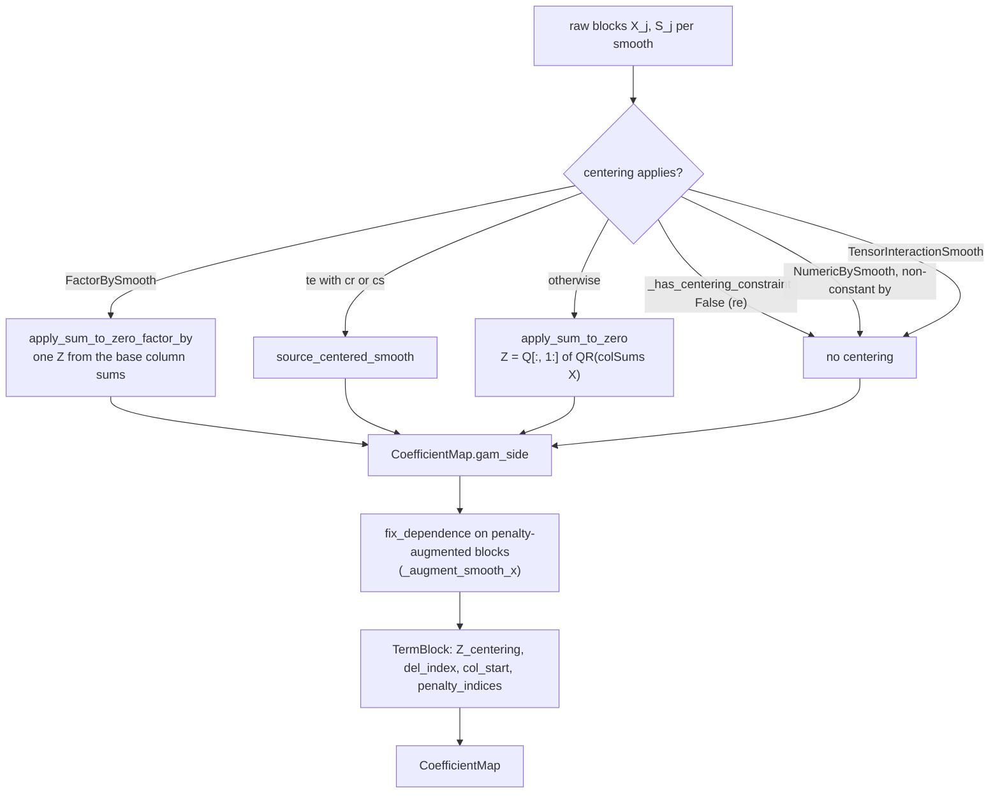
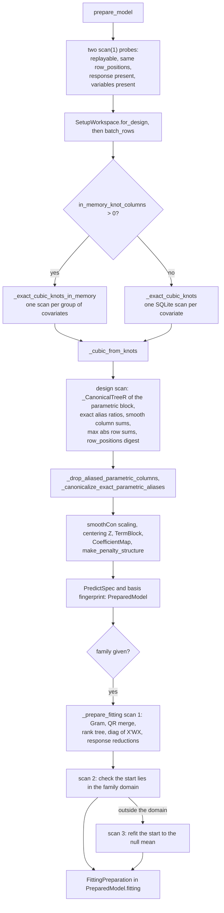
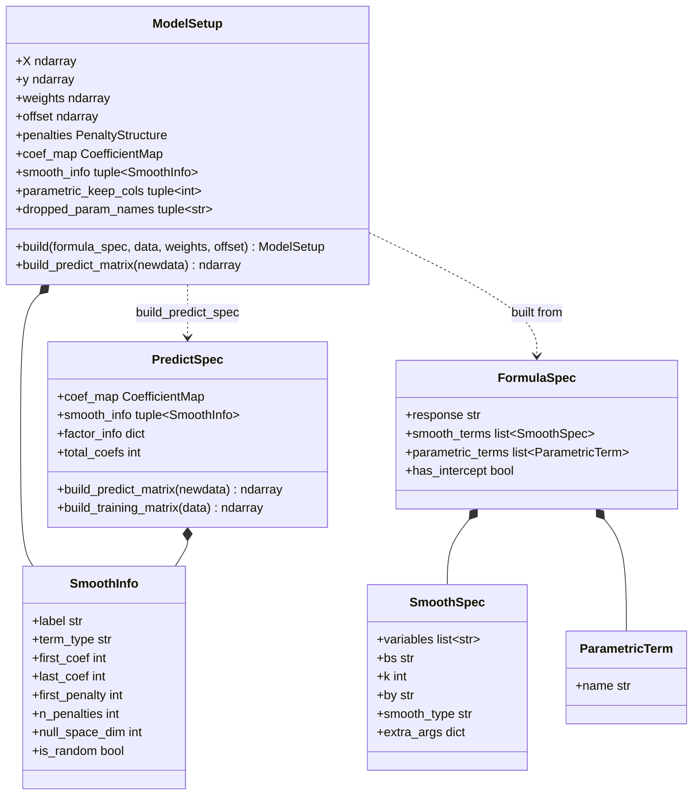
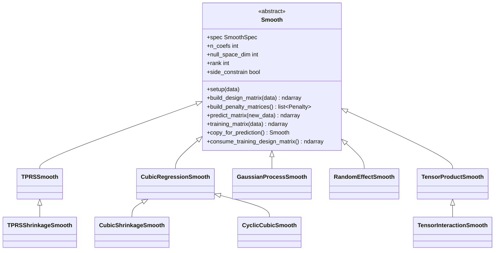
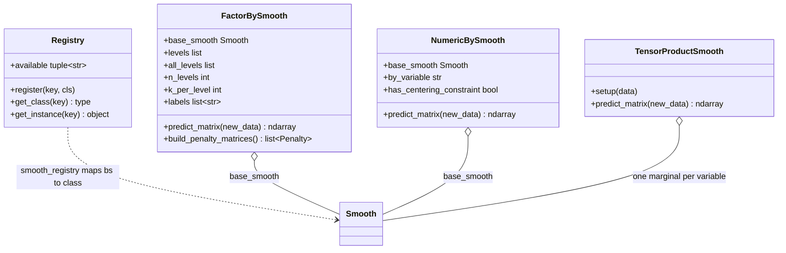
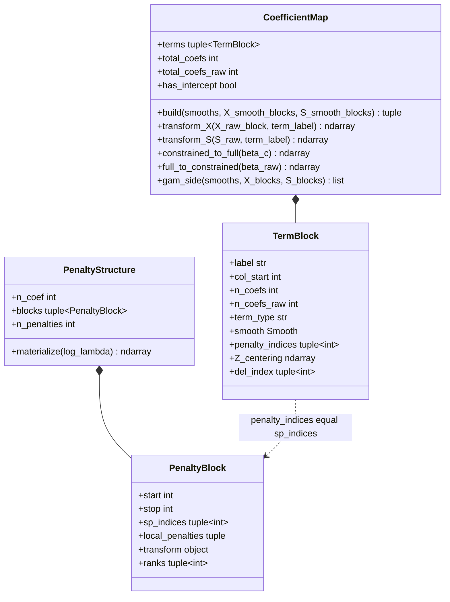
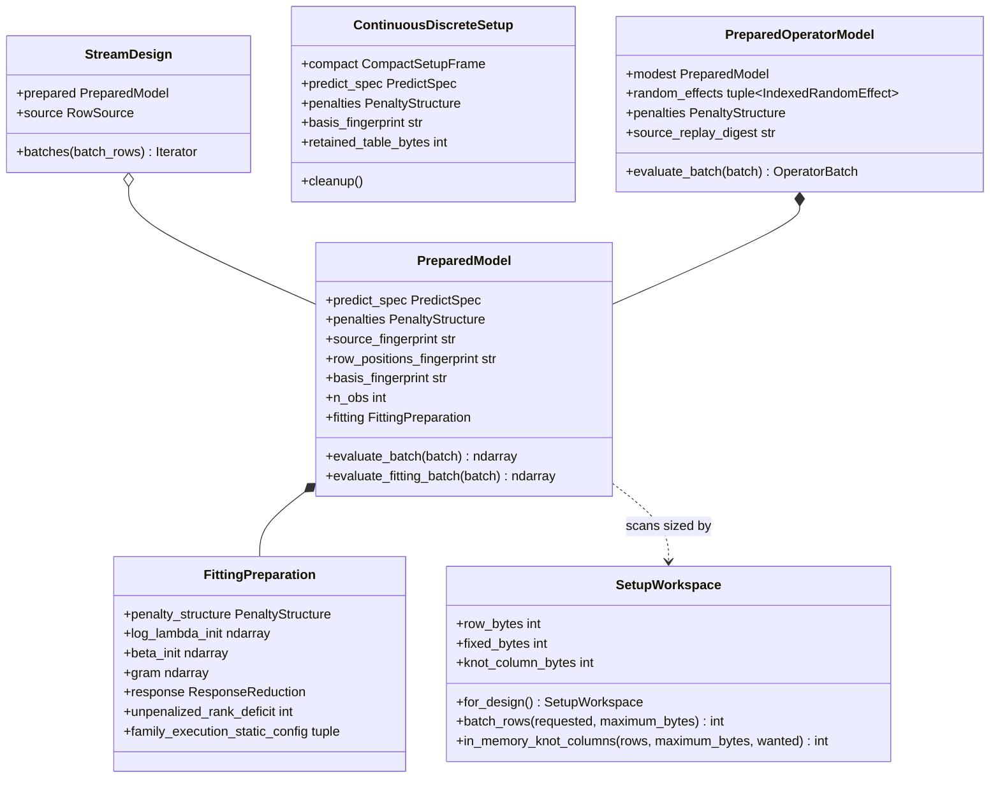

# Phase 1: model setup

## Scope

This page covers everything that happens before fitting, on the CPU with NumPy and SciPy: parsing the formula, constructing smooth bases and penalties, absorbing identifiability constraints into a `CoefficientMap`, and assembling the dense model matrix. It then covers the three row-source setups that never build a dense training matrix: streamed preparation (`jaxgam/formula/prepare.py`), the compact setup of the discretized route (`jaxgam/formula/discrete/continuous_setup.py` and its neighbours) and the operator preparation modules. Fitting starts at the Phase 1 to 2 boundary described in [fitting_dense.md](fitting_dense.md).

## Where the code is

| Module | Role |
|---|---|
| `jaxgam/formula/__init__.py` | Re-exports `parse_formula`, `FormulaSpec`, `SmoothSpec`, `ParametricTerm`. |
| `jaxgam/formula/parser.py` | AST-based parser: formula string to `FormulaSpec`. |
| `jaxgam/formula/terms.py` | Frozen term dataclasses `SmoothSpec`, `ParametricTerm`, `FormulaSpec`. |
| `jaxgam/formula/design.py` | `ModelSetup.build`, the dense setup (port of `gam.setup` in `R/mgcv.r`), and `SmoothInfo`. |
| `jaxgam/formula/predict_matrix.py` | `PredictSpec` (prediction-only setup state), `build_predict_spec`, `build_predict_matrix`, parametric and factor encoding shared by training and prediction. |
| `jaxgam/formula/design_provider.py` | `StreamDesign` (prepared metadata plus a source, evaluates one batch at a time) and `DenseDesign` (explicit materialization, used by tests). |
| `jaxgam/formula/prepare.py` | Streamed preparation: `prepare_model`, `prepare_fitting`, `PreparedModel`, `SetupWorkspace`, exact cubic knots. |
| `jaxgam/formula/fitting_prepare.py` | CPU fitting-coordinate preparation shared by dense and streamed setup: `reparameterize_structure`, `qr_penalty_roots`, `initial_log_sp_from_diagonal` (port of `initial.sp`), `FittingPreparation`. |
| `jaxgam/formula/rank_coordinates.py` | CPU rank-coordinate maps for Gaussian QR fitting (`IdentifiableCoordinateMap`, used by `jaxgam/execution/gaussian_qr/preparation.py`); follows `gdiPK`'s coordinate choice. |
| `jaxgam/formula/discrete/working_penalties.py` | `build_working_penalty_blocks`: the initial local penalty parameterization of `Sl.setup` (`R/fast-REML.r`) for the discrete working model. |
| `jaxgam/formula/kernel_groups.py` | Host grouping of equal-shape items (`shape_groups`, `pair_reduction_plan`, `discrete_pair_schedule`) so JIT kernels in `jaxgam/fitting/` trace one loop per shape. |
| `jaxgam/formula/discrete/design.py` | Indexed design descriptors: `FrozenDiscreteDesign`, `LookupBlock`, `TensorLookupBlock`, `DiscreteDesignControl`, the memory `_Ledger` and `_memory_plan`. |
| `jaxgam/formula/discrete/continuous_setup.py` | `build_continuous_discrete_setup`: basis setup on the compact frame of the discretized route. |
| `jaxgam/formula/discrete/continuous_design.py` | `build_continuous_discrete_design`: evaluates the frozen bases on compact representatives into a `FrozenDiscreteDesign`. |
| `jaxgam/formula/discrete/continuous_metadata.py` | Row-free record of the fitted discretization (`ContinuousDiscretizationMetadata`) and the prediction request grouping (`build_request_compression`). |
| `jaxgam/formula/operator/prepare.py` | `prepare_operator_model`: bounded preparation for the operator route, with symbolic random-effect blocks (`IndexedRandomEffect`). |
| `jaxgam/formula/operator/modest.py` | `prepare_modest_cubic_by`: the capped non-random-effect part of an operator model when it has `by=`, `te`/`ti` or radial terms. |
| `jaxgam/formula/operator/radial.py` | `prepare_radial_smooth`: rowless thin-plate and Gaussian-process setup for the operator route. |
| `jaxgam/formula/operator/workspace.py` | Prospective evaluator workspace bounds for operator prediction (`smooth_evaluator_workspace_bound`). |
| `jaxgam/smooths/__init__.py` | Re-exports the smooth classes, wrappers, `CoefficientMap`, `TermBlock` and the registry. |
| `jaxgam/smooths/base.py` | Abstract `Smooth` base class and the `smoothCon` penalty normalization helpers. |
| `jaxgam/smooths/registry.py` | `smooth_registry` and `get_smooth_class`. |
| `jaxgam/smooths/tprs.py` | `TPRSSmooth` (`tp`) and `TPRSShrinkageSmooth` (`ts`). |
| `jaxgam/smooths/cubic.py` | `CubicRegressionSmooth` (`cr`), `CubicShrinkageSmooth` (`cs`), `CyclicCubicSmooth` (`cc`). |
| `jaxgam/smooths/tensor.py` | `TensorProductSmooth` (`te`) and `TensorInteractionSmooth` (`ti`). |
| `jaxgam/smooths/gaussian_process.py` | `GaussianProcessSmooth` (`gp`). |
| `jaxgam/smooths/gp_kernels.py` | `GPKernel` and its five subclasses, `gp_kernel_registry`. |
| `jaxgam/smooths/random_effects.py` | `RandomEffectSmooth` (`re`). |
| `jaxgam/smooths/by_variable.py` | `FactorBySmooth`, `NumericBySmooth`, `resolve_by_variable`. |
| `jaxgam/smooths/constraints.py` | `CoefficientMap` and `TermBlock`: centering, `gam_side`, coefficient and design transforms. |
| `jaxgam/smooths/utils.py` | Factor detection (`is_factor`, `get_factor_levels`, `is_ordered_factor`), `row_tensor`, `radial_knot_options`, unique rows, Lanczos helpers. |
| `jaxgam/smooths/source_arithmetic.py` | Numba ports of mgcv's compiled scalar loops with the pinned build's fused multiply-add rounding, and `libm_exp`/`r_pow`. |
| `jaxgam/smooths/source_lapack.py` | Pinned LAPACK provider (`scipy-openblas32`) for source-exact cubic, thin-plate and Gaussian-process constructors. See [numerics_and_platform.md](numerics_and_platform.md). |
| `jaxgam/smooths/source_penalty_coordinates.py` | Source-faithful centering of `te` cubic penalties (`source_centered_smooth`) and the source eigensolver used for Gaussian determinants. |
| `jaxgam/penalties/__init__.py` | Re-exports `Penalty`, `CompositePenalty`, `PenaltyBlock`, `PenaltyStructure`. |
| `jaxgam/penalties/penalty.py` | `Penalty` (one symmetric matrix with rank and null-space dimension) and `CompositePenalty` (exported and tested, not used by the fit). |
| `jaxgam/penalties/structure.py` | Local penalty descriptors: `PenaltyStructure`, `PenaltyBlock`, `make_penalty_structure`, the `IdentityPenalty`/`DiagonalPenalty`/`DenseLocalPenalty` and transform types. |
| `jaxgam/penalties/stable_reparam.py` | `stable_reparam`: port of `gam.reparam` (`R/gam.fit3.r`) and `get_stableS` (`src/gdi.c`). Called from `jaxgam/fitting/stable_log_det.py` and `jaxgam/formula/fitting_prepare.py`. |

## How it works

### Which route uses which setup

| Route (`FitControl.execution`) | Setup entry point | Training matrix built? |
|---|---|---|
| `dense` | `parse_formula`, then `ModelSetup.build` (`jaxgam/api.py`) | Yes, dense `X` |
| `stream` | `parse_formula`, then `prepare_model(..., family=...)` and `StreamDesign` | No; one batch at a time |
| `discrete` | `parse_formula`, then `build_continuous_discrete_setup` from `jaxgam/execution/discrete/gaussian.py` | Only on the compact frame, then discarded |
| `operator` | `prepare_operator_model` | No; random effects stay symbolic |

The route dispatch itself is on [fit_lifecycle.md](fit_lifecycle.md).

### Formula parsing

`parse_formula` splits the string on the first `~`. The left side is taken verbatim as the response column name. The right side is parsed with `ast.parse(..., mode="eval")` and walked by `_TermCollector`; no regular expressions are used.

Accepted:

- `+` between terms. Long chains are flattened iteratively (`_additive_chain`), so the recursion depth does not grow with the number of terms.
- `0` and `- 1` (or a leading `-1`) remove the intercept; `1` restores it. The walk is left to right, so the last token wins, as in R.
- Bare names become `ParametricTerm`s. A repeated name is dropped, as R's `model.matrix` does.
- Calls to `s`, `te` and `ti` only (`_SMOOTH_FUNCTIONS`). Positional arguments must be bare names. A smooth identical to an earlier one (same variables, `bs`, `k`, `by`, type and extra arguments) is dropped, like R's `terms.formula`; a repeat with a different configuration is kept.
- Keywords: `k` must evaluate to an `int`, `bs` to a `str`, `by` to a name or string. `fx=False`, `sp=None` and `id=None` are accepted and ignored. `TRUE`, `FALSE` and `NA` are mapped to `True`, `False` and `None`. Every other keyword is evaluated with `ast.literal_eval` into `SmoothSpec.extra_args` (for example `m`, `xt`, `max_knots`, `seed`, and the GP options).

Rejected:

- `ValueError` for `*`, `:` (not valid Python, so `ast.parse` fails), `- x` other than `- 1`, any function other than `s`/`te`/`ti` (including `I()`, `offset()`, `factor()`), non-name positional arguments, non-literal keyword values, and a non-integer `k` (so per-margin `k=[5, 6]` is rejected).
- `NotImplementedError` for `fx=True`, a per-term `sp=` other than `None`, and any `id=` other than `None`. The `id` check also runs in `SmoothSpec.__post_init__`, so a hand-built spec cannot bypass it.

The parser does not check `bs`. An unregistered basis fails at setup with the registry's `KeyError` (see [families_links_smooths.md](families_links_smooths.md)). Unread keys in `extra_args` are ignored without a warning.

Default bases: `s()` uses `tp`; `te()` and `ti()` use `cr` (`_DEFAULT_BASIS`), as in R.

### Dense model setup

Read it top to bottom: validation, then the parametric block and the smooth blocks are built independently, joined in `CoefficientMap.build`, and the result is one frozen `ModelSetup` that feeds both the fit and prediction.

`ModelSetup.build` in order:

1. Converts the data to a column mapping (`predict_matrix._to_dict`, which keeps categorical Series intact).
2. Validates: the response exists, is finite and has at least two rows; every formula variable exists and has the response's length; weights are finite, non-negative and not all zero; the offset is finite; numeric covariates are finite (factor columns are skipped).
3. Builds the parametric block (`_build_parametric_matrix`): an intercept column, numeric columns as given, factors with treatment contrasts and ordered factors with polynomial contrasts (`_contr_poly`). Without an intercept the first factor is coded in full. A factor needs at least two levels.
4. Drops exactly aliased parametric columns (`_drop_aliased_parametric_columns`): a pivoted QR with tolerance `|R[0,0]| * eps**0.9`, as mgcv's `Rrank` check; the intercept is never dropped. Dropped names are kept in `dropped_param_names` and reproduced at prediction through `parametric_keep_cols`.
5. Builds each smooth (`_build_smooth_components`): looks up the class, calls `setup`, wraps it with `resolve_by_variable`, takes ownership of the training basis with `consume_training_design_matrix` and collects the raw penalties from `build_penalty_matrices`.
6. Applies constraints with `CoefficientMap.build` (next sections).
7. Stacks `X = [X_parametric, constrained smooth blocks...]` and checks its width against `coef_map.total_coefs`.
8. Stores penalties locally with `make_penalty_structure`. With `source_penalty_coordinates=True` (the discretized route passes it) a second `source_determinant_penalties` structure keeps multi-penalty blocks in the coordinates pinned mgcv uses for determinants.
9. Builds `SmoothInfo` per smooth (one entry per level for a factor-by smooth, as mgcv's per-level `object$smooth`), the column names, and the factor levels of parametric factors (`factor_info`, `ordered_factors`).

The Phase 1 to 2 transfer, `FittingData.from_setup`, is in `jaxgam/fitting/data.py` and is described on [fitting_dense.md](fitting_dense.md).

### Smooth construction

`_build_smooth_components` resolves the registry key as `spec.smooth_type` for `te`/`ti` and `spec.bs` otherwise, instantiates the class with the `SmoothSpec`, and calls `setup(data_dict)`. Each `setup` builds the training basis (kept in `_X`), the penalty matrices, and the dimensions `n_coefs`, `rank` and `null_space_dim`, then sets `_is_setup`. Most constructors end with `smoothCon`'s penalty scaling, dividing the penalty by `norm(S, 1) / norm(X, inf)**2` (`Smooth._smoothcon_normalize`, or `_source_smoothcon_normalize`, which follows LAPACK `dlange`'s summation order; tensor products scale each margin penalty by its own norm).

| Class (`bs`) | mgcv routines ported | Notes from the code |
|---|---|---|
| `TPRSSmooth` (`tp`) | `smooth.construct.tp.smooth.spec`, `Predict.matrix.tprs.smooth` (`R/smooth.r`); `tprs_setup`, `predict_tprs` (`src/tprs.c`); `Rlanczos` (`src/mat.c`) through `source_lanczos` | Default `k = M + (8, 27, 100)[min(d,3)-1]` where `M` is the null-space dimension (`_default_k`); `k` is raised to `M + 1`. Knots are the unique centred rows; when there are more than `max_knots` (default 2000) unique rows, that many are sampled with a port of R's sampler (`r_sample_knot_rows`). Training rows map to knot rows (`training_matrix`), which differ from prediction rows. |
| `TPRSShrinkageSmooth` (`ts`) | `smooth.construct.ts.smooth.spec` | Null-space eigenvalues of `S` replaced by `0.1` times the smallest non-zero absolute eigenvalue (`_uniform_replacement`); `null_space_dim` becomes 0. |
| `CubicRegressionSmooth` (`cr`) | `smooth.construct.cr.smooth.spec`, `place.knots`, `Predict.matrix.cr.smooth` (`R/smooth.r`); `getFS` (`src/mgcv.c`) | Default `k = 10`, raised with a warning to 3. Knots interpolate equally spaced ranks of the unique values. Sets `_noterp = True`. |
| `CubicShrinkageSmooth` (`cs`) | `smooth.construct.cs.smooth.spec` | Geometric null-space shrinkage through `cubic_shrinkage_penalty` on the pinned provider. |
| `CyclicCubicSmooth` (`cc`) | `smooth.construct.cc.smooth.spec`, `Predict.matrix.cyclic.smooth` | Minimum `k` 4; `k - 1` coefficients; null space of dimension 1. |
| `GaussianProcessSmooth` (`gp`) | `smooth.construct.gp.smooth.spec`, `gpE`, `Predict.matrix.gp.smooth` | Kernel from `gp_kernel_registry` (default `matern_3_2`); `m=` raises `ValueError`; negative truncated eigenvalues are replaced by their absolute values with a warning. |
| `RandomEffectSmooth` (`re`) | `smooth.construct.re.smooth.spec`, `Predict.matrix.random.effect` | Design equals `model.matrix(~v1:...:vN - 1)`; identity penalty scaled by `norm(X, inf)**2`; `k` ignored; `side_constrain = False`, `_has_centering_constraint = False`. Unseen or missing levels predict 0. |
| `TensorProductSmooth` (`te`) | `smooth.construct.tensor.smooth.spec`, `tensor.prod.penalties`, `Predict.matrix.tensor.smooth` | One 1-D margin per variable, all with the term's `bs` and one scalar `k` (default 5 per margin); only `m` is forwarded to the margins. Univariate margins whose class leaves `_noterp` false (thin plate, GP) are reparameterized at evenly spaced points (`_reparameterize_margin`); cubic margins are not. One penalty per margin. |
| `TensorInteractionSmooth` (`ti`) | the same routines, with margin constraints | Absorbs a centering constraint into each margin before the product, so `CoefficientMap.build` skips its centering. |

By-variables are resolved after `setup` by `resolve_by_variable`, which applies to `s`, `te` and `ti` alike:

- A factor `by` (pandas categorical, object or string column; integers are never factors, see `is_factor`) returns a `FactorBySmooth`: one block per level, rows non-zero only in their level's block, one penalty per level and base penalty, labels `s(x):fLEVEL`. An ordered factor drops its first level. An empty level raises `ValueError`. At prediction an unseen level gives a `NaN` row and the warning `factor levels ... not in original fit`.
- A numeric `by` returns a `NumericBySmooth`: the base basis times the column, same penalties. It keeps the centering constraint only when the column is constant (R's `sd(by) > mean(by) * eps * 1000` test).

Neither wrapper subclasses `Smooth`; they duck-type the same members and hold the base smooth in `base_smooth`.

### Identifiability constraints and CoefficientMap

Each smooth first loses one column to its sum-to-zero constraint (`Z` has shape `(k, k-1)`), unless it opts out. Then `gam_side` (port of `gam.side`, with `fixDependence` and `augment.smX` from `R/mgcv.r`) runs from low to high dimension and deletes columns of a smooth that are linearly dependent on the intercept plus the smooths processed before it (lower-dimensional ones, or earlier ones of the same dimension) that share one of its variables. It returns early when no two smooths share a variable. A parametric term sharing a smooth's variable (`y ~ x + s(x)`) never triggers a deletion, as in R. Two 1-D smooths of the same variable are both kept, the later one side-constrained, with the warning `model has repeated 1-d smooths of same variable.`

`CoefficientMap` (frozen) holds one `TermBlock` per term: a single `parametric` block first, then one block per smooth with its constrained width `n_coefs`, raw width `n_coefs_raw`, `Z_centering`, `del_index` and `penalty_indices`. It maps both ways:

- `transform_X` and `transform_S` take a raw design or penalty block to constrained coordinates (`X @ Z`, then drop `del_index`).
- `constrained_to_full` and `full_to_constrained` move coefficient vectors between the constrained and raw bases.

Prediction depends on it because the fitted coefficients live in constrained coordinates. `build_predict_matrix` evaluates each smooth's raw `predict_matrix` on new data and passes it through `coef_map.transform_X` with that term's own `TermBlock`, so new rows get exactly the centering and deletions of the training design. If the map were wrong, the fit could be right and every prediction wrong; `tests/test_predict/test_predict.py` checks that predicting the training data reproduces `fitted_values`.

### Penalties

`make_penalty_structure` stores each smooth's constrained penalties in that smooth's coefficient block, never padded to `p x p`:

- A `PenaltyBlock` has `start`/`stop`, the global `sp_indices`, the `local_penalties` and an initial `IdentityTransform`.
- Each local matrix becomes an `IdentityPenalty` (scaled identity), a `DiagonalPenalty`, or a `DenseLocalPenalty`.
- Several penalties with disjoint supports (factor-by levels) become one block per penalty covering only its own interval. Overlapping penalties (tensor margins) share one block.
- Source-centered `te` cubic penalties keep their exact bytes (`preserve_bytes`), because re-symmetrizing them changes the pinned coordinate gauge.

`PenaltyStructure.materialize` builds the combined `S_lambda` explicitly when a caller needs it, with smoothing parameters formed by `libm_exp`. The penalty reparameterization used by the fit (`reparameterize_structure`, `stable_reparam`) is described on [fitting_dense.md](fitting_dense.md).

### Prediction state

`build_predict_spec` turns a `ModelSetup` into a `PredictSpec`: the `CoefficientMap` with each smooth replaced by `copy_for_prediction()` (training design, penalties and other fit caches dropped), the `SmoothInfo`, column names, factor levels and alias columns. `ModelSetup` builds it lazily and caches it. In Phase 3 `GAMPredictor` holds the `PredictSpec` rather than the `ModelSetup`, while a full `GAMResults` also keeps its `setup`; see [results_and_prediction.md](results_and_prediction.md). `PredictSpec.build_training_matrix` instead evaluates `training_matrix`, which differs from `predict_matrix` only where a thin-plate basis with data knots is involved (directly, as a tensor margin or under a by wrapper); it is used only to replay setup-source rows (`PreparedModel.evaluate_batch`).

### Streamed preparation

`prepare_model` builds the same frozen metadata as dense setup, for a narrower formula, by scanning a `RowSource` several times and keeping only coefficient-sized state. It never calls `ModelSetup.build`. Accepted: univariate `s(x, bs="cr")` or `bs="cs"` (and `cc` when the caller passes `allow_cyclic=True`, which only the operator route does), distinct smooth variables, numeric parametric terms, with or without an intercept. Everything else raises `NotImplementedError` before the design scan: `by=`, `te`/`ti`, other bases, factor parametric terms and two smooths of one variable.

Read each box below the probes as one full scan of the source, except the knot box, which is one scan per group of covariates (in memory) or one per covariate (SQLite).

What each scan produces:

- **Probes.** Two `scan(1)` calls must return equal first `row_positions`, or the source is not replayable (`TypeError`). The first batch gives the column dtypes used to size the workspace.
- **Exact cubic knots.** mgcv's `place.knots` interpolates ranks of the sorted unique values, so knots need every distinct value. In memory, a covariate costs 8 bytes per row and as many covariates are gathered per scan as the budget allows. Otherwise each covariate gets a temporary on-disk SQLite table (`PRAGMA temp_store = FILE`, a 2,048 KiB page cache) and the needed ranks are read with `SELECT DISTINCT` and `ROW_NUMBER()`. Both paths share `_interpolate_knots` and give bitwise-identical knots (`test_in_memory_knots_are_bitwise_equal_to_sqlite_knots` in `tests/test_formula/test_prepare.py`).
- **Design scan.** Column sums give each smooth's centering constraint; the maximum absolute row sum gives `smoothCon`'s scaling, applied before centering as in dense setup. The parametric block feeds a `_CanonicalTreeR`.
- **Rank and alias decisions.** `_CanonicalTreeR` cuts rows into fixed 1,024-row leaves by scan ordinal and merges leaf R factors in a binary tree, so the R factor, and every decision made from it, does not depend on the batch partition. The parametric R factor goes through the dense `_drop_aliased_parametric_columns`, then `_canonicalize_exact_parametric_aliases` reproduces the dense pivot choice for exactly proportional columns. In `_prepare_fitting` a second tree on the unpenalized directions gives `unpenalized_rank_deficit` (an SVD with tolerance `max(sv) * max(n, columns) * eps`).
- **Fitting scans** (`_prepare_fitting`, only with a `family`). They compute the start coefficients from `family.initialize` and `family.link`, `diag(X'WX)` for `initial_log_sp_from_diagonal`, and the response, weight and offset ranges in `ResponseReduction`. The family is duck-typed: this Phase 1 module never imports `jaxgam.families`. Its `execution_static_config()` and `execution_parameter_snapshot()` are stored and compared again at the end, so a family mutated during preparation raises.

The fingerprint is checked at the start and end of `prepare_model` and `_prepare_fitting`; `GAM._fit_stream` runs the whole preparation inside `single_fit_fingerprints()` (see [data_sources.md](data_sources.md)).

**The setup workspace and its budget.** `SetupWorkspace.for_design` estimates the live bytes per batch row and the fixed bytes of a design scan and, with cubic smooths, of a knot scan. An SQLite knot scan is charged a fixed 16 MiB (`_SQLITE_SCOPE_BYTES`) whether or not it runs, so every cubic model needs at least that much. `batch_rows(requested, maximum_bytes)` returns the largest scan size that fits, or raises `MemoryError("Streamed setup requires at least ...")` before any full scan when one row does not fit. `GAM._fit_stream_routes` passes `FitControl.batch_rows` and `FitControl.memory_budget_bytes`. The estimate covers JaxGAM-owned arrays only; source storage, allocator retention and native BLAS/LAPACK workspace are outside it. `test_setup_workspace_bounds_traced_setup_allocations` checks it with `tracemalloc`.

### Compact setup for the discretized route

The discretized route reproduces `bam(discrete=TRUE)`: covariates are compressed first, and bases are then built on the compact rows.

1. `build_continuous_discrete_setup` opens `single_fit_fingerprints(verify_on_exit=False)` and calls `build_compact_setup_frame` (in `jaxgam/data/continuous_frame.py`; see [data_sources.md](data_sources.md)). That returns a padded compact `DataFrame` and one `CompactGroup` with row selectors per jointly discretized group.
2. `_prospective_basis_bytes` bounds the arrays `ModelSetup.build` will create on the compact frame; with the frame's retained bytes it must fit `DiscretizationBudget.max_table_bytes`, or the result is a `ContinuousSetupUnavailable`.
3. `ModelSetup.build(formula, compact.frame, source_penalty_coordinates=True)` runs the ordinary dense setup on the compact frame, so every registered basis is accepted. Only `build_predict_spec`, the penalties and the source determinant penalties are kept; the compact training `X` is discarded.
4. The result is a `ContinuousDiscreteSetup` with a `basis_fingerprint` (SHA-256 of the pickled `PredictSpec`) and a byte ledger.

Then `_prepared_discrete` in `jaxgam/execution/discrete/gaussian.py` calls `build_discretization_metadata` and, for `prediction_policy="mgcv_predict_bamd"`, `build_request_compression` (both in `jaxgam/formula/discrete/continuous_metadata.py`), and `build_continuous_discrete_design` (`jaxgam/formula/discrete/continuous_design.py`). That last step evaluates each term's frozen `predict_matrix` on its group's compact representatives and stores the constrained table with the group's selector as a `LookupBlock`, or as a `TensorLookupBlock` for tensor and by terms, where margins and the by multiplier are separate indexed tables. Each step returns a typed unavailable value (`ContinuousSetupUnavailable`, `DiscreteDesignUnavailable`) instead of raising; `_prepared_discrete` turns it into `MemoryError("{reason}: requires {n} bytes, budget is {m}.")`. A multi-variable random effect, `s(x, g, bs="re")`, is refused by `_reject_unsupported_formula`. The fit itself is on [fitting_discrete.md](fitting_discrete.md).

`jaxgam/formula/discrete/design.py` also holds exact (unrounded) descriptor builders, `build_discrete_design_from_predict_spec` and its `build_discrete_design_from_prepared` and `build_discrete_design_from_setup` adapters. They replay a frozen `PredictSpec` over `exact_index_columns` rather than re-running setup on unique rows, because re-running it would change centering and normalization. At HEAD only tests call them.

### Operator preparation

`prepare_operator_model` accepts numeric parametric terms, `cr`/`cs`/`cc`, `tp`/`ts`/`gp` and `re`; `re` cannot have `by=` or be a tensor. It splits the formula:

- **Random effects** are never built densely. One scan discovers factor levels (declared categorical levels are kept in order, otherwise observed levels are sorted) and the maximum interaction amplitude. Each term becomes an `IndexedRandomEffect` (per row: one level ID and one amplitude; unknown levels get amplitude 0) and a `PenaltyBlock` with an `IdentityPenalty` scaled by the squared maximum amplitude, which mirrors `smoothCon`'s scaling of the dense `re` penalty.
- **The modest part** (all other terms) is capped at `OperatorPreparationControl.max_modest_coefficients` (default 64) raw columns. Plain cubic and numeric terms use `prepare_model(..., allow_cyclic=True)`; terms with `by=`, `te`/`ti` or radial bases use `prepare_modest_cubic_by`, which calls `prepare_radial_smooth` for `tp`/`ts`/`gp`. That function harvests knots following `uniquecombs(ordered=TRUE)` and the R sampler and, for `tp`/`ts`, reuses the dense `tprs_setup` port (`_source_tprs_knot_basis`).
- **Replay checking.** Every scan goes through `_CheckedSource`, which hashes every row (position, every column value, `y`, weight, offset) and requires each replay to give the same digest.

`jaxgam/formula/operator/workspace.py` bounds the prediction scratch of radial smooths, whose knots can make evaluation larger than the coefficient width suggests. The fit is on [fitting_operator.md](fitting_operator.md).

## Key types

The three formula types are frozen dataclasses produced by `parse_formula`; `ModelSetup` and `PredictSpec` are the dense setup's output and its prediction-only projection. `SmoothInfo` is per smooth (per level for factor-by smooths), whereas `coef_map.terms` is per formula term.

All nine registered classes derive from `Smooth`. The four abstract methods are `setup`, `build_design_matrix`, `build_penalty_matrices` and `predict_matrix`; the others have defaults on the base class.

`smooth_registry` is a `Registry` instance in `jaxgam/smooths/registry.py`; the by-variable wrappers and tensor products compose base smooths rather than subclass them.

`TermBlock.smooth` may also be a `FactorBySmooth` or `NumericBySmooth`. A `PenaltyBlock` is placed by `col_start` and the smooth's width; its `sp_indices` are the global smoothing-parameter positions listed in the term's `penalty_indices`.

These are the row-free outputs of the three row-source setups; none holds an observation-sized array except the compact frame's selectors.

## Rules and invariants

- **No JAX in Phase 1.** `jaxgam/formula/`, `jaxgam/smooths/` and `jaxgam/penalties/` contain no `import jax`. They do use SciPy, Numba (`jaxgam/smooths/cubic.py`, `jaxgam/smooths/utils.py`, `jaxgam/smooths/source_arithmetic.py`) and `ctypes` (`jaxgam/smooths/cubic.py`, `jaxgam/smooths/source_lapack.py`, `jaxgam/smooths/source_arithmetic.py`). Families reach `jaxgam/formula/prepare.py` duck-typed, never imported. Import guards that stub the package and assert JAX stays unloaded exist for some modules only: `test_compact_setup_import_does_not_import_jax` (`tests/test_formula/test_continuous_setup.py`), `test_continuous_descriptor_import_does_not_import_jax` (`tests/test_formula/test_continuous_design.py`), `test_metadata_module_imports_without_jax` (`tests/test_formula/test_continuous_metadata.py`) and `test_global_rank_coordinate_helpers_import_without_jax` (`tests/test_formula/test_rank_coordinates.py`).
- **Bases match pinned mgcv.** Knot placement, eigen truncation and normalization are ported operation by operation; R comparisons of the bases are in `tests/test_smooths/` (`tests/test_smooths/test_tprs.py`, `tests/test_smooths/test_tprs_source_parity.py`, `tests/test_smooths/test_cubic.py`, `tests/test_smooths/test_tensor.py`, `tests/test_smooths/test_gaussian_process.py`, `tests/test_smooths/test_random_effects.py`, `tests/test_smooths/test_by_variable.py`), and of whole fits in `tests/test_validation_matrix.py`.
- **Prediction reproduces training.** `build_predict_matrix` on the training data must equal the training design through the same `CoefficientMap` (`tests/test_predict/test_predict.py`, `tests/test_constraints.py`).
- **Setup owns the training basis.** `setup` must leave the basis in `_X`; `consume_training_design_matrix` transfers it and clears it, so no smooth keeps a second `n x k` matrix (`tests/test_smooths/test_prediction_copy.py`).
- **Every smooth class chooses a prediction-copy strategy.** `test_copy_for_prediction_registry_audit` fails for a registered class that neither overrides `copy_for_prediction` nor is on its audited list.
- **Penalties stay local and symmetric.** `Penalty` validates symmetry; `make_penalty_structure` never pads to `p x p` (`tests/test_penalties/test_structure.py`, `tests/test_penalties.py`).
- **Streamed decisions are partition-invariant.** Knots, alias and rank decisions do not depend on `batch_rows` (`test_prepared_model_is_invariant_to_setup_batch_partition`, `test_canonical_tree_r_is_bitwise_invariant_to_row_chunking` in `tests/test_formula/test_prepare.py`), and the streamed metadata matches dense setup (`test_prepared_cubic_matches_dense_setup_and_batch_boundaries`).

## Pitfalls

- **Label collisions.** `s(x, k=6) + s(x, k=8)` gives two smooths with the same label. `SmoothInfo`, column names and `transform_X` pair smooths with `TermBlock`s by position, never by label (comments in `jaxgam/formula/design.py` and `jaxgam/formula/predict_matrix.py`). New code must do the same; `CoefficientMap.get_term(label)` returns the first match.
- **Integer columns are not factors.** `is_factor` follows R's `is.factor`: an integer-coded group in `s(g, bs="re")` or `by=g` becomes one numeric column without a warning.
- **`te` cubic margins.** For `te` with `cr`/`cs`, margins are built without `smoothCon` normalization (`setup(data, _normalize_penalty=False)`), centered with `source_centered_smooth`, and stored with `preserve_bytes`. Re-symmetrizing or normalizing them changes the rank-deficient coordinate gauge pinned R uses.
- **`bs="te"` inside `s()`.** `te` and `ti` are registry keys but are chosen by the function name. `s(x, bs="te")` recurses until Python raises a RecursionError.
- **Thin-plate training rows are not prediction rows.** With data knots, `tprs_setup` maps each datum to its knot row, which differs from re-evaluating the kernel by the Lanczos residual. Source replay must use `training_matrix` or `copy_for_training()`, not `predict_matrix`.
- **Silently ignored keywords.** Unread `extra_args` keys (for example `pc=`, `select=`, `d=`) are accepted without a warning, and only `m` is forwarded to tensor margins.

## Where to change things

- **Accept a new formula construct:** `_TermCollector` in `jaxgam/formula/parser.py`, then `FormulaSpec` in `jaxgam/formula/terms.py` and `ModelSetup.build`; add cases to `tests/test_formula/test_parser.py`.
- **Add or change a smooth basis:** a `Smooth` subclass in `jaxgam/smooths/`, registered in `jaxgam/smooths/registry.py`; see the checklist on [families_links_smooths.md](families_links_smooths.md).
- **Change centering or side constraints:** `CoefficientMap.build` and `CoefficientMap.gam_side` in `jaxgam/smooths/constraints.py`; tests in `tests/test_constraints.py`.
- **Change parametric or factor encoding:** `_build_parametric_matrix` and `_encode_factor` in `jaxgam/formula/predict_matrix.py`. Training and prediction share them, so both change together.
- **Change how penalties are stored:** `make_penalty_structure` in `jaxgam/penalties/structure.py`, and every consumer of `PenaltyBlock` in `jaxgam/formula/fitting_prepare.py` and `jaxgam/fitting/`.
- **Widen streamed preparation:** `_cubic_class` and the checks at the top of `prepare_model`; extend `SetupWorkspace.for_design` for any new per-row array.
- **Change the discretized setup bound:** `_prospective_basis_bytes` in `jaxgam/formula/discrete/continuous_setup.py` and `_memory_plan` in `jaxgam/formula/discrete/design.py`.
- **Widen operator preparation:** the term checks in `prepare_operator_model` and `prepare_modest_cubic_by`.
