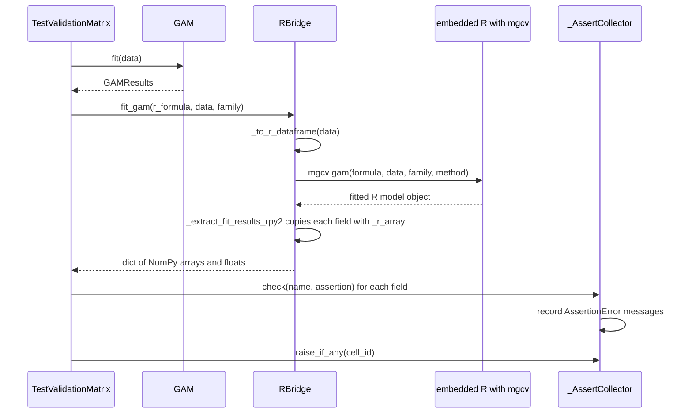
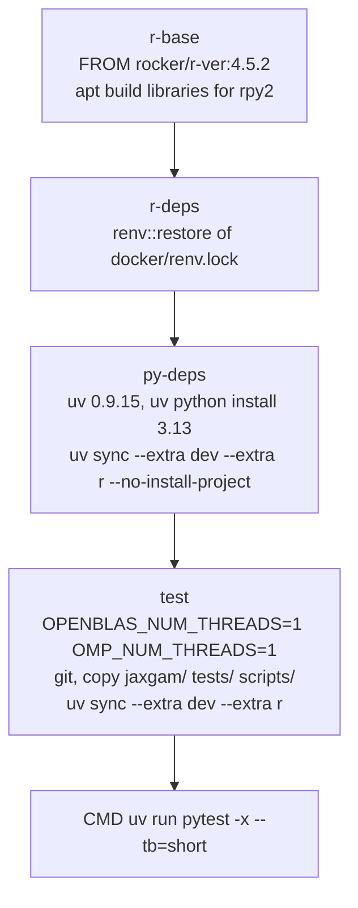
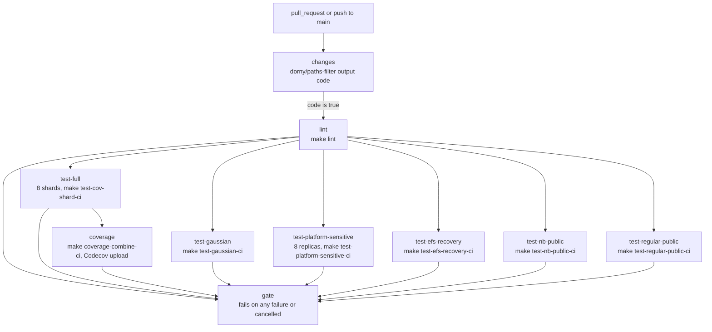
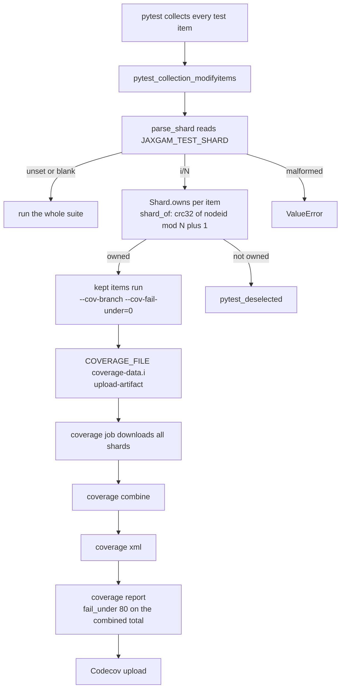
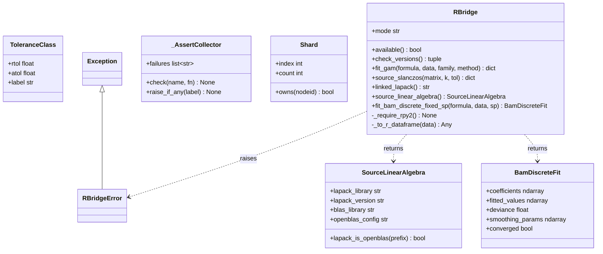

# Testing and continuous integration

## Scope

This page explains how JaxGAM establishes and guards numerical correctness.
It covers the layout of `tests/` and its shared support modules, the R bridge
that runs pinned mgcv in the test process, the tolerance classes, the
validation matrix and hard-gate invariants, platform-sensitive tests, the
Docker test image, the Makefile targets, and the GitHub Actions workflows that
run all of it.

## Where the code is

| Path | Role |
|---|---|
| `tests/conftest.py` | Data fixtures, the `r_bridge` fixture, shard selection (`pytest_collection_modifyitems`), the report header and the replay-count terminal summary. |
| `tests/helpers.py` | `SEED`, `N`, `r_available`, `r_tolerance`, `_AssertCollector`, `check_that`, `check_flat_ridge_endpoint`, `make_smooth_spec`, data generators, OpenBLAS identity probes and the per-platform replay bounds. |
| `tests/tolerances.py` | `ToleranceClass` and its three instances `STRICT`, `MODERATE`, `LOOSE`; the sign normalizers `normalize_column_signs` and `normalize_symmetric_signs`. |
| `tests/sharding.py` | `Shard`, `shard_of`, `parse_shard` and `SHARD_ENV`: the CRC-32 split of the suite over CI runners. |
| `tests/r_bridge.py` | `RBridge`, `RBridgeError`, the typed frozen result dataclasses, and `_r_array`, the copy of R values into NumPy memory. |
| `tests/r_ast.py` | Builds R language objects through rpy2 for instrumenting pinned mgcv internals without editing or parsing source. |
| `tests/r_number_format.py` | Exact model of R 4.5.2's numeric `paste0` label, whose rounding depends on the platform's `long double` width. |
| `tests/efs_oracle.py` | Reproducible EFS oracle fixtures and controller traces modelled on mgcv's `efsudr`; also the `make efs-fixture` generator. |
| `tests/operator_efs_calibration.py` | Generated rows and a 50-digit `decimal` REML reference for the operator Fellner-Schall calibration. |
| `tests/test_validation_matrix.py` | The 75-cell R comparison, the hard-gate invariants and route-level parity tests against pinned R. |
| `Dockerfile`, `docker/renv.lock`, `.dockerignore` | The test image with pinned R 4.5.2 and mgcv 1.9-3. |
| `Makefile` | Contributor and CI entry points. |
| `.github/workflows/test.yml` | Lint, sharded test suite, combined coverage, focused jobs, platform-sensitive replicas and the gate. |
| `.github/workflows/docs.yml`, `.github/workflows/publish.yml` | Documentation deployment and PyPI release. |
| `.pre-commit-config.yaml` | ruff, ruff-format and vulture hooks. |
| `pyproject.toml` | pytest markers, coverage settings, ruff and vulture configuration. |

## How it works

### Test layout

There are 178 `test_*.py` modules. Each directory mirrors a package area:

| Directory | Owns |
|---|---|
| `tests/` (31 modules at top level) | Cross-cutting checks: `tests/test_validation_matrix.py`, families and links (`tests/test_families.py`, `tests/test_links.py`), the R bridge itself (`tests/test_r_bridge.py`, `tests/test_r_ast.py`), sharding (`tests/test_sharding.py`), replay bounds (`tests/test_replay_bounds.py`), the Accelerate guard (`tests/test_platform_guard.py`), result modes, constraints, the benchmark harnesses and the tolerance classes (`tests/test_infrastructure.py`). |
| `tests/test_api/` | `GAM` construction and fitting through the public API. |
| `tests/test_data/` | Row sources, source tokens, discretization, continuous range grids and R number formatting. |
| `tests/test_execution/` (60 modules) | Phase 2 host drivers in `jaxgam/execution/`: streamed PIRLS and REML, QR reducers, EFS providers, discretized and operator routes. |
| `tests/test_fitting/` (39 modules) | Phase 2 JAX kernels in `jaxgam/fitting/`: PIRLS, REML, Newton, EFS algebra, streamed, discretized and operator kernels, JIT behaviour. |
| `tests/test_formula/` | Parser, dense design, streamed, discretized and operator setup. |
| `tests/test_smooths/` | Basis and penalty construction, the pinned LAPACK provider and source arithmetic. |
| `tests/test_penalties/` | Penalty structure and stable reparameterization (there is also a top-level `tests/test_penalties.py`). |
| `tests/test_inference/`, `tests/test_predict/`, `tests/test_summary/`, `tests/test_plot/` | Phase 3: `GAMPredictor`, operator prediction geometry, prediction, summary tables, plots. |
| `tests/test_scripts/` | The benchmark scripts under `scripts/`. |

No reference data is stored. `.gitignore` ignores `*.csv` and `/tests/fixtures/`;
inputs are generated in code from seeds (`SEED = 42`, `N = 200` in
`tests/helpers.py`) and references come from R at test time.

### Shared support modules

- `tests/conftest.py` provides seeded data fixtures (`simple_gaussian_data`,
  `factor_by_data`, `re_model_data`, `gp_2d_data`, `family_data` and others),
  the `r_bridge` fixture, the shard hook, `pytest_report_header` and
  `pytest_terminal_summary`, and `minimal_git_checkout`, which builds a
  throwaway committed checkout because the Docker image has no `.git`.
- `tests/helpers.py` holds `r_available()` (true only when the bridge loads R
  and the versions match), `r_tolerance(family_name)` (`MODERATE` for Gaussian,
  `LOOSE` otherwise), `_AssertCollector` and `check_that`,
  `check_flat_ridge_endpoint` (the rule for judging a REML endpoint where
  pinned R stopped on a flat ridge), `_setup_fd` (a `FittingData` without the
  public API), shared prediction case zoos, `r_links_pinned_openblas`,
  `platform_report_lines`, and the replay-bound machinery described below.
- `tests/tolerances.py` and `tests/sharding.py` are described in their own
  sections.

### The R bridge

`tests/r_bridge.py` (about 9,500 lines) is the only sanctioned way for tests to
obtain mgcv reference values. Its constants pin `_REQUIRED_R_VERSION = "4.5.2"`
and `_REQUIRED_MGCV_VERSION = "1.9.3"` (R's `packageVersion` spelling of
1.9-3), and `_PINNED_MGCV_SOURCE_COMMIT` records the mgcv source commit in
oracle provenance.

**In-process R.** `_r_packages()` imports `rpy2.robjects` and wraps the
`mgcv`, `base`, `stats` and `utils` packages of the single embedded R
interpreter; it is cached with `functools.lru_cache`, so every `RBridge` in the
process shares one R session. The constructor `RBridge(mode="auto")` (or
`mode="rpy2"`) calls `_setup_rpy2()`; there is no automatic fallback, so
without rpy2 the constructor raises `ImportError`.

- `RBridge.available()` is a static method that returns whether
  `_r_packages()` succeeds. It never looks for an `Rscript` executable.
- `RBridge.check_versions()` reads `getRversion()` and
  `packageVersion("mgcv")` through rpy2 and returns `(True, "")` only for the
  pinned pair, otherwise `(False, reason)`. It checks nothing about BLAS.
- `_require_rpy2()` raises `RBridgeError` when the bridge is in subprocess
  mode or the versions do not match. Most typed oracle methods call it first.
  The rpy2 paths of the dual-mode methods (`fit_gam`, `get_smooth_components`,
  `predict_gam`, `summary_gam`) do not, and rely on the caller's skip gate.

**Data in and out.** Inputs go to R through `_to_r_vector` (double, integer or
logical vectors, with an int32 range check), `_to_r_matrix` (column-major) and
`_to_r_dataframe` (the pandas converter). Every value that comes back passes
through `_r_array`, which calls `np.array(value, copy=True, order="K")`. rpy2
exposes R vectors through buffers that `np.asarray` would wrap without
copying, and R's garbage collector may reuse that memory after any later R
allocation, so a view could silently change under a test.

**Typed methods.** The class has about 110 public methods. Simple ones return a
`dict` (for example `fit_gam`, which fits `mgcv::gam` and returns
coefficients, fitted values, smoothing parameters, EDF, deviance, scale,
`Vp`, the REML score, theta and convergence flags). Many reach mgcv internals
with `_call_internal` (`utils::getFromNamespace`) or instrument them with
`tests/r_ast.py`, and return frozen dataclasses defined at the top of the
module, such as `BamDiscreteFit` (a pinned `bam(discrete=TRUE)` fit),
`SourceLinearAlgebra` (R's LAPACK and BLAS identity from `La_library()`),
`DiscreteOperatorLayout`, `SourceStableReparam` and
`SourceWorkingModelTrace`. Two representative typed methods:
`source_slanczos(matrix, k, tol)` calls `mgcv::slanczos` and returns its
values, vectors and iteration count; `linked_lapack()` returns the resolved
path of the LAPACK library R links, which `r_links_pinned_openblas` in
`tests/helpers.py` then identifies by its `openblas_get_config` string.
`_preserved_r_seed` sets R's seed for a fixture and restores
`.Random.seed` afterwards.

**Legacy subprocess mode.** `RBridge(mode="subprocess")` is never selected
automatically. In that mode six methods (`fit_gam`, `get_smooth_components`,
`smooth_construct`, `smooth_construct_list`, `predict_gam`, `summary_gam`)
write CSV files and an R script to a temporary directory and run `Rscript`
with a 120 second timeout; every other method raises `RBridgeError` through
`_require_rpy2()`. Only `tests/test_r_bridge.py` constructs this mode, to
check that the two modes agree and that typed oracles refuse it.

R is also reached outside the bridge in a few places: `tests/test_families.py`
and `tests/test_links.py` run `Rscript` themselves (30 second timeout), and
`tests/test_summary/test_summary.py` and `tests/r_ast.py` use rpy2 directly.

The sequence below is one validation-matrix cell.

The R model never leaves the bridge: by the time the test compares anything,
every R value has been copied into NumPy-owned memory, and the collector
reports all failed fields of the cell in one assertion.

### Tolerance classes

`tests/tolerances.py` defines one frozen dataclass and three instances:

| Instance | `rtol` | `atol` | Files that use it | `.rtol`/`.atol` references |
|---|---|---|---|---|
| `STRICT` | 1e-10 | 1e-12 | 143 | about 2,300 |
| `MODERATE` | 1e-4 | 1e-6 | 63 | about 540 |
| `LOOSE` | 1e-2 | 1e-4 | 16 | about 50 |

Counts are from a grep over `tests/` at HEAD. In practice `STRICT` is the
default for everything, including most R comparisons of individual routines
and matched-state oracles. `MODERATE` appears for Gaussian final-model R
comparisons (`r_tolerance`, the Gaussian single-smooth cells of the
validation matrix) and for derived quantities. `LOOSE` is used for final-model
comparisons of non-Gaussian families against R: `r_tolerance()` and the
validation matrix's `_r_tol` and `_fitted_tol`. The module docstring describes
the tiers as "CPU self-consistency", "cross-backend" and "JaxGAM vs R mgcv".
`tests/test_infrastructure.py` checks only that the three are ordered. Nothing
enforces their use; a few assertions pass literal `rtol`/`atol` values.

`normalize_column_signs` and `normalize_symmetric_signs` remove the
per-column sign ambiguity of eigenvectors before element-wise comparison.

### The validation matrix

`tests/test_validation_matrix.py` crosses 15 smooth configurations
(`SMOOTH_CONFIGS`: `tp`, `cr`, `te`, `ti`, `tp_by`, `cr_by`, `te_by`, `re`,
`re_slope`, `re_mixed`, `gp`, `gp_2d`, `gp_mixed`, `gp_te`, `gp_ti`) with five
families (`FAMILIES`: gaussian, binomial, poisson, gamma, nb), giving 75 cells
(`CELL_IDS`, ids like `tp-gaussian`). A `SmoothConfig` holds the Python
formula, the R formula and a data generator key.

In `TestValidationMatrix`, a class-scoped `cell` fixture fits the cell with
`GAM(...).fit(data)` on the default dense route and with `RBridge().fit_gam`,
and `test_matches_r` compares:

| Field | Tolerance |
|---|---|
| deviance, scale, theta (NB) | `_r_tol`: `MODERATE` for Gaussian `tp`, `cr`, `re`, `re_slope`, `re_mixed`, `gp`, `gp_2d` (7 cells); `LOOSE` for the other 68 |
| fitted values, total EDF | `_fitted_tol`: `_r_tol`, widened to `LOOSE` for some tensor and factor-by cells |
| coefficients | `_r_tol` on raw coefficients for `cr`, `re`, `re_slope` only; the other 12 configurations compare fitted values instead (`_compare_fitted_not_coefs`), because eigenvector signs and flat REML surfaces make coefficients non-unique |
| `model.predict()` against `fitted_values` | `STRICT` |

`gp_mixed` compares total model EDF because its parametric `x` duplicates the
GP null space. The `gp_2d-gaussian` cell is fitted through
`_fit_matrix_model`, which traces the Newton optimizer and prints a
`GP_GAUSSIAN_TRACE` line for CI diagnostics. The rest of the module (37 test
functions in all) holds route-level parity tests against pinned R for the
streamed, discretized, operator, Gaussian QR and EFS paths.

### Hard-gate invariants

`TestHardGateInvariants` in the same module fits every one of the 75 cells
again, with no R involved and no skip marker, and `test_all_invariants`
checks eight items through one `_AssertCollector`:

1. `model.converged`.
2. Deviance is non-negative.
3. Coefficients, fitted values, linear predictor, scale and deviance are
   finite.
4. Every per-smooth EDF is positive, total EDF is at most p and at most n.
5. `Vp` is symmetric (`STRICT.atol`) with no negative eigenvalue.
6. Every smooth penalty is symmetric with eigenvalues at least `-STRICT.atol`.
7. Estimated theta is positive when the family has one.
8. `rank(X)` is at least `min(X.shape)` minus the number of smooth penalties.

Objective monotonicity and Hessian symmetry are not in that class.
`test_source_loops_hold_the_hard_gates_under_jit` in
`tests/test_fitting/test_dense_source_parity.py` replays the source PIRLS loops
(Poisson/log, Gamma/log, fixed-theta NB/sqrt) under `jax.jit` with an
increasing iteration cap, checks that the penalized deviance never rises by
more than R's divergence threshold, and that the converged penalized Hessian
is symmetric positive definite. `test_reml_monotonicity` in
`tests/test_fitting/test_newton.py` checks that the REML score does not
increase at accepted Newton steps. These run in the ordinary shards; there is
no separate hard-gate job.

### `_AssertCollector`

`_AssertCollector` (in `tests/helpers.py`) lets one expensive fit feed many
named assertions. `check(name, fn)` runs `fn` and records an `AssertionError`
message (other exceptions propagate); `raise_if_any(label)` raises one
`AssertionError` listing every recorded failure. Lambdas cannot contain
`assert`, so `check_that(condition, message)` raises for boolean conditions.
94 test modules import it.

### Platform-sensitive tests and replay bounds

Some results depend on the CPU's SIMD maths or on which OpenBLAS kernel family
a machine selects. Those tests carry `@pytest.mark.platform_sensitive` (25
modules, mostly source-parity tests in `tests/test_smooths/`,
`tests/test_execution/` discrete and working-model tests, and rank
coordinates).

The discretized performance iteration (a port of mgcv's `bgam.fitd` in
`R/bam.r`) halves a coefficient step when one penalized deviance exceeds
another. Near convergence the two can agree to rounding, and pinned R's own
outcome there flips under a one-ULP perturbation. Tests in
`tests/test_execution/test_discrete_regular.py` and
`tests/test_execution/test_discrete_nb.py` therefore allow a fit to replay R's
step-control outcome at such ties (only where the relative margin is within
`STRICT.rtol`) and then gate every field at `STRICT`. The number of replayed
decisions is bounded per case and per platform:

- `cpu_platform_class()` returns `macos-arm64`, `linux-aarch64`, `x86_64` or
  `x86_64-avx512` (`PLATFORM_CLASSES`). On x86_64 it reads the CPU's own
  `avx512f` flag (from `/proc/cpuinfo` or `sysctl`), never the runner name.
- `check_replay_bound(table_name, table, key, measured)` looks up
  `{platform class: (bound, measured count)}` for the case. A case absent from
  the table must need zero replays. A listed case on a class with no entry
  fails and prints the measured count, unless the case lists
  `OTHER_CLASSES_NEED_NONE`.
- Every check is appended to `REPLAY_COUNT_RECORDS`, and
  `pytest_terminal_summary` prints them, so a passing run still reports its
  counts.

Counts are per platform because the residual last-bit differences between
CPU families change how many ties occur; the tables (for example
`_REVIEWED_TIE_REPLAYS`) record each reviewed count with the CI run that
measured it. `tests/test_replay_bounds.py` tests the classifier and the bound
logic.

When the `-m` expression names `platform_sensitive`, `pytest_report_header`
prints `platform_report_lines()`: machine, CPU model, AVX-512 flags, NumPy's
AVX-512 dispatch, and the OpenBLAS configuration and core of the provider
wheel and of R's LAPACK.

### Pytest markers

`pyproject.toml` registers two markers and sets no default command-line options:

- `platform_sensitive`: selected by `make test-platform-sensitive-ci`; also
  runs in the ordinary shards.
- `slow`: one use (`tests/test_execution/test_operator_bulk_variance.py`); no
  target deselects it.

### Skipping without the pinned R

R-dependent tests skip unless rpy2 loads the pinned R and mgcv:

- the `r_bridge` fixture skips on `not RBridge.available()` or a failed
  `check_versions()` (the skip message suggests `make test`);
- 50 modules decorate tests with `@pytest.mark.skipif(not r_available(), ...)`
  (190 decorators);
- `tests/test_families.py`, `tests/test_links.py` and `tests/test_r_bridge.py`
  define a local `_r_available()`, and a few tests call
  `pytest.importorskip("rpy2...")`.

`make install` runs `uv sync --extra dev`, which does not install rpy2 (the
`r` extra), so local runs skip these tests. Known cases that do not skip:

- `tests/test_execution/test_discrete_score.py`:
  `test_bridge_invalid_inputs_reject_before_r_process` (8 cases) constructs
  `RBridge()` with no gate, which raises `ImportError` without rpy2.
- `tests/test_execution/test_efs_stream_provider.py`:
  `test_live_source_provider_score_theta_and_fisher_contractions` (3 cases)
  is decorated `skipif(not r_available, ...)` without calling the function, so
  the condition is always false and the test reaches
  `RBridge(mode="rpy2")`.
- `tests/test_r_bridge.py`: `TestRBridgeAvailability` gates on
  `RBridge.available()` only and asserts the pinned versions, so it fails by
  design when rpy2 loads a different R.

### The Docker test image

Each stage is cached until its inputs change: R version, `docker/renv.lock`,
`pyproject.toml`/`uv.lock`, then the source tree.

- `docker/renv.lock` pins R 4.5.2, mgcv 1.9-3, Matrix 1.7-1, lattice 0.22-6
  and nlme 3.1-166.
- `ENV UV_PYTHON_PREFERENCE=only-managed`, `R_HOME=/usr/local/lib/R` and
  `LD_LIBRARY_PATH=/usr/local/lib/R/lib:...` let rpy2 build against the
  rocker R.
- `ENV OPENBLAS_NUM_THREADS=1 OMP_NUM_THREADS=1`: the embedded R, SciPy and
  the pinned LAPACK provider link threaded OpenBLAS, whose reduction order
  changes with the core count, so R reference values would differ between a
  local image and a CI runner. One thread gives every R comparison the same
  reference arithmetic. See [Numerics and platform](numerics_and_platform.md).
- `git` is installed for `minimal_git_checkout`. Only `jaxgam/`, `tests/`,
  `scripts/`, `pyproject.toml` and `uv.lock` are copied; `.dockerignore`
  excludes `.git`, `.venv`, `.github`, caches and `site/`.
- The suite runs only on the image's Python 3.13 and only on x86_64 Linux in
  CI, although `requires-python` is `>=3.11`.

### Makefile targets

`make help` lists targets with a `##` description; its pattern excludes
digits, so the `test-pr82-*` targets do not appear, nor do
`test-operator-fit` and `test-operator-fit-local`, which have no description.

| Group | Targets |
|---|---|
| Setup and lint (local, uv) | `install`, `check`, `format`, `lint` (ruff check, ruff format --check, vulture), `pre-commit`, `pre-commit-install` |
| Local tests | `test-local` (`uv run pytest`), plus focused local runs such as `test-operator-local`, `test-iterative-local`, `test-operator-fit-local`, `test-operator-bulk-local`, `test-operator-adapters-local`, `test-scaling-memory`, `test-discrete-approximation-harness` |
| Docker, builds the image first | `docker-build` (depends on `colima-start`), `test` (image CMD in one container, stops at the first failure, no coverage), `test-file FILE=...`, `test-cov` (line coverage only), and focused runs such as `test-discrete`, `test-continuous-discrete`, `test-pivoted-cholesky`, `test-efs-*`, `test-nb-*`, `test-operator`, `test-iterative`, `test-operator-adapters`, `test-pr82-*` |
| CI, in an already built image | `test-cov-shard-ci`, `coverage-combine-ci`, `test-gaussian-ci`, `test-platform-sensitive-ci`, `test-efs-recovery-ci`, `test-nb-public-ci`, `test-regular-public-ci`, and `test-cov-ci` (called by no workflow) |
| Benchmarks and fixtures | `benchmark-*` (wrappers for `scripts/benchmark_*.py`), `efs-fixture OUTPUT=...` |

`test-operator-fit` builds with its own `docker build --target test` and skips
`colima-start`. Override `DOCKER_IMAGE`, `DOCKER_TAG`, `TEST_SHARD` and
`TEST_SHARDS` on the command line.

### CI: the test workflow

`.github/workflows/test.yml` runs on pull requests and on pushes to `main`; a
newer run cancels an older one for the same ref. Every job runs on
`ubuntu-latest`.

Every test job also lists `changes` in `needs` and runs only when its `code`
output is true; `coverage` depends on `test-full` alone; `gate` runs
`if: always()`.

- **changes.** The `code` filter matches `jaxgam/**`, `tests/**`,
  `pyproject.toml`, `uv.lock`, `Dockerfile`, `Makefile` and
  `.github/workflows/test.yml`. It omits `scripts/**` and `docker/renv.lock`,
  although the image copies the first and restores the second, and it omits
  `.pre-commit-config.yaml` and `docs/**`.
- **lint.** `uv sync --extra dev`, then `make lint`.
- **test-full.** An eight-entry matrix (`shard: [1..8]`, `fail-fast: false`).
  Each entry builds `jaxgam-test:ci` with the docker/build-push-action GitHub action from the
  GitHub Actions layer cache, which only shard 1 writes, then runs
  `make test-cov-shard-ci DOCKER_TAG=ci TEST_SHARD=<n> TEST_SHARDS=<job total>`
  and uploads `coverage/coverage-data.<n>`. To change the shard count, change
  the matrix list only.
- **coverage.** Downloads every shard's data and runs
  `make coverage-combine-ci`, then uploads `coverage/coverage.xml` to Codecov.
- **Focused jobs.** `test-gaussian` (the `gp_2d-gaussian` matrix cell with its
  optimizer trace), `test-efs-recovery`, `test-nb-public` and
  `test-regular-public` each run one `*-ci` target with `-s -x`. They re-run
  tests that are also in the shards, with output visible.
- **test-platform-sensitive.** Eight replicas of
  `pytest -p no:cacheprovider -m platform_sensitive` with one BLAS thread.
  One full-suite run lands on a single random x86_64 runner type; eight
  replicas make sampling both the AVX-512 and non-AVX-512 types likely, not
  certain.
- **gate.** Fails only when a needed job's result is `failure` or
  `cancelled`. A skipped job passes, so a change confined to paths outside the
  filter passes the gate without running tests.

### Sharding and coverage

A test's shard depends only on its pytest node id, through `zlib.crc32`, which
is stable across processes, platforms and Python versions (the built-in
`hash` is salted per process). The N shards of one commit therefore partition
the suite: every test runs exactly once. Assignment is per item, so two
parametrizations of one test can land in different shards.
`tests/test_sharding.py` pins two CRC-32 values so a change of hash fails
loudly. Each shard records statement and branch coverage without a threshold;
`fail_under = 80` in `pyproject.toml` applies to the combined data. Local
`make test-cov` measures line coverage only, so its number differs from CI's.

### Docs and publish workflows

- `.github/workflows/docs.yml` runs on pushes to `main` that touch `docs/**`,
  `mkdocs.yml` or `jaxgam/**`, or on manual dispatch. It installs
  `mkdocs-material` and `mkdocstrings[python]` with pip on Python 3.11,
  installs the package with `--no-deps` for docstring introspection, and runs
  `mkdocs gh-deploy --force`. No Makefile target builds the docs.
- `.github/workflows/publish.yml` runs when a release is published. The
  `publish` job sets the `pyproject.toml` version from the tag (without a
  leading `v`), runs `uv build` and publishes to PyPI; `backmerge` commits
  the same version bump to `main`.

### Pre-commit hooks

`.pre-commit-config.yaml` configures `ruff` with `--fix`, `ruff-format`
(ruff-pre-commit v0.15.1) and `vulture jaxgam --min-confidence 80` (vulture
v2.14). No hook runs tests. `make lint` and CI run the same tools without
`--fix`.

## Key types

`ToleranceClass` and `Shard` are frozen dataclasses; `SourceLinearAlgebra`
and `BamDiscreteFit` stand for the roughly twenty frozen result dataclasses at
the top of `tests/r_bridge.py`. `RBridge` holds the rpy2 handles `_ro`,
`_mgcv`, `_base`, `_stats` and `_utils`, shared through `_r_packages()`.

## Rules and invariants

- **R values are copied.** Every R-to-NumPy conversion in the bridge goes
  through `_r_array`; never use `np.asarray` on an rpy2 object.
  `tests/test_r_bridge.py` exercises the bridge's own contracts.
- **The pinned pair is R 4.5.2 with mgcv 1.9-3.** `check_versions()` and
  `_require_rpy2()` enforce it; `docker/renv.lock` and the `rocker/r-ver`
  tag provide it. Changing either means updating `_REQUIRED_R_VERSION` or
  `_REQUIRED_MGCV_VERSION` and re-validating every R comparison.
- **The default bridge launches no process.**
  `test_default_reference_never_launches_rscript` in
  `tests/test_r_bridge.py` patches `subprocess.run` to fail.
- **Use the tolerance classes.** Import `STRICT`, `MODERATE` or `LOOSE` from
  `tests/tolerances.py` rather than writing literals.
- **Shards partition the suite.** `tests/test_sharding.py` checks that each
  node id has exactly one owner, the pinned CRC-32 values, comparable shard
  sizes and the parsing of `JAXGAM_TEST_SHARD`.
- **Hard gates hold for every matrix cell, with or without R.**
  `TestHardGateInvariants` in `tests/test_validation_matrix.py`.
- **Replays are bounded per platform.** A case not listed in a replay table
  must need zero replays everywhere (`check_replay_bound`, tested by
  `tests/test_replay_bounds.py`).
- **Reference results run with one BLAS thread** in the image and in the
  platform-sensitive target.

## Pitfalls

- A test that constructs `RBridge()` outside the `r_bridge` fixture or an
  `r_available()` gate errors instead of skipping on a machine without rpy2
  (see the known cases above). Write `skipif(not r_available(), ...)` with the
  call; `skipif(not r_available, ...)` never skips.
- `tests/test_r_bridge.py` availability tests fail, rather than skip, when
  rpy2 loads an R other than 4.5.2.
- `make test` stops at the first failure and runs everything in one
  container; CI runs eight shards without `-x`. A local `make test` is slow.
- Changes to `scripts/**` or `docker/renv.lock` alone do not trigger lint or
  tests in CI, and the gate still passes.
- `make test-local` sets no BLAS thread variables, so R comparisons on a
  many-core machine can differ in the last bits from CI. Use the Docker
  targets for R parity work.
- A new platform-sensitive tie case on a platform class without an entry
  fails with its measured count; add a reviewed entry rather than widening a
  tolerance.
- The module docstring of `tests/test_validation_matrix.py` and the
  `TestHardGateInvariants` docstring cite design-document sections that are
  no longer in the repository.

## Where to change things

- **Add an R oracle:** add a typed method to `RBridge` in
  `tests/r_bridge.py` that starts with `self._require_rpy2()`, converts inputs
  with `_to_r_vector`/`_to_r_matrix`/`_to_r_dataframe`, copies outputs with
  `_r_array`, and returns a frozen dataclass or a dict. Add its own test to
  `tests/test_r_bridge.py`.
- **Add a validation-matrix configuration:** add an entry to
  `SMOOTH_CONFIGS`, a `_make_*_data` generator and a branch in `_get_data`,
  and decide its membership in `_r_tol`, `_fitted_tol` and
  `_compare_fitted_not_coefs`. The hard gates pick it up automatically.
- **Add a family to the matrix:** extend `FAMILIES` and the data generators.
- **Mark a test platform-sensitive:** add `@pytest.mark.platform_sensitive`;
  it then runs in the eight replicas as well as in a shard.
- **Add a per-platform replay table:** follow `_REVIEWED_TIE_REPLAYS` in
  `tests/test_execution/test_discrete_regular.py` and call
  `check_replay_bound` inside an `_AssertCollector` check.
- **Change the shard count:** edit the `shard` matrix list in
  `.github/workflows/test.yml`; `TEST_SHARDS` follows `strategy.job-total`.
- **Add a focused CI job:** add a `*-ci` target to the `Makefile`, a job to
  `.github/workflows/test.yml` that needs `changes` and `lint`, and add the job to `gate`'s
  `needs`.
- **Change pinned R packages:** edit `docker/renv.lock` (and the
  `rocker/r-ver` tag in the `Dockerfile` for R itself), then the version
  constants in `tests/r_bridge.py`.
